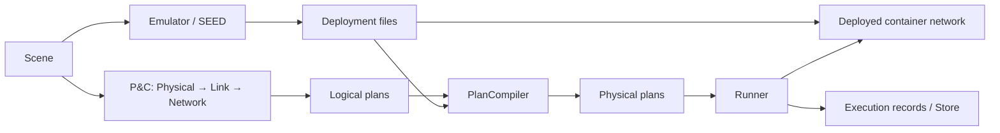

# SkySEED

[中文](README.zh-CN.md)

SkySEED builds satellite-network experiments on [SEED](https://github.com/seed-labs/seed-emulator).
It combines reusable scenarios, model-driven precomputation and timed changes to
real container networks, where ordinary protocols and applications can run.



- **Scene** describes nodes, orbital organization, ground sites and logical endpoints.
- **Emulator** uses SEED to configure nodes, software, services and static networks.
- **P&C** computes positions, connections and routes. Replace models or use the
  Perturbation and Delivery hooks; save plans independently of execution.
- **Compiler and Runner** translate plans and apply them to deployed resources.
  MPLS-like BPF forwarding is the default; ordinary IPv4/Linux forwarding is also supported.
- **Tools** inspect saved scenarios, plans and execution records. They are optional
  repository utilities, separate from the installed `skyseed` package.

## Start here

| Task | Entry |
|---|---|
| Install, build, save, run and clean up | [Usage guide](docs/usage.md) |
| Find a public operation or output | [Interface and artifact reference](docs/reference.md) |
| Understand or extend a module | [Module index](src/skyseed/README.md) |
| Inspect saved results | [Tools](tools/README.md) |
| Read current working examples | [Examples](examples/README.md) |
| Develop and test | [Development](docs/development.md) |

## Installation

Use Python 3.11+ and a SEED checkout with `ExtensionNode` lifecycle support,
merged into SEED's `extension-node` branch in [PR #611](https://github.com/seed-labs/seed-emulator/pull/611).
The commands below select the tested merge commit; SEED's default branch does not
yet provide this capability.
The package version `seedemu==0.0.7` alone does not establish that capability.
Install [Conda](https://docs.conda.io/projects/conda/en/stable/user-guide/install/index.html)
and Git, then clone both repositories into the same parent directory:

```bash
git clone --branch extension-node https://github.com/seed-labs/seed-emulator.git
git -C seed-emulator checkout 80433bf813c8f9be23d4d9c7c9f7c914b5132da9
git clone https://github.com/seed-labs/skyseed.git
cd skyseed
bash scripts/setup_dev_environment.sh
conda activate skyseed_dev
python scripts/check_dev_environment.py
```

The setup script installs both checkouts and the Python dependencies. If SEED is
elsewhere, set `SEED_EMULATOR_CHECKOUT` to its directory before running the script.
For an existing clone, run the last three commands from its root. After moving a checkout or changing installation
metadata, reinstall it with:

```bash
python -m pip install --no-deps --no-build-isolation --editable .
```

The source is `src/skyseed`; tests are under `tests`. Actual network execution
requires Linux, Docker Compose and the host capabilities described in the
[usage guide](docs/usage.md#runtime-requirements). Offline planning and viewing do
not start containers.

Then follow the [tiny network](examples/tiny_network/README.md) for a short SEED
deployment, or [S4](examples/s4_handover/README.md) for planning, visualization and
a TCP handover experiment that repeats a ten-minute scenario until Ctrl+C.
Prepare the runtime dependencies before starting either deployment.

Repository documentation covers the implemented interfaces and their use. Research
notes in [research](research/README.md) are supporting material, not the user guide.
