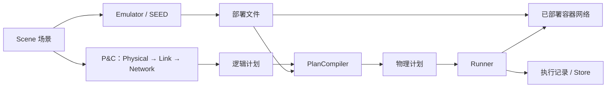

# SkySEED

[English](README.md)

SkySEED 基于 [SEED](https://github.com/seed-labs/seed-emulator) 构建卫星网络实验，
将可复用场景、模型预计算与真实容器网络中的定时变化结合起来，在其中运行普通协议和应用。



- **Scene**：节点、轨道组织、地面站及逻辑端点。
- **Emulator**：使用 SEED 配置节点、软件、服务与静态网络。
- **P&C**：计算位置、连接和路由；可替换模型或使用 Perturbation、Delivery hook，计划可独立保存。
- **Compiler 与 Runner**：将计划转换为后端操作，在本次部署中执行。
  默认采用 MPLS-like BPF，也支持普通 IPv4/Linux 转发。
- **Tools**：查看保存的场景、计划及执行记录，是可选的仓库工具，与安装的 `skyseed` 包分开。

## 从这里开始

| 需要做什么 | 入口 |
|---|---|
| 安装、构建、保存、运行和清理 | [使用指南](docs/usage.zh-CN.md) |
| 查找公开操作或输出 | [接口与产物速查](docs/reference.zh-CN.md) |
| 理解或扩展模块 | [模块索引](src/skyseed/README.zh-CN.md) |
| 查看保存的结果 | [Tools](tools/README.zh-CN.md) |
| 阅读当前可运行例子 | [Examples](examples/README.zh-CN.md) |
| 开发与测试 | [开发说明](docs/development.zh-CN.md) |

## 安装

需要 Python 3.11+，以及包含 `ExtensionNode` 生命周期支持的
[SEED checkout](https://github.com/seed-labs/seed-emulator)。该功能通过
[PR #611](https://github.com/seed-labs/seed-emulator/pull/611) 合入上游 `extension-node` 分支，
默认分支尚不包含。下列命令明确选择已验证的合并提交。
仅看到 `seedemu==0.0.7` 版本号不能确认这项能力。
安装 [Conda](https://docs.conda.io/projects/conda/en/stable/user-guide/install/index.html)
和 Git，将两个仓库克隆到同一父目录：

```bash
git clone --branch extension-node https://github.com/seed-labs/seed-emulator.git
git -C seed-emulator checkout 80433bf813c8f9be23d4d9c7c9f7c914b5132da9
git clone https://github.com/seed-labs/skyseed.git
cd skyseed
bash scripts/setup_dev_environment.sh
conda activate skyseed_dev
python scripts/check_dev_environment.py
```

脚本会安装两个 checkout 及 Python 依赖。SEED 位于其他位置时，先设置
`SEED_EMULATOR_CHECKOUT` 指向其目录。已有仓库从根目录执行最后三条命令。
移动 checkout 或改变安装元数据后，重新安装当前源码：

```bash
python -m pip install --no-deps --no-build-isolation --editable .
```

源码位于 `src/skyseed`，测试位于 `tests`。实际运行网络需要 Linux、Docker Compose
及[使用指南](docs/usage.zh-CN.md#运行环境)列出的主机能力；离线规划与查看不会启动容器。

随后可用 [tiny network](examples/tiny_network/README.zh-CN.md) 做短小的 SEED 部署，
或按 [S4](examples/s4_handover/README.zh-CN.md) 完成规划、可视化和 TCP 换星实验：
默认循环执行十分钟场景，直到 Ctrl+C 停止。
启动部署前先准备运行依赖。

仓库文档说明已实现的接口与用法。[research](research/README.md) 保存研究参考，不作为使用指南。
