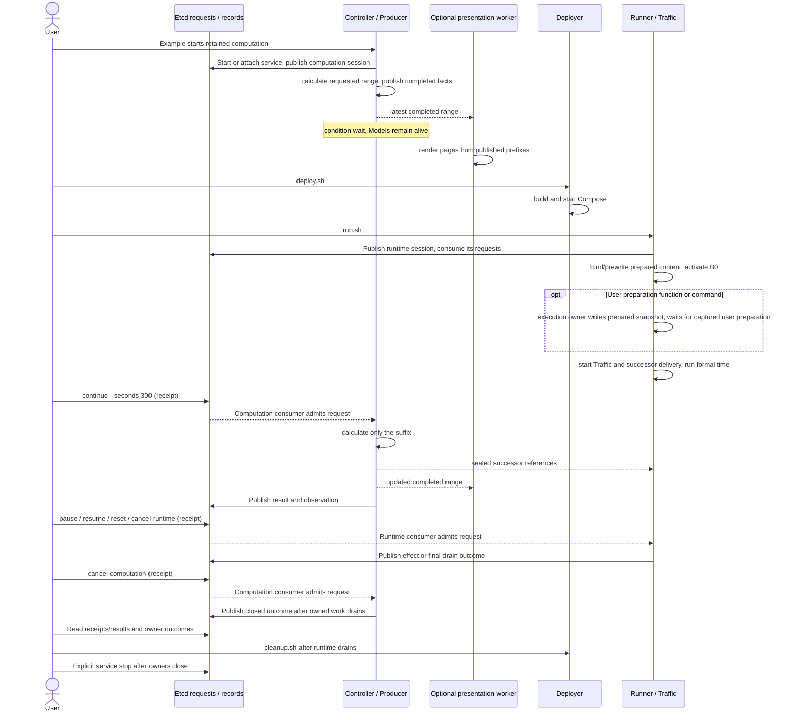
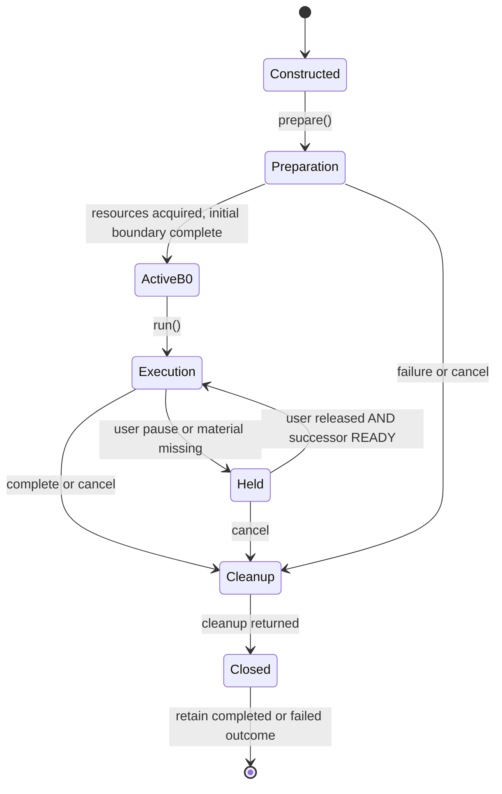

# Calculation, deployment and execution cooperate

A foreground retained calculation can wait while a separately invoked deployment and Runner
use its published materials. The assembly selects BPF (default) or Linux before deployment
preparation. Each backend has pure translation invoked by the shared Compiler material
writer, and an adapter owned by the shared Runner. Executable actions and the backend
foundation are sealed; BPF also carries ELF and encoded map patches. Runtime binds actual
descriptors, namespace resources and interface indexes. Calculation and runtime have
distinct owner sessions/claims, with one Etcd service for client requests and publications.
No resident Controller is required to execute already generated compiler output.
Console feedback is a projection of these existing owners' milestones and status snapshots;
it introduces no progress owner, persisted state or control protocol. The
[experiment contract](../development/experiment-control.md#calculation-lifetime) specifies
message ordering and completion semantics. Deployer owns Docker output and cleanup stages;
Example node descriptions and Traffic evidence legends remain presentation responsibilities.

Optional rendering can overlap calculation and execution. It receives completed facts,
not live Model objects. Waiting for a view never becomes an execution barrier. A runtime
without its next delivery holds the current complete network; it does not tear down containers.
Pause likewise holds updates while applications and container clocks continue.

An optional captured user function (or lower-level command) runs in the existing execution owner between B0 and
`run()`. It reads the prepared snapshot and must finish before Traffic or successor
delivery starts. Runner has no protocol-specific readiness state or watcher.
The [preparation contract](../development/experiment-control.md#user-preparation-function)
describes command capture, evidence and cooperative cancellation.

This is Runner's resource lifecycle, not the lifetime of every result value or container.
`Closed` does not assert successful cleanup: shared outcomes retain Traffic, Runner
and handoff errors. The cancellation result waits for closure and a known outcome;
failed drainage reports `FAILED`. Stale state or a missing final outcome remains
indeterminate. Stopping Etcd after explicit closure does not repair failed cleanup.
Reset ends one invocation and constructs another Runner on the same deployment/materials.
Coordinated shutdown retains requests across deployment/runtime handoff. Precise ordering is
in [experiment controls](../development/experiment-control.md#commands-and-cancellation) and
[backend lifecycle](../development/compiler-and-runner.md#shared-runner-resource-lifecycle).

## Distinct kinds of waiting and stopping

A pause and a material wait can coexist. Either holds the last complete ACTIVE network;
resume clears only the user pause, while READY releases the material wait. Reset creates
a fresh Runner over retained materials on the existing deployment.

Revision is a separate calculation request; Runner normally keeps progressing with
selected valid materials. Preparation freezes a window before loading work completes.
A late candidate is deferred/recomputed from the predecessor that will execute, or
rejected if no compatible future range remains. The
[revision sequence](../development/experiment-control.md#revision-and-reusable-continuation)
shows that race. Etcd carries requests and small results; candidates, selected
catalogs and execution evidence remain files. A selected version is not proof of activation.

Applications and container clocks continue during update holds. Computation cancellation
does not implicitly remove an independently deployed network. Owner completion signals,
not interruptible thread bookkeeping or elapsed time, establish drainage; see the
[control contract](../development/experiment-control.md#commands-and-cancellation).

For BPF, `DataPlane` seals one program/data profile per selected node. Its loaded object and
mutable state serve both managed network ingress and a fixed local-output veth
ingress. Empty/uncovered nodes receive no fallback or injection. Fixed local-output
steering precedes source forwarding; logical exits bind only to recreated network
interfaces. Runner consumes encoded values and sealed objects, never author
definitions or C compilation. See [DataPlane ownership](../development/dataplane.md)
and [fixed ingress](../development/compiler-and-runner.md#fixed-bpf-local-output-ingress).

For Linux, the same Compiler/material/Runner owners use prepared IPv4 operations
and the native adapter, with the shared timing and delivery lifecycle. It activates ordered operations and records completion without a BPF
publication point. Both modes use a framework-owned identity dummy. See the
[native foundation contract](../development/compiler-and-runner.md#native-ipv4-foundation)
for addressing and cleanup. [Native precomputed routes](../development/compiler-and-runner.md#supported-route-expressions)
use the same Compiler bindings and activate only changed owned IPv4 routes.

Traffic generation selects one fixed GS/Zone workload from static identities before
deployment; preview and persistent senders use the same communication IDs. No per-window
Traffic sealing/admission participates in network publication. Observation pages never send traffic. BPF packet
telemetry has a separate option. Native OSPF software is a SEED deployment payload,
while its example RouteModel supplies only explicit GS edge routes. A read-only
bounded observer hands acknowledged Runner connection changes to the default Map;
viewer availability never participates in activation. See [precise ownership](../development/compiler-and-runner.md#applied-connection-observation).
