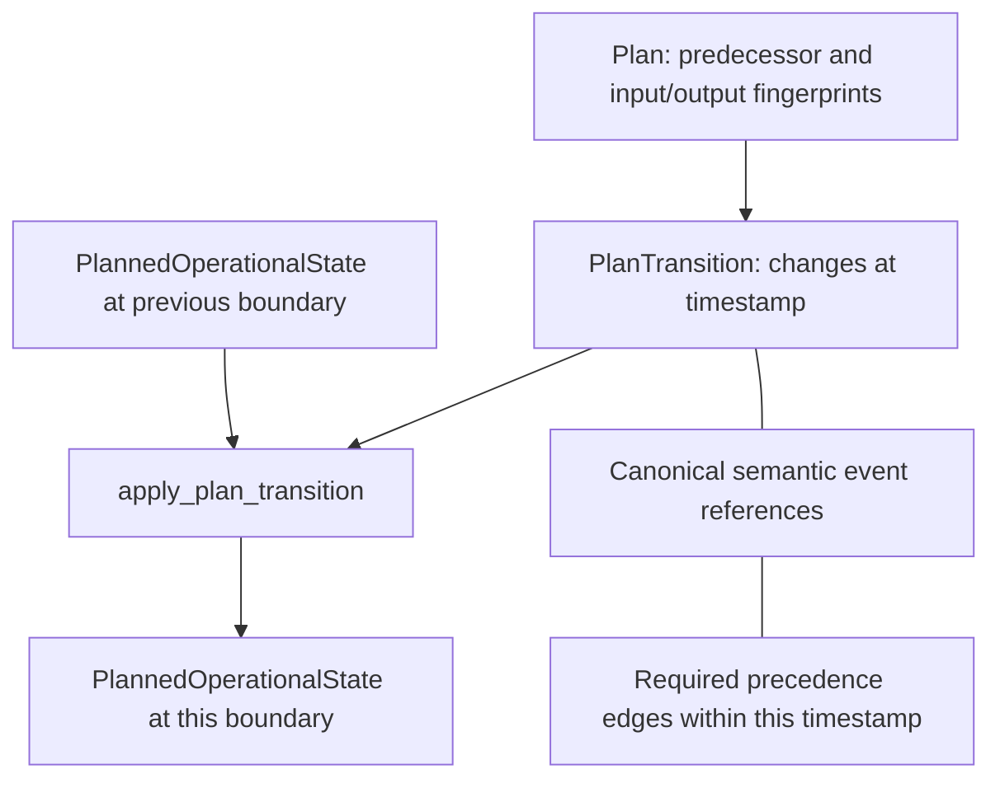

# Algorithms inside a framework-owned progression

Models supply positions, feasible candidates, selections, parameters and route outcomes.
The framework owns the clock, acquisition reservations, state adoption, event dependencies,
publication and resource lifetime. Replacing one algorithm does not replace those semantics.

The [calculation diagram](calculation.md) shows the seven hooks, their input/output
meaning and how their decisions enter framework-owned progression. This topic focuses
on the state and change values that the framework retains and publishes.

The [Model navigation](../development/model-interfaces.md) is the single minimum-contract/template/default
index. Seven roles are the main entry points. ZoneMembership is a lower-level geographical
capability; ZoneService chooses operational service. Optional prediction, search limits,
reuse and diagnostics are separate capabilities. Their absence does not require default
algorithm internals or constrain a custom Model's private representation.

## State, change and publication

Current operational state is a value held by Planner. A Transition describes the change at
one formal timestamp. A Plan groups ordered Transitions and carries lineage; its dependency
edges refer to events inside those Transitions, not to a second event-owning policy.

Acquisition memory, Model state and bounded unpublished evidence remain with live owners;
they are not copied into operational state. At a request boundary, flushing a partial Plan
preserves the next timestamp and the same Model objects. [Planner reference](../development/planner-state-and-plans.md)
defines replay and dependency validation, and [experiment reference](../development/experiment-control.md)
defines publication and retention.
