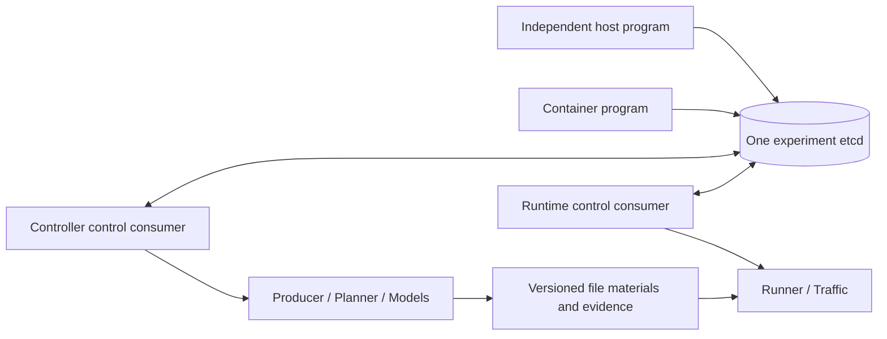
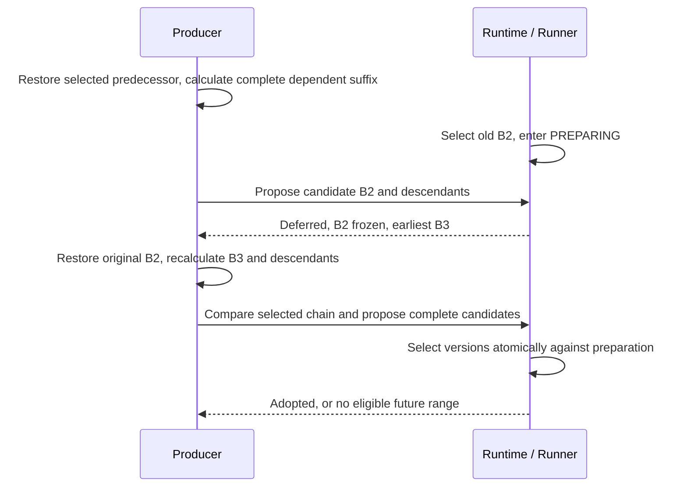

# Experiment publication and control interfaces

Request publication and shutdown are ownership boundaries. The details below
support review of retained computation and independent runtime controls. User commands and terminal examples belong in the
[control guide](../user-guides/computation-and-controls.md).

## Shared interaction and process authority

`experiment.interaction.InteractionClient` uses the etcd v3 API via `etcd3gw`.
Controller construction performs no service I/O. Explicit generation starts one
output-scoped etcd member (or attaches the explicitly configured external endpoint).
`.control/interaction.json` discovers its experiment ID, endpoints and ownership.
The owned database persists in `.control/etcd-data`; its service survives finite
calculation and retained calculation closure so independent runtime and clients can
continue. `interaction_service stop` requires both owner publications to confirm
closure and excludes owner startup/cleanup using the output claims, then signals
and waits for only the recorded owned PID/start identity.
External services are never stopped. Stale live state leaves closure indeterminate.
This service-stop check establishes owner exit and exclusion of new ownership, not
successful business-resource drainage. An explicitly closed owner may retain a failed
outcome; stopping Etcd preserves that record on disk and neither retries cleanup nor
removes deployment resources.
Explicit restart retains records, not Models, consumers or kernel resources.

Binary discovery for owned startup is explicit `executable`, then
`SKYSEED_ETCD_EXECUTABLE`, PATH `etcd`, then `~/.local/share/skyseed/etcd/etcd`.
The separate installer supplies that last location; Python package installation
alone does not. Host discovery uses loopback HTTP and container provisioning uses
the owned native Unix listener by default. `from_output` honors an explicit
`SKYSEED_INTERACTION_ENDPOINT` override. External endpoints require the v3 HTTP
gateway and author-provided reachability; the client exposes no credentials/token
or client-certificate configuration. A stopped external attachment does not stop its
server. The helper restarts explicitly stopped outputs, not unconfirmed crashed
members. Setup and copyable usage belong in the [guide](../user-guides/computation-and-controls.md#interaction-setup-and-independent-programs).

Keys under `/skyseed/<experiment-id>/` separate meaningful `state/<owner>` and
immutable `state-history/<owner>/<session>/<sequence>` publications, small
`liveness/<owner>` records, `requests/<owner>/<session>/<request-id>` with active
`pending/` indexes, unrestricted `user/` JSON, and private `coordination/` and
`parameters/` records. The write-only `coordination/runtime` record is removed;
output/runtime claims and owner-session admission comparisons are the actual fences.

A meaningful publication changes only when owner facts or `live` change. Its current
record and history entry commit atomically, carrying session, within-session sequence,
owner observation time (`published_at`) and etcd modification revision (`version`).
Lost publication acknowledgements reuse the same history identity. The consumer checks
local facts/pending requests at 0.1-second intervals; unchanged request status/results
produce no transaction. Small heartbeats are written at most once per second when
facts are unchanged. `state(owner, revision=...)` reads state and liveness at one etcd
revision; availability requires a matching session heartbeat within five seconds and
`live=true`. `liveness_at`/`liveness_version` describe health independently of the last
meaningful observation. Disconnection, stale health and closure remain distinct.
These are independent owner observations, not a simultaneous snapshot of all processes.

`state_history(owner, after_revision=0, limit=100)` pages meaningful changes in commit
order across sessions; resume after the last returned `version`. `watch_state(owner,
start_revision=..., timeout=...)` returns one such change, including changes without a
request; its starting revision is inclusive. It excludes heartbeats. To follow from
current state, watch from `state['version'] + 1`. Watch timeout raises `TimeoutError`;
it does not imply owner closure. `ExperimentController.status()` is a store-independent
local diagnostic snapshot, including before startup; it has no shared version/session/
freshness guarantee. Use `controller.interaction.state('computation')` for that contract.

Newly started/restarted framework-owned etcd members use periodic **one-hour MVCC
retention** (`--auto-compaction-mode periodic --auto-compaction-retention 1h`), recorded
in discovery as `mvcc_retention`. Existing running members are not reconfigured.
This service-wide policy is never imposed when attaching an external shared endpoint;
its administrator owns retention. See [etcd's configuration reference](https://etcd.io/docs/v3.6/op-guide/configuration/).
Compaction removes old MVCC versions, not current user values, request records and
their meaningful histories, or immutable owner-state history keys. Those records have
no automatic expiry and remain until the experiment data is explicitly removed.
Thus compaction limits duplicate-version history, not total experiment record growth
or disk size; no automatic defragmentation or quota recovery is promised.

Pinned reads and watches requesting compacted revisions raise
`InteractionHistoryCompacted`, rather than returning current data or silently missing
changes. Reread current values explicitly. For meaningful state, page `state_history`
after the last processed version and restart the watch after the last returned version;
those retained keys survive MVCC compaction. Past versions of overwritten user values
have no separate framework archive. Outages raise `InteractionUnavailable`, and receipt
completion can remain indeterminate. Polling reads only current state and pending keys,
not the full history.
`query('communication', ...)` asks for focused ACTIVE bindings and Zone service;
`query('bindings', node_ids=...)` returns identity/runtime-address facts;
`query('materials')` returns selected versions and Runner freeze position. Both
bindings and materials accept `offset`/`limit` (maximum 100). `query('inspect')`
writes the larger owner inspection and returns its path under `.control/inspections/`,
with the runtime invocation identity. Read that file on the output host. Artifacts and
bulk evidence stay in files. This is a trusted experiment namespace, not a security
boundary between mutually untrusted researchers.

The sole control route is an etcd request consumed by its actual owner. The old
per-owner Unix RPC servers are removed. For containers with `network_mode: none`,
Compose mounts **etcd's native v3 listener** and the public client source. It is the
same store/API, without an owner proxy, network route or socket-control fallback.
Host clients use loopback HTTP by default. An external service requires an explicit
reachable container endpoint. See the [setup and client guide](../user-guides/computation-and-controls.md#interaction-setup-and-independent-programs).

`submit()` returns `RequestReceipt`, not execution status. `result()` and `wait()`
return validation/progress/history and terminal `SUCCEEDED`, `REJECTED`, `FAILED`,
`CANCELLED` or `EXPIRED`. Storage acknowledgement never implies completed cleanup.
Identical IDs deduplicate only within their target owner session; different intent
under one ID rejects. Eligible controls execute in the stable etcd creation-revision
order of their acceptance transactions; IDs and duplicate submissions do not reorder
them. A future or otherwise ineligible request does not block eligible controls.
Later pause/resume intent supersedes an earlier unfinished pause/resume request.
No exactly-once external effects or process recovery is claimed.
Completed effects and persisted terminal results survive reset and owner closure.
The consumer retains terminal publication decisions across lost acknowledgements and
retries the record, never the completed effect. Only unfinished work whose target
session is gone expires. An admitted dispatch with unknown effects remains
indeterminate; cancellation/reset cannot manufacture either adoption or rejection.
Reset rotates the runtime session, expires queued old commands, and fences dispatch
against the actual invocation ID. Transactional admission compares the current owner
publication; closure/reset publishes the fence before draining old pending requests.
Initialization defers controls requiring an owner that is still being constructed.
Owner-local primitives execute admitted commands
without resubmission; exception/signal cleanup bypasses the store to release local
resources. An outage blocks new ownership/replacement decisions while admitted valid
work and cleanup continue. A lost response or stale state is indeterminate: retain
the receipt and query after connectivity returns.

User values have no framework semantics. `user_get`, `user_put` (optional version
comparison), `user_read` (one consistent etcd transaction), and `watch_user` are
available to Models and independent programs. Authors choose every read and response.
A write alone neither computes nor revises nor invalidates caches. Watch history
is subject to etcd compaction; disconnected clients must explicitly reread.

## Revision and reusable continuation

Every complete delivery, including delivery zero, is replaceable until Runner begins
its actual preparation. A single-delivery retained calculation can therefore revise
its initial range before runtime starts. Registration leaves a window PENDING.
`frozen_through=-1` means initial preparation has not started. Runner's condition
serializes initial reference selection and later pending selection with
entering PREPARING; artifact loading, computation and kernel work occur outside that
decision. PREPARING/READY remain frozen. Revision intent reserves nothing and does not
pause runtime. Original materials remain usable while candidates are calculated.

Producer retains an initial continuation before priming, plus reusable framework
continuation at replaceable boundaries: physical
and temporal inputs, Planner frontiers/acquisition/adopted parameter memory, previous
planned state, compiler translation/predecessor, ports/addresses/generations/capacity.
Compiler checkpoints copy explicit framework value containers, not arbitrary Models,
streams, locks or resource owners. Each built-in Model owns its cache validity for
earlier/repeated inputs; generic Planner and revision code do not identify concrete
Model types or mutate their caches. Model instances and their private state stay
live; user-area writes are not rolled back. Explicit revision can call Models at earlier
times again. Authors remain responsible for private caches, mutable external state,
algorithms, read timing and effectiveness; no mandatory checkpoint hook is added.

Producer owns each calculation stream's history writer, physical evidence writer/sink,
health and capture diagnostics as one scope. Candidate acquisition, publication and
cleanup cannot clear an original failure or poison later ordinary publication. Partial
acquisition drains acquired writers; cleanup preserves the primary error. Revision
results retain per-attempt evidence diagnostics, including cleanup failures. Producer
status labels the currently observed stream with `evidence_scope`. Optional
physical evidence failure does not invalidate otherwise valid execution materials;
a detached reader reports an unavailable selected candidate stream explicitly instead
of substituting superseded evidence.

Candidates and their evidence live under `results/revisions/<revision>/attempt-NNN/`.
Failures preserve the valid selected chain. Losing a preparation race restores the
predecessor that will execute and recomputes its entire affected suffix; timestamps or
indices alone cannot make a losing candidate compatible. If no replaceable range
remains the request rejects explicitly. The existing computation control consumer
reads bounded runtime facts at most once per second and passes available freeze frontiers to Producer. Producer prunes only when
the observed frontier advances; it never queries etcd on its computation path. Stale or
unavailable facts retain extra checkpoints conservatively. Only actual adoption uses
the authoritative Runner decision. Reset replays retained files without recreating discarded
calculation checkpoints, so subsequent revision still needs a retained compatible
predecessor. Offline adoption holds the existing exclusive runtime claim. Runtime
constructs its selected catalog after acquiring that same claim, so a completed
offline adoption is visible at startup. The runtime consumer then becomes the sole
authority. Catalog refresh reads only newly appended material records. Selection compares the
expected predecessor/suffix and verifies seals before the short Runner decision.
The catalog captures references and a version under its lock, validates immutable
headers and stages selection metadata outside delivery locks, then rechecks the
version and commits via Runner. Normal registration also reads immutable headers
outside catalog/Runner locks and rechecks selection before enqueueing. A catalog
change or preparation win cannot admit a stale candidate. Only the staged atomic
rename and small in-memory selection occur at the shared decision boundary.
Initial replacement has no predecessor; it preserves the generated scene, backend,
cadence and complete window. Execution verifies the selected initial header against
its fixed generated inputs, and Runner validates/loads that reference under its
preparation freeze. The original execution definition remains provenance.
Adoption requests carry a hash-checked proposal file reference under
`.control/revision-proposals/`; bulk candidate catalogs remain in files. Revision
results identify the selected version/range and catalog path. A reporting or
evidence-close error after adoption reports failure with `adopted=true`; it cannot
restore an incompatible old computation head.
Local cancellation can end adoption waits while no submission or selection has been
attempted, even if etcd cannot record the terminal outcome yet. Candidate/evidence
resources drain and the original selected chain remains valid. Once submission or
selection is attempted, a lost reply remains indeterminate and blocks incompatible
computation-head restoration until the authoritative outcome can be read; cancellation
does not turn that uncertainty into rejection. Confirmed adoption retains its
compatible continuation through cancellation or later reporting failure.

`results/compiler/selection.json` records accepted versions alongside append-only
original material references. Completed publications pin selected material/evidence
references; detached readers overlay only selected complete ranges and retain old
pinned publications. Material selection does not assert execution: Runner load and
activation evidence identify actual use. Superseded candidate histories stay separate.

## Calculation lifetime

Controller construction is inert. `generate()` owns finite generation and returns its output
path. `serve(delivery_duration=..., run=False, cleanup=True, on_completed=None)` retains the
same Producer until explicit cancellation. Both support `physical-world`, `planner` and
`compiler`; cutoff is fixed for the session. Partial cutoffs do not advance downstream
stages or prepare deployment. `run=True` requires Compiler and explicitly manages deployment,
Runner/Traffic and eventual cleanup through `run_generated_experiment`.

Initial Timeline, latest requested endpoint, computed frontiers, sealed compiler deliveries,
completed requests, waiting and termination are separate facts. The original definition
remains unchanged. `continue_calculation(additional_duration=... | end_time=...,
delivery_duration=...)` requests an aligned increasing suffix. The Producer alone extends
its cursor and retains Models, Planner memory and compiler predecessor. Finishing a request
flushes publications without shutting those owners down. Working memory retains necessary
current state and bounded queues, not every completed Plan/frame. There is no process recovery, mid-session promotion, automatic future calculation or distributed execution. The scoped etcd service has its explicitly separate lifetime.

Presentation has its own completion signal and drains independently before `serve()`
releases ownership.

Human lifecycle feedback uses the existing best-effort `_console` and is promptly flushed
to stderr. The control client prints its human summary before detailed JSON-only stdout,
using existing owner snapshots (calculation state/range, runtime frontier/available range,
preparation, pause, material wait, cancellation and errors); it reads the owner-published interaction records. Calculation start/range publication, Runner preparation/formal-clock
start and pause/material-wait transitions report actual milestones. Waiting messages occur
on state transitions, never every poll. Retained range readiness means waiting, not exit;
finite materials still finish normally. A cancellation receipt acknowledges admission.
Its terminal result waits for owner closure and the promised owned work to settle;
`SUCCEEDED` requires a known completed outcome. Execution/drain failures yield `FAILED`,
with the final owner state in the result. Missing outcomes stay indeterminate.
Missing endpoints and lost replies do not establish completed cleanup. The retained calculation terminal reports session
closure only after computation and accepted presentation have drained, identifying
primary errors separately.

The runtime terminal reports resource cleanup starting, then success only after
delivery, Traffic, Runner and connection-observer cleanup have returned successfully.
Generated `run.sh` reports subsequent observation Tool generation separately,
including each failed Tool. Tool failures do not change the runtime exit status.
The deployment CLI used by `cleanup.sh` reports its own cleanup start and result;
runtime cleanup does not remove independently deployed containers. Console-write
failures cannot replace an owner's result or primary error.

## Completed range boundary

`results/experiment/completed.json` atomically publishes one completed request. It contains
the selected cutoff, completed endpoint, request/status facts, stream byte/count/hash summaries,
candidate prefix metadata, performance byte bound and compiler delivery count. The history
manifest (v4) marks `terminal=false` while retained; it does not falsely report process exit.
`generation-status.json` separately reports final termination, cancellation or failure.

Histories are append-only, grouped under their responsible result directories. Writers retain
incremental digests/counts and close gzip members when publishing a complete range. Readers
consume only the explicitly published byte prefixes. They never consume a suffix still being
written. Tools pin one completion record across all component readers and detached workers;
older pinned records remain readable after later append. Hash verification occurs in the
consuming pass. No full-history copy, replay or validation occurs on each internal batch.

Producer's `produce(..., completed=...)` reports a drained range to Controller. `on_completed`
is optional presentation side work with `(output_path, publication)` arguments. Controller
runs it outside calculation and coalesces pending refreshes to the newest complete range.
Slow or failed presentation cannot prevent continuation or Runner progress. Accepted side
work drains at shutdown; failures are recorded separately. `tools.write_experiment_tools`
accepts the publication or reads the latest completed record and never reruns Models.
Standalone Performance and network export also pin that same request boundary. Export
uses recorded frame counts and timestamps, not the coverage of an earlier rendered page.
Runtime views additionally wait for the invocation's completed `runs/latest.json` record;
an active run's partially written handoff and performance files are not presentation inputs.

Compiler deliveries have their own earlier readiness boundary: sealed immutable batch paths
are appended to `results/compiler/materials.jsonl`. Runner can consume them while the remainder
of the requested range is being calculated. Presentation waits for the coarser request boundary.

## User preparation function

`ExperimentController(preparation=module_level_function, preparation_inputs=...)`
captures the function's source with ordinary input provenance and detaches its
JSON-compatible inputs into `inputs/preparation.json`. `PreparationContext` supplies
initial prepared runtime, Planner and compiler facts without a Simulator owner.
The captured function is invoked in a separate process through the **same**
initial-readiness command lifecycle below (`python -m skyseed.experiment.preparation`).
There is no second orchestration loop, protocol registry or convergence-report contract.
It accepts one context argument and may simply sleep. Normal return releases the
handoff; exceptions become the primary command failure with the traceback retained
in stderr. No arbitrary preparation deadline is imposed.

Module-level source and `input_files` are the portability contract: list local
imports/data, use captured context paths, keep generation under a main guard, and
pass dynamic values through `preparation_inputs`. Capture preserves the function’s
package context and directory hierarchy, so imports such as `from .helper import VALUE`
resolve listed dependencies from the snapshot even after the originals change. List
`__init__.py` files when their code is required; omitted initializers act as namespace
packages within the captured tree, without falling back to the original package.
Standalone-file functions retain sibling import support. Python environment dependencies
remain external. A function and a raw command cannot both be selected. Pause/resume
and later topology updates do not rerun the hook; a fresh reset invocation does.
See [authoring/API examples](../api/assembly-and-control.md#user-preparation-function).

## Initial readiness command

`ExperimentController(initial_readiness_command: Sequence[str] | None = None)`
optionally inserts one command after successful `Runner.prepare()`/B0 and before
Traffic start, successor delivery, `Runner.run()` and formal timing. The default
adds no wait or query. Runner remains protocol agnostic; the existing generated
execution owner starts, observes and drains this command under its runtime claim.

Supply argv, never shell text. Execution uses the output directory as cwd and appends
`--output <absolute-output> --invocation-directory <absolute-invocation>`. Include a
Python command's source in `input_files` (or as `entry_path`), and use its resolved
absolute filename as an argv element. Generation maps exact captured source names
from ordinary `inputs/provenance.json` to `inputs/sources/...`; it does not rewrite
substrings, infer imports or copy dependencies. The selected generated Python
interpreter executes the captured script. Later edits to the original source do
not change that output; regenerate to apply them.

Execution definition v6 records optional `initial_readiness_command` and the
generation interpreter. Existing v5 output is still accepted without a hook.
Before launch, execution must write `runs/<invocation>/runner/prepared.json`, using
the existing `runner-inspection-handoff` v1 schema with the actual B0 snapshot,
frontier and runtime bindings. A write failure stops execution and still cleans up.
The author command owns the meaning of readiness and may consume this file.
It must cooperate with SIGTERM and drain its query children before exiting.

`readiness/command.json` records exact argv/cwd, UTC start/end, exit status,
separate elapsed seconds, errors and stdout/stderr paths. Runtime `status` exposes
`initial_readiness`; existing runtime events record its start/end. Performance
records `experiment/initial-readiness` separately; the existing Runner lifetime
rollup includes this wait. The wait consumes wall time without advancing simulated
time. A zero exit releases execution; a nonzero exit remains the primary failure,
with later cleanup failures attached.

Cancel/reset/Ctrl-C stop and drain the owned command process group before Runner
cleanup. Admission and completion both recheck cancellation. There is no forced
kill or wall-clock termination deadline. Reset cancellation is normal control flow:
after drainage/cleanup the existing loop constructs a new Runner, activates a fresh
B0, and repeats readiness. A genuine command failure is not converted into a reset.
Commands that launch isolated query sessions must own their cooperative drainage;
the native Example closes query stdin to stop and reap in-container commands.

## Output ownership

| Location | Owner and content |
|---|---|
| `inputs/` | Experiment-captured sources, provenance, effective configuration |
| `results/physical-world/` | Formal positions and optional candidate evidence |
| `results/planner/` | Published Plan/evidence stream |
| `results/compiler/` | Compact compiler facts, authoritative execution materials, delivery references and execution definition |
| `results/traffic/` | One fixed communication workload |
| `results/experiment/` | Completed range, history/status and generation performance/timing |
| `results/tools/` | Presentation invocation records |
| `deployment/` | SEED build/Compose files and Deployer-owned state/measurements |
| `runs/<invocation>/` | Actual Runner, Traffic and performance records; reset creates a new invocation |
| `visualizations/` | Browser pages and their relative data/assets |
| `.control/` | Etcd discovery/data, staging and coordination evidence |

Root `README.md`, `index.html`, `experiment_control.py`, and (Compiler only)
`deploy.sh`, `run.sh`, `cleanup.sh` are the user entry points. Authoritative materials have
one location. Old `start.sh`/`launch.sh` and old-layout aliases are absent.

## Commands and cancellation

| Action | Meaning and owner |
|---|---|
| continue | Original computation owner calculates more; it does not resume Runner |
| pause / resume | Runner holds/releases future updates at a completed boundary; applications and clocks keep running |
| reset | Stop Traffic, drain Runner/evidence, then replay retained materials with a fresh Runner on the existing deployment |
| cancel-computation | Stop calculation admission and drain accepted work; independent runtime remains owned separately |
| cancel-runtime | Stop Traffic/Runner; retained calculation remains available |
| shutdown | Request both owners; managed execution retains the request through deployment/runtime handoff and cleanup |
| revise | Retained Producer recomputes the replaceable dependent suffix; runtime arbitrates adoption |
| parameters | Validate supported settings and report their effective resource/boundary |
| cleanup.sh | Deployer removes its deployment after runtime has released ownership |

Output claims protect replacement and deployment teardown while allowing calculation and
execution to coexist. Runtime claims ownership before reading the selected catalog
and publishing its interaction session. The consumer remains live through resource
drainage and the computation handoff-release check; its closing publication precedes
claim release. Shutdown and that handoff are serialized: pre-handoff cancellation
prevents Runner construction, post-handoff cancellation reaches its owner. Request acceptance
is distinct from completed cleanup. `cleanup=False` keeps teardown with the caller.
Shared state includes `outcome`, null until the owner can report termination. Runtime
publishes the existing invocation outcome (`status`, `exit_code`, `primary_error`,
`traffic`, `cleanup`) and a top-level structured `error` for escaping owner errors,
including a failed final computation handoff. Calculation publishes outcome `status`,
`primary_error`, `execution_error` and `presentation` after finite calculation or
retained calculation/presentation have drained. Error facts retain type, message and
additional notes. These outcomes do not include independently owned deployment cleanup.
`live=false` means the owner exited; it does not erase errors or certify resource cleanup.
An outage may leave the last publication live/stale even after local cleanup finishes.

No arbitrary wall-clock deadline, retry-count termination or forced kill substitutes for
actual completion. Primary errors retain any secondary cleanup errors.

At the physical cutoff, scoped query cooperation reads the same injected Models’
potential-pair and optional search/prediction declarations independently of Planner.
It performs no connection selection, planning advancement or Compiler work. This
preserves configured query scope without silently introducing all-pairs defaults.

## Scheduling and parameter effect

Requests default to the earliest valid boundary and finish admitted indivisible work.
Distant scheduled requests do not block immediate eligible requests. `at` is an aware
ISO timestamp. Pause is scheduled by Runner: align upward to its cadence, complete
that boundary, then hold later activation. Late requests apply at the earliest still
valid boundary and report requested, scheduled and actual positions. Maintenance may
prepare while activation is paused. Revision's `at` selects the first complete window
starting at/after the target; it does not delay request submission until that time.
Other scheduled controls wait for their owner's published completed frontier. Owner
closure expires unfinished requests that can no longer execute, preserving confirmed
results and indeterminate dispatched effects. Coordinated shutdown is immediate;
schedule individual owner stop requests when a boundary is required.

Computation parameters: `delivery_duration_seconds` applies to the next selected delivery;
`route_workers`, `deploy_parallel`, `runtime_workers`, and `batch_capacity_factor` apply
when the relevant worker pool/deployment/Runner capacity is next created. Existing live
resources are not resized. Runtime `batch_lead_fraction` applies to its next preparation
decision. World identity, cadence and backend structure cannot be hot-edited. Calculation
cancellation ends the retained session; it is not resumable calculation pause.

Standalone `Producer`, Planner and Runner retain local APIs with no etcd dependency.
Managed generated execution requires the discovery/service contract; old output files
remain evidence but must be regenerated to use the new managed controls.
