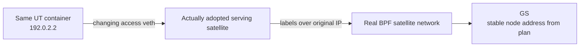

# Example UT attachment

[中文](README.zh-CN.md) · [Experiment](../README.md)

The independent UT container supplies a stable application address and a real TCP
session. It is neither a Scene/Emu satellite/GS nor a default terminal mobility
protocol. Original IP packets travel under labels, without IP-in-IP.



| File/object | Responsibility |
|---|---|
| `routing.py:TerminalRoutingModel` | Default GZ routes plus a classifier at each associated GS mapping the UT /32 to its existing Zone label path |
| `attachment.py:TerminalExperiment` | Owns the UT container, attachment/measurement processes and cleanup |
| `attachment.py:Attachment` | Access veth and temporary routes, following actual adopted service rules |
| `traffic.py` | One TCP connect/accept, numbered messages and exact echoes |

```python
network.set_routing_hook(TerminalRoutingModel, model_options={"ground_stations_per_zone": 3})
# Save and compile plans, then in the run stage:
with TerminalExperiment(scene, deployment, plans, run_output, seconds=600,
                        ground_stations=build["experiment"]["ground_stations"], capture=True):
    runner.run()
```

## Addresses and packet paths

| Identity | Address in this scene | Location/purpose |
|---|---|---|
| UT application | `192.0.2.2/32` | Experiment configuration in Scene; UT `ssutidentity`, unchanged at handover |
| GS application | `skynodes` | GS's stable node address, read from plans and managed by Runner |
| Zone identity | `PhysicalPlan.targets` | Logical endpoint address managed by Runner; not an outer packet header |
| Access next hops | Satellite `169.254.254.1/30`, UT `.2/30` | Temporary `ssut` veth, separate from application addresses |

GS/Zone addresses come from compilation, not hardcoded setup commands. The UT is
created with `--network none` and communicates only through its access veth.

```text
Satellite frame: Ethernet | MPLS label | original IPv4 | TCP
Forward IP: 192.0.2.2 → GS node address
Reverse IP: GS node address → 192.0.2.2
```

The UT routes forward packets over the access veth. At the satellite, an ingress
policy for `ssut` and the GS destination sends them through Runner's BPF entry
`sslocalout → sslocalin`. BPF selects a first label from the original destination;
transit nodes swap local labels, and the GS pops and delivers to its application.

Reverse packets keep the UT destination. `TerminalRoutingModel` adds only a GS
prefix classifier reusing the existing Zone path's exit and downstream label.
Transit nodes need no UT IP route or changed labels. After the serving satellite
pops the label, Linux routes destination `192.0.2.2` over the access veth using a
temporary /32 route. The Zone identity is distinct from the UT address, so this
packet is not consumed by a local satellite application.

Actual `pop_deliver` receipts drive handover, never future planned state. Removing
an old attachment restores its UT drop route; a new veth installs the new serving
node's UT /32 route. The UT container, address and socket survive. Detached traffic
drops instead of falling through to unrelated default routes. There is no NAT,
tunnel or reconnect.

## Labels and measurements

| Stage | Behavior |
|---|---|
| Ingress | Classify the original IP destination; BPF selects the path and TC inserts a label header |
| Transit | BPF looks up a local label, swaps to the downstream label, decrements label TTL and redirects |
| Egress | BPF selects pop, TC removes the label header, Linux delivers locally or routes to the UT |
| Missing link | An unbound logical port drops traffic while still-valid route intent is retained |

No routing daemon or Linux MPLS FIB is used. The temporary veth adds no separate
UT wireless link budget, delay or loss; this does not validate full radio mobility.

The GS TCP server listens on its node address, port 2323, accepting once. The UT
connects once, sends `skyseed sequence\n` and checks exact echoes without reconnecting.
This is TCP echo, not Telnet negotiation, terminal control or login; the single
connection server cannot serve a second interactive session simultaneously.

TCP retransmission timeouts increase the wait after repeated loss. Restoration
does not reset the sender's timer; the application can still be waiting for retransmission. See
[RFC 6298 §5](https://www.rfc-editor.org/rfc/rfc6298.html#section-5). Compare endpoint
PCAP, socket state and execution times; endpoint captures do not prove every hop.

TCP JSONL goes into the run directory; endpoint PCAP is saved only with capture=True. The
client starts after first attachment; no attachment retains an unstarted status.
The adapter owns and cleans its container, processes, interfaces and routes.
