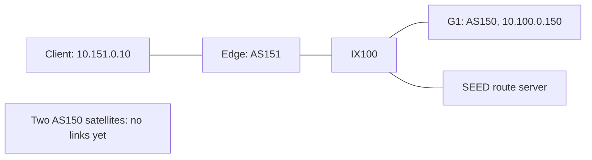

# Two satellites and one ground station

[中文](README.zh-CN.md)

[scene.py](scene.py) builds the satellite Scene. [emulator.py](emulator.py) loads
it into AS150, adds a ground AS151 and generates Docker deployment files.
This static example runs independently of PlanningControl and Runner.



The edge router uses `10.151.0.254` on the LAN and `10.100.0.151` on IX100.
The LAN's `.1` is Docker's bridge gateway. Private eBGP between edge and G1
provides the client–GS path and return route.

## Build and start

With [SkySEED installed](../../README.md#installation) and Docker Compose available,
run from the repository root:

```bash
conda activate skyseed_dev
python examples/tiny_network/emulator.py
python -m tools.deployment.build_images examples/tiny_network/output
cd examples/tiny_network/output
docker compose -f docker-compose.runtime.yml -p skyseed-tiny up -d
```

Python writes Dockerfiles, node configuration and `docker-compose.yml`. The image tool
reads SEED's dependencies, preparing base-image aliases before building node images.

## Check and stop

From the generated `output` directory:

Container startup and BGP establishment take a few seconds after `up -d` returns.
Check `birdc` first; if its socket is not ready or BGP is not yet `Established`,
wait briefly and repeat that check before testing connectivity.

```bash
docker compose -f docker-compose.runtime.yml -p skyseed-tiny ps
docker compose -f docker-compose.runtime.yml -p skyseed-tiny logs --tail 10
docker compose -f docker-compose.runtime.yml -p skyseed-tiny exec brdnode_151_edge birdc show protocols
docker compose -f docker-compose.runtime.yml -p skyseed-tiny exec hnode_151_client ping -c 3 10.100.0.150
```

Expect six running nodes, successful ping and an `Established` edge–GS BGP session.
The two image-helper services may show `Exited (0)`; that is normal. Each satellite
prints its Scene ID at startup and has no satellite-facing links yet.

```bash
docker compose -f docker-compose.runtime.yml -p skyseed-tiny down
```

This removes the example's containers and networks, retaining generated files and
images. Use a fresh output directory when regenerating, and stop the old deployment
before starting another copy with the same fixed names and addresses.

## Reuse a saved Scene

The default example passes `build_scene()` directly to Emu. To save and reload it
instead, run from the repository root:

```bash
python examples/tiny_network/scene.py examples/tiny_network/tiny.scene
python examples/tiny_network/emulator.py --scene examples/tiny_network/tiny.scene --output examples/tiny_network/output-from-file
```

`--description PATH` also saves an unrendered SEED construction description.
For grouping, selecting nodes and customization, see [Scene](../../src/skyseed/scene/README.md)
and [Emulator](../../src/skyseed/emulator/README.md).
