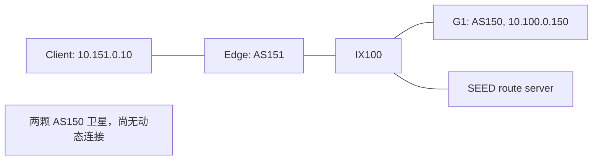

# 两颗卫星与一个地面站

[English](README.md)

[scene.py](scene.py) 构建卫星 Scene，[emulator.py](emulator.py) 加载到 AS150，
添加地面 AS151 并生成 Docker 部署文件。这个静态例子独立于 P&C 和 Runner。



Edge 的 LAN 地址为 `10.151.0.254`，IX 地址为 `10.100.0.151`。
LAN 的 `.1` 是 Docker bridge 网关，Edge 与 G1 的私有 eBGP 提供 Client—GS 往返路径。

## 构建与启动

完成[安装](../../README.zh-CN.md#安装)，准备 Docker Compose 后，从仓库根目录执行：

```bash
python examples/tiny_network/emulator.py
python -m tools.deployment.build_images examples/tiny_network/output
cd examples/tiny_network/output
docker compose -f docker-compose.runtime.yml -p skyseed-tiny up -d
```

Python 写出 Dockerfile、节点配置和 Compose；镜像构建工具读取 SEED 生成的依赖，
先准备基础镜像别名，再构建节点镜像。

## 检查与停止

在生成的 `output` 内运行：

`up -d` 返回后，节点启动与 BGP 建邻还需要几秒。先检查 `birdc`；如果控制 socket
尚未出现，或 BGP 还不是 `Established`，稍等后重试该检查，再测试连通性。

```bash
docker compose -f docker-compose.runtime.yml -p skyseed-tiny ps
docker compose -f docker-compose.runtime.yml -p skyseed-tiny logs --tail 10
docker compose -f docker-compose.runtime.yml -p skyseed-tiny exec brdnode_151_edge birdc show protocols
docker compose -f docker-compose.runtime.yml -p skyseed-tiny exec hnode_151_client ping -c 3 10.100.0.150
docker compose -f docker-compose.runtime.yml -p skyseed-tiny down
```

预期有六个运行节点，Client—GS 可达，BGP 为 Established；基础镜像辅助服务退出零为正常。
卫星启动时打印 Scene ID，尚未建立星间／星地动态连接。
`down` 移除本例容器与网络，保留文件和镜像。重新生成时使用新输出目录，
以相同名称和地址启动另一份前先停止原部署。

## 复用 Scene

```bash
python examples/tiny_network/scene.py examples/tiny_network/tiny.scene
python examples/tiny_network/emulator.py --scene examples/tiny_network/tiny.scene --output examples/tiny_network/output-from-file
```

默认直接传递 `build_scene()` 的结果；以上展示独立保存再加载。
`--description PATH` 还可保存未 render 的 SEED 描述。
详细接口见 [Scene](../../src/skyseed/scene/README.zh-CN.md) 与
[Emulator](../../src/skyseed/emulator/README.zh-CN.md)。
