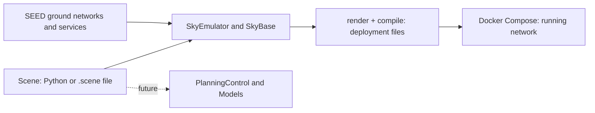

# From Scene to deployment

**Scene** describes satellites, ground stations and their organization. It owns
stable identities and scenario data, independently of SEED and AS assignment.
**Emulator** turns selected Scene nodes into SEED objects, which you connect and
configure through ordinary SEED APIs.

## What SkySEED adds to SEED

| Class | Extension |
|---|---|
| `SkyEmulator(Emulator)` | Global lookup by Scene ID; retains SEED's layer and rendering lifecycle |
| `SkyBase(Base)` | Adds `createSkyAutonomousSystem`; keeps the ordinary AS factory and shared AS inventory |
| `SkyAS(AutonomousSystem)` | `loadScene` creates satellite ExtensionNodes and GS Routers |

GS nodes participate in SEED's normal router inventory, including iBGP. Satellites
use SEED's ExtensionNode capability. Scene IDs remain stable across AS assignment
and appear in the generated node metadata.

The current path deploys nodes, software and declared static networks. Future
PlanningControl and Models will consume Scene independently to compute positions
and plans; algorithm settings and state belong to those consumers.

See [Scene structure](scene.md#structure), [Emulator usage](emulator.md) and the
[working example](../new_examples/tiny_network/README.md).
