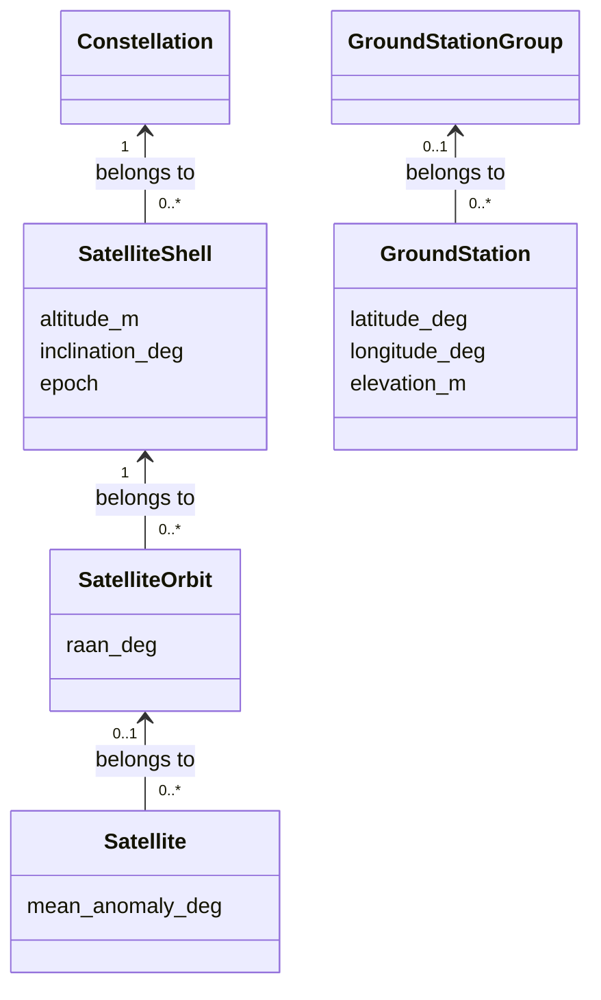

# Scene

`Scene` stores satellite-network facts and stable identities for reuse by Emu and
future planning models. It contains no AS assignment or algorithm configuration.
You can construct it in Python, pass it directly to a consumer, or save it as a
`.scene` file.

## Structure



For circular constellations, a shell holds shared altitude, inclination and epoch;
an orbit adds RAAN, and each satellite adds its phase. A satellite can instead
have an independent position source, without an orbit. GS grouping is optional.
Membership is explicit: equal geometry does not make two shells the same shell.

Every entity and Scene itself has custom `data`, for example an operator name or
equipment information. These facts do not automatically assign ASs or policies.

## Build and query

```python
from datetime import datetime, timezone
from skyseed.scene import Scene

scene = Scene()
scene.create_constellation(
    "demo", planes=2, satellites_per_plane=3,
    altitude_km=550, inclination_deg=53,
    epoch=datetime(2026, 1, 1, tzinfo=timezone.utc),
    data={"operator": "example"},
)
scene.create_ground_station_group("ground")
scene.create_ground_station("G1", latitude_deg=40, longitude_deg=116, group="ground")

shells = scene.get_shells("demo")
orbits = scene.get_orbits(shells[0].group_id)
satellites = scene.get_satellites(orbits[0].group_id)
stations = scene.get_ground_stations("ground")
```

The constellation helper creates one shell, evenly spaced RAANs and evenly spaced
satellite phases starting at zero in each plane. Counts are positive integers;
altitude is supplied in kilometres and stored in metres. Epochs must include a
timezone and are normalized to UTC per shell.

For multiple shells or individual geometry, build the hierarchy explicitly:

```python
scene.create_constellation("custom")
scene.create_shell("low", constellation="custom", altitude_km=550,
                   inclination_deg=53, epoch=datetime(2026, 1, 1, tzinfo=timezone.utc))
scene.create_orbit("plane", shell="low", raan_deg=45)
scene.create_satellite("S1", orbit="plane", mean_anomaly_deg=90)
```

Creation methods return the new entity and accept optional `data`. Parent arguments
take group IDs. GS elevation defaults to zero metres; its name is the default
node ID. Node and group IDs each have their own unique namespace within Scene.

Typed queries return tuples of owned objects; omit the parent ID to get all of
that type. `get_node` and `get_group` resolve IDs, while `nodes` and `groups` list
all entities. Upward references such as `satellite.orbit.shell` point to shared
parent objects. When using `add_group` or `add_node` directly, add parents first
and refer to those owned objects.

## Select nodes

```python
selected = scene.get_node_ids(groups=["demo", "ground"])
```

This returns descendant node IDs in Scene order, deduplicating overlaps.
`kind="satellite"` or `"ground_station"` optionally filters the result.
Omitting `groups` selects all nodes, including ungrouped ones; `groups=[]` selects
none. Unknown IDs fail. Pass the result to
[SkyAS.loadScene](emulator.md#load-and-customize); the consumer decides AS assignment.

## Custom data and position inputs

Identity, membership and initial geometry are fixed after construction; `data`
remains editable. Input dictionaries are copied and must contain JSON-compatible
values, with finite numbers. Model instances, settings and execution state belong
to their consumers. `Scene.validate()` checks editable data before saving or Emu
loading; errors identify the entity and field.

A node's `position` provides a detached `ScenePositionSource` for position consumers:

| Kind | Data |
|---|---|
| `circular-orbit/v1` | Altitude in metres, inclination, RAAN and phase in degrees, plus UTC epoch |
| `geodetic/v1` | GS latitude/longitude in degrees and elevation in metres |
| Custom kind | Consumer-defined JSON, such as a trajectory file reference |

For an independent satellite, use
`create_satellite(node_id, position=ScenePositionSource(kind, data))`, importing
`ScenePositionSource` from `skyseed.scene`. This replaces the orbit/phase input.
Custom source data is preserved for its consumer; Scene does not fetch referenced
files or implement external orbit/trajectory importers.

## Save and load

```python
scene.dump("tiny.scene")
restored = Scene.load("tiny.scene")
```

The file is UTF-8 JSON (`format: "skyseed.scene"`, `version: 2`), separate from
SEED's construction-description format. Loading restores identities, order and
shared parent references. Saving validates data and atomically replaces the file;
its parent directory must exist. Invalid content reports the file and record.
Unsupported versions are rejected; regenerate unreleased version-1 files.

See the [authoring example](../new_examples/tiny_network/scene.py) and
[module layout](../new_src/skyseed/scene/README.md).
