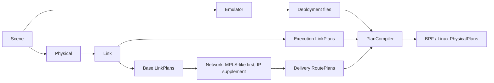

# Offline Emulator and P&C

[中文版](README.zh-CN.md)

One Scene feeds a real SEED deployment and the complete offline P&C pipeline.
The default scene has 128 synthetic circular-orbit satellites, three ground
stations and six geographic zones. Emulator adds three static access clients.
Nothing starts containers or runs a Runner.



## Generate and inspect

With [the existing development environment](../../README.md#installation), run
from the repository root:

```bash
conda activate skyseed_dev
python -m new_examples.offline_planning.main
python -m http.server 8766 --bind 127.0.0.1 --directory new_examples/offline_planning/output
```

Open `http://127.0.0.1:8766/`. Stop the preview server with Ctrl-C. The pages
are self-contained HTML and can also be opened directly where the browser allows
local files. The server only serves files; it does not run the experiment.

The output directory must be new, so previous results are kept. For another run:

```bash
python -m new_examples.offline_planning.main --output new_examples/offline_planning/output-second --planes 4 --seconds 120
```

`--planes` changes the number of planes, each containing 16 satellites.
`--seconds` changes the total interval; requests continue in 20-second batches.
All offsets use Python's standard `timedelta`, relative to `START` in
[scene.py](scene.py). Both backends use the same Scene, base links and deployment.
The supplementary IP NetworkLayer generates its own ordinary IP rules from those
base links; the Linux compiler does not translate away MPLS labels.

## Read the example

| File | Responsibility |
|---|---|
| [main.py](main.py) | Assemble Emu and P&C, issue requests, save plans and compile the saved inputs |
| [scene.py](scene.py) | Synthetic orbit inputs, ground coordinates and Zone locations |
| [models.py](models.py) | Example-only constant downlink loss model |
| [visualization.py](visualization.py) | Connect existing inspection tools to these results |
| [index.html](index.html) | Output navigation page |

The satellites are generated, not imported from an operational constellation.
Ground coordinates are illustrative city locations. Default physical/link/routing
models are used. The perturbation model adds **5% loss only from satellite to GS**
on the default bidirectional connections; it is not a radio/interference model.
Base routing still sees unperturbed links. Half the satellites receive **200 ms**
Delivery delay. These are explicit demonstration choices, not paper-mandated values.
Any Delivery tail is included automatically in the returned route batches.

Start with Scene's grouping, then Physical's candidates and Link's base/execution
comparison. In Network, select a GS and Zone, advance beyond the five-second
setup interval, and compare paths and labels. GZ only computes its associated
GS–Zone pairs; a service satellite alone does not imply every pair has a route.
Compiler turns each recorded operation into interface and forwarding steps.
Network shows routes based on **base links**; Link shows execution perturbations.
Neither page claims actual packet delivery.

## Output and reuse

| Under `output/` | Contents |
|---|---|
| `scene.scene`, `emulator.bin` | Saved Scene and unrendered SEED construction description |
| `deployment/` | Actual Compose file, Dockerfiles and node configuration |
| `scene/`, `physical/` | Scene structure and sampled geometry/candidates |
| `link/` | Link inspector; `plans/` holds base/execution `.plan` files and detail page |
| `network/`, `network-ip/` | MPLS-like and IP inspectors; `plans/` holds base/delivery files |
| `compiler/` | Operation inspector, `bpf.plan` and `linux.plan` |
| `summary.json` | Scene size, interval and separate planning/compilation/display costs |

The same files that appear in plan-detail pages are read by PlanCompiler.
Compiler's inspector reads the saved physical plans. Link/routing decisions are
not recalculated for display; Physical and spatial views query positions separately.
The extra access clients belong to Emulator, not the satellite Scene or route graph.
Their presence does not yet establish end-to-end client traffic.

Saved plans can be loaded with `skyseed.load_plans` without the original models.
For file and compilation interfaces see [P&C](../../new_src/skyseed/pc/README.md)
and [Compiler](../../new_src/skyseed/pc/compiler/README.md). Runtime namespace,
interface-index and BPF-handle binding, timed execution and live connectivity
remain Runner work. This example does not supply a run command.
