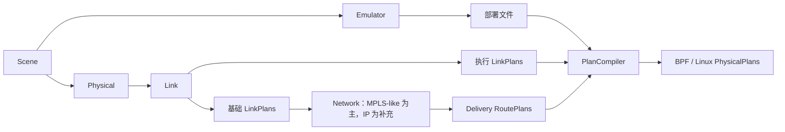

# 离线 Emulator 与 P&C 示例

[English](README.md)

同一个 Scene 同时用于生成真实 SEED 部署文件和完整的离线 P&C 计划。
默认包含 128 颗合成圆轨道卫星、3 个地面站、6 个地理 Zone；Emulator 另加
3 个静态接入客户端。本例不启动容器，也不执行 Runner。



## 生成与查看

使用[既有开发环境](../../README.md#installation)，在仓库根目录运行：

```bash
conda activate skyseed_dev
python -m new_examples.offline_planning.main
python -m http.server 8766 --bind 127.0.0.1 --directory new_examples/offline_planning/output
```

打开 `http://127.0.0.1:8766/`，Ctrl-C 停止预览服务。页面为自包含 HTML，浏览器
允许时也可直接打开本地文件。预览服务只提供文件，不运行网络实验。

输出目录必须尚不存在，以保留上次结果。再次生成可指定新目录：

```bash
python -m new_examples.offline_planning.main --output new_examples/offline_planning/output-second --planes 4 --seconds 120
```

`--planes` 设置轨道数量，每轨 16 颗卫星；`--seconds` 设置总时长，按 20 秒一批
连续请求。时间偏移使用 Python 标准的 `timedelta`，起点在 [scene.py](scene.py)
的 `START` 中定义一次。两种后端共用 Scene、基础链路及部署文件。补充的 IP
NetworkLayer 根据同一批基础链路生成普通 IP 规则；Linux 编译器并不是去掉 MPLS 标签。

## 如何阅读代码

| 文件 | 职责 |
|---|---|
| [main.py](main.py) | 装配 Emu／P&C、发出请求、保存计划并从文件编译 |
| [scene.py](scene.py) | 合成轨道输入、地面坐标与 Zone 位置 |
| [models.py](models.py) | 仅供本例使用的固定下行丢包模型 |
| [visualization.py](visualization.py) | 将既有查看工具接到本例的真实结果 |
| [index.html](index.html) | output 导航页 |

卫星由参数生成，不来自实际运营星座；地面坐标采用城市附近的示意位置。
使用默认 Physical、Link 和路由模型。扰动模型在默认双向连接中，仅对
**卫星→GS 方向添加 5% 丢包**，不代表无线传播或干扰算法；基础路由仍读取未受扰的
链路。半数卫星的规则交付延迟 **200 ms**。这些是明确的演示设定，不是论文规定。
若交付延迟越过请求终点，返回的路由批次会自动包含尾部。

建议依次查看 Scene 分组、Physical 候选，再比较 Link 的基础／执行分支。
Network 中选择 GS 与 Zone，前进到五秒建链等待结束后，查看路径与标签。
GZ 只计算它所关联的 GS–Zone 对；有服务卫星不等于任意两端都已计算路由。
Compiler 可逐项查看接口与转发指令。Network 展示基于**基础链路**的路由，
Link 展示执行扰动；这些页面都不表示实际报文已经成功交付。

## 输出与复用

| `output/` 下的位置 | 内容 |
|---|---|
| `scene.scene`、`emulator.bin` | 保存的 Scene 和未 render 的 SEED 构造描述 |
| `deployment/` | 真实 Compose 文件、Dockerfile 和节点配置 |
| `scene/`、`physical/` | 场景结构、按时间采样的位置／物理候选 |
| `link/` | 连接查看页；`plans/` 中有基础／执行 `.plan` 文件与详情页 |
| `network/`、`network-ip/` | MPLS-like／IP 查看页；`plans/` 中有基础／交付计划 |
| `compiler/` | 后端操作查看页、`bpf.plan` 与 `linux.plan` |
| `summary.json` | 场景规模、区间和规划／编译／展示各阶段耗时 |

计划详情页对应的文件会实际交给 PlanCompiler 读取；Compiler 查看页读取保存后的
物理计划。展示不重跑路由或连接决策；Physical 与空间图另行查询位置。
接入客户端归 Emulator，不属于卫星 Scene 或路由图；添加它们还不代表客户端端到端流量已打通。

`skyseed.load_plans` 可在不加载原模型的情况下恢复计划。
文件与编译接口见 [P&C](../../new_src/skyseed/pc/README.zh-CN.md) 和
[Compiler](../../new_src/skyseed/pc/compiler/README.zh-CN.md)。运行时的命名空间、
接口索引、BPF 句柄绑定、按时执行和实际连通性验证留给 Runner。本例不提供运行命令。
