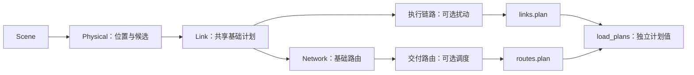
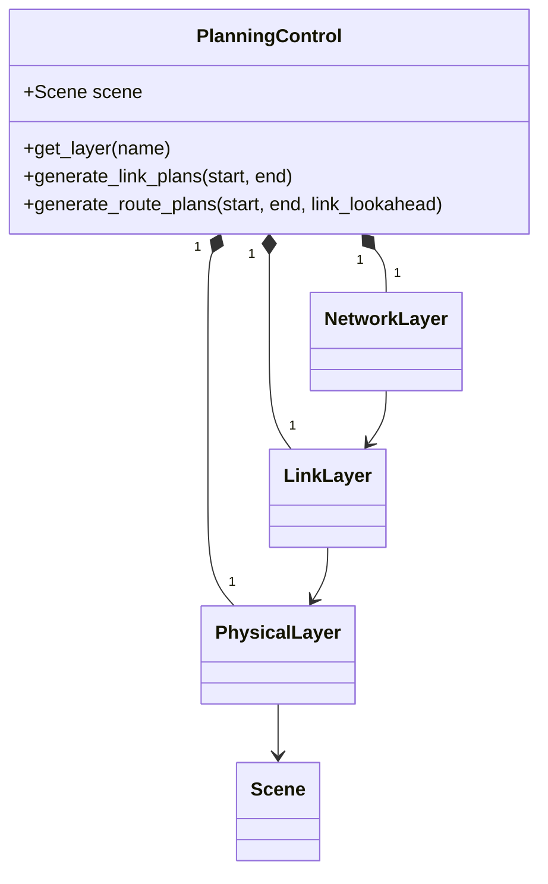

# PlanningControl 与计划文件

**中文** · [English](README.md)

`PlanningControl(scene)` 围绕同一个 Scene 装配 Physical、Link、Network 各一层。
各层持有自己的模型实例和历史。P&C 提供两路独立、有限的计划请求，不执行网络操作。



## 用法

```python
from datetime import datetime, timedelta
from skyseed import Scene, PlanningControl, save_plans, load_plans

scene = Scene.load("scene.json")
pc = PlanningControl(scene)
network = pc.get_layer("network-layer")
# 需要替换模型时，在生成前通过所属层配置。
start = datetime.fromisoformat("2026-01-01T00:00:00+00:00")
middle = start + timedelta(seconds=30)
end = start + timedelta(seconds=60)
save_plans("output/links.plan", pc.generate_link_plans(start=start, end=end))

def route_batches():
    yield from pc.generate_route_plans(start=start, end=middle)
    yield from pc.generate_route_plans(start=middle, end=end)

save_plans("output/routes.plan", route_batches())
for plan in load_plans("output/routes.plan"):
    rules_by_node = plan.state_at(plan.start_time)
    print(plan.start_time, len(plan.operations), rules_by_node.keys())
```

`timedelta` 是 Python 标准的时长类型，与 datetime 相加得到另一个时刻。
只需定义一次规划起点，也可以读取 Scene 中已知 shell 的 `epoch`；
Scene 本身不强制所有输入共用一个纪元。

两路请求返回迭代器，由 `save_plans`、`tuple(...)` 或 `for` 消费时才计算。
同一实例先消费完当前请求，再发起下一次请求。保存会消费输入序列；
如果还要查看原对象，由调用者自行保留。

| 入口 | 结果与归属 |
|---|---|
| `get_layer("physical-layer")` | 已有 [PhysicalLayer](physical/README.zh-CN.md)：位置和候选模型 |
| `get_layer("link-layer")` | 已有 [LinkLayer](link/README.zh-CN.md)：选择、属性、生成和扰动 |
| `get_layer("network-layer")` | 已有 [NetworkLayer](network/README.zh-CN.md)：服务、路由、生成和交付 |
| `generate_link_plans(start=..., end=...)` | 执行 LinkPlan；不计算路由 |
| `generate_route_plans(start=..., end=..., link_lookahead=timedelta(0))` | 交付 RoutePlan；准备基础链路，不触发扰动 |
| `save_plans(path, plans)` | 消费有限序列，同一文件保存一种计划 |
| `load_plans(path)` | 按保存顺序逐份恢复，不需要 Scene 或模型 |

各层 setter 接收模型类并保留生成的实例。模型最低合同与配置见对应层说明；
P&C 不另设一套模型注册管理者。

## 覆盖与接续

请求共享**基础链路覆盖**，输出分支保持独立。请求 `[0, 20)` 的路由并前视 10 秒，
会准备到 30 秒的基础链路；随后请求 `[0, 20)` 的链路时复用这份基础输入，
返回所请求区间的执行链路。停用 Network 预计算时，路由请求返回空迭代器，
也不额外准备链路。

按请求终点接续，不按 Delivery 延长后的终点接续：请求到 20 秒可能返回 25 秒的操作，
下一请求仍从 20 秒开始。因此路由批次可能重叠，其中内容分为：

| RoutePlan 字段 | 保存批次中的含义 |
|---|---|
| `initial_rules` | 本批起点操作前的已知状态 |
| `operations` | 本批新返回的操作，包含本批延迟尾部 |
| `context_operations` | 前批已返回、但本批还原状态需要的操作；不属于新指令 |

文件原样保留批次，不合并它们，也不把上下文变成新操作。
每批保留生成时已知的信息，可单独读取。对于仍在使用的 P&C 实例，
通过 Network 的 `delivery_state_at`／`delivery_plans_between` 查询最新的合并结果。

生成遵守各层连续向前的合同；已有结果通过查询接口读取，独立实验使用新 P&C 实例。
文件恢复的是计划值，**不是正在工作的模型状态**，也不是 P&C 检查点。

## 计划文件

当前编码为 version 1、UTF-8 JSON Lines。`.plan` 是命名惯例，格式由头部标识。
同一文件只包含 LinkPlan、RoutePlan 或 PhysicalPlan 中的一种，也允许空序列。

| 记录 | 字段 | 用途 |
|---|---|---|
| 头部 | `format: "skyseed.plans"`、`version: 1`、`plan_type: "link" / "route" / "physical" / null` | 标识格式与类型；null 表示空序列 |
| 每份 LinkPlan | `start_time`、`end_time`、`initial_links`、`operations` | 初始连接、方向报告／属性及定时变化 |
| 每份 RoutePlan | `start_time`、`end_time`、`initial_rules`、`operations`、`context_operations` | 类型化目的、逻辑出口、规则及单独的交付上下文 |
| 每份 PhysicalPlan | 后端、部署关联、目标、起点／新增／上下文指令 | 见 [Compiler](compiler/README.zh-CN.md) 字段表 |
| 完成记录 | `end: <计划数量>` | 检测未完整写入，包括恰好截断在两条完整记录之间 |

时刻保存为 UTC ISO 字符串。逻辑含义见 [LinkPlan](link/README.zh-CN.md) 与
[RoutePlan](network/README.zh-CN.md) 字段表。规则保留 MPLS-like 局部标签与动作，
也支持补充的普通 IP 目的规则。

模型的 `data` 可递归包含 `None`、字符串、布尔、整数、有限浮点数、字符串键映射、
列表、元组和带时区 datetime。复合值通过类型标记保存，以保留元组并区分用户键与格式标记；
映射读取为普通字典。自定义类或数组先转换为支持的值再保存。
模型实例、随机状态和运行资源不写入文件。

保存逐份写入目标同目录的临时文件，全部成功后替换目标，缺失的父目录会创建；
失败保留原文件。再次保存是替换文件，不是追加。读取逐份返回计划，
**完整消费迭代器**后才能确认文件完整。错误会指出路径与记录行号。
内存按一份完整计划记录使用，调用者及各层自行保留的历史另计。

## 组成与查看



| 位置 | 职责 |
|---|---|
| `planning_control.py` | 层装配与两路请求迭代器 |
| `plan_file.py` | 版本化编码、逐份读写与文件完整性 |
| `physical/`、`link/`、`network/` | 层算法、模型合同与生产模块持有的值类型 |

`PlanningControl`、`save_plans`、`load_plans` 可从 `skyseed` 或 `skyseed.pc` 导入。
[Link](../../../tools/observation/link/README.zh-CN.md) 和
[Network](../../../tools/observation/network/README.zh-CN.md) 工具从图形主页面进入计划详情子页，
查看原始批次、恢复后的内容和可下载文件。PlanningControl 负责装配各层及提供两路请求入口，
无需另设可视化页面。`new_tests/unit/pc` 检查文件与失败路径，
`new_tests/integration` 验证真实三层工作流。[PlanCompiler](compiler/README.zh-CN.md) 将两路计划编译为可保存的 PhysicalPlan；Runner 属于后续模块。
