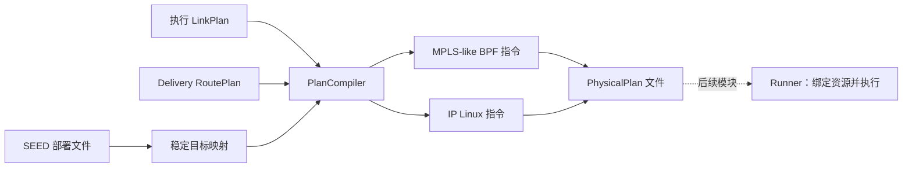

# PlanCompiler

[English](README.md) · **中文**

`PlanCompiler` 读取 Emulator／SEED 部署目录，把 LinkPlan 和 RoutePlan 转成可复用的
**PhysicalPlan**。容器尚未启动时即可分配服务名、接口、地址和逻辑端口。
编译器不启动容器、不创建接口、不加载 BPF，也不执行路由。



## 用法

```python
from skyseed import PlanCompiler, save_plans, load_plans

compiler = PlanCompiler("output/deployment")  # 默认 MPLS-like BPF
save_plans("output/physical.plan", compiler.compile_plans(
    link_plans=load_plans("output/links.plan"),
    route_plans=load_plans("output/routes.plan"),
))
```

普通 IPv4 规则选 `forwarding_backend="linux"`。默认 GZ 路由模型可通过
`label_forwarding=False` 生成这种规则；Linux 编译器拒绝标签动作，不会直接删掉标签含义。
BPF 也支持明确的 `forward`／`deliver` IP 规则。其他转发语义需要与其对应 Compiler／Runner
共同约定，不能靠 `rule.data` 中的任意字段改变执行。
公共 PhysicalPlan／文件结构可保留其他编译器的后端名称、ABI 和指令；读取只恢复它们，
须由对应 Runner 解释。内置 PlanCompiler 仍只接受 BPF 和 Linux。

两路输入分别为按起点递增的有限迭代器，区间、批次数不必相等，任一路可以为空。
每个输入批次产生一个输出批次，按起点合并，同刻 Link 在 Route 前。
这是**批次顺序，不是已经摊平的执行时间线**；延迟路由操作可以晚于下一批的起点。
连续请求复用同一编译器以保留目标分配；编译器不存储或重放此前的计划历史。

## 输出结构

| PhysicalPlan 字段 | 含义 |
|---|---|
| `start_time`、`end_time` | 原 UTC 覆盖区间，保留 RoutePlan 的延迟尾部 |
| `stream` | `link` 或 `route`，各自只恢复本路状态 |
| `forwarding_backend` | `bpf` 或 `linux` |
| `deployment_id` | 编译所用节点／服务／网络事实及分配地址池的摘要 |
| `targets` | 本批引用的节点、链路两端、目的前缀；BPF 程序与处理链说明 |
| `initial_operations` | 从本批开始时恢复起点状态所需的指令 |
| `operations` | 本批新增的定时更新 |
| `context_operations` | 前批已交付的重叠操作，用于独立恢复，不再重复交付 |
| `backend_abi` | `skyseed.physical.v1`，指令含义见下表 |

每条 `PhysicalOperation` 包含 `timestamp`、逻辑 `kind`、`target`，以及有序的
`BackendInstruction(opcode, node_id, parameters, requires)` 元组。
`requires` 表达该操作内部步骤依赖的资源。路由的 `parameters.resource` 则是
**有条件的出口依赖**：链路不存在时按原时刻采用丢弃行为，不等待接口来推迟路由。

```python
plan = next(load_plans("output/physical.plan"))
for operation in plan.operations:
    print(operation.timestamp, operation.kind, operation.target)
    for instruction in operation.instructions:
        print(instruction.opcode, dict(instruction.parameters))
```

文件沿用公共 version 1 格式，增加 `plan_type="physical"`。保存完整目标和指令，
读取不依赖 Scene、模型或原部署目录；真正运行仍须匹配部署资料和后端 ABI。
文件没有临时容器 ID、命名空间句柄、实际 ifindex 或 BPF 描述符。
读取不恢复编译器检查点；继续编译使用原实例。

## 目标分配与指令

节点身份取自 `docker-compose.yml` 中 SEED 的 `skyseed.scene_id`／`skyseed.scene_kind`
元数据标签，同时保留既有网络地址。默认节点 `/32` 身份地址池为 `198.18.0.0/16`，
逻辑端点 `/32` 为 `198.19.0.0/16`，动态链路 `/31` 为 `100.64.0.0/10`。
与部署网络冲突时，可配置 `node_address_pool`、`endpoint_address_pool`、`link_address_pool`。
节点按排序后的身份分配，新连接和端点按首次引用分配。相同实例及其保存结果保持稳定；
不同实例以不同顺序首次引用目标，不保证地址／端口相同。

| 指令 | Runner 须落实的具体行为 |
|---|---|
| `veth.create` | 创建一对接口，分别放入指定节点服务 |
| `interface.configure` | 设置接口名、MAC、`/31` 地址、MTU 和固定对端邻居 |
| `netem.replace` | 一次替换该方向的延迟（µs）、速率（bit/s）和随机丢包率（%） |
| `link.activate` | 两端准备好后，按后端接入 BPF 处理链、启用接口并绑定端口；重新落实仍有效的 Linux 路由意图 |
| `link.unbind` | 删除接口前解除 BPF 端口绑定，或把依赖它的 Linux 路由意图切换为 blackhole |
| `veth.delete` | 删除接口对，保留独立的路由意图 |
| `bpf.rule` | 在下一节点表版本中安装／替换／撤销匹配与动作；本地交付规则也拥有对应本地目的前缀 |
| `linux.route` | 更新受管理的 IPv4 转发路由或本地交付前缀；出口缺失时保留转发意图 |

建链步骤在操作时刻按列出的顺序执行。微秒及整数 bit/s 是后端分辨率，正的不足 1 bit/s
速率取 1。缺失方向和零带宽均采用 100% 丢包，不设置容易被误解为不限速的 `rate 0`。
两个方向分别保留属性。Linux 路由材料包含前缀、出口、对端网关、主表 254、协议号 253、
优先级 1；本地交付使用对应 local 前缀，不转向默认路由。

**断链时**，规则仍作为期望状态保留。BPF 查到逻辑端口没有绑定就丢包；Linux 对受管理的
前缀安装 blackhole。链路恢复后，仅重新绑定／安装仍有效的规则。路由计划撤销规则时，
活动／丢弃项及保留意图一起删除。Compiler 不补回链路、不重算路径，也不修改 Delivery 时间。

## MPLS-like 报文与表结构

报文为 Ethernet（`0x8847`）＋标准 4 字节 MPLS 头＋IPv4。20 位标签在节点内有效，
由 P&C 从下游向上游分配。中转查的是**入标签**，不看业务 IP 目的地址。
入口按 IPv4 前缀分类并 `push`；中转 `swap` 成下一接收节点的标签；出口 `pop_deliver`
移除标签并交给本地 Linux。这是单标签转发，不是完整 MPLS 协议或标签栈。
内置处理链使用 pipe TTL：压入时为 64，交换时递减，耗尽则丢弃；内层 IP TTL 不随标签转发改变。
节点之间不运行标签分发协议。

| BPF 表 | 键 → 值 | 用途／所有者 |
|---|---|---|
| `active_generation` | 槽位 0 → 已发布的 generation ID | 所有节点共用，Runner 到点发布一次 |
| `generation_readers` | generation → 正在读取的调用数 | 所有节点共用，保护读取期间的代次数据 |
| `node_versions` | generation → 本节点的数据版本 | 节点独立；未变化节点复用原版本 |
| `rule_versions` | 数据版本 → 不可变的内部规则表 | 节点独立的预备版本 |
| 内部 LPM 规则表 | 前缀长度＋kind＋匹配值 → 动作、逻辑端口、出标签 | 标签精确匹配（kind=0，64 位）；IPv4 分类（kind=1，32＋前缀位数） |
| `port_bindings` | 逻辑端口 → 实际 ifindex、本端 MAC、对端 MAC | Runner 随链路绑定／解除 |

键的 kind 和匹配值采用网络字节序；前缀长度及动作值中的三个整数使用本机字节序。
`encode_rule(..., byteorder=...)` 可生成两种编码；编译结果的十六进制字段明确为小端，
同时保留其他主机重编码所需的语义字段。动作编号依次为 push=1、swap=2、pop_deliver=3、
forward=4、deliver=5。未匹配、未知动作及出口未绑定均丢包。

程序选中规则后复制一次动作；后续压入／移除步骤直接消费该决定，不再查一次可能已更新的表。
TC 原生 `mpls` 动作负责报文头空间及协议字段变化，BPF 决定标签和出口。
Runner 提前准备各代次的节点版本映射及新表，到点统一发布一个共享 generation ID；
应更新节点选择新版本，其他节点沿用原版本。ID 非零且在本次运行中不复用。
程序增加读者计数后重新核对发布值，复制选中规则，再释放读者；遇到发布竞争最多尝试三次，
仍无法取得稳定选择则丢包。Runner 仅在旧代次退役且读者为零后回收该代次，
数据版本还须不再被任何保留代次引用才能回收。后续压入／移除步骤只用复制的动作。
同一节点同一时刻的改动合为一份待生效表，同刻按输入批次先后处理。
起点／上下文只用于恢复对应计划流，连续执行不重复交付它们。
报文不携带全网统一的表版本，不同节点 Delivery 时刻不同的影响仍然保留。

Runner 须让**所有节点**复用 `targets.bpf_program.shared_maps` 中的两个共享表，
其余表由本节点的五个程序共用，并按 `targets.bpf_program.pipeline` 装配 TC 处理链。
节点本地产生的流量还需要专用入口 veth 和目的前缀引流；入口 MTU 为 1500，动态链路为 1504，
容纳 4 字节标签开销。节点身份地址和当前本地交付前缀也由 Runner 配置。
这些是运行阶段职责，Compiler 没有创建它们。表容量可在装载前调整；端口条目按需分配，
哈希桶仍有固定开销。源码模板容纳 128 个保留代次／版本、每节点 4096 个同时绑定的端口，
Runner 按实际准备窗口设置容量。

## 文件与验证

| 文件 | 职责 |
|---|---|
| `plan_compiler.py` | 两路迭代及后端指令转换 |
| `deployment_targets.py` | 部署身份／地址读取和稳定分配 |
| `physical_plan.py` | 可保存的输出值 |
| `bpf/label_tables.py` | 标签优先的表编码与 TC 处理链说明 |
| `bpf/label_forwarding.bpf.c` | 实际报文分类、标签动作和端口绑定查询 |

`new_tests/unit/compiler` 验证转换、时间／上下文、分配和成本；
`new_tests/connections/test_deployment_compiler.py` 使用真实 SEED 导出及独立进程读取。
C 测试编译大小端 eBPF，并以离线 helper 替身执行同一份 C 逻辑；
这**不证明**内核 verifier、TC 接入或现场转发已经通过，后续由 Runner 验证。
可选 [Compiler 工具](../../../../tools/observation/compiler/README.zh-CN.md) 展示实际保存的指令和目标映射。

实现参考：Linux [TC MPLS 动作](https://github.com/torvalds/linux/blob/v6.8/net/sched/act_mpls.c)、
[BPF 分类器](https://github.com/torvalds/linux/blob/v6.8/net/sched/cls_bpf.c) 与
[map-in-map](https://docs.kernel.org/bpf/map_of_maps.html)。标签转发依据用户已确认的新决定，
替代论文早期 BPF 只查 IP 地址的措辞。
