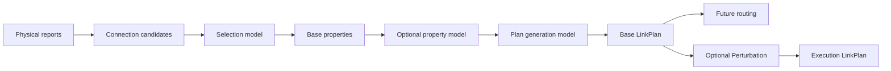
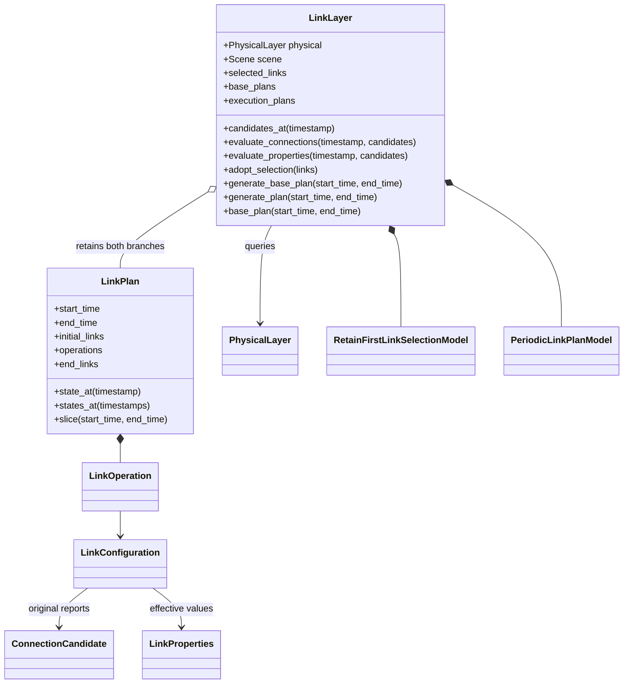

# Link layer

**English** · [中文](README.zh-CN.md)

`LinkLayer` consumes the shared [Physical](../physical/README.md), selects
connections, evaluates properties and retains logical `LinkPlan` results.
It performs no deployment, routing or backend execution.





## Use and extension

```python
from datetime import datetime, timedelta
from skyseed.pc.link import LinkLayer

# physical is an existing configured PhysicalLayer.
start_time = datetime.fromisoformat("2026-01-01T00:00:00+00:00")
end_time = start_time + timedelta(minutes=1)
query_time = start_time + timedelta(seconds=8)
link = LinkLayer(physical)
execution_plan = link.generate_plan(start_time, end_time)
base_plan = link.base_plan(start_time, end_time)
connections = base_plan.state_at(query_time)
```

`datetime` and `timedelta` are Python standard-library types for an instant and
a duration. Define the planning start once; adding a duration gives another instant.

`execution_plan` is a logical plan for the later execution pipeline; generation
does not execute network operations. `base_plan` reads the retained plan before
Perturbation; without a perturbation model, the branches have the same contents.
`connections` maps endpoint pairs to established `LinkConfiguration` values at
the query time. No operation at second 8 is required: apply updates through that
instant to the starting state, retaining previous values between changes. This
does not recompute or interpolate properties. The query must lie within coverage.

Setters accept a model **class**, create one instance and bind `model.layer`
after construction. Configure before generation. Models can query
`self.layer.physical`, estimate properties for a candidate set, inspect the
adopted `selected_links`, or read retained base plans. Queries do not adopt
trial selections or publish predictions. Generators call `adopt_selection`
when accepting a selection, making its occupied slots visible to the policy.

| Model interface | Only required method | Setter | Default / `None` |
|---|---|---|---|
| `LinkSelectionModel` | `select_links(scene, timestamp, candidates)` | `set_selection_hook` | Retain-first / retain all candidates |
| `LinkPropertyModel` | `adjust_properties(scene, timestamp, links)` | `set_property_hook` | None / use base properties |
| `LinkPlanModel` | `generate_plan(scene, start_time, end_time)` | `set_plan_model` | Periodic / required |
| `LinkPerturbationModel` | `perturb(plan)` | `set_perturbation_hook` | None / execution uses base plan |

The Python `Protocol` classes describe the minimum contract. A subclass only
needs the method listed above; a plain class with that method also works.
Default-model private methods and extra lifecycle methods are not required.
The framework supplies `layer` for use in business methods; the author does not
implement that attribute. Selection returns an input subset. Property
adjustment returns the same connection set with its physical evidence intact.
Each evaluation starts from fresh base values, so processing delay or sharing
adjustments do not accumulate across queries. A custom generator can schedule
selection and properties separately and query beyond its output interval.

<details>
<summary>Model-owned parameters</summary>

The model defines and interprets its sampling interval, setup durations and
other algorithm settings. Basic use needs no model configuration. A custom
model can choose settings in its constructor, leaving registration simple:

```python
from datetime import timedelta
from skyseed.pc.link import PeriodicLinkPlanModel

class ExperimentLinkPlanModel(PeriodicLinkPlanModel):
    def __init__(self):
        super().__init__(isl_setup_duration=timedelta(seconds=7.5))

link.set_plan_model(ExperimentLinkPlanModel)  # Before the first generation.
```

The existing setters also accept an optional `model_options` dictionary, passed
unchanged as keyword arguments to the model constructor. Names, defaults and
handling remain model-owned. This is optional and is not a required model method.

</details>

## LinkPlan data shape

| Field / query result | Contents | Short example |
|---|---|---|
| `start_time` / `end_time` | UTC half-open coverage | `[0 s, 60 s)` relative to one planning start |
| `initial_links` | Configurations before start-time operations | `{("GS", "S1"): configuration}` |
| `operations` | Time-ordered `LinkOperation` values | `5 s: establish GS–S1` |
| `end_links` | Configuration after all segment operations | Same mapping shape as `initial_links` |
| `state_at(t)` | Effective configuration at t | `connections[("GS", "S1")]` selects a connection |

For an initially empty plan with establishment at second 5 and withdrawal at second 9,
a query at second 8 contains that connection; a query at second 9 does not.
`configuration.properties_from("GS")` reads effective GS→S1 attributes; actual physical reports determine available directions.

## Connection values

| Value | Meaning |
|---|---|
| `ConnectionCandidate` | A sorted endpoint pair (`id` / `endpoints`), with original per-source Physical `LinkCandidate` reports |
| `LinkProperties` | `link_id`, `bandwidth_bps`, `delay_s`, `packet_loss_ppm`, model-defined `data` |
| `LinkConfiguration` | `candidate`, common `properties`, optional `reverse_properties` override |
| `LinkOperation` | UTC `timestamp`, `kind` (`establish`, `withdraw`, `update`), `link_id`, configuration except for withdrawal |

A pair appears once and consumes one slot at each end. Physical's opposite
reports remain distinct. `properties` applies to both available directions;
`reverse_properties` overrides the lexically second endpoint's outgoing
direction. `properties_from(source)` returns the effective values, or `None`
when no physical report exists for that direction. Default selection requires
both directions; custom selection (including `None`) may retain a one-way
opportunity without inventing its reverse.

Propagation delay comes from each report; when missing it is computed as d/c
from a shared Physical snapshot. Raw evidence is retained separately. Values
and top-level mappings are read-only. Nested custom data must be treated as
unchanging; effective property data should support equality comparisons.

## Default policy and timing

Retain physically feasible selected pairs, including pending setups, before
allocating new slots. ISLs use two same-orbit and two adjacent-plane slots per
satellite; planes are ordered by RAAN within each shell, including wraparound.
New pairs are considered by distance. Standalone TLE/trajectory inputs have no
Scene orbit organization: this policy can select their GS links, but their ISLs
need a policy that defines their neighbor relationships.

GS allocation reserves incumbents, then maximizes newly covered GSs, newly
involved satellites, connection count, and elevation, in that order. A sparse
min-cost flow solves the remaining competition. There is no GS×satellite table
or contact prediction in this default policy.

| Setting | Default and owner |
|---|---|
| ISL / GS bandwidth | 1 Gbit/s / 500 Mbit/s, `LinkLayer` |
| Additional random loss | Zero in base properties |
| GS / satellite GS capacity | 4 / no additional cap, selection model; configurable |
| Evaluation interval | 5 seconds, periodic model |
| ISL / GS setup | 5 / 5 seconds, periodic model; zero is allowed |
| Relative delay threshold / maximum hold | 10% / 120 seconds, periodic model; hold may be `None` |

The five-second sampling and four-ISL organization follow the paper design.
Rates, GS limits, setup durations and delay suppression parameters are adjustable
engineering baselines referenced from the previous implementation, not hardware
guarantees. Capacity is model configuration, not mandatory Scene metadata.

<details>
<summary>Exact events, continuity, history and cost</summary>

Coverage is **[start, end)**. `initial_links` carries the state before operations
at start; `state_at(start)` applies those operations. End-time operations belong
to the next segment. `end_links` carries forward the state before that boundary.
The plan validates operation order and connection existence once on construction.

The default generator anchors its periodic phase at the first start and retains
pending setups across requests. Setup completes at selection time + duration,
including between samples. Initial properties use the latest evaluated values.
If selection disappears at a coincident sample, it cancels setup before enabling
the link. No continuous-contact guarantee is inferred between samples.

Delay changes compare against the last **adopted** delay, with independent clocks
for both directions. Bandwidth, loss and custom effective properties update at
their evaluation time. Unchanged values cause no operation, even after the hold
interval. Withdrawing a pending selection emits no withdrawal of a nonexistent
operational link.

`generate_base_plan` reuses covered time and appends contiguous missing time.
`base_plan` only reads history; `states_at` scans operations once for ascending
queries. `generate_plan` applies Perturbation once per original base segment,
retains the execution result, then returns the requested interval. The perturbation
model must continue its execution state across segments, including intervals that
start during a disturbance. Base and execution plans never overwrite each other.

Changing experiment inputs or models after planning requires a new instance and
fresh generation. This module does not roll back a model, repair its state after
an exception, or replace already computed history. It is not necessary to recompute
anything merely to query an old interval.

Models retain prepared indexes and current planning state. Plans retain initial
configurations and actual changes, not every evaluation's full network state.
The periodic model's optional `observer` receives `LinkEvaluation` values; callers
decide whether to store them for inspection. Dense candidate sets and large GS
competition still have real computation costs; no universal linear bound is claimed.

</details>

## Files and inspection

| File | Responsibility |
|---|---|
| [link_layer.py](link_layer.py) | Model registration, queries, physical handoff and retained branches |
| [link_values.py](link_values.py) | Connection evidence, directional properties and optional observations |
| [link_plan.py](link_plan.py) | Timed operations, interval state queries and slicing |
| [link_selection_model.py](link_selection_model.py) | Selection interface and default policy |
| [ground_allocation.py](ground_allocation.py) | Sparse GS allocation algorithm |
| [link_property_model.py](link_property_model.py) | Optional property interface |
| [link_plan_model.py](link_plan_model.py) | Generation interface and default timing algorithm |
| [link_perturbation_model.py](link_perturbation_model.py) | Execution transformation interface |

[Interactive inspection](../../../../tools/observation/link/README.md) shows
preparation, actual events and branch differences. Tests live in
[unit/link](../../../../new_tests/unit/link) and the real
[Physical–Link connection tests](../../../../new_tests/connections/test_physical_link.py).
Use [save_plans / load_plans](../README.md#plan-files) to retain and restore
these plans independently; inspection JSON is a separate display format.
Network consumes base plans. Compiler and Runner remain later modules.
