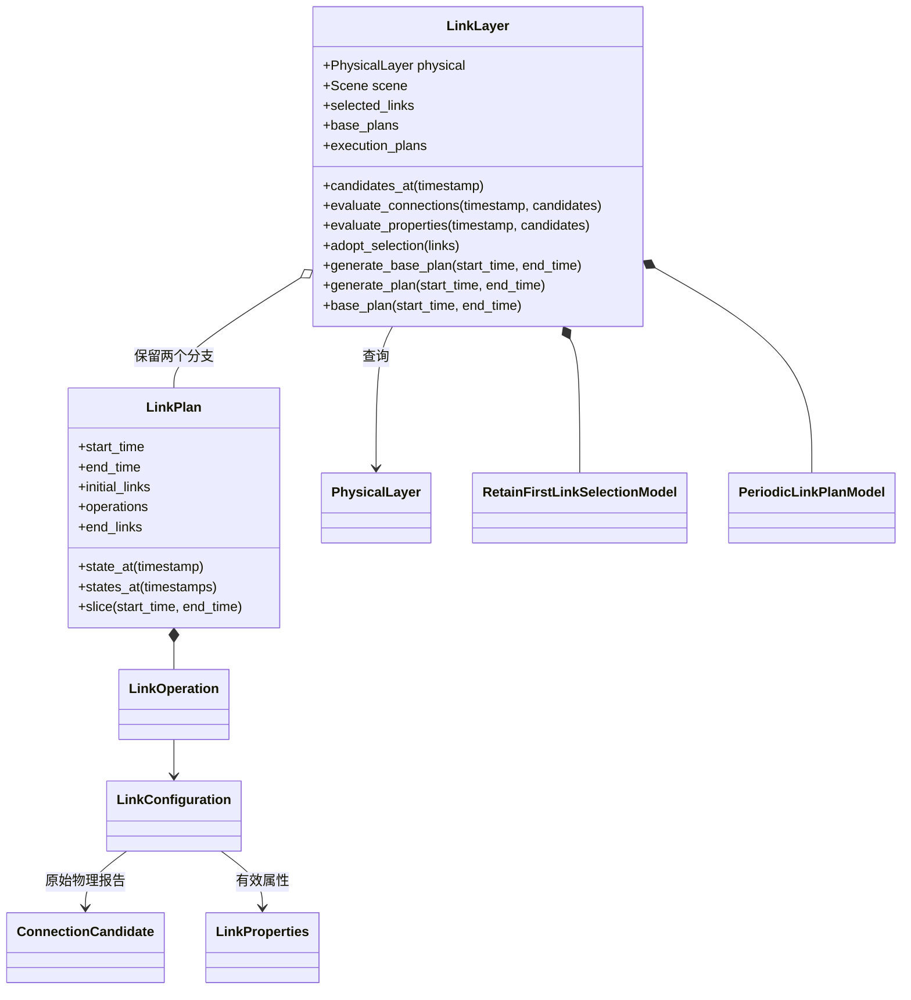

# Link 链路层

**中文** · [English](README.md)

`LinkLayer` 使用共同的 [Physical](../physical/README.zh-CN.md)，选择连接、计算属性，
保存逻辑 `LinkPlan`；不部署节点，不计算路由，也不操作执行后端。




## 用法与替换

```python
from datetime import datetime, timedelta
from skyseed.pc.link import LinkLayer

# physical 是已配置的 PhysicalLayer。
start_time = datetime.fromisoformat("2026-01-01T00:00:00+00:00")
end_time = start_time + timedelta(minutes=1)
query_time = start_time + timedelta(seconds=8)
link = LinkLayer(physical)
execution_plan = link.generate_plan(start_time, end_time)
base_plan = link.base_plan(start_time, end_time)
connections = base_plan.state_at(query_time)
```

`datetime` 和 `timedelta` 是 Python 标准库的时间点与时长类型。
规划起点只需定义一次，加上时长即可得到其他时间点。

`execution_plan` 是交给后续执行链路的逻辑计划，生成调用不会执行网络操作。
`base_plan` 读取未经过 Perturbation 的已生成计划；没有扰动模型时两个分支内容一致。
`connections` 是查询时刻已建立的连接及生效属性，按“端点对 → LinkConfiguration”返回。
第 8 秒无需恰好有操作：从起点状态应用截至该时刻的更新，没有变化就沿用上次值，
不重新计算或插值。查询须在计划覆盖区间内。

setter 接收模型**类**，创建并复用实例，在构造后关联 `model.layer`。
首次生成前配置。模型可查询 `self.layer.physical`、试算一组选定候选的属性、
读取已采用的 `selected_links` 和基础计划。试算或预测不会自动成为正式选择。
生成器通过 `adopt_selection` 接纳选择，使准备中的占用对后续选择可见。

| 模型接口 | 唯一必需方法 | setter | 默认／`None` |
|---|---|---|---|
| `LinkSelectionModel` | `select_links(scene, timestamp, candidates)` | `set_selection_hook` | 保留优先策略／保留全部候选 |
| `LinkPropertyModel` | `adjust_properties(scene, timestamp, links)` | `set_property_hook` | 无／沿用基础属性 |
| `LinkPlanModel` | `generate_plan(scene, start_time, end_time)` | `set_plan_model` | 周期生成／不可为空 |
| `LinkPerturbationModel` | `perturb(plan)` | `set_perturbation_hook` | 无／执行沿用基础计划 |

接口使用 Python `Protocol` 表达最低要求。可以继承对应接口，只实现表中方法；
也可以写一个具有相同方法的普通类。无需实现默认模型的私有方法或额外生命周期方法；
`layer` 由框架提供，在业务方法中使用，不是要求用户实现的属性。
选择模型返回输入候选子集；属性模型保持同一连接集合及物理依据。
每次属性求值都从新的基础值开始，不重复累加处理时延或容量分配。
自定义生成器可分别安排选择与属性求值，物理预测可以越过输出区间。

<details>
<summary>模型自己的参数（展开）</summary>

采样间隔、准备时长等参数由模型定义和解释，最简装配直接使用默认模型。
自定义模型可以在自己的构造函数中确定参数，外部只注册类：

```python
from datetime import timedelta
from skyseed.pc.link import PeriodicLinkPlanModel

class ExperimentLinkPlanModel(PeriodicLinkPlanModel):
    def __init__(self):
        super().__init__(isl_setup_duration=timedelta(seconds=7.5))

link.set_plan_model(ExperimentLinkPlanModel)  # 在首次生成之前。
```

现有 setter 还支持可选的 `model_options` 字典，仅原样展开传给模型的构造函数；
参数名称、默认值和处理逻辑均在模型里。它不是必需配置，也不属于模型业务方法合同。

</details>

## LinkPlan 的数据形状

| 字段／查询结果 | 内容 | 简短示意 |
|---|---|---|
| `start_time` / `end_time` | UTC 半开覆盖区间 | `[0 s, 60 s)`，相对同一个规划起点 |
| `initial_links` | 起点操作前的连接配置映射 | `{("GS", "S1"): configuration}` |
| `operations` | 按时刻排列的 `LinkOperation` | `5 s: establish GS–S1` |
| `end_links` | 应用本段全部操作后的配置 | 与 `initial_links` 使用相同映射形状 |
| `state_at(t)` | t 时刻已生效的配置 | `connections[("GS", "S1")]` 取某条连接 |

例如起点为空、5 秒建链、9 秒撤销，则 8 秒查询包含该连接，9 秒查询不再包含。
`configuration.properties_from("GS")` 读取 GS→S1 的有效属性；方向仍由真实物理报告决定。

## 连接及方向

| 值类型 | 含义 |
|---|---|
| `ConnectionCandidate` | 排序后的端点对 `id`／`endpoints`，及按来源端点保留的原始 Physical `LinkCandidate` 报告 |
| `LinkProperties` | `link_id`、`bandwidth_bps`、`delay_s`、`packet_loss_ppm`、自定义 `data` |
| `LinkConfiguration` | `candidate`、共同 `properties`、可选的反向覆盖 `reverse_properties` |
| `LinkOperation` | UTC `timestamp`、`kind`（establish／withdraw／update）、`link_id`；建立与更新还含配置 |

每个端点对只出现一次，在两端各占一个名额，两个方向的原始报告分别保存。
`properties` 适用于已有的两个方向；`reverse_properties` 可覆盖按字符串排序后第二个
端点的发送方向。`properties_from(source)` 返回该方向有效属性，没有物理报告则返回
`None`。默认选择要求双向可行；自定义选择或清空选择 hook 可保留单向机会，不补造反向。

传播时延优先取各方向报告，缺失时复用位置快照计算 d/c，原始依据单独保留。
值对象和映射顶层只读；嵌套自定义资料使用期间应保持不变，有效属性的 `data` 应支持相等比较。

## 默认选择与时间

先保留仍物理可行的已选连接，包括准备中的连接，再填剩余名额。
星间每星两个同轨、两个相邻轨道面名额；同一 shell 内按 RAAN 排序并首尾相邻，
新连接按距离选择。独立 TLE／轨迹节点没有 Scene 轨道组织：默认可选其星地连接，
星间邻接规则应由自定义选择模型给出。

星地先扣除保留连接，再依次最大化新增地面站覆盖、新增参与卫星、连接数、仰角。
用稀疏最小费用流解决剩余竞争；不建立地面站×卫星全配对表，也不把接触预测加入默认准入。

| 设置 | 默认值与归属 |
|---|---|
| 星间／星地带宽 | 1 Gbit/s／500 Mbit/s，LinkLayer |
| 额外随机丢包 | 基础属性为零 |
| 每 GS／每卫星的星地名额 | 4／不额外限制，选择模型，可配置 |
| 求值间隔 | 5 秒，周期生成模型 |
| 星间／星地准备时长 | 5／5 秒，周期生成模型，允许零 |
| 时延相对阈值／最长保持 | 10%／120 秒，周期生成模型，最长保持可为 None |

5 秒采样和四口 ISL 组织来自论文设计；速率、星地名额、准备时长及更新抑制参数，
是参考旧实现选取的可调工程基线，不是硬件能力保证。容量归模型配置，不加入 Scene 必填字段。

<details>
<summary>精确事件、接续、历史查询和计算成本（展开）</summary>

区间采用 **[start, end)**。`initial_links` 表示应用起点操作前的承接状态；
`state_at(start)` 会应用起点操作。恰好落在 end 的操作归下一段，
`end_links` 保留应用该边界操作前的状态。构造计划时一次核对操作顺序和连接存在性。

默认生成器以首次起点固定采样相位，跨请求保留准备进度。建立时刻等于选中时刻加准备时长，
可以落在两个采样点之间；初始属性使用最近一次求值。若恰逢采样时选择已消失，先取消准备，
不瞬间建立再撤销。不由离散采样推断两采样点之间始终可行。

时延与上次**正式采用**值比较，两方向各自计时。带宽、丢包、自定义有效属性在求值时更新。
值没变，即使超过最长保持时间也不生成重复操作；准备中断不为尚未存在的可用连接生成撤销。

`generate_base_plan` 复用已覆盖区间，只接续缺失的未来部分。
`base_plan` 只读历史，`states_at` 对升序时间一次遍历操作。
`generate_plan` 对每个原始基础片段至多调用一次 Perturbation，保留执行结果，再取所请求区间。
扰动模型应接续前一执行状态，包括片段起点已经受扰的情况；基础、执行分支不互相覆盖。

生成后改变输入或模型，用户应新建实例、重新生成。不提供模型回滚、异常后状态修复或替换
既有历史；普通历史查询不需要重算。

模型保留预处理索引及当前规划状态，计划保存起点配置和实际变化，不默认保存每次求值的全网状态。
周期模型可选 `observer` 接收 `LinkEvaluation`，由调用者决定是否为展示留存。
真实候选密集、星地资源竞争较大时仍有实际计算成本，不承诺普遍线性复杂度。

</details>

## 文件与检查

| 文件 | 职责 |
|---|---|
| [link_layer.py](link_layer.py) | 模型注册、查询、Physical 交接及两个计划分支 |
| [link_values.py](link_values.py) | 连接依据、方向属性和可选观察记录 |
| [link_plan.py](link_plan.py) | 定时操作、状态查询和区间截取 |
| [link_selection_model.py](link_selection_model.py) | 选择接口与默认策略 |
| [ground_allocation.py](ground_allocation.py) | 稀疏星地分配算法 |
| [link_property_model.py](link_property_model.py) | 可选属性接口 |
| [link_plan_model.py](link_plan_model.py) | 生成接口与默认时间算法 |
| [link_perturbation_model.py](link_perturbation_model.py) | 执行条件变换接口 |

[可视化工具](../../../../tools/observation/link/README.zh-CN.md)展示准备、精确事件和分支差异。
测试位于 [unit/link](../../../../new_tests/unit/link) 与真实
[Physical–Link 连接测试](../../../../new_tests/connections/test_physical_link.py)。
通过 [save_plans／load_plans](../README.zh-CN.md#计划文件) 可独立保存和恢复计划；
可视化 JSON 是另一种展示格式。Network 消费基础计划，Compiler 和 Runner 属于后续模块。
