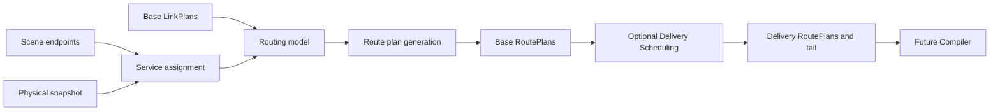
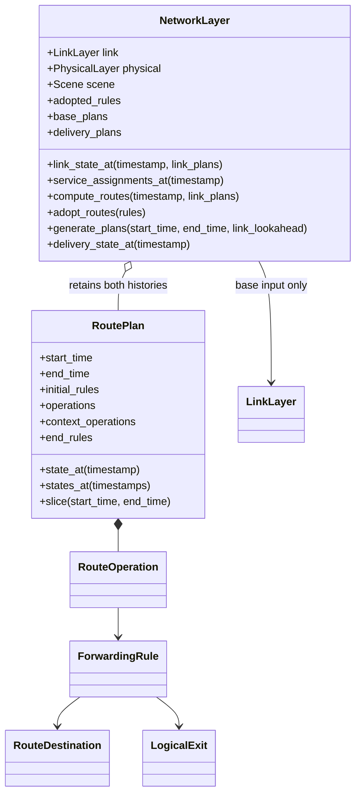

# Network layer

**English** · [中文](README.zh-CN.md)

`NetworkLayer` reads base LinkPlans, computes node forwarding rules and retains
base and delivery-adjusted RoutePlans. Model instances own their algorithms and
private state. No backend commands or routing protocols run here.





## Use

```python
from datetime import datetime, timedelta
from skyseed.pc.network import NetworkLayer

# link is an existing LinkLayer. Scene already contains the desired endpoints.
start = datetime.fromisoformat("2026-01-01T00:00:00+00:00")
end = start + timedelta(minutes=1)
network = NetworkLayer(link)
plans = network.generate_plans(start, end)
query_time = start + timedelta(seconds=8)
rules_by_node = network.delivery_state_at(query_time)
beijing_rules = rules_by_node.get("Beijing", ())
```

`datetime` / `timedelta` are Python standard-library instant / duration types.
Every generation call returns all newly scheduled updates, including those beyond `end`.
No finalization call is needed. Continue from the requested base `end`, not the returned
batch's extended delivery end. Generation does not execute operations.
See [PlanningControl and plan files](../README.md) for assembly and independent save/load.

`rules_by_node` maps node IDs to their managed rules at that time. It is neither a future
schedule nor a complete path. Without an update at that instant, the preceding state holds.
`plans[0]` is the first returned plan; its `state_at(t)` reads the state known when that batch
was generated, within its coverage. Use `delivery_state_at` for the latest combined history.

| Model interface | Only required method | Setter | Default |
|---|---|---|---|
| `ServiceAssignmentModel` | `assign_service(scene, snapshot)` | `set_service_assignment_model` | Highest elevation |
| `RoutingModel` | `compute_routes(scene, timestamp, link_plans)` | `set_routing_hook` | Ground Station–Zone |
| `RoutePlanModel` | `generate_plans(scene, start_time, end_time, link_plans)` | `set_plan_model` | Five-second periodic |
| `DeliverySchedulingModel` | `schedule_plans(scene, route_plans)` | `set_delivery_scheduling_hook` | None |

Register classes before generation; the layer creates and reuses instances,
binding `model.layer` after construction. Protocol inheritance is optional.
Algorithm parameters belong to model constructors; optional `model_options`
only forwards constructor keywords. `FixedDelayDeliverySchedulingModel` is an
optional illustrative model, not the default.

`set_routing_hook(None)` or `set_precomputed_routing(False)` skips input preparation,
generation and delivery processing. The switch retains the chosen model.
An active model returning `{}` instead produces withdrawals of its previous rules.
No custom model is required to use endpoints, zones or service assignment.

## Shared output and plan organization

A routing computation returns `node_id -> tuple of managed rules`. The node belongs to the
outer mapping; each rule describes a match, its action and any logical exit. The generator
compares rule identity and content to create timed updates. These responsibilities do not
require label forwarding. The concrete built-in rule representation is described with the
implementations below.

| `RoutePlan` field | Contents / example |
|---|---|
| `start_time` / `end_time` | Half-open coverage of the batch's known state; delivery may extend past the request |
| `initial_rules` | Configuration before start-time operations, e.g. `{"B": (rule1, rule2)}` |
| `operations` | Ordered new `RouteOperation` values, including delayed tails |
| `context_operations` | Previously returned updates occurring within this batch; usually empty, used for state restoration |
| `end_rules` | Final configuration after context and new operations |

| `RouteOperation` field | Example | Meaning |
|---|---|---|
| `timestamp` | `start + timedelta(seconds=7)` | Scheduled effective time |
| `node_id` | `"B"` | Owning node |
| `kind` | `"replace"` | install / replace / withdraw |
| `rule` | A rule value | New install/replace content, or the withdrawn rule |

`RouteOperation` has no label fields. Its `rule` retains the complete value needed for an
installation, replacement or withdrawal. A node-local `rule.key` identifies the managed
entry; changing its content at the same key produces a replacement. Distinct IP prefixes
remain distinct entries even when their address ranges overlap. Plan queries reconstruct
configured entries, not packet lookup or longest-prefix matching.

### Model–Compiler boundary

| Information | Owner and meaning |
|---|---|
| Node, rule identity and effective time | Shared plan organization; updates target an existing logical node and managed rule |
| Match and action | A defined rule representation understood by both the model and its compiler |
| Logical exit | The chosen connection and sending endpoint; compilation resolves interface and next-hop address |
| Additional model data | Research values may be retained; values that affect forwarding require explicit compiler semantics |

The current `data` mapping preserves model additions and participates in value comparison.
It does not silently create a new match field or backend action. For example, recording a
path score does not make it a kernel-route metric. Algorithm changes can reuse an existing
rule representation; a new representation needs a corresponding compiler translation.
The compiler must handle supported forms explicitly and report unsupported forms rather than
infer meaning from arbitrary fields. Compilation is a later stage; this is its required
handoff boundary, not a claim of installed IP or BPF forwarding.

## Default GZ and local labels

Scene owns optional `AccessEndpoint` definitions. Use `scene.create_zone(...)`
for a representative point and optional rectangular bounds, or
`scene.create_default_zones()` for the fixed 24-band cosine-scaled partition.
Other endpoint kinds carry model-defined JSON data. Endpoints are separate from
physical nodes and survive Scene save/load; existing scenes without them remain valid.

Default service assignment selects the highest-elevation satellite above a
5° minimum at each geographic representative point, or `None`. It makes no
capacity reservation or guarantee for every terminal in the region. Coverage
uses spatial bins separated by horizon scale, followed by exact geometry.

GZ associates each zone with its nearest GS by great-circle distance (default
one, configurable), then finds minimum-hop paths in each direction. Satellites
are transit nodes; GSs are endpoints. Directional link availability is preserved.
Five degrees and one associated GS are adjustable engineering defaults.

Paths and bindings expand from the destination toward upstream nodes. For E
through A→B→C, C assigns incoming label 30 to E; B assigns incoming label 20
and installs **20 → swap to 30 → C**; A pushes 20 when sending to B.
These numbers are illustrative. A label's meaning belongs to its receiving
node, not the whole network. A node retains its incoming binding for the same
logical destination across path changes; its next hop and outgoing label can
change. Numbers are not reassigned to another destination within this model instance.
`label_bindings()` exposes these retained assignments, including inactive ones.

This follows downstream-assigned, locally interpreted labels
([RFC 3031 §3.4](https://www.rfc-editor.org/rfc/rfc3031.html#section-3.4)).
P&C computes bindings offline; no label-distribution protocol runs on nodes.
The default emits `push`, `swap`, `pop_deliver` and ingress-local `deliver` actions.
`label_forwarding=False` selects destination-based `forward` / `deliver` output
for IP-oriented compilation. Actual encapsulation, BPF maps and terminal last-hop
delivery belong to subsequent backend/access work.

### Built-in forwarding representation

`ForwardingRule` currently supports two forms. GZ uses labels by default; a custom routing
model can directly emit ordinary IP-prefix rules without endpoints or service assignment.

| Field | MPLS-like label example | IP-prefix example |
|---|---|---|
| `destination` | `RouteDestination("endpoint", "E")` | `RouteDestination("prefix", "10.0.0.0/24")` |
| `action` | `"swap"` | `"forward"` |
| `exit` | `LogicalExit(("B", "C"), "B")` | Same logical connection |
| `incoming_label` | `20`, assigned locally by B | `None` |
| `outgoing_label` | `30`, assigned by downstream C | `None` |
| `data` | Optional model additions | Model additions, e.g. `{"path_cost": 4}` |

The first rule receives label 20, swaps to 30 and sends through B→C. The second sends the
IP prefix over the same connection; the compiler resolves C's link address and the output interface.
For IP rules, use CIDR prefixes, including host routes and default routes. Their packet lookup
semantics belong to the target IP backend; the planner retains each prefix independently.

| Built-in form | Match | Supported actions |
|---|---|---|
| Label-based | Destination at ingress; node-local label in transit | `push`, `swap`, `pop_deliver`; local `deliver` |
| Destination-based | Typed destination: node, endpoint or IP prefix | `forward`, `deliver`; both labels are `None` |

In this implementation the key is an incoming label or typed destination, actions are the five
above, and forwarding uses one logical exit. These are built-in representation limits, not
requirements that every precomputed routing scheme use MPLS-like labels. Multiple exits,
new match fields or other actions need a coordinated rule/consumer extension; the current
`data` field is not a substitute. No arbitrary-rule compiler or general extension registry
is implemented. Queries include the model's managed entries, not other protocols' tables.

## Queries, history and timing

`compute_routes` and `service_assignments_at` return trial results; only explicit
`adopt_routes` or accepted generated plans advance adopted forwarding state.
Models may inspect prepared base links through `link_state_at`. A request's
nonnegative `link_lookahead` extends only the prepared link input, not route output.
The whole target interval and input sequence reach a custom generator together.
Service snapshots include physical ground nodes as well as satellites, so a
custom assignment model can combine ground positions with actual access links.
Rule values and outer mappings are read-only; nested custom data must remain
unchanged and support equality comparisons.

`base_plans_between(start, end)` and `delivery_plans_between(start, end)` read
history without model calls. RoutePlan queries apply operations through the
requested instant; times need not coincide with an update. Ascending queries
sweep events once. Ordinary link queries also reuse an ascending event cursor.
GZ reuses reverse searches per destination and per unchanged satellite component.
Optional `observer` receives `GZRouteEvaluation`; callers own its retention.

<details>
<summary>Plan boundaries and Delivery contract</summary>

Coverage is **[start, end)**. `initial_rules` is the state before start-time
operations; `state_at(start)` includes them. Each node's rule key identifies its
match: an incoming label or a typed destination. Operations install, replace or
withdraw that match. Missing nodes/rules in a computation remove only the model's
managed rules; protocol-managed tables remain outside this state.

The default generator preserves its five-second phase across requests and emits
one plan per newly generated interval. Custom generators may emit several adjacent
plans. Covered requests read retained output; new requests extend continuously.
Changed inputs/models require a new instance, not rollback of existing history.

Delivery receives the entire newly generated sequence once. It preserves the
initial state and each node's ordered forwarding content, while changing times
and segment boundaries. It returns every scheduled operation, including those
after the source interval's end, in a valid RoutePlan sequence. A later call must not
overtake an earlier update of the same node.

The layer retains `delivery_plans` by generation batch; delivery coverage can overlap.
Each batch's `operations` contains only newly scheduled updates. Previously returned
updates that are still in the future are retained in `context_operations` for independent
state queries, not emitted again as new instructions. Initial rules are the actual state
before the batch's start-time operations. At equal times, context precedes new operations.

A batch is a projection of what was known when it was generated; later batches cannot
retroactively change its object. `delivery_state_at(t)` reads the latest combined state.
`delivery_plans_between(start, end)` returns non-overlapping time projections whose
`operations` contain the interval's complete evolution, for reading rather than redelivery.
Neither query calls models. A single plan's `slice` preserves the new/context distinction.

For example, batch one schedules A's installation at second 7; batch two adds B's installation
at second 5 and A's replacement at second 7. The original installation is context only in
batch two. Combined queries show only B at second 6 and updated A at second 7.
Returned coverage automatically extends one microsecond past its final known event to retain
half-open intervals. This is not a runtime cutoff or shutdown instruction. Runner must later
execute scheduled operations and record actual times; configurations hold without new commands.

</details>

## Files and inspection

| File | Responsibility |
|---|---|
| [network_layer.py](network_layer.py) | Model instances, shared queries, adopted/history state and delivery tail |
| [forwarding_rules.py](forwarding_rules.py) | Typed destinations, local matches and logical exits/actions |
| [route_plan.py](route_plan.py) | Timed operations and independently readable intervals |
| [service_assignment_model.py](service_assignment_model.py) | Service interface and geographic default |
| [routing_model.py](routing_model.py) | Routing interface, GZ, reverse trees and local label bindings |
| [route_plan_model.py](route_plan_model.py) | Generator interface and periodic default |
| [delivery_scheduling_model.py](delivery_scheduling_model.py) | Scheduling interface and optional fixed delays |

[Inspection tool](../../../../tools/observation/network/README.md) follows actual
rules, displaying missing matches, loops and unavailable exits without inventing
paths. Tests: [unit/network](../../../../new_tests/unit/network) and
[Link–Network connection](../../../../new_tests/connections/test_link_network.py).
