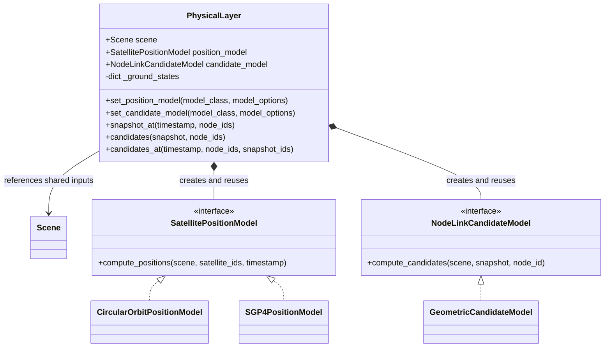
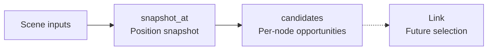

# Physical

[中文](README.zh-CN.md) · **English**

`PhysicalLayer` owns position queries and per-node communication candidates for
Link planning. It can also be queried directly for research and inspection.
Scene supplies inputs; Link will select connections and produce plans.
`Scene` is a separate class shared with Emulator. The diagram's arrow denotes a
reference to that object, not ownership or a Scene nested inside Physical.

## Class structure



The interfaces are Python protocols, not mandatory base classes. Setters accept
**classes**, instantiate them with keyword-only `model_options`, and attach
`model.layer`; models can then access `self.layer.scene`. Register models before
planning. Direct queries can replace a model; this module owns no adopted plans.
Both model slots require an implementation; neither accepts `None` to disable it.

## Query flow



| Call | Result and scope |
|---|---|
| `snapshot_at(timestamp, node_ids=None)` | `PhysicalPositionSnapshot`; compute requested satellites and reuse fixed ground states |
| `candidates(snapshot, node_ids=None)` | `node ID → tuple[LinkCandidate]`; query centres against **only the nodes in that snapshot** |
| `candidates_at(timestamp, node_ids=None, *, snapshot_ids=None)` | Convenience combination; `snapshot_ids` bounds the peer universe, `node_ids` selects centres |

`None` means all applicable nodes; `[]` means none. Times must be timezone-aware
and are normalized to UTC. Unknown IDs, centres outside the snapshot and a
snapshot belonging to another Scene fail explicitly. Reusing a snapshot avoids
repeating propagation; a new snapshot request calls the position model again.

| Value | Fields |
|---|---|
| `NodeState` | Required ECEF `position_m`; optional ECEF `velocity_m_s`; model-defined `data` |
| `PhysicalPositionSnapshot` | `scene`, UTC `timestamp`, `states`; `snapshot[node_id]` returns a state |
| `LinkCandidate` | Query `node_id`, `peer_id`; optional `distance_m`, `propagation_delay_s`, `elevation_deg`; `data` |

Positions and velocities are finite 3-vectors in metres and m/s. Ground velocity
is zero in ECEF. Missing optional values remain unknown. Mappings are read-only
at the top level; nested custom values retain their own semantics and should
remain unchanged while in use. Opposite node reports remain separate, preserving
directional fields. Candidates allocate no terminals, bandwidth or connection time.

The following synthetic geometry illustrates output values, not extra model configuration:

| Read expression | Example | Unit / structure |
|---|---|---|
| `snapshot["GS"].position_m` | `(6378137, 0, 0)` | ECEF metres; equatorial surface point |
| `snapshot["S1"].position_m` | `(6928137, 0, 0)` | ECEF metres; satellite 550 km overhead |
| `reports["GS"][0].peer_id` | `"S1"` | GS's first directed candidate report |
| `reports["GS"][0].distance_m` | `550000` | Metres; optional fields are None when omitted |

## Use and models

```python
from datetime import datetime, timezone
from skyseed import Scene
from skyseed.pc.physical import PhysicalLayer

epoch = datetime(2026, 1, 1, tzinfo=timezone.utc)
scene = Scene()
scene.create_constellation("demo", planes=2, satellites_per_plane=8,
                           altitude_km=550, inclination_deg=53, epoch=epoch)
scene.create_ground_station("Beijing", latitude_deg=40, longitude_deg=116)
physical = PhysicalLayer(scene)
snapshot = physical.snapshot_at(epoch)
reports = physical.candidates(snapshot, ["Beijing"])
```

| Model | Inputs → outputs / configurable baseline |
|---|---|
| `CircularOrbitPositionModel` (default) | Shared Scene orbits or `circular-orbit/v1` → ECEF position and velocity |
| `SGP4PositionModel` | `sgp4-tle/v1` → SGP4 TEME propagation → ECEF position and velocity |
| `GeometricCandidateModel` (default) | WGS84 visibility; ISL range ≤ 6000 km; ground elevation ≥ 5°; optional ground range cap; delay = distance / c |

Circular-orbit and SGP4 are both built-in position implementations with the same
result contract. A new layer selects the circular model; for TLE inputs, select
`SGP4PositionModel` with `set_position_model`. Both live beside their interface in
`position_model.py`.

Candidate defaults are engineering settings, not paper-prescribed hardware limits.
The default model excludes ground-to-ground and below-ellipsoid opportunities.
Custom models provide mixed-source or trajectory replay support; unsupported
input kinds do not silently fall back to a different built-in model.

<details>
<summary>TLE input, numerical conventions and computation cost</summary>

```python
from skyseed.pc.physical import SGP4PositionModel, tle_position_source

scene = Scene()
scene.create_satellite("sat-1", position=tle_position_source(
    line1, line2, source="my-input.tle"))  # Two TLE lines read from your file.
physical = PhysicalLayer(scene)
physical.set_position_model(SGP4PositionModel)
```

The adapter retains TLE lines, their epoch and optional source in Scene save/load.
It does not download data or import arbitrary OMM/CSV formats. Propagation errors
identify the satellite and query time. Circular inputs use GCRS axes, phase zero
at the ascending node, radius = WGS84 equatorial radius + altitude, and
μ = 3.986004418e14 m³/s²; elapsed time includes leap seconds. Both built-ins
transform position and velocity together to ITRS/ECEF, including frame motion.
SGP4 state velocity is an approximation, not an arbitrarily precise position derivative.

Astropy uses locally installed Earth-orientation data, disables downloads within
the calculation scope and restores configuration afterwards. Accuracy warnings
remain visible. See [Astropy satellite coordinates](https://docs.astropy.org/en/stable/coordinates/satellites.html)
and [SGP4](https://pypi.org/project/sgp4/).

Prepared inputs are reused per satellite and invalidated when that input changes.
The candidate model retains one snapshot's arrays/spatial bins. ISL and ground
searches use separate range bounds; ground bins exist only when both node types
are present. Conservative range/horizon filtering precedes exact geometry.
It creates no N×N matrix; dense
candidate output can still be quadratic. The core retains no full trajectory history.

</details>

## Files and inspection

| File | Responsibility |
|---|---|
| [physical_layer.py](physical_layer.py) | Query owner, model instances and identity handoff |
| [physical_results.py](physical_results.py) | Node states, position snapshots and candidate results |
| [position_model.py](position_model.py) | Position protocol, circular-orbit and SGP4 implementations, TLE adaptation |
| [link_candidate_model.py](link_candidate_model.py) | Candidate protocol, geometric implementation and its spatial search |
| [earth_geometry.py](earth_geometry.py) | WGS84 geometry and shared frame transformations |

Inspect [Scene inputs](../../../../tools/observation/scene/README.md) separately
from [Physical results](../../../../tools/observation/physical/README.md).
Tests: [Physical units](../../../../new_tests/unit/physical),
[Scene–Physical connections](../../../../new_tests/connections/test_scene_physical.py).
LinkPlan, routing and execution remain subsequent modules.
