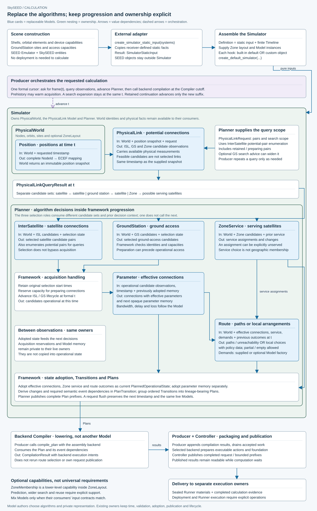
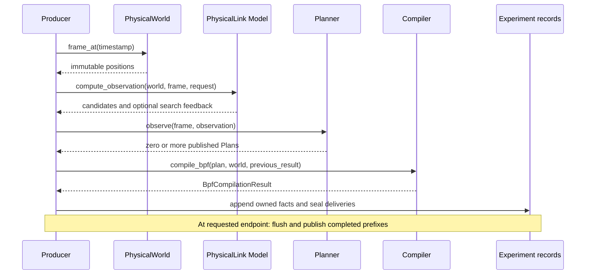

# From inputs to executable results

Shell declarations describe orbital elements, phases and satellite capabilities. GroundStation
declarations describe sites and access limits. Emulator construction turns those declarations
into a SEED scene; an external adapter copies only receiver-defined static facts into Simulator.
This keeps simulation independent of SEED object lifetime and deployment naming.

[Open the zoomable calculation diagram](calculation-flow.svg) ·
[Editable Python source](calculation_flow.py)



Blue cards are algorithm hooks; arrows show value dependencies. ISL pair enumeration
also shapes physical queries. ISL and GS selections pass through acquisition before
Parameter produces effective connections. Route combines those connections with Zone
service and demands. Simulator owns its physical side and Planner; Producer orchestrates
them and calls the backend Compiler. Material sealing and request publication remain
with Producer and Controller.

Replace a hook by supplying your own instance through the existing assembly API:

```python
from skyseed_v2.simulator import create_default_simulator
from my_routing import MyRouteModel

simulation = create_default_simulator(definition, route_model=MyRouteModel())
```

Here `my_routing` is your module, and `definition` supplies the pure input and finite
Timeline. Omitted hooks use defaults; supplied instances replace the same role. Model
combinations must satisfy their consumers' input contracts. See the [extension guide](../user-guides/model-extension.md)
and [contract, template and default navigation](../development/model-interfaces.md).
ZoneMembership is subordinate to ZoneLayout; prediction, search expansion and reuse
are optional capabilities.

Regenerate from `skyseed_v2/` with `python docs/architecture/calculation_flow.py`.
The Python file is the single editable source for this project-understanding SVG.

Producer advances the one formal cursor. Prehistory can warm acquisition before the formal
start; candidate search can expand at one timestamp. Planner adopts state and records a
Transition; publication packages a bounded prefix. Compiler consumes each Plan and its
predecessor result. The call sequence makes those handoffs explicit:



PhysicalWorld cutoff stops after observations; Planner cutoff stops after Plans. Compiler
cutoff additionally prepares static deployment files and seals executable deliveries. Static
SEED preparation supports later deployment; it does not introduce another formal timestamp.
A subsequent request starts at the next cadence, preserving Models and operational memory.
See [experiment semantics](../development/experiment-control.md) and [local Producer interfaces](../../src/skyseed_v2/experiment/README.md).
