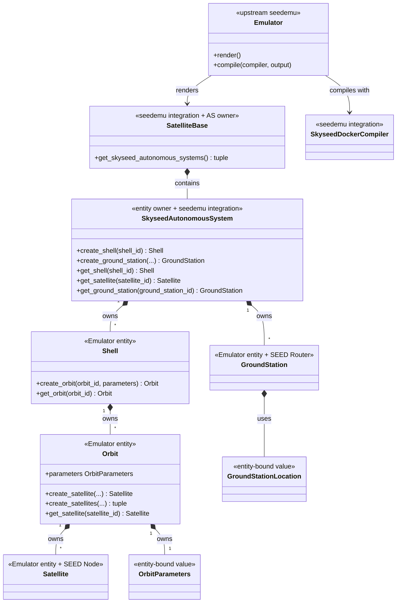
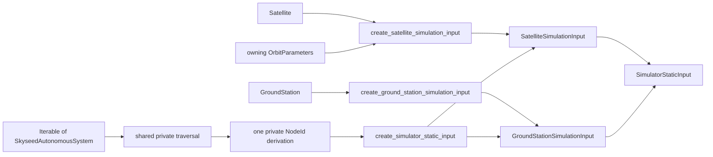
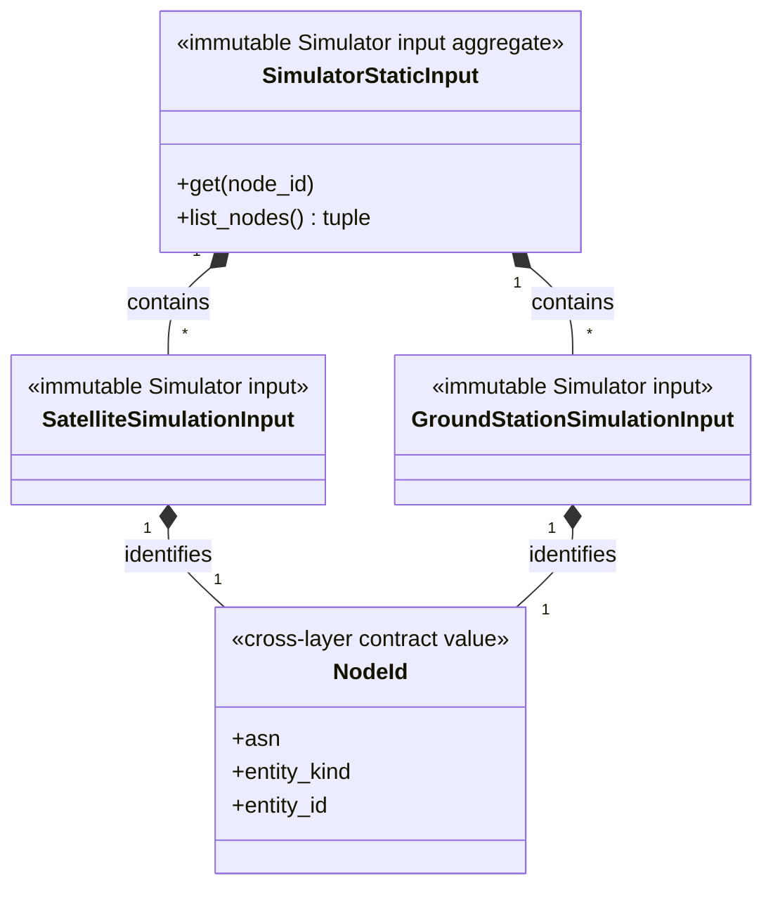
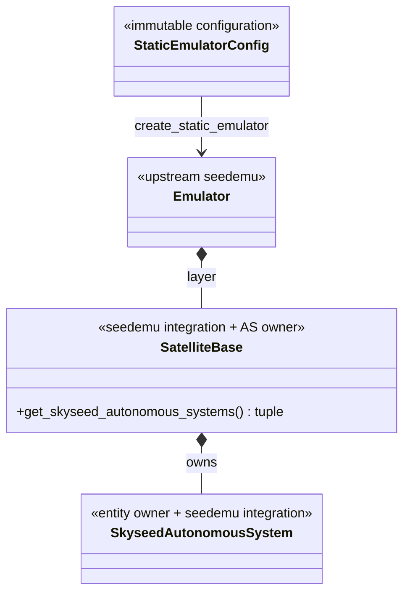
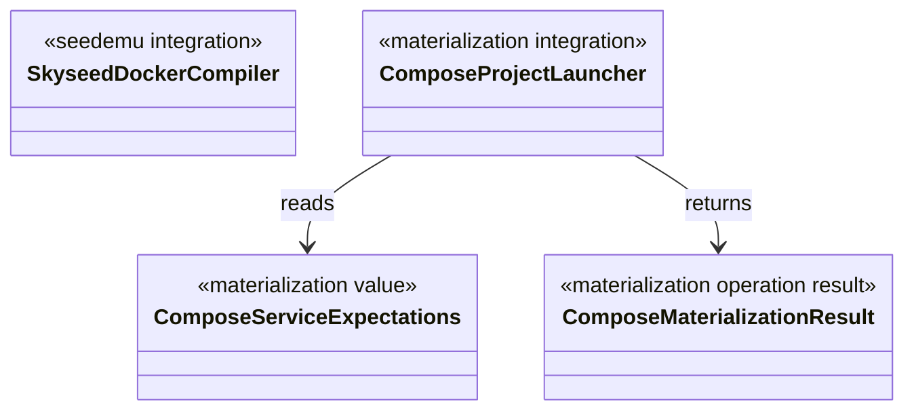
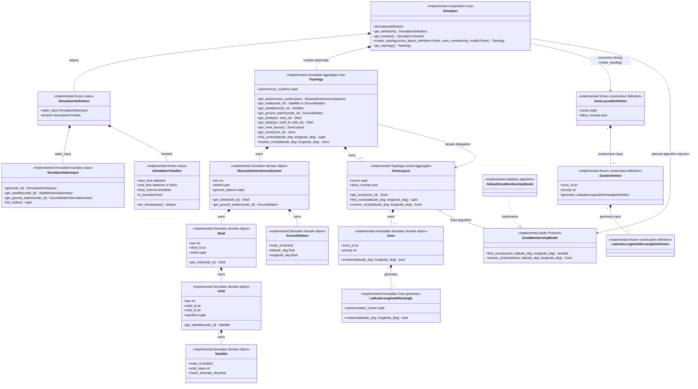
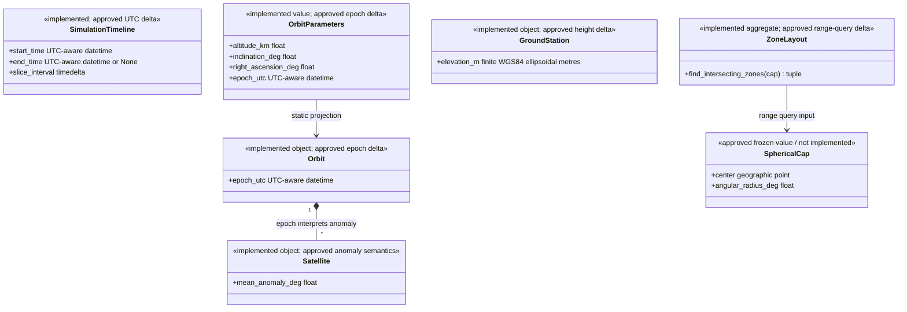
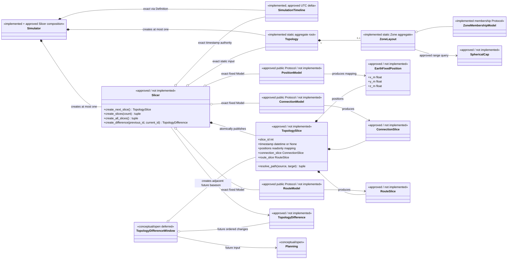
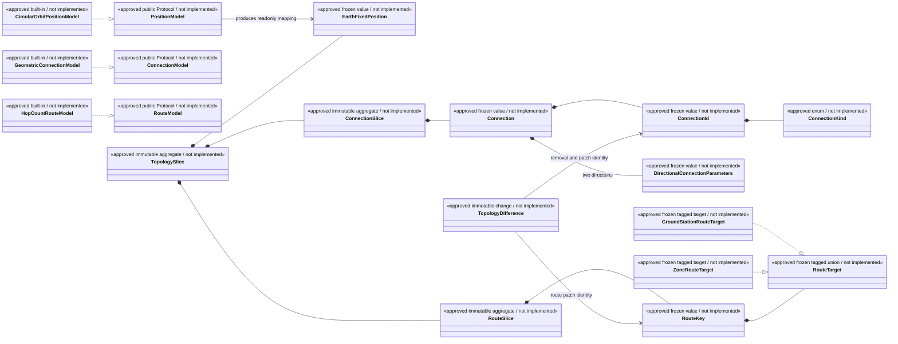

# Conceptual Class Diagrams

## Status

The first diagrams describe implemented Skyseed v2 code, including accepted
and frozen Simulator Iteration 1 plus Iteration 2 static Zones. The later
`Simulator approved dynamic-slice boundary map` combines that implemented
foundation with the accepted/frozen but not-yet-implemented dynamic Slice
contract and the still-conceptual future Planning/execution boundary.

Status stereotypes are normative: `implemented` means current code,
`approved / not implemented` means a frozen public contract awaiting its
authorized implementation Slice, and `conceptual/open` means deferred design.
The detailed frozen dynamic contract is
[`dynamic-slice-public-contract.md`](dynamic-slice-public-contract.md).

## Emulator entities and seedemu integration

`Shell`, `Orbit`, `Satellite` and `GroundStation` each have a defining file
with the same primary name under `entities/`. Splitting those files does not
change ownership or create a parent above Shell.

## Emulator → direct generation → Simulator static input

The dependency direction is intentional: `simulator_input_generation` depends
on entities, seedemu integration, neutral `node_id` and
`simulator.static_input`; the receiving-side input package depends on none of
the Emulator/SEED layers. The copied objects retain no entity, Registry,
container or Compose reference. `NodeId` is a pure value with no resolution
method, and there is no public/global mapping from it to Emulator entities or
runtime resources.

## Configuration, Emulator creation and input generation

`load_static_emulator_config(path)` creates Config values.
`create_static_emulator(config)` sequences existing public construction calls
and directly returns the upstream Emulator. The caller obtains SatelliteBase
through `Emulator.getLayer("Base")` and invokes the owner's narrow
`get_skyseed_autonomous_systems()` query before the separate
`create_simulator_static_input(...)` call. No operation-result class or new
ownership level exists, and handwritten examples do not require the
file-driven operations.

Any future dynamic-execution resolution will reuse the implemented owner
methods rather than add an index: Base `getAutonomousSystem(asn)`, Skyseed AS
`get_satellite()` / `get_ground_station()` / `get_shell()`, Shell
`get_orbit()` and Orbit `get_satellite()`. No resolution path exists yet. The
conceptual dynamic execution chain is independent from the implemented
`SkyseedDockerCompiler`, which lowers only the rendered static Emulator/SEED
model to Docker/Compose deployment configuration.

## Materialization boundary

The launcher consumes an existing Compose artifact. It is outside entity
construction, Simulator static input, `SkyseedDockerCompiler` lowering and
the conceptual dynamic planning/execution chain. It is not the conceptual
`SimulationRunner`.

## Simulator implemented class map through Iteration 2

`Topology` stores its AS tuple, immutable ASN lookup, one immutable `NodeId`
lookup and at most one ZoneLayout. Node-type facade methods use the unified
node lookup and check the result type. Shell and Orbit queries delegate down
their owner chain; Zone queries delegate to the layout. There are no
Satellite-parent reverse APIs or indexes. Every public tuple and private
`MappingProxyType` lookup references the same object instances. The Definition
is consumed during materialization and is not retained.

The implemented field lists above intentionally show current code. The
accepted Slice A deltas—UTC-only Timeline normalization, Orbit `epoch_utc` and
finite GroundStation ellipsoidal height—are not marked implemented here.

## Approved static/time contract deltas

The displayed `epoch_utc`, aware-only UTC normalization, required
GroundStation height and cap query are accepted target contracts, not current
implemented fields or methods.

## Simulator approved dynamic-slice boundary map

Only nodes marked `implemented` exist in current code. Nodes marked
`approved / not implemented` are frozen contracts from
`dynamic-slice-public-contract.md`; their presence is not an implementation
claim or implementation authorization. The dependency labels A through G are
grouped as A–E, F and G for explicit engineering authorization. Planning and
backend execution remain `conceptual/open`.

`Topology` does not create TopologySlice or TopologyDifference. Slicer is the
sole dynamic generation, validation, publication and retained-adjacent-
difference facade. PositionModel, ConnectionModel and RouteModel form one
fixed call chain and do not own authoritative Slice history.

## Approved dynamic values and built-in Models

The built-in Models are explicit choices, never hidden defaults. Same-Orbit
ordering is unique mean anomaly; cross-Orbit structure is unique-RAAN
adjacency plus stable cyclic-offset pairing at Timeline start. Candidate and
geometry evidence remain private ConnectionModel state. RouteSlice stores
next hops, not full paths.

Planning, `TopologyDifferenceWindow`, plan types, backend lowering,
`ExecutionCompiler`, `ExecutableBundle` and `SimulationRunner` remain
conceptual/open and are deliberately omitted from the accepted public-value
diagram.
