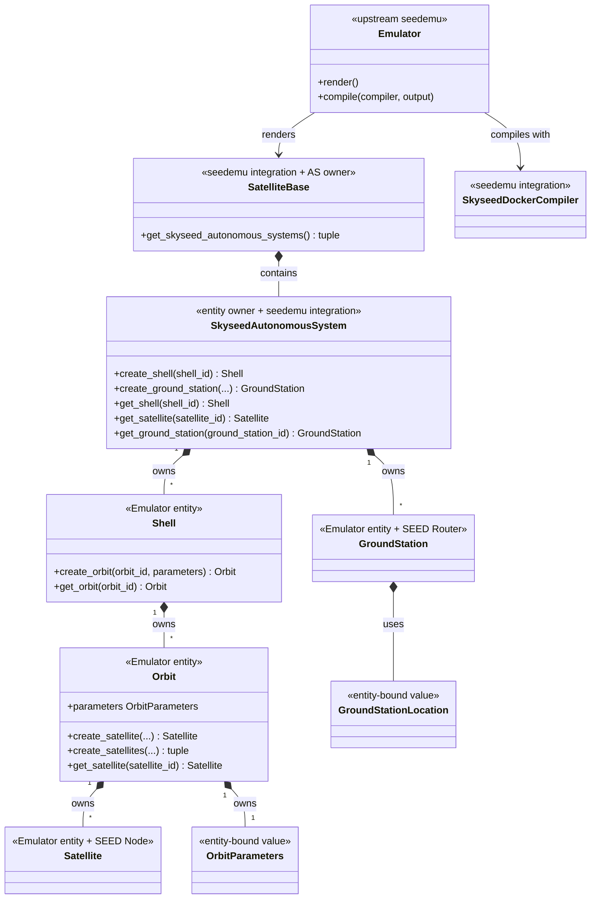
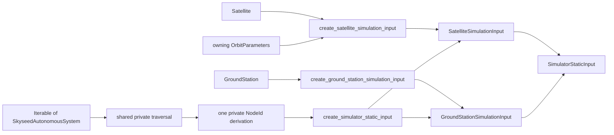
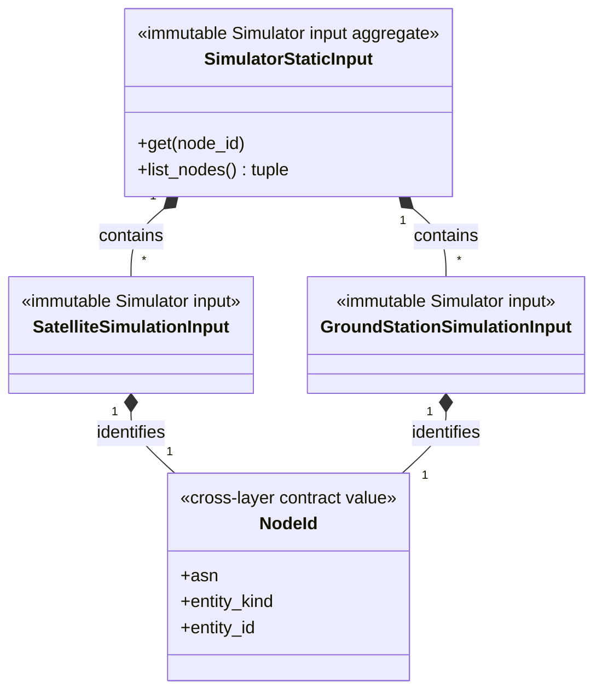
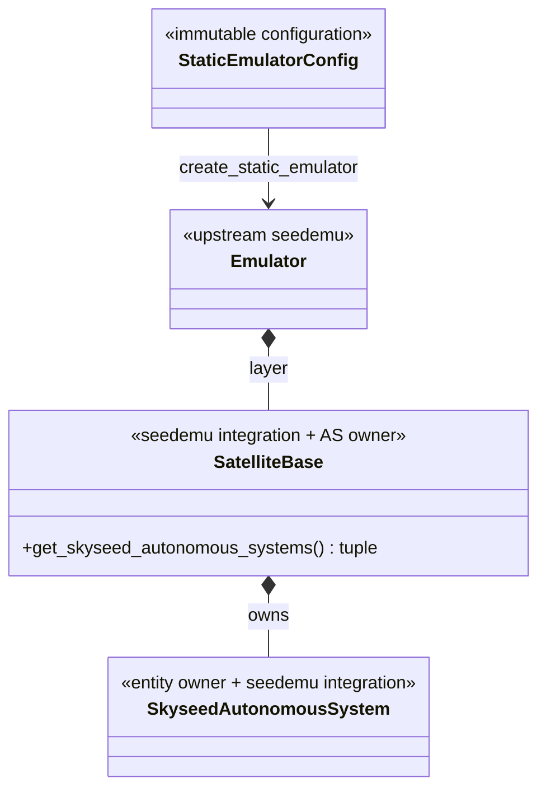
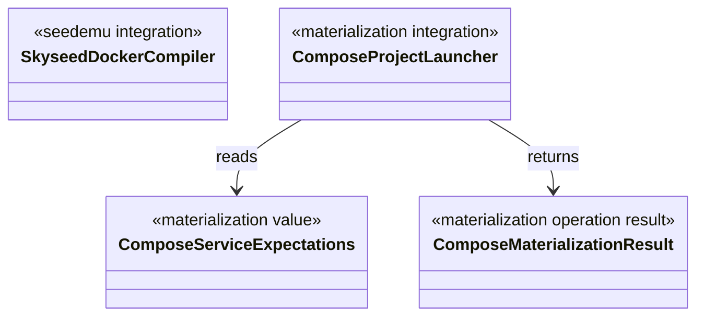
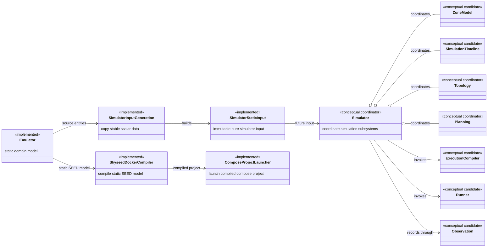
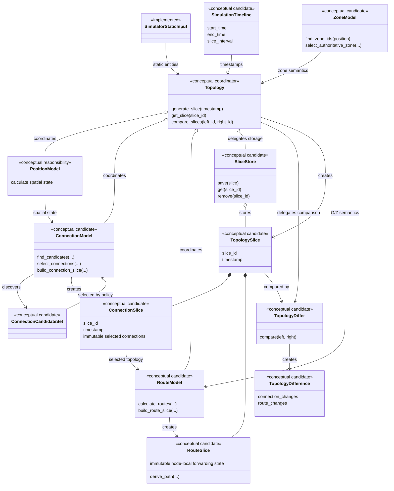

# Conceptual Class Diagrams

## Status

The first diagrams describe implemented Skyseed v2 code. The later
`Simulator future conceptual map` restores approved responsibility directions,
conceptual candidates and open questions even though the corresponding code is
**NOT STARTED**.

A conceptual diagram is not a public API freeze or an implementation task
list. Candidate objects may remain private, be renamed, split, merged or
removed by later approved vertical slices. Status and detailed boundaries are
defined in
[`../design/simulator-conceptual-design.md`](../design/simulator-conceptual-design.md).

## Emulator entities and seedemu integration

`Shell`, `Orbit`, `Satellite` and `GroundStation` each have a defining file
with the same primary name under `entities/`. Splitting those files does not
change ownership or create a parent above Shell.

## Emulator → direct generation → Simulator static input

The dependency direction is intentional: `simulator_input_generation` depends
on entities, seedemu integration, neutral `node_id` and
`simulator.static_input`; the Simulator-owned input package depends on none of
the Emulator/SEED layers. The copied objects retain no entity, Registry,
container or Compose reference. `NodeId` is a pure value with no resolution
method, and there is no public/global mapping from it to Emulator entities or
runtime resources.

## Configuration, Emulator creation and input generation

`load_static_emulator_config(path)` creates Config values.
`create_static_emulator(config)` sequences existing public construction calls
and directly returns the upstream Emulator. The caller obtains SatelliteBase
through `Emulator.getLayer("Base")` and invokes the owner's narrow
`get_skyseed_autonomous_systems()` query before the separate
`create_simulator_static_input(...)` call. No operation-result class or new
ownership level exists, and handwritten examples do not require the
file-driven operations.

Any future dynamic-execution resolution will reuse the implemented owner
methods rather than add an index: Base `getAutonomousSystem(asn)`, Skyseed AS
`get_satellite()` / `get_ground_station()` / `get_shell()`, Shell
`get_orbit()` and Orbit `get_satellite()`. No resolution path exists yet. The
conceptual dynamic execution chain is independent from the implemented
`SkyseedDockerCompiler`, which lowers only the rendered static Emulator/SEED
model to Docker/Compose deployment configuration.

## Materialization boundary

The launcher consumes an existing Compose artifact. It is outside entity
construction, Simulator static input, `SkyseedDockerCompiler` lowering and
the conceptual dynamic planning/execution chain. It is not a dynamic Runner.

## Simulator future conceptual map

### Simulator coordination boundary

`Simulator` and all of the dynamic subsystems in this diagram are not
implemented. `SimulatorStaticInput`, `NodeId` and the functions in
`simulator_input_generation.py` are implemented. The diagram records long-term
responsibility boundaries; it does not require every candidate to become a
public class. `SkyseedDockerCompiler` and `ComposeProjectLauncher` remain on the
independent static deployment path.

### Topology coordination shell and internal layers

The map preserves these boundaries and uncertainties:

1. `Topology` is a coordination shell. It does not personally implement orbit,
   visibility, connection-selection or routing algorithms.
2. Position calculation, candidate relations, connection selection and route
   generation are different responsibilities.
3. A candidate connection is not a selected connection.
4. `ConnectionSlice` stores selected logical connections at one instant.
5. The authoritative state of `RouteSlice` tends toward node-local forwarding
   state.
6. A complete end-to-end path tends to be a derived query, not authoritative
   storage.
7. `ConnectionSlice`, `RouteSlice` and `TopologySlice` tend to be immutable
   after generation.
8. Whether `SliceStore`, `PositionModel` and `ConnectionCandidateSet` become
   public classes is an open question.
9. An initial empty state or `slice0`, continuous operation, sliding windows
   and ahead-of-time computation are candidate designs, not frozen contracts.
10. Whether `PositionModel` exists independently, whether it is internal to
    Topology, and whether `ConnectionModel` should be split further must be
    decided again in the relevant vertical slice.

Zone remains independent of Topology: Topology queries Zone semantics and does
not copy or own a Zone map.

### Two-level Planner, Compiler and Runner

```mermaid
classDiagram
direction LR

class TopologySlice {
  <<conceptual candidate>>
}

class TopologyDiffer {
  <<conceptual candidate>>
}

class TopologyDifference {
  <<conceptual candidate>>
  connection_changes
  route_changes
}

class Planning {
  <<conceptual coordinator>>
}

class SemanticPlanner {
  <<conceptual candidate>>
  plan(topology_difference)
}

class SemanticTransitionPlan {
  <<conceptual candidate>>
  backend-neutral network changes
}

class BackendPlanner {
  <<conceptual interface>>
  plan(semantic_plan, backend_context)
}

class BpfBackendPlanner {
  <<conceptual candidate>>
}

class LinuxMplsBackendPlanner {
  <<conceptual candidate>>
}

class IpRoutingBackendPlanner {
  <<conceptual candidate>>
}

class BackendExecutionPlan {
  <<conceptual candidate>>
  backend-specific operations
  dependencies
  batching
  barriers
  failure policy
  cleanup policy
}

class ExecutionCompiler {
  <<conceptual candidate>>
  compile(backend_execution_plan)
}

class ExecutableBundle {
  <<conceptual candidate>>
  immutable executable inputs
}

class Runner {
  <<conceptual candidate>>
  execute(bundle)
}

class Observation {
  <<conceptual candidate>>
  record facts and results
}

TopologySlice --> TopologyDiffer : compared by
TopologyDiffer --> TopologyDifference : creates

Planning o-- SemanticPlanner : coordinates
Planning o-- BackendPlanner : selects

TopologyDifference --> SemanticPlanner : input
SemanticPlanner --> SemanticTransitionPlan : creates

SemanticTransitionPlan --> BackendPlanner : input
BackendPlanner --> BackendExecutionPlan : creates

BackendPlanner <|-- BpfBackendPlanner
BackendPlanner <|-- LinuxMplsBackendPlanner
BackendPlanner <|-- IpRoutingBackendPlanner

BackendExecutionPlan --> ExecutionCompiler : lowered by
ExecutionCompiler --> ExecutableBundle : creates
ExecutableBundle --> Runner : consumed by

Runner --> Observation : execution events
ExecutionCompiler --> Observation : compile evidence
```

`SemanticPlanner` turns raw topology differences into backend-neutral network
changes, such as logical-link and node-local forwarding-semantic changes. It
does not express BPF maps/generations, tc attachment, Linux routes, namespaces,
commands, batches or backend barriers. `SemanticTransitionPlan` says what the
network must change semantically; it is neither directly executable nor a
shared low-level backend schema.

`BackendPlanner` selects operations, batching, dependencies, serial/parallel
rules, barriers, preload/activation, failure behavior and cleanup/rollback for
one explicit backend. It must not recompute Topology, alter the semantic plan
or silently fall back to another backend. BPF and Linux MPLS plans may have
entirely different operation forms and synchronization rules; neither is
forced to imitate the other.

`ExecutionCompiler` only lowers the approved backend plan to an immutable
executable bundle. It does not re-plan, re-select a backend, recompute Topology
or change the plan's batching/barrier/concurrency semantics. `Runner` only
executes that bundle and must not decide network intent, choose a backend,
re-plan or manufacture a fallback plan. `Observation` records compile and
execution evidence, timing, state transitions, failures, cleanup and audit
facts; it makes no Planner or Runner control decision.

Every dynamic type in this map is a conceptual candidate rather than a current
implementation or frozen public API. Detailed BPF/Linux examples, design
evolution and open questions are preserved in the
[Simulator conceptual design baseline](../design/simulator-conceptual-design.md).
