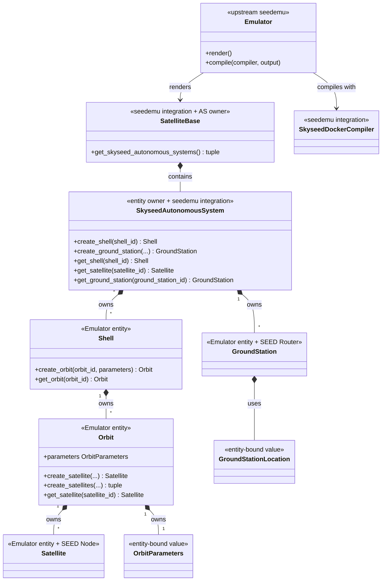
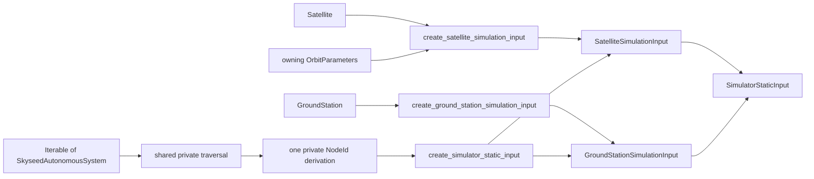
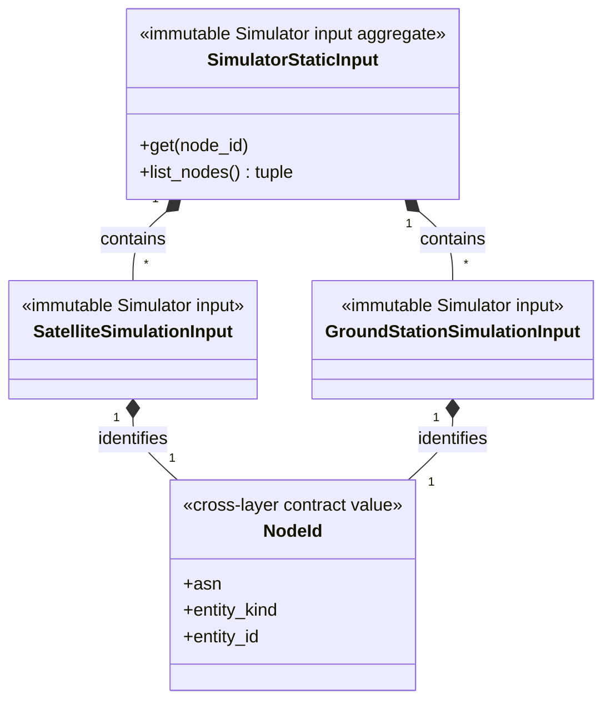
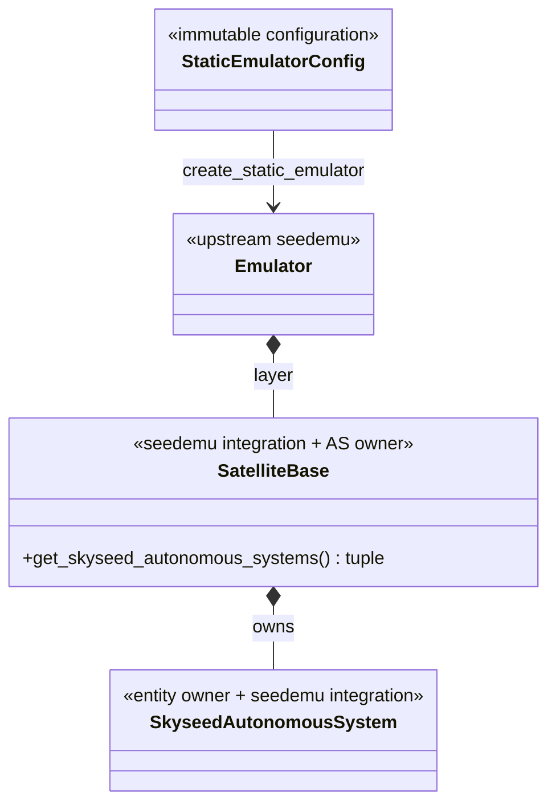
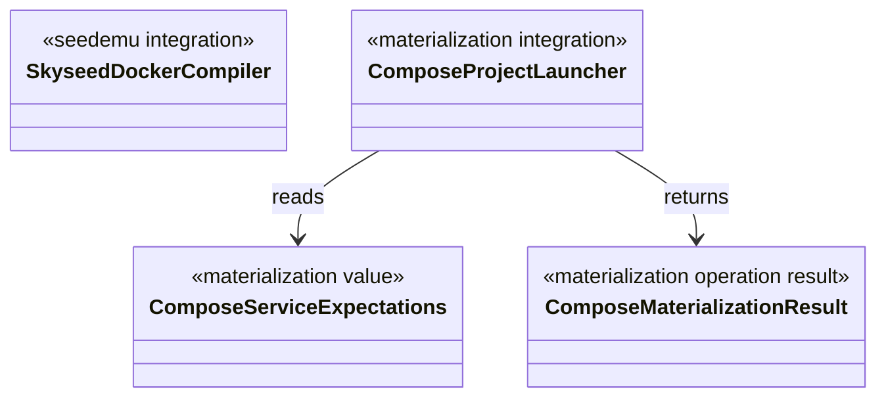
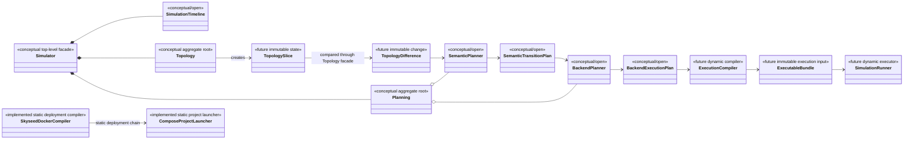

# Conceptual Class Diagrams

## Status

The first diagrams describe implemented Skyseed v2 code. The later
`Simulator future conceptual boundary map` records approved responsibility directions,
conceptual candidates and open questions even though the corresponding code is
**NOT STARTED**.

A conceptual diagram is not a public API freeze or an implementation task
list. Candidate objects may remain private, be renamed, split, merged or
removed by later approved vertical slices. Status and detailed boundaries are
defined in
[`../design/simulator-conceptual-design.md`](../design/simulator-conceptual-design.md).

## Emulator entities and seedemu integration

`Shell`, `Orbit`, `Satellite` and `GroundStation` each have a defining file
with the same primary name under `entities/`. Splitting those files does not
change ownership or create a parent above Shell.

## Emulator → direct generation → Simulator static input

The dependency direction is intentional: `simulator_input_generation` depends
on entities, seedemu integration, neutral `node_id` and
`simulator.static_input`; the receiving-side input package depends on none of
the Emulator/SEED layers. The copied objects retain no entity, Registry,
container or Compose reference. `NodeId` is a pure value with no resolution
method, and there is no public/global mapping from it to Emulator entities or
runtime resources.

## Configuration, Emulator creation and input generation

`load_static_emulator_config(path)` creates Config values.
`create_static_emulator(config)` sequences existing public construction calls
and directly returns the upstream Emulator. The caller obtains SatelliteBase
through `Emulator.getLayer("Base")` and invokes the owner's narrow
`get_skyseed_autonomous_systems()` query before the separate
`create_simulator_static_input(...)` call. No operation-result class or new
ownership level exists, and handwritten examples do not require the
file-driven operations.

Any future dynamic-execution resolution will reuse the implemented owner
methods rather than add an index: Base `getAutonomousSystem(asn)`, Skyseed AS
`get_satellite()` / `get_ground_station()` / `get_shell()`, Shell
`get_orbit()` and Orbit `get_satellite()`. No resolution path exists yet. The
conceptual dynamic execution chain is independent from the implemented
`SkyseedDockerCompiler`, which lowers only the rendered static Emulator/SEED
model to Docker/Compose deployment configuration.

## Materialization boundary

The launcher consumes an existing Compose artifact. It is outside entity
construction, Simulator static input, `SkyseedDockerCompiler` lowering and
the conceptual dynamic planning/execution chain. It is not the conceptual
`SimulationRunner`.

## Simulator future conceptual boundary map

This is a conceptual boundary map, not an implementation inventory. Only the
nodes explicitly marked implemented exist in the repository. Internal
Satellite, Orbit, Shell, Zone and Slice details will be refined by later
vertical slices. The first coming investigation concerns how construction
material is transformed into Simulator- and Topology-owned domain objects.

`NodeId`, the `*SimulationInput` values and the functions in
`simulator_input_generation.py` are also implemented, but are omitted from the
map to keep the lifecycle boundary legible. They form immutable cross-layer
construction data, not the Simulator's long-lived domain model. `Simulator`
will create and own its domain objects from that data and user parameters.

`Simulator`, `SimulationTimeline`, `Topology`, `Planning`, both Planners, the
Slice and plan objects, `ExecutionCompiler`, `ExecutableBundle` and
`SimulationRunner` are unimplemented conceptual/open structures. The
composition and dependency arrows record approved directions; they do not
freeze names, methods, fields, modules or public visibility.
