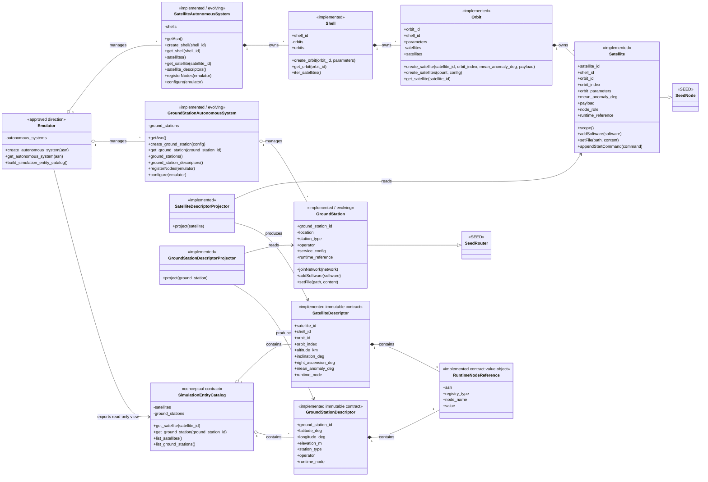

# Conceptual Class Diagrams

本文档是 Skyseed v2 当前整体设计的 **conceptual design reference**。
图中的对象、属性和方法只表达当前大致职责，不是最终 Python API，也不要求
未来实现逐字遵守。已有实现支撑的部分应尽量与当前代码一致；尚未实现的部分
将在对应纵向切片中重新设计、验证和修订。

如果实际实现发现更合理的对象边界，应通过显式设计讨论更新本文档，不能为了
匹配旧图而强行实现。

本文使用以下成熟度标记：

- `implemented`：已有真实实现支撑；
- `approved direction`：当前已确认的整体方向；
- `conceptual`：仅表达未来子系统的大致位置和职责。

这些标记描述设计成熟度，不会创建空类、接口或占位实现。

## Emulator conceptual class diagram

该图同时表达三个不同层次：

1. Emulator domain：描述静态卫星网络实体；
2. SEED integration：描述卫星实体自身如何参加 SEED 节点生命周期；
3. Simulator contract：描述 Simulator 能读取的只读视图。

Satellite 与 GroundStation 静态 Emulator 主线已有纵向切片实现支撑。完整
Entity Catalog 仍属于后续设计方向。图中的方法签名只表达职责，不是最终 API。

- `Satellite` 是唯一的卫星对象并直接继承 SEED `Node`；
- Shell 和 Orbit 负责所有权，Satellite 自身负责节点与容器生命周期能力；
- Descriptor 负责 Emulator–Simulator 只读边界；
- 图中的 Satellite 与 GroundStation 两条静态对象、AS 生命周期和 Descriptor
  投影关系均有当前实现支撑；
- `GroundStation` 直接继承 `SeedRouter` 已通过本轮标准 `rnode`、IX、Routing、
  eBGP、Compiler、容器和 InternetMap 真实运行验证，但仍是 evolving 边界；
- `RuntimeNodeReference` 位于公共 `contracts.runtime` 模块，Satellite 与
  GroundStation Descriptor 包含同一公共不可变类型；其当前字段与已实现合同
  一致，但最终字段仍未定稿；
  图的长期含义只要求它提供稳定运行节点引用；
- UT 暂不进入该图。

### GroundStation implemented static direction

用户创建和管理唯一的 `GroundStation`。该对象直接继承 SEED Router，并作为
标准 `rnode` 参加 Registry、configure、Routing、eBGP、Compiler 和容器生命
周期；没有第二个节点对象、`GroundStationNode` 或稳定 ID binding。

GroundStation 当前实现的静态语义包括：

- ground station ID、地理位置和海拔；
- 运营商与地面站类型；
- 受限的静态 service configuration。

其复用的 SEED 节点能力包括 Registry/configure 生命周期、容器配置、
加入地面 Network 或 IX、地面侧 forwarding、显式启用的路由协议和 Service、
metadata，以及未来卫星侧动态接口的节点执行入口。

这些职责不包括卫星可见性、某时刻连接选择、Zone 服务卫星选择、动态路径
计算、TopologySlice、Backend Plan 或 BPF/MPLS 更新规划；它们属于未来
Simulator。

`GroundStationDescriptorProjector` 从唯一 GroundStation 投影不可变的
`GroundStationDescriptor`。Simulator 只接收该 Descriptor，不接收完整
GroundStation/SEED Router。Descriptor 可包含稳定 ID、位置、必要分类、稳定
运行节点引用和经过确认的只读静态值，但不得包含 Registry、BIRD/FRR 配置、
软件、文件、启动命令、Docker/Compose 对象、可修改接口或 Emulator 生命周期
方法。未来新增字段必须通过显式合同设计，而不是暴露完整 GroundStation。

`GroundStation --|> SeedRouter` 已由当前静态纵向切片验证为合理的最小实现
边界，但仍不是所有未来 GS 能力必须逐字遵守的铁则。卫星侧动态接口、更多
Service 或更复杂路由能力必须在各自切片重新确认，不由本轮结果自动授权。

## Simulator conceptual class diagram

该图表达 Simulator 当前确认的主要子系统、数据流和职责分层。

Simulator 尚未进入具体实现，因此这些类、属性和方法均为 conceptual。
后续每个纵向切片开始前，都应重新确认对应对象是否需要保留、拆分、合并或
改名。

图的核心约束是职责和依赖方向，而不是具体类数量。

```mermaid
classDiagram
    direction LR

    class Simulator {
        <<approved direction>>
        -entity_catalog
        -zone_model
        -timeline
        -topology
        -planning
        -runner
        +configure(config)
        +generate_next_slice()
        +prepare_transition(from_slice, to_slice)
        +execute_transition(plan)
    }

    class SimulationEntityCatalog {
        <<input contract>>
        +get_satellite(satellite_id)
        +get_ground_station(ground_station_id)
        +list_satellites()
        +list_ground_stations()
    }

    class ZoneModel {
        <<conceptual>>
        -zones
        -selection_policy
        +find_zone_ids(position)
        +select_authoritative_zone(candidates, context)
        +get_zone(zone_id)
    }

    class Zone {
        <<conceptual>>
        +zone_id
        +geometry
        +priority
        +contains(position)
    }

    class SimulationTimeline {
        <<conceptual>>
        +start_time
        +end_time
        +slice_interval
        +next_timestamp()
        +is_bounded()
    }

    class Topology {
        <<conceptual coordinator>>
        -connection_model
        -route_model
        -slice_store
        +generate_slice(timestamp)
        +get_slice(slice_id)
        +compare_slices(left_id, right_id)
    }

    class ConnectionModel {
        <<conceptual>>
        -visibility_policy
        -connection_selection_policy
        +find_candidates(timestamp, entities)
        +select_connections(candidates, context)
        +build_connection_slice(timestamp)
    }

    class Connection {
        <<conceptual value object>>
        +connection_id
        +source_node_id
        +target_node_id
        +distance
        +latency
        +bandwidth
        +loss_rate
    }

    class ConnectionSlice {
        <<conceptual immutable>>
        +slice_id
        +timestamp
        -connections
        +has_connection(source_id, target_id)
        +get_connection(connection_id)
        +list_connections()
    }

    class RouteModel {
        <<conceptual>>
        -path_algorithm
        -label_policy
        +calculate_routes(connection_slice, zones)
        +build_route_slice(connection_slice)
    }

    class ForwardingEntry {
        <<conceptual value object>>
        +fec
        +label
        +outgoing_connection_id
    }

    class NodeRoute {
        <<conceptual immutable>>
        +node_id
        -forwarding_entries
        +find_entry(fec)
        +list_entries()
    }

    class RouteSlice {
        <<conceptual immutable>>
        +slice_id
        +connection_slice_id
        -node_routes
        +get_node_route(node_id)
        +find_path(source_semantic, destination_semantic)
    }

    class TopologySlice {
        <<conceptual immutable>>
        +slice_id
        +timestamp
        +connection_slice
        +route_slice
    }

    class SliceStore {
        <<conceptual>>
        +save(slice)
        +get(slice_id)
        +remove(slice_id)
        +list_available()
    }

    class TopologyDiffer {
        <<conceptual>>
        +compare(left_slice, right_slice)
    }

    class TopologyDifference {
        <<conceptual immutable>>
        +from_slice_id
        +to_slice_id
        +connection_changes
        +route_changes
        +is_empty()
    }

    class Planning {
        <<conceptual coordinator>>
        -semantic_planner
        -backend_planner
        +create_semantic_plan(difference)
        +create_backend_plan(semantic_plan)
    }

    class SemanticPlanner {
        <<conceptual backend-independent>>
        +plan(difference)
    }

    class SemanticTransitionPlan {
        <<conceptual immutable>>
        +from_slice_id
        +to_slice_id
        +semantic_actions
        +validate()
    }

    class BackendPlanner {
        <<conceptual interface>>
        +plan(semantic_plan, backend_context)
    }

    class BpfBackendPlanner {
        <<conceptual>>
    }

    class LinuxMplsBackendPlanner {
        <<conceptual>>
    }

    class IpRoutingBackendPlanner {
        <<conceptual>>
    }

    class BackendExecutionPlan {
        <<conceptual immutable>>
        +backend_id
        +operations
        +dependencies
        +failure_policy
        +validate()
    }

    class ExecutionCompiler {
        <<conceptual>>
        +compile(backend_execution_plan)
    }

    class ExecutableBundle {
        <<conceptual immutable>>
        +bundle_id
        +operations
        +execution_constraints
        +metadata
        +verify_integrity()
    }

    class Runner {
        <<conceptual execution engine>>
        +execute(bundle)
        +stop()
        +cleanup(session_id)
    }

    class Observation {
        <<conceptual>>
        +record_operation_started(operation)
        +record_operation_finished(result)
        +record_failure(error)
        +flush()
    }

    Simulator --> SimulationEntityCatalog : reads
    Simulator --> ZoneModel : coordinates
    Simulator --> SimulationTimeline : coordinates
    Simulator --> Topology : coordinates
    Simulator --> Planning : coordinates
    Simulator --> ExecutionCompiler : invokes
    Simulator --> Runner : invokes
    Simulator --> Observation : observes through

    ZoneModel "1" o-- "*" Zone : contains

    Topology --> SimulationEntityCatalog : references
    Topology --> ZoneModel : queries
    Topology --> SimulationTimeline : uses
    Topology --> ConnectionModel : delegates
    Topology --> RouteModel : delegates
    Topology --> SliceStore : manages through

    ConnectionModel --> ConnectionSlice : produces
    ConnectionSlice "1" *-- "*" Connection : contains

    RouteModel --> ConnectionSlice : consumes
    RouteModel --> RouteSlice : produces
    RouteSlice "1" *-- "*" NodeRoute : contains
    NodeRoute "1" *-- "*" ForwardingEntry : contains

    TopologySlice *-- ConnectionSlice : contains
    TopologySlice *-- RouteSlice : contains
    Topology --> TopologySlice : produces
    SliceStore "1" o-- "*" TopologySlice : stores

    TopologyDiffer --> TopologySlice : compares
    TopologyDiffer --> TopologyDifference : produces

    Planning --> SemanticPlanner : delegates
    Planning --> BackendPlanner : delegates

    SemanticPlanner --> TopologyDifference : consumes
    SemanticPlanner --> SemanticTransitionPlan : produces

    BackendPlanner <|.. BpfBackendPlanner
    BackendPlanner <|.. LinuxMplsBackendPlanner
    BackendPlanner <|.. IpRoutingBackendPlanner

    BackendPlanner --> SemanticTransitionPlan : consumes
    BackendPlanner --> BackendExecutionPlan : produces

    ExecutionCompiler --> BackendExecutionPlan : consumes
    ExecutionCompiler --> ExecutableBundle : produces

    Runner --> ExecutableBundle : executes
    Runner --> Observation : emits events to
```

- `Simulator`、`Topology` 和 `Planning` 是子系统协调对象，不应成为承载
  所有实现细节的巨型类；
- 具体算法应由拥有对应数据和职责的对象实现；
- `ConnectionSlice`、`RouteSlice`、`TopologySlice` 当前方向是生成后不可变；
- `RouteSlice` 的权威数据倾向于节点本地转发状态，完整 path 是派生查询；
- Semantic Planner 不包含 BPF、MPLS、Linux 命令或批处理细节；
- Backend Planner 不允许重新计算 Topology；
- Compiler 只降低已批准计划，不重新规划；
- Runner 不进行网络业务判断，但负责通用执行合同；
- rollback、cleanup 和 failure policy 的最终模型尚未确定；
- streaming、sliding window 和 UT 不在本图详细范围内。

## Relationship to flowcharts

现有 [diagrams.md](./diagrams.md) 中的 flowchart 表达系统流程与数据流；本文的
class diagram 表达对象职责与关系。两类图互相补充，不能互相替代。
