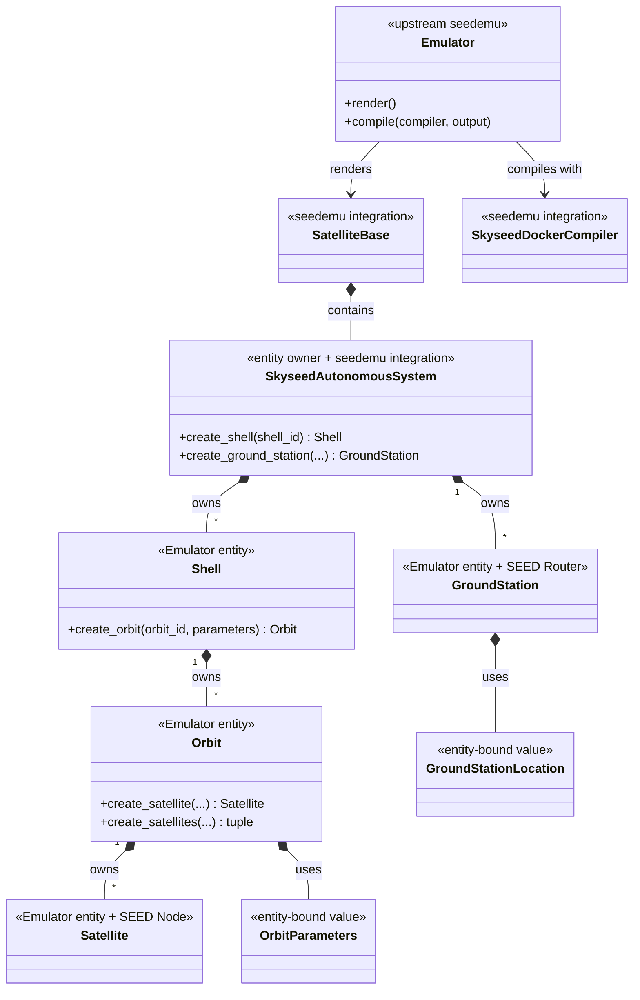
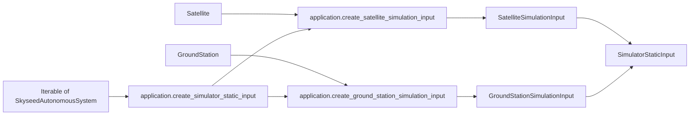
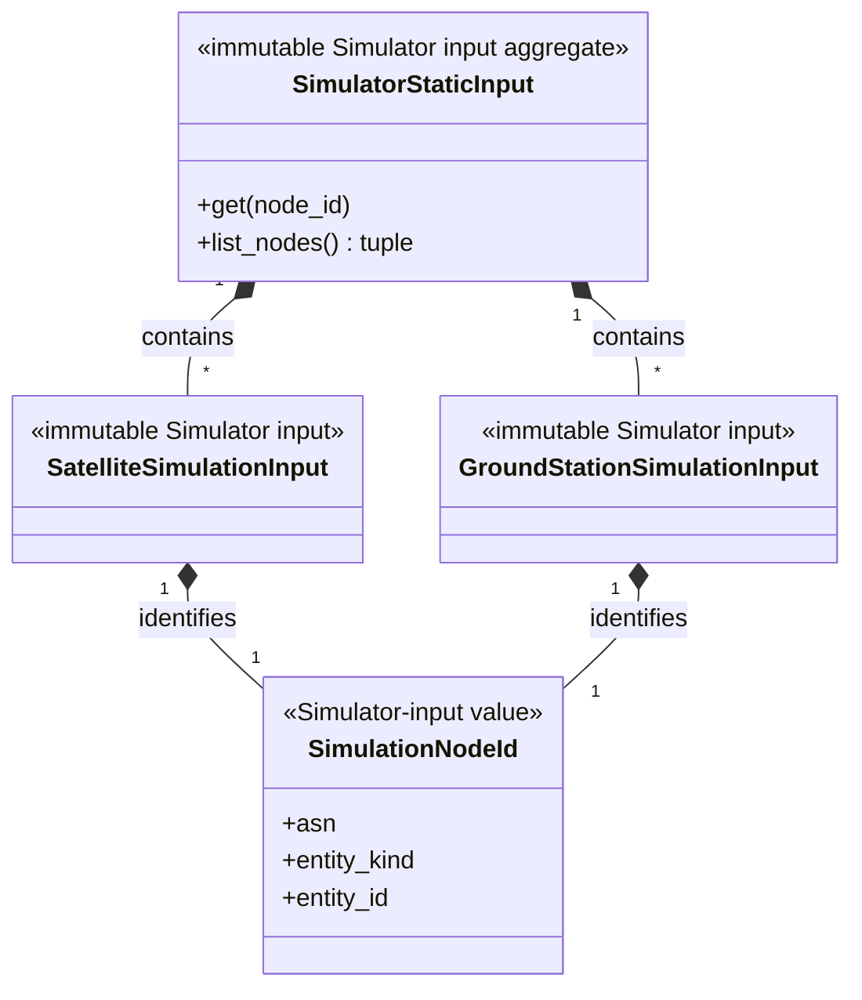
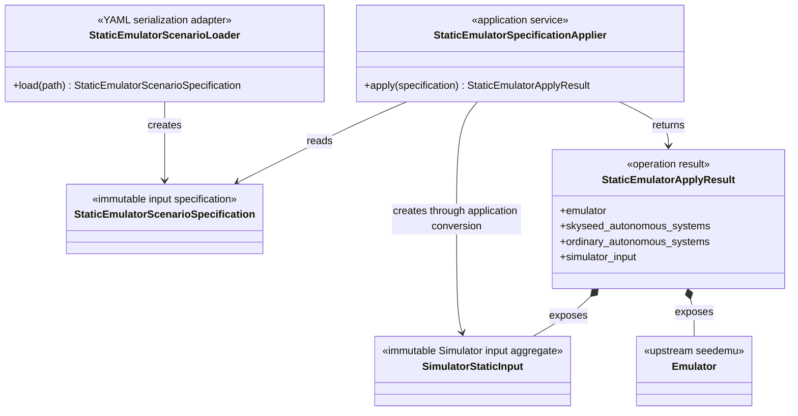
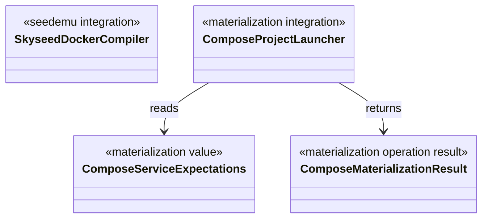

# Conceptual Class Diagrams

## Status

These diagrams describe only implemented Skyseed v2 code. Simulator runtime
types are deliberately absent because Simulator is **NOT STARTED**.

## Emulator entities and seedemu integration

`Shell`, `Orbit`, `Satellite` and `GroundStation` each have a defining file
with the same primary name under `entities/`. Splitting those files does not
change ownership or create a parent above Shell.

## Emulator → application conversion → Simulator static input

The dependency direction is intentional: application conversion depends on
entities, seedemu integration and `simulator_input`; the input package depends
on none of those Emulator/SEED layers. The copied objects retain no entity,
Registry, container or Compose reference.

## Specification, serialization and application

The Loader is a file adapter. The Applier sequences existing public
construction calls. Neither type is an entity, ownership level or facade
required by handwritten examples.

## Materialization boundary

The launcher consumes an existing Compose artifact. It is outside entity
construction, Simulator static input and Compiler lowering.
