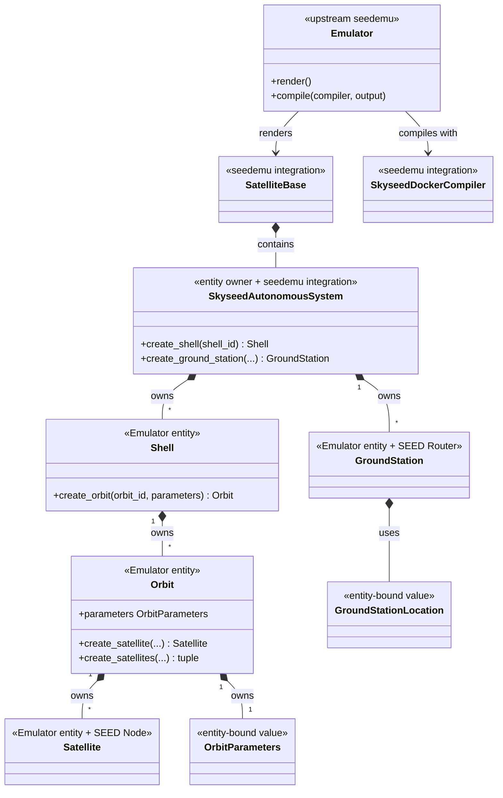
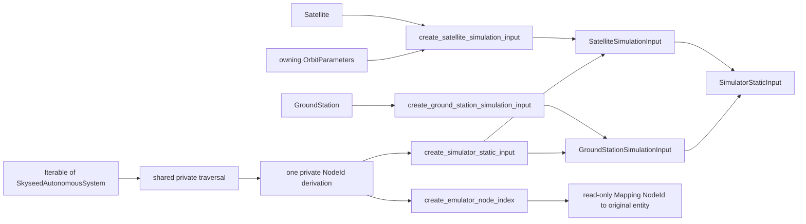
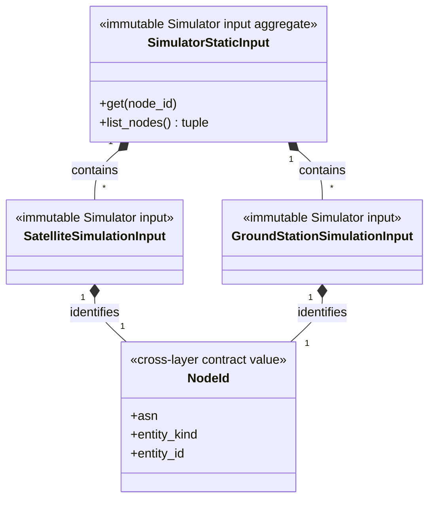
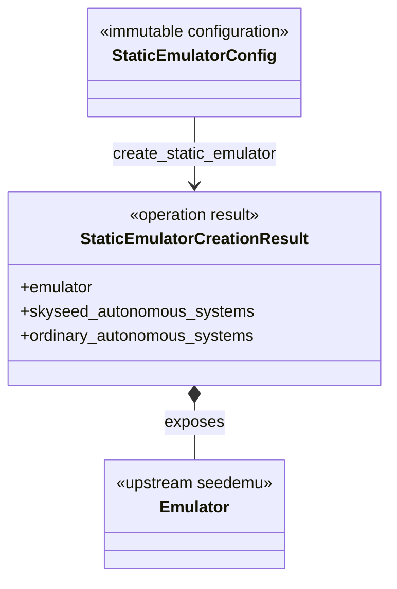
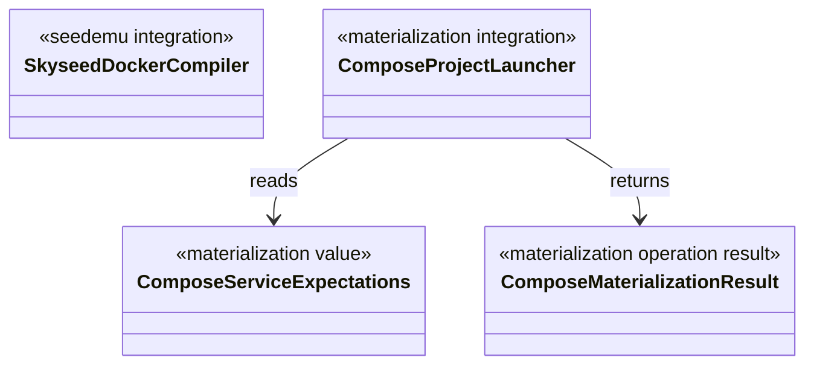

# Conceptual Class Diagrams

## Status

These diagrams describe only implemented Skyseed v2 code. Simulator runtime
types are deliberately absent because Simulator is **NOT STARTED**.

## Emulator entities and seedemu integration

`Shell`, `Orbit`, `Satellite` and `GroundStation` each have a defining file
with the same primary name under `entities/`. Splitting those files does not
change ownership or create a parent above Shell.

## Emulator → direct generation → Simulator static input

The dependency direction is intentional: `simulator_input_generation` depends
on entities, seedemu integration, neutral `node_id` and `simulator_input`; the
input package depends on none of the Emulator/SEED layers. The copied objects
retain no entity, Registry, container or Compose reference. The node index is
not a new class: it is a read-only Mapping from the same IDs to the exact
original Satellite/GroundStation instances.

## Configuration, Emulator creation and input generation

`load_static_emulator_config(path)` creates Config values.
`create_static_emulator(config)` sequences existing public construction calls
and returns only the three creation outputs. A separate
`create_simulator_static_input(creation.skyseed_autonomous_systems)` call
generates the immutable Simulator input; `create_emulator_node_index(...)`
generates the Compiler-facing lookup from the same entity collection. None is
an entity or ownership level, and handwritten examples do not require the
file-driven operations.

## Materialization boundary

The launcher consumes an existing Compose artifact. It is outside entity
construction, Simulator static input and Compiler lowering.
