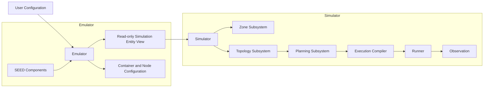
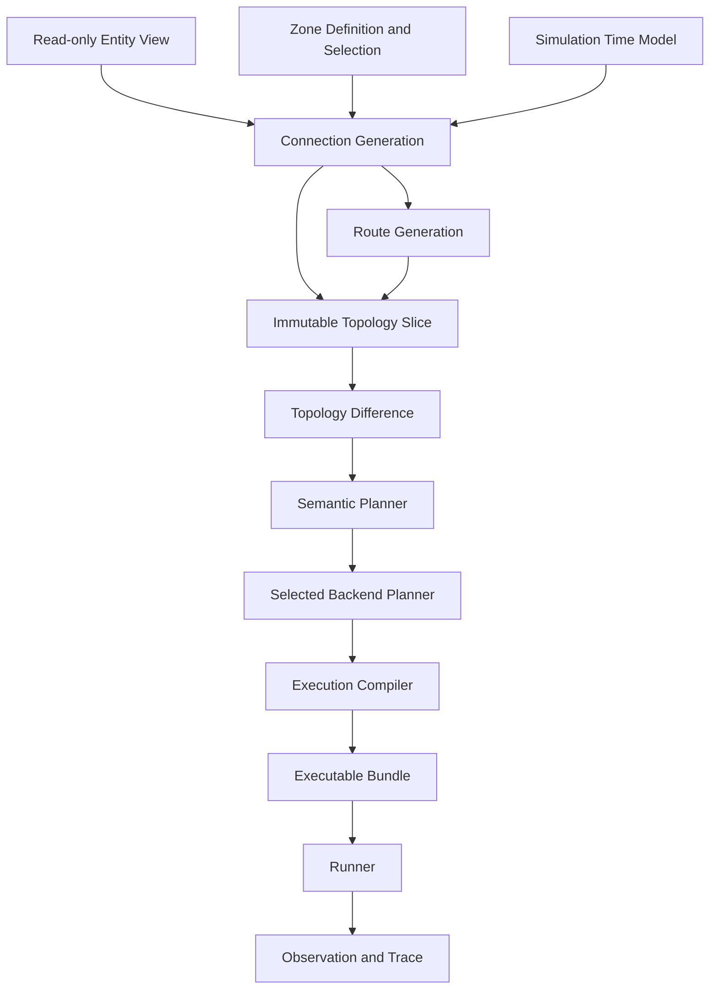
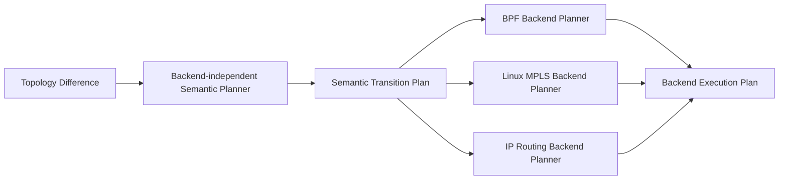
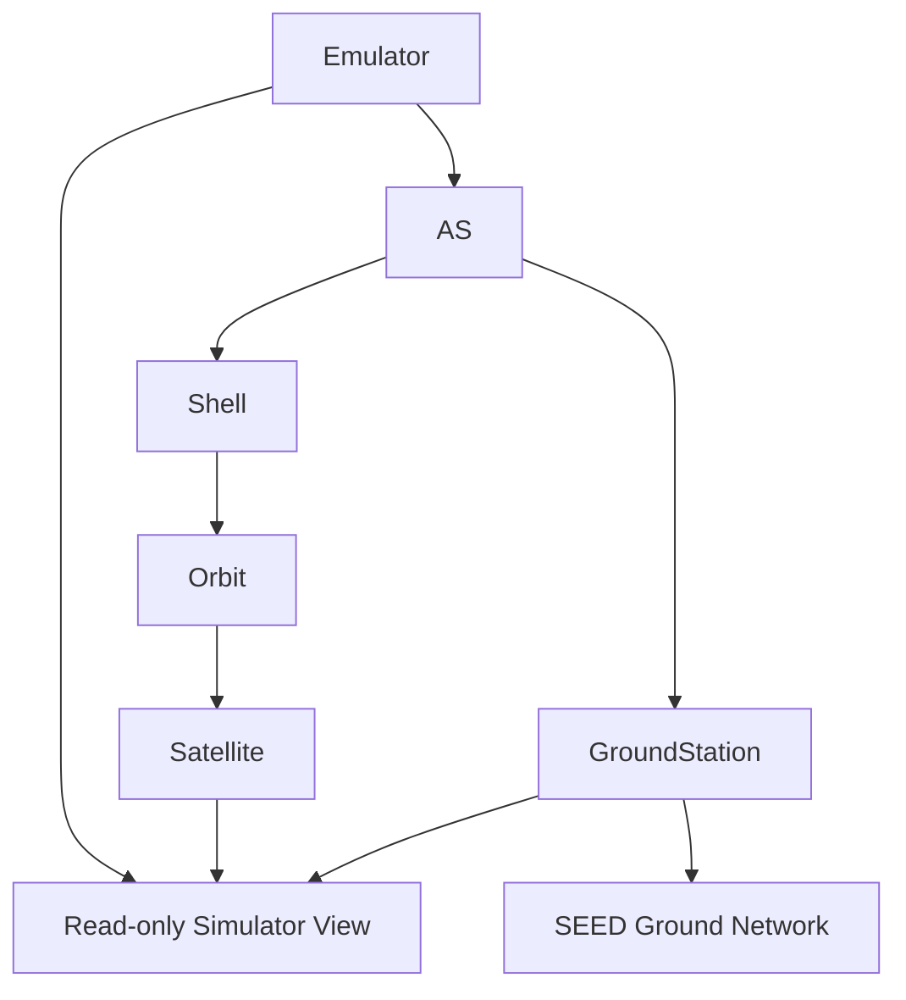
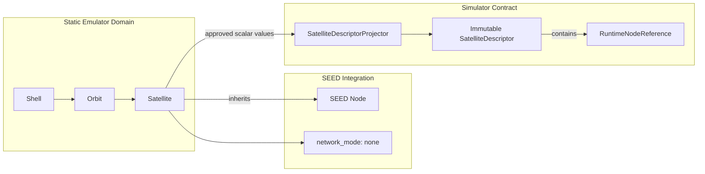
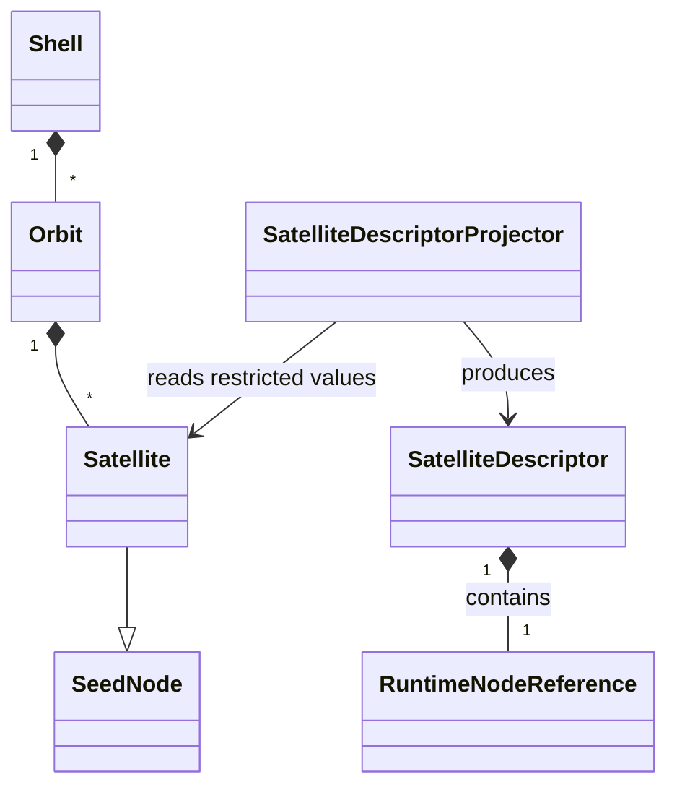
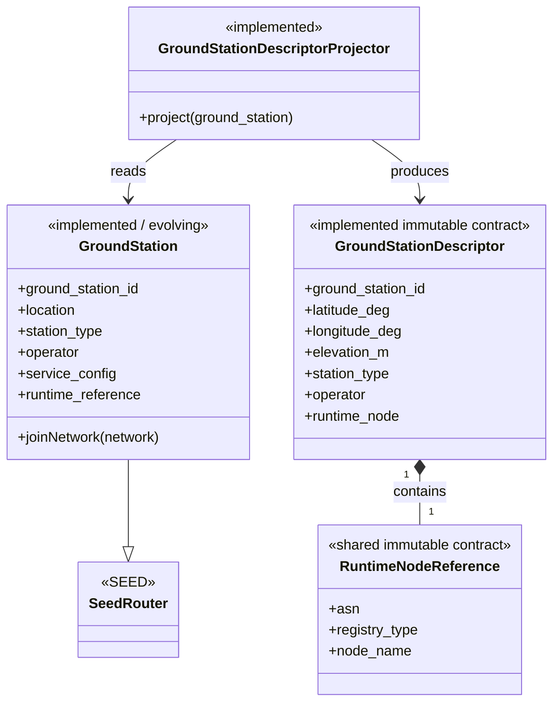

# Initial Architecture Diagrams

这些图只表达当前确认的模块关系和信息流，不代表最终类图或最终 API。

Detailed conceptual class diagrams with responsibilities, key attributes and
methods are maintained in
[conceptual-class-diagrams.md](./conceptual-class-diagrams.md).

## 1. System boundary



## 2. Simulator flow



## 3. Planning layers



## 4. Emulator static hierarchy concept



## 5. Implemented isolated Satellite boundary





```text
Satellite(Node) -> SatelliteDescriptorProjector -> SatelliteDescriptor
```

## 6. Implemented static GroundStation boundary

该图记录当前已验证的单对象静态纵向路径；动态卫星侧能力仍未实现。



```text
Satellite(Node) -> SatelliteDescriptor
GroundStation(Router) -> GroundStationDescriptor
```

Simulator 只接收受限的 Descriptor。Router 继承方向已由标准 rnode、IX、
Routing/eBGP、Compiler 和真实容器验证；未来动态 GS 能力仍需独立设计。
