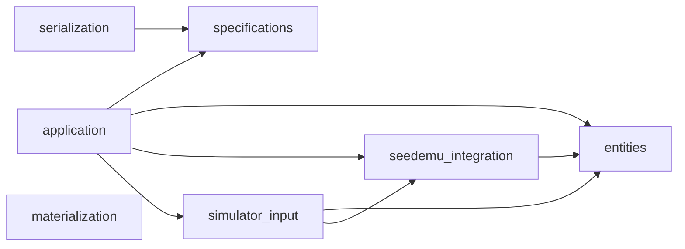
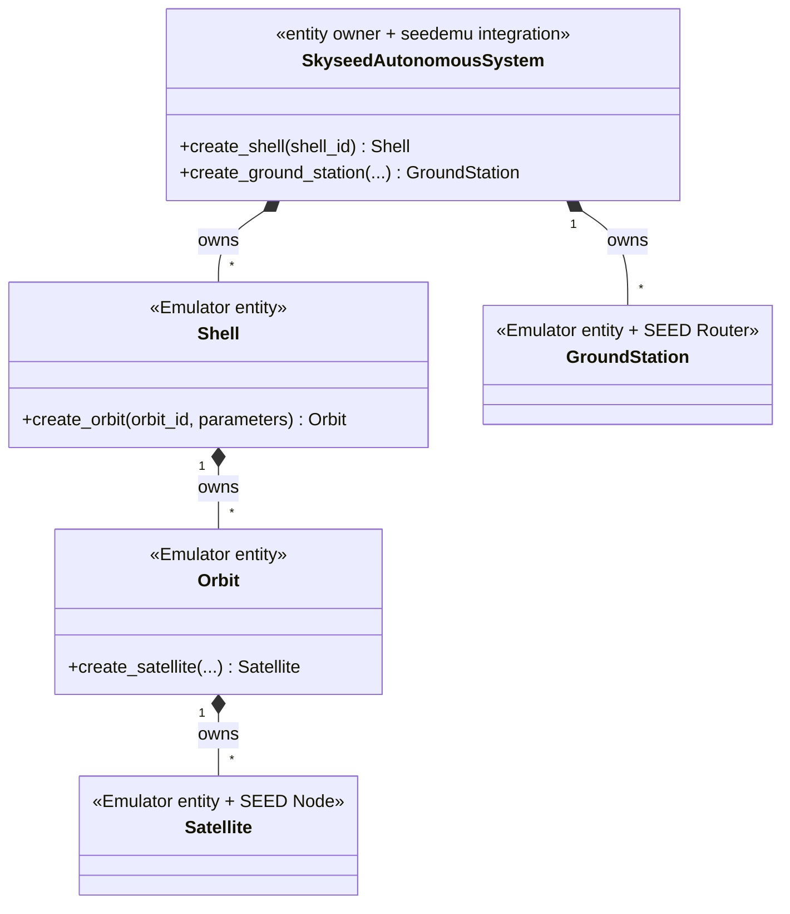
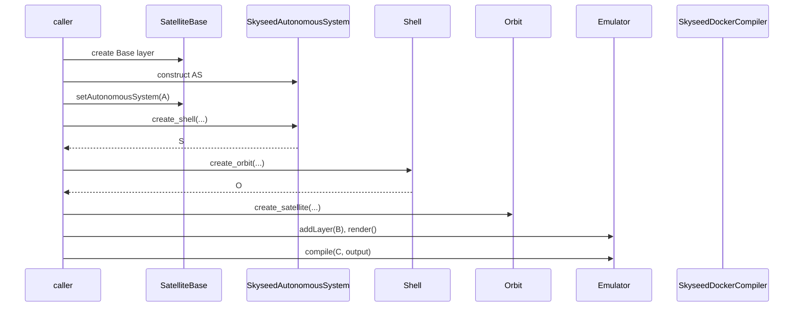
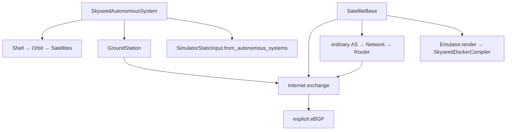
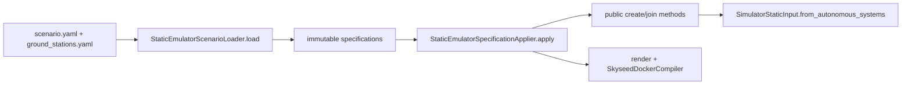
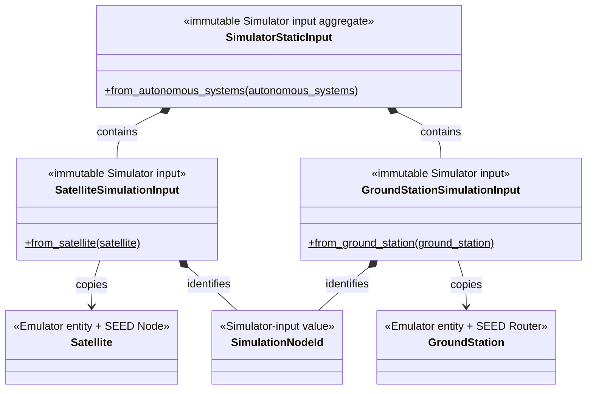
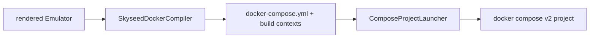

# Current Architecture Diagrams

All diagrams on this page reflect implemented code. Simulator remains
**NOT STARTED**; the right-hand box is only a consumer boundary.

## 1. Package dependency direction

There is no arrow from `entities` to `simulator_input`. `materialization` is
independent of entities, static input and seedemu Compiler implementation.

## 2. Entity ownership

## 3. Isolated example call chain

## 4. Complete example call chain

## 5. File-driven large call chain

## 6. Static Simulator-input boundary

## 7. Compiler artifact and materialization

`ComposeProjectLauncher` never reconstructs entities, reads Simulator input or
recompiles the Emulator.
