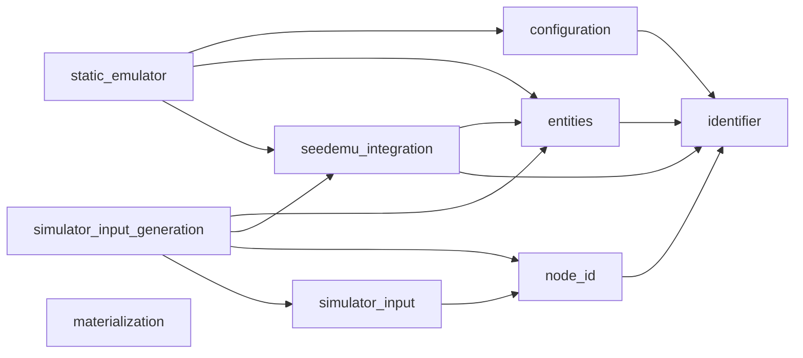
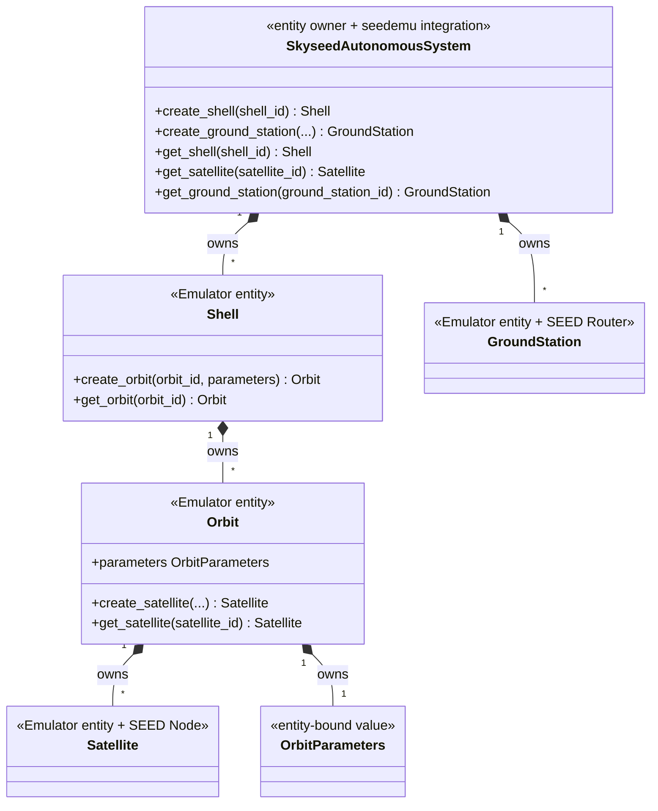
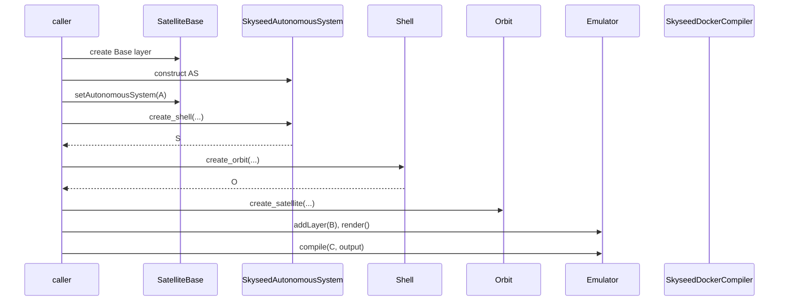
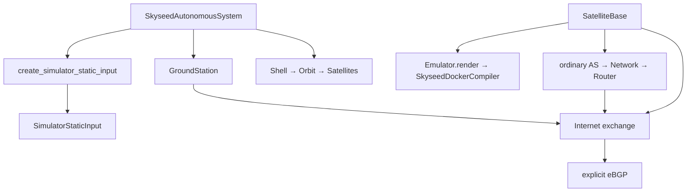
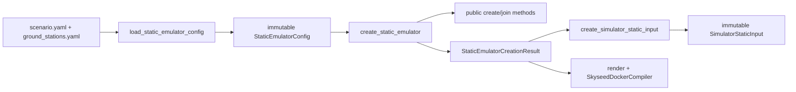
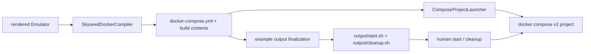

# Current Architecture Diagrams

All diagrams on this page reflect implemented code. Simulator remains
**NOT STARTED**; the right-hand box is only a consumer boundary.

## 1. Package dependency direction



There is no arrow from `simulator_input` to entities, seedemu integration or
upstream seedemu. `node_id` is the neutral cross-layer logical identity and
uses the general `identifier` validator. `materialization` is independent of
entities, static input and seedemu Compiler implementation.

## 2. Entity ownership



## 3. Isolated example call chain



## 4. Complete example call chain



## 5. File-driven large call chain



## 6. Static Simulator-input boundary

```mermaid
flowchart LR
    AS[Iterable of SkyseedAutonomousSystem] --> WALK[shared private entity traversal]
    SAT[Satellite + OrbitParameters] --> WALK
    GS[GroundStation] --> WALK
    WALK --> DERIVE[one private NodeId derivation]
    DERIVE --> CA[create_simulator_static_input]
    CA --> SI[SatelliteSimulationInput + NodeId]
    CA --> GI[GroundStationSimulationInput + NodeId]
    SI --> INPUT[SimulatorStaticInput]
    GI --> INPUT
    INPUT --> SIM[future Simulator consumer boundary]
    SIM -. future plan cites NodeId .-> COMP[future Compiler plan consumer]
    COMP -. NodeId.asn .-> BASE[SatelliteBase.getAutonomousSystem]
    BASE -. require Skyseed AS .-> OWNER[SkyseedAutonomousSystem]
    OWNER -. kind + entity_id .-> ENTITY[Satellite or GroundStation]
```

`SimulatorStaticInput` performs type validation, deterministic sorting,
duplicate-ID rejection, immutable snapshotting and read-only indexing only. It
does not traverse AS objects or call entity conversion and contains no entity
reference. No unified NodeId-to-entity/resource mapping exists. The dashed
path documents future owner-directed Compiler calls only; no Simulator, plan,
resolution or Compiler update path is implemented.

## 7. Generated experiment artifact and materialization



The Python entrypoint finalizes controls only after the current output is
complete. Generated scripts use the exact Compose file/project and never
reconstruct entities. `ComposeProjectLauncher` remains the programmatic,
state-verifying materialization adapter; it never recompiles the Emulator.
