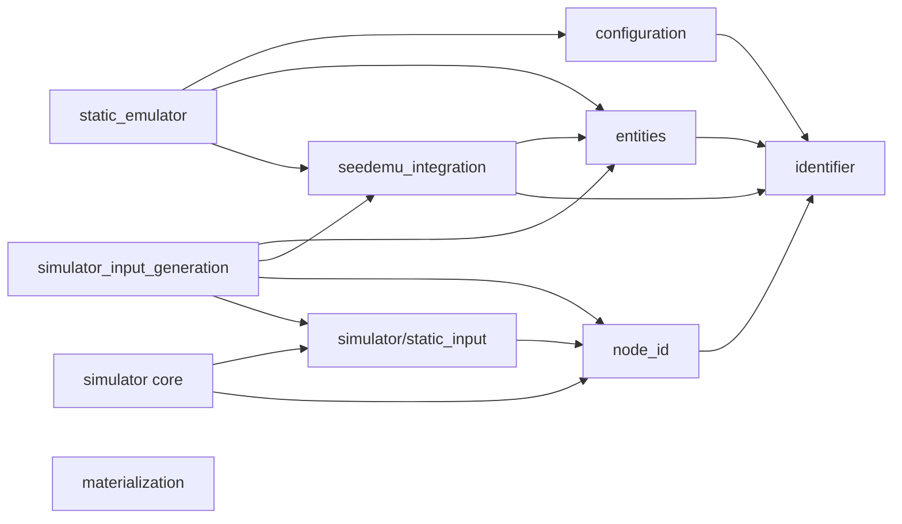
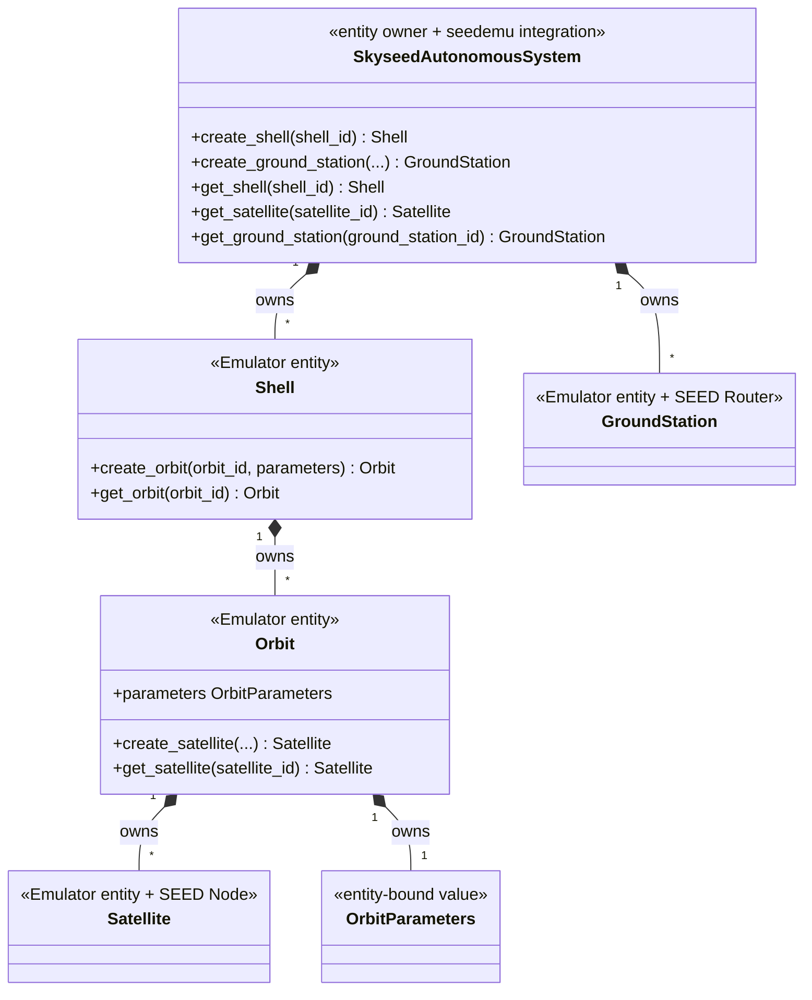
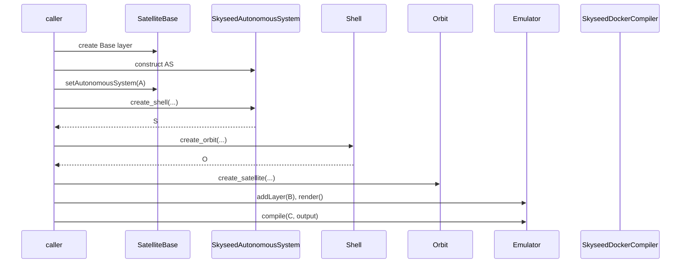
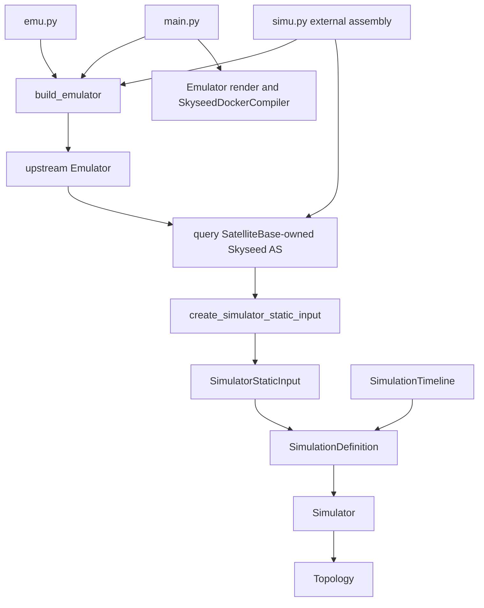
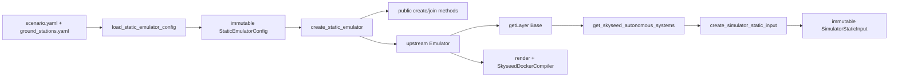
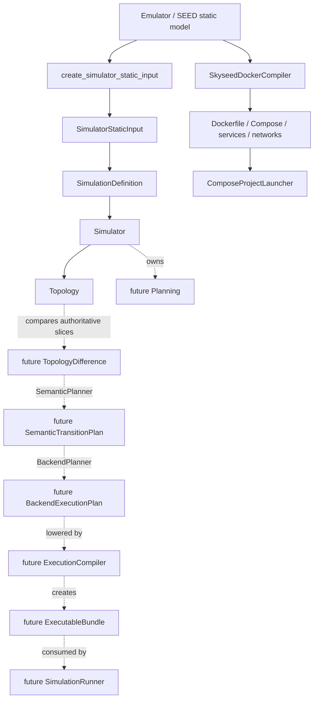
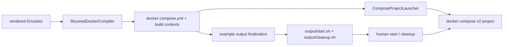

# Current Architecture Diagrams

Solid implemented nodes and arrows reflect current code. Simulator Slice 1 is
**IMPLEMENTED**; dashed Planning/dynamic nodes are conceptual boundaries, not
implementations or frozen public APIs. The top-level map is in
[`conceptual-class-diagrams.md`](conceptual-class-diagrams.md#simulator-future-conceptual-boundary-map).

## 1. Package dependency direction

There is no arrow from `simulator` core or `simulator/static_input` to entities,
seedemu integration, upstream seedemu or `simulator_input_generation`. The
external generation adapter alone points to both the Emulator side and the
Simulator boundary. `node_id` is the neutral cross-layer logical identity and
uses the general `identifier` validator. `materialization` is independent of
entities, static input and the `SkyseedDockerCompiler` implementation.

## 2. Entity ownership

## 3. Isolated example call chain

## 4. Complete example call chain

`emu.py` only constructs and returns the Emulator. `main.py` is the pure
Emulator render/compile entrypoint. `simu.py` is the external assembly entrypoint
that crosses from the Emulator side, through the thin adapter, to the Simulator
side; it does not import `main.py`. Simulator core never imports back across
that boundary.

## 5. File-driven large call chain

## 6. Static Simulator-input boundary

```mermaid
flowchart LR
    AS[Iterable of SkyseedAutonomousSystem] --> WALK[shared private entity traversal]
    SAT[Satellite + OrbitParameters] --> WALK
    GS[GroundStation] --> WALK
    WALK --> DERIVE[one private NodeId derivation]
    DERIVE --> CA[create_simulator_static_input]
    CA --> SI[SatelliteSimulationInput + NodeId]
    CA --> GI[GroundStationSimulationInput + NodeId]
    SI --> INPUT[SimulatorStaticInput]
    GI --> INPUT
    INPUT --> DEF[SimulationDefinition.static_input]
    TIMELINE[SimulationTimeline] --> DEF
    DEF --> SIM[Simulator construction]
    SIM --> TOPOLOGY[Topology materialization]
    TOPOLOGY --> DOMAIN[immutable AS → Shell → Orbit → Satellite tree]
    TOPOLOGY --> GSOWN[AS-owned GroundStation objects]
    SIM -. future ownership .-> PLANNING[future Planning]
    TOPOLOGY -. creates and compares .-> SLICE[future Slice / Difference citing NodeId]
    SLICE -. consumed by .-> PLANNING
    PLANNING -. later approved plan .-> DYNAMIC[dynamic execution resolution]
    DYNAMIC -.->|NodeId.asn| BASE[SatelliteBase.getAutonomousSystem]
    BASE -. require Skyseed AS .-> OWNER[SkyseedAutonomousSystem]
    OWNER -. kind + entity_id .-> ENTITY[Satellite or GroundStation]
```

`SimulatorStaticInput` performs type validation, deterministic sorting,
duplicate-ID rejection, immutable input copying and read-only indexing only. It
does not traverse AS objects or call entity conversion and contains no entity
reference. Its lookups require `NodeId`; no local string-ID fallback exists. It
is construction boundary data, not the Simulator's long-lived domain graph.
The implemented Topology has one private unified `NodeId` index over its own
static nodes, never Emulator entities or runtime resources. Simulator,
Timeline, Definition, Topology and the static domain objects are implemented;
the dashed Planning, Slice, plan, resolution and dynamic-update structures are
not.

## 7. Static deployment and conceptual dynamic execution chains

The implemented static deployment compiler and the conceptual dynamic
`ExecutionCompiler` have different inputs, outputs, ownership and lifecycles;
they have no inheritance relationship or required shared public parent.
`ComposeProjectLauncher` is not the conceptual `SimulationRunner`. The old
`SimulationPlanCompiler` label is retained only as a **retired/corrected**
over-compression of semantic planning, backend planning and executable-form
compilation, not as a frozen master contract.

## 8. Generated experiment artifact and materialization

The Python entrypoint finalizes controls only after the current output is
complete. Generated scripts use the exact Compose file/project and never
reconstruct entities. `ComposeProjectLauncher` remains the programmatic,
state-verifying materialization adapter; it never recompiles the Emulator.
