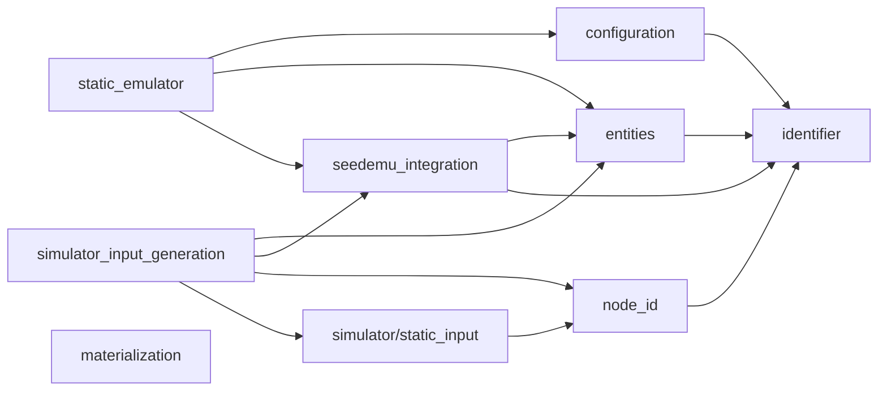
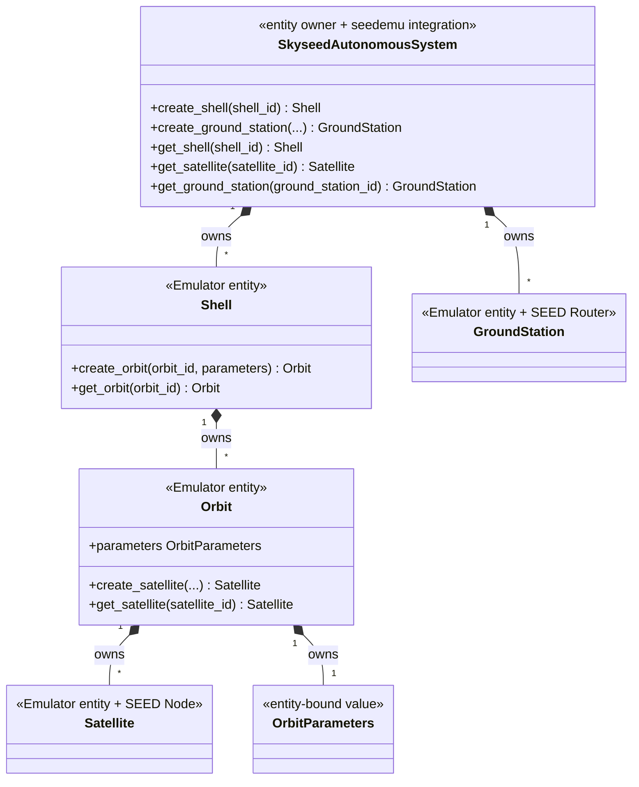
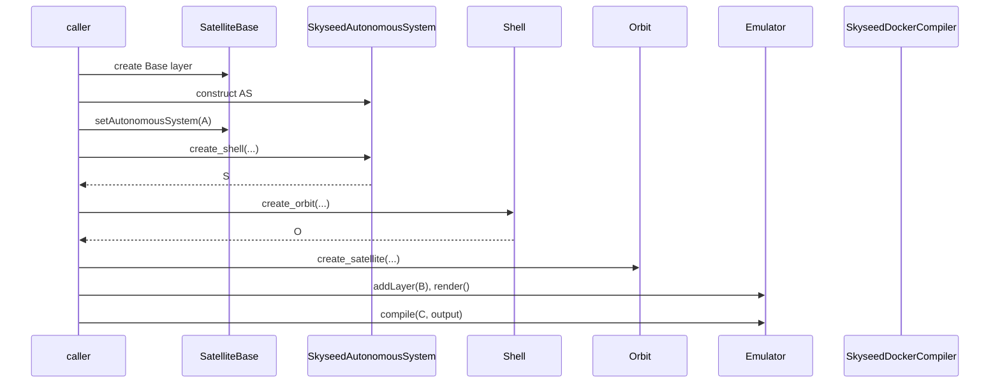
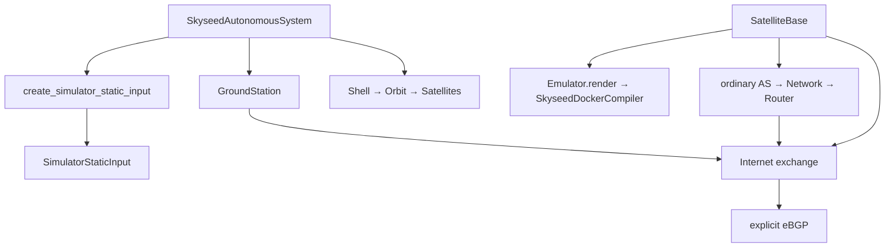
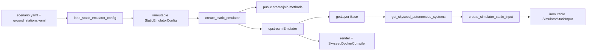
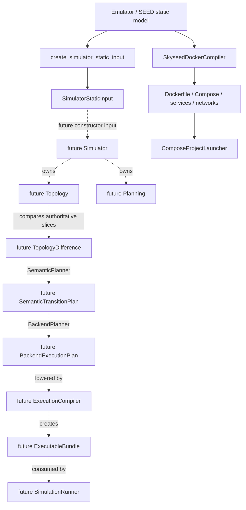
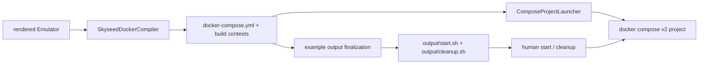

# Current Architecture Diagrams

Solid implemented nodes and arrows reflect current code. The Simulator static
input contract is **IMPLEMENTED**; dashed Simulator/dynamic nodes are conceptual
boundaries, not implementations or frozen public APIs. The top-level map is in
[`conceptual-class-diagrams.md`](conceptual-class-diagrams.md#simulator-future-conceptual-boundary-map).

## 1. Package dependency direction

There is no arrow from `simulator/static_input` to entities, seedemu integration
or upstream seedemu. `node_id` is the neutral cross-layer logical identity and
uses the general `identifier` validator. `materialization` is independent of
entities, static input and the `SkyseedDockerCompiler` implementation.

## 2. Entity ownership

## 3. Isolated example call chain

## 4. Complete example call chain

## 5. File-driven large call chain

## 6. Static Simulator-input boundary

```mermaid
flowchart LR
    AS[Iterable of SkyseedAutonomousSystem] --> WALK[shared private entity traversal]
    SAT[Satellite + OrbitParameters] --> WALK
    GS[GroundStation] --> WALK
    WALK --> DERIVE[one private NodeId derivation]
    DERIVE --> CA[create_simulator_static_input]
    CA --> SI[SatelliteSimulationInput + NodeId]
    CA --> GI[GroundStationSimulationInput + NodeId]
    SI --> INPUT[SimulatorStaticInput]
    GI --> INPUT
    INPUT --> SIM[future Simulator construction]
    SIM -. owns .-> TIMELINE[future SimulationTimeline]
    SIM -. owns .-> TOPOLOGY[future Topology]
    SIM -. owns .-> PLANNING[future Planning]
    TOPOLOGY -. creates and compares .-> SLICE[future Slice / Difference citing NodeId]
    SLICE -. consumed by .-> PLANNING
    PLANNING -. later approved plan .-> DYNAMIC[dynamic execution resolution]
    DYNAMIC -.->|NodeId.asn| BASE[SatelliteBase.getAutonomousSystem]
    BASE -. require Skyseed AS .-> OWNER[SkyseedAutonomousSystem]
    OWNER -. kind + entity_id .-> ENTITY[Satellite or GroundStation]
```

`SimulatorStaticInput` performs type validation, deterministic sorting,
duplicate-ID rejection, immutable snapshotting and read-only indexing only. It
does not traverse AS objects or call entity conversion and contains no entity
reference. It is construction boundary data, not the future Simulator's
long-lived domain graph. No unified NodeId-to-entity/resource mapping exists.
The dashed paths show approved ownership direction and future owner-directed
execution-boundary calls only; none of the Simulator, Timeline, Topology,
Planning, Slice, plan, resolution or dynamic update structures is implemented.

## 7. Static deployment and conceptual dynamic execution chains

The implemented static deployment compiler and the conceptual dynamic
`ExecutionCompiler` have different inputs, outputs, ownership and lifecycles;
they have no inheritance relationship or required shared public parent.
`ComposeProjectLauncher` is not the conceptual `SimulationRunner`. The old
`SimulationPlanCompiler` label is retained only as a **retired/corrected**
over-compression of semantic planning, backend planning and executable-form
compilation, not as a frozen master contract.

## 8. Generated experiment artifact and materialization

The Python entrypoint finalizes controls only after the current output is
complete. Generated scripts use the exact Compose file/project and never
reconstruct entities. `ComposeProjectLauncher` remains the programmatic,
state-verifying materialization adapter; it never recompiles the Emulator.
