# Initial Architecture Diagrams

这些图只表达当前确认的模块关系和信息流，不代表最终类图或最终 API。

Detailed conceptual class diagrams with responsibilities, key attributes and
methods are maintained in
[conceptual-class-diagrams.md](./conceptual-class-diagrams.md).

## 1. System boundary

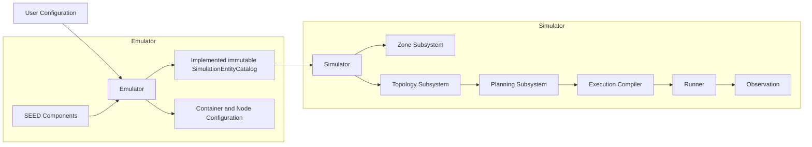

## 2. Simulator flow

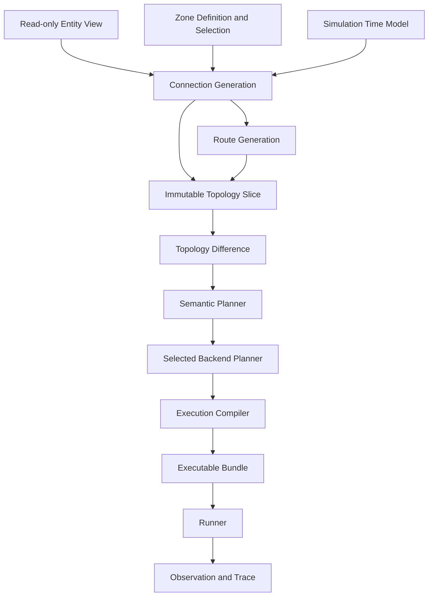

## 3. Planning layers

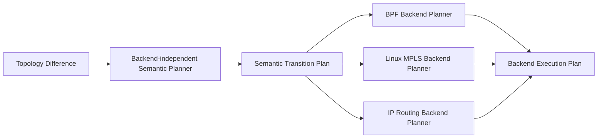

## 4. Emulator static hierarchy concept

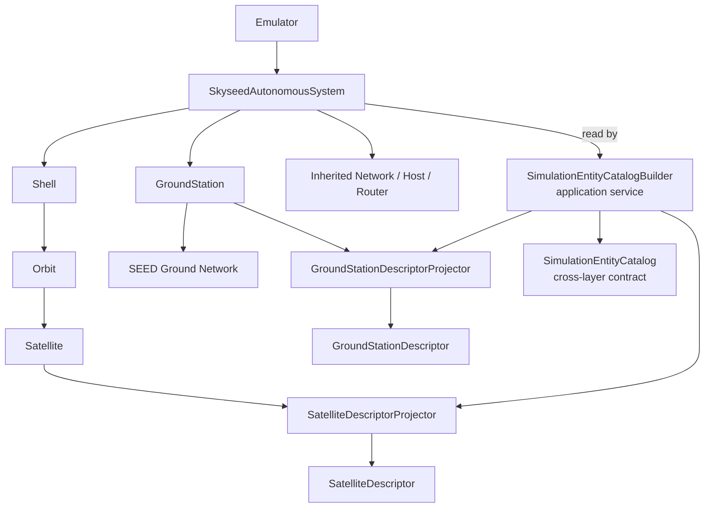

## 5. Implemented isolated Satellite boundary

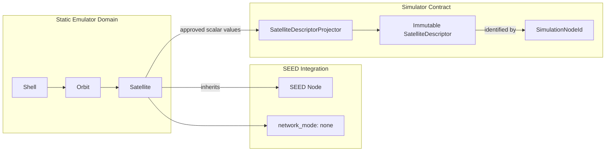

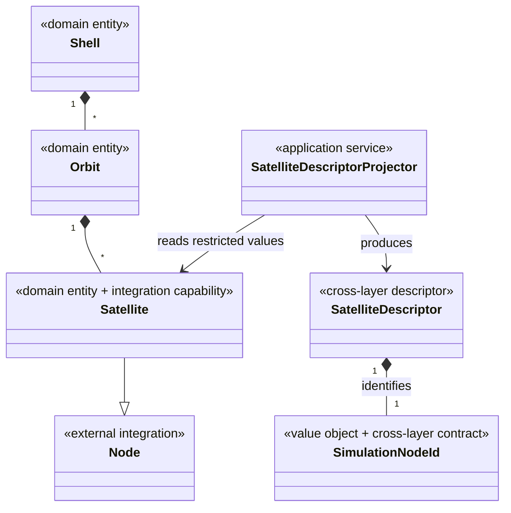

```text
Satellite(Node) -> SatelliteDescriptorProjector -> SatelliteDescriptor
```

## 6. Implemented static GroundStation boundary

该图记录当前已验证的单对象静态纵向路径；动态卫星侧能力仍未实现。

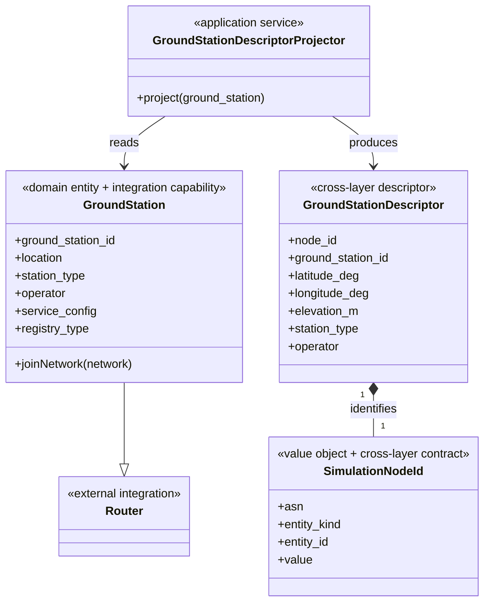

```text
Satellite(Node) -> SatelliteDescriptor
GroundStation(Router) -> GroundStationDescriptor
```

Simulator 只接收受限的 Descriptor。Router 继承方向已由标准 rnode、IX、
Routing/eBGP、Compiler 和真实容器验证；未来动态 GS 能力仍需独立设计。
`SimulationNodeId` 只表达 Simulator 逻辑身份，不表达图中 SEED Router 的
Registry、容器或执行目标身份。

## 7. Implemented unified AS and Compiler boundaries

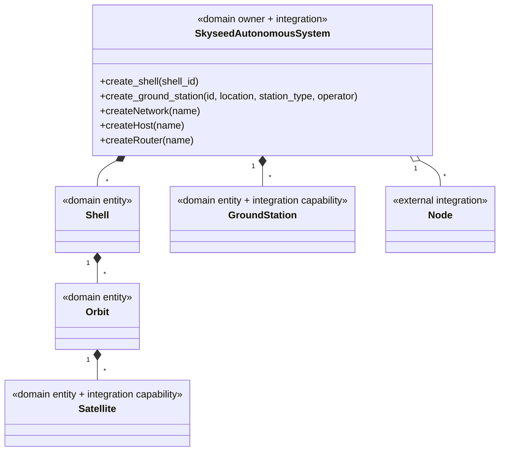

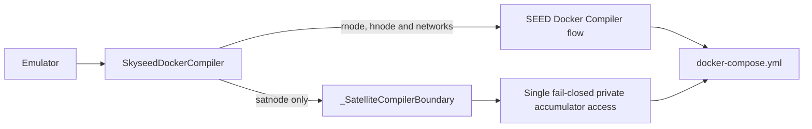

Compiler 只读取已经完成构造并 render 的 Emulator/Registry 状态，产生 Compose
artifact；它不创建 Shell、Orbit、Satellite 或 GroundStation。

`SkyseedDockerCompiler` 是唯一的公开 Skyseed Docker Compiler。Satellite 的
零接口特殊行为仍集中在内部边界；GroundStation 和普通 SEED 节点继续复用
上游路径。不存在按旧节点种类命名的公开 Compiler 别名。

## 8. Implemented static Emulator output boundary

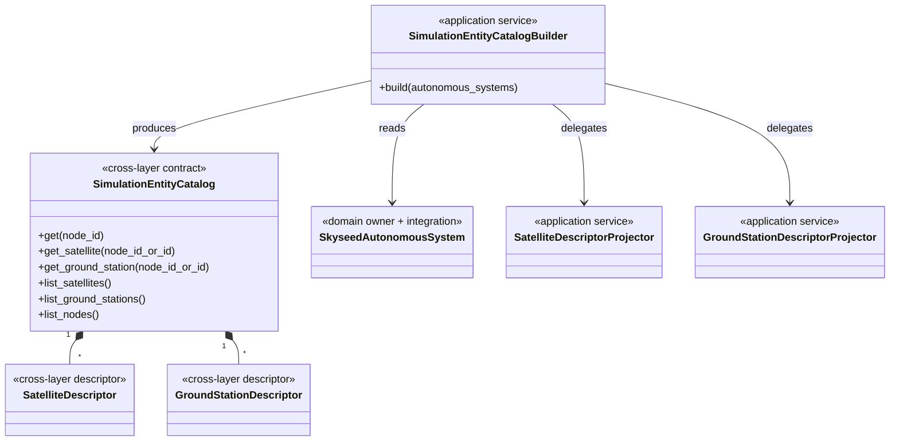

Builder 不读取 SEED Registry 或 Compiler output；Catalog 不包含 AS、Node、Router、
容器或可修改集合。普通 SEED AS 不会被解释成 Skyseed 实体。

## 9. Compiler artifact and materialization boundary

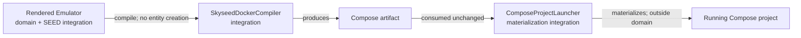

`ComposeProjectLauncher` 不进入 Emulator 所有权图、Descriptor、Catalog 或
Simulator 合同，也不反向调用 Loader、Applier 或 Compiler。
