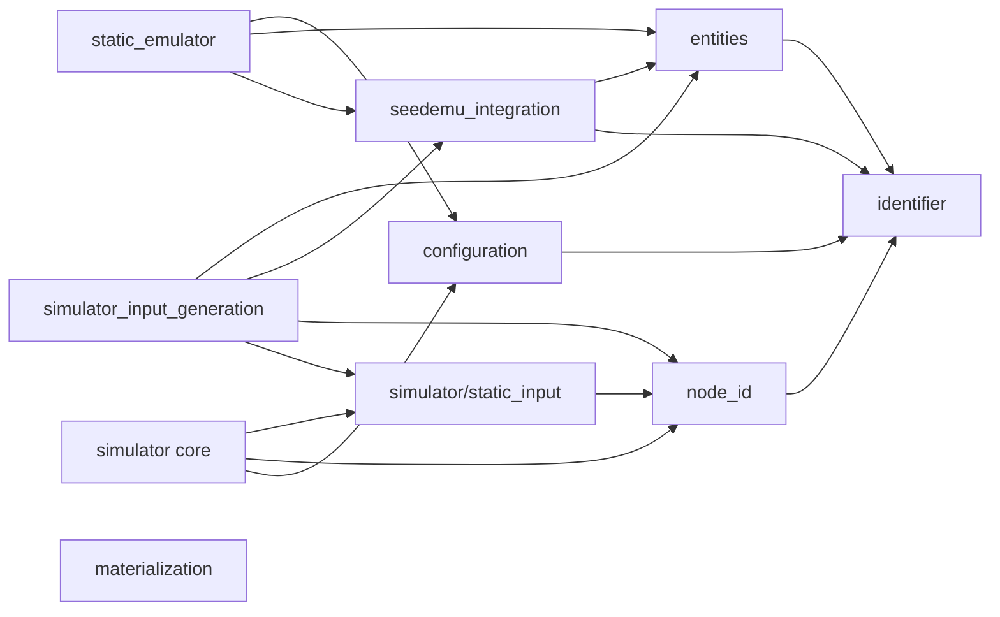
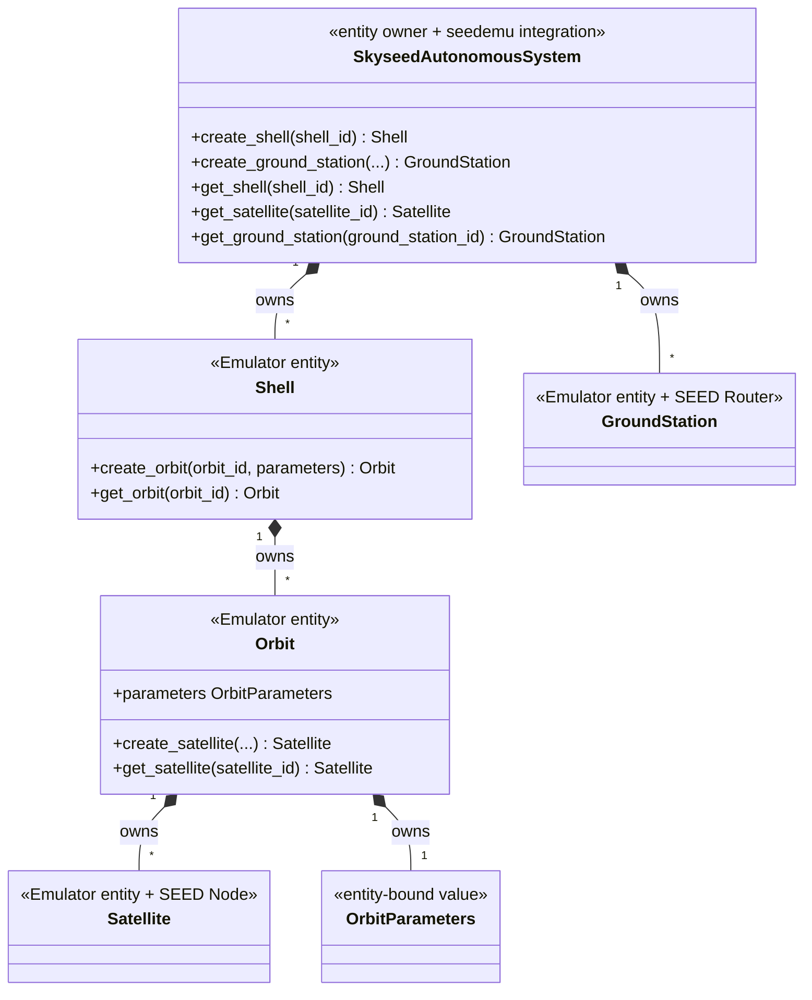
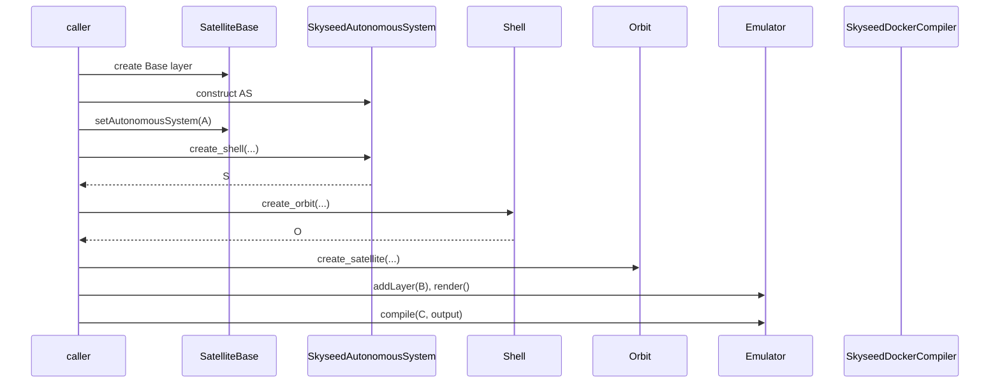
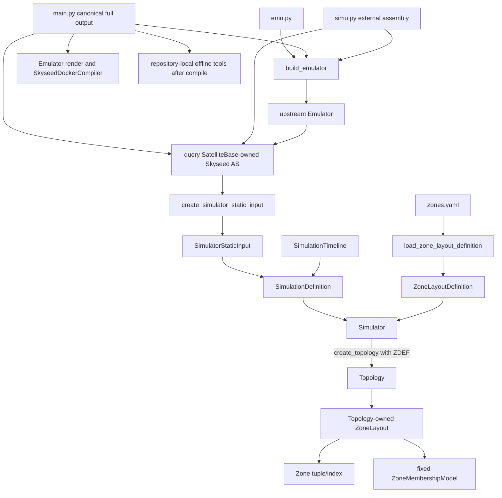
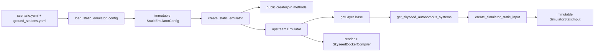
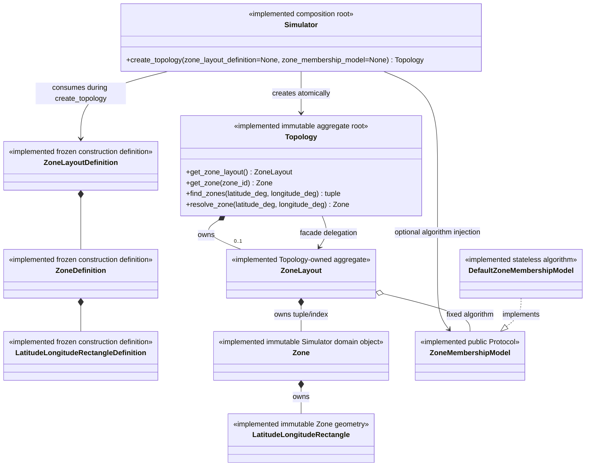
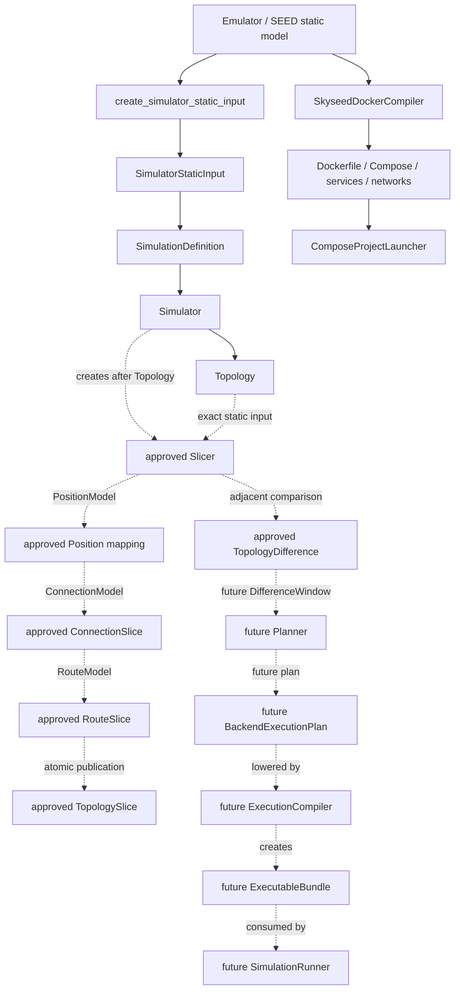
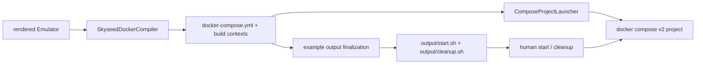

# Current Architecture Diagrams

Solid implemented nodes and arrows reflect current code. Accepted/frozen
Simulator Iteration 1 and Iteration 2 static Zones are **IMPLEMENTED**; dashed
dynamic-Slice nodes are **APPROVED / NOT IMPLEMENTED**, while dashed Planning
and backend nodes remain conceptual/open. The top-level map is in
[`conceptual-class-diagrams.md`](conceptual-class-diagrams.md#simulator-approved-dynamic-slice-boundary-map).

## 1. Package dependency direction

There is no arrow from `simulator` core or `simulator/static_input` to entities,
seedemu integration, upstream seedemu or `simulator_input_generation`. The
external generation adapter alone points to both the Emulator side and the
Simulator boundary. `node_id` is the neutral cross-layer logical identity and
uses the general `identifier` validator. `materialization` is independent of
entities, static input and the `SkyseedDockerCompiler` implementation.

## 2. Entity ownership

## 3. Isolated example call chain

## 4. Complete example call chain

`emu.py` only constructs and returns the Emulator. `main.py` is the canonical
full-output entrypoint: it creates the Emulator and Topology once, preserves
render/compile, then gives that same Topology to repository-local offline
tools. `simu.py` remains the independent readable assembly entrypoint and does
not import `main.py` or generate tool artifacts. Simulator core never imports
back across that boundary or into `tools`.

## 5. File-driven large call chain

## 6. Static Simulator-input boundary

```mermaid
flowchart LR
    AS[Iterable of SkyseedAutonomousSystem] --> WALK[shared private entity traversal]
    SAT[Satellite + OrbitParameters] --> WALK
    GS[GroundStation] --> WALK
    WALK --> DERIVE[one private NodeId derivation]
    DERIVE --> CA[create_simulator_static_input]
    CA --> SI[SatelliteSimulationInput + NodeId]
    CA --> GI[GroundStationSimulationInput + NodeId]
    SI --> INPUT[SimulatorStaticInput]
    GI --> INPUT
    INPUT --> DEF[SimulationDefinition.static_input]
    TIMELINE[SimulationTimeline] --> DEF
    DEF --> SIM[Simulator construction]
    SIM --> TOPOLOGY[Topology materialization]
    TOPOLOGY --> DOMAIN[immutable AS → Shell → Orbit → Satellite tree]
    TOPOLOGY --> GSOWN[AS-owned GroundStation objects]
    ZINPUT[zones.yaml or programmatic construction] --> ZDEF[ZoneLayoutDefinition]
    ZDEF --> SIM
    TOPOLOGY --> ZLAYOUT[optional Topology-owned ZoneLayout]
    ZLAYOUT --> ZONES[Zone tuple/index]
    ZLAYOUT --> ZMODEL[fixed ZoneMembershipModel]
    SIM -. approved ownership .-> SLICER[approved Slicer]
    SLICER -. exact reference .-> TOPOLOGY
    SLICER -. ordered generation .-> SLICE[approved TopologySlice]
    SLICER -. adjacent comparison .-> DIFF[approved TopologyDifference]
    DIFF -. future finite window .-> PLANNING[future Planning]
    PLANNING -. later approved plan .-> DYNAMIC[dynamic execution resolution]
    DYNAMIC -.->|NodeId.asn| BASE[SatelliteBase.getAutonomousSystem]
    BASE -. require Skyseed AS .-> OWNER[SkyseedAutonomousSystem]
    OWNER -. kind + entity_id .-> ENTITY[Satellite or GroundStation]
```

`SimulatorStaticInput` performs type validation, deterministic sorting,
duplicate-ID rejection, immutable input copying and read-only indexing only. It
does not traverse AS objects or call entity conversion and contains no entity
reference. Its lookups require `NodeId`; no local string-ID fallback exists. It
is construction boundary data, not the Simulator's long-lived domain graph.
The implemented Topology has one private unified `NodeId` index over its own
static nodes, never Emulator entities or runtime resources, plus at most one
ZoneLayout. Simulator, Timeline, Definition, Topology, the static node objects
and static Zone domain are implemented. Slicer, TopologySlice and
TopologyDifference are accepted contracts but not implemented; Planning,
dynamic resource-resolution and update structures remain conceptual/open.

## 7. Implemented Zone construction and ownership

The Definition is materialization input and is not retained. ZoneLayout is the
only owner of its Zone tuple and ID index; the Model receives those same Zone
instances and does not own another collection. A valid Topology may omit the
layout, and the algorithm reference cannot be replaced after construction.

## 8. Static deployment, approved Slice state and future execution

Solid arrows remain current implementation. Dashed Position through Difference
arrows are accepted public contracts awaiting Slices A through F; dashed
Planner/backend arrows remain deferred. Topology does not create or compare
Slices.

The implemented static deployment compiler and conceptual dynamic
`ExecutionCompiler` have different inputs, outputs, ownership and lifecycles;
they have no inheritance relationship or required shared public parent.
`ComposeProjectLauncher` is not the conceptual `SimulationRunner`. The old
`SimulationPlanCompiler` label is retained only as a **retired/corrected**
over-compression, not as a frozen master contract.

## 9. Generated experiment artifact and materialization

The Python entrypoint finalizes controls only after the current output is
complete. Generated scripts use the exact Compose file/project and never
reconstruct entities. `ComposeProjectLauncher` remains the programmatic,
state-verifying materialization adapter; it never recompiles the Emulator.
