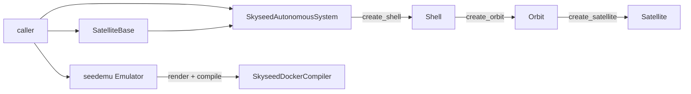
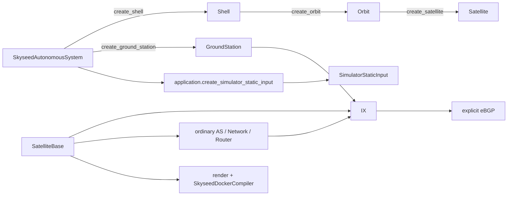
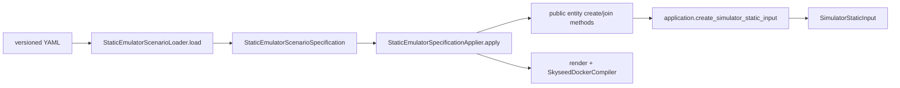

# Emulator Public Construction API

## Status and scope

The static Emulator construction API and package layout are implemented. This
document records the current code after the package-structure review. It does
not define or start Simulator behavior.

The ownership model is unchanged:

```text
SkyseedAutonomousSystem
├── Shell
│   └── Orbit
│       └── Satellite
└── GroundStation
```

## Package ownership

| Package | Responsibility | Main public imports |
| --- | --- | --- |
| `skyseed_v2.entities` | Emulator entities and tightly bound values | `Shell`, `Orbit`, `OrbitParameters`, `Satellite`, `GroundStation`, `GroundStationLocation` |
| `skyseed_v2.simulator_input` | Immutable static data supplied to the future Simulator | `SatelliteSimulationInput`, `GroundStationSimulationInput`, `SimulationNodeId`, `SimulatorStaticInput` |
| `skyseed_v2.seedemu_integration` | Skyseed-owned extensions of external seedemu | `SkyseedAutonomousSystem`, `SatelliteBase`, `SkyseedDockerCompiler` |
| `skyseed_v2.specifications` | Immutable construction inputs split by subject | all qualified `*Specification` types |
| `skyseed_v2.serialization` | Versioned YAML parsing into specifications | `StaticEmulatorScenarioLoader` |
| `skyseed_v2.application` | Application sequencing and entity-to-input conversion | `StaticEmulatorSpecificationApplier`, `StaticEmulatorApplyResult`, `create_satellite_simulation_input`, `create_ground_station_simulation_input`, `create_simulator_static_input` |
| `skyseed_v2.materialization` | Launch an already compiled Compose project | `ComposeProjectLauncher` |

These are ownership packages, not compatibility facades. The defining files
are discoverable from the primary class names.

## Simulator static-input design

The boundary is a frozen scalar snapshot with conversion owned by application:

```text
Satellite
  → application.create_satellite_simulation_input()
  → SatelliteSimulationInput

GroundStation
  → application.create_ground_station_simulation_input()
  → GroundStationSimulationInput

Iterable[SkyseedAutonomousSystem]
  → application.create_simulator_static_input()
  → SimulatorStaticInput
```

The entity types never import `simulator_input`. The input package imports no
entity, seedemu integration or upstream seedemu module. Application conversion
copies approved values and retains no entity reference. The aggregate function
accepts only Skyseed AS values and fails closed on ordinary SEED AS or unknown
objects. `SimulatorStaticInput` receives copied data, validates and sorts it,
rejects duplicate logical IDs and builds a read-only index; it neither
traverses AS objects nor recognizes SEED. No input retains Registry, container,
namespace, Compose, persistence or runtime Simulator objects.

The three direct functions replace both copying-only projector classes and the
short-lived input classmethods without introducing another service class.

## Public construction paths

### Handwritten isolated path



`examples/isolated_satellites/main.py` contains this path directly. It imports
no specification, serialization or application type.

### Handwritten complete path



`examples/complete_static_emulator/main.py` shows Satellite, GroundStation,
ordinary Router/Network, IX, eBGP, static Simulator input and Compiler in one
file without YAML or application orchestration.

### File-driven large path



`examples/large_static_network/main.py` is the only formal YAML example. The
Loader owns serialization; the Applier owns heterogeneous sequencing. Neither
is required for handwritten construction.

## Implemented class and API map

```mermaid
classDiagram
    class Emulator {
        <<upstream seedemu>>
        +addLayer(layer)
        +render()
        +compile(compiler, output)
    }
    class SkyseedAutonomousSystem {
        <<entity owner + integration>>
        +create_shell(shell_id) Shell
        +create_ground_station(...) GroundStation
        +satellites() tuple
        +ground_stations() tuple
    }
    class Shell {
        <<Emulator entity>>
        +create_orbit(orbit_id, parameters) Orbit
    }
    class Orbit {
        <<Emulator entity>>
        +create_satellite(...) Satellite
        +create_satellites(...) tuple
    }
    class OrbitParameters {
        <<entity-bound value>>
        +altitude_km
        +inclination_deg
        +right_ascension_deg
    }
    class Satellite {
        <<Emulator entity + SEED Node>>
        +satellite_id
        +orbit_parameters
    }
    class GroundStationLocation {
        <<entity-bound value>>
        +latitude_deg
        +longitude_deg
        +elevation_m
    }
    class GroundStation {
        <<Emulator entity + SEED Router>>
        +ground_station_id
        +location
    }
    class SimulationNodeId {
        <<Simulator-input value>>
        +asn
        +entity_kind
        +entity_id
    }
    class SatelliteSimulationInput {
        <<immutable Simulator input>>
    }
    class GroundStationSimulationInput {
        <<immutable Simulator input>>
    }
    class SimulatorStaticInput {
        <<immutable Simulator input aggregate>>
        +list_nodes() tuple
    }
    class SatelliteBase {
        <<seedemu integration>>
    }
    class SkyseedDockerCompiler {
        <<seedemu integration>>
    }
    class StaticEmulatorScenarioSpecification {
        <<input specification>>
    }
    class StaticEmulatorScenarioLoader {
        <<serialization adapter>>
        +load(path) StaticEmulatorScenarioSpecification
    }
    class StaticEmulatorSpecificationApplier {
        <<application service>>
        +apply(specification) StaticEmulatorApplyResult
    }
    class StaticEmulatorApplyResult {
        <<operation result>>
        +emulator
        +simulator_input
    }
    class ComposeProjectLauncher {
        <<materialization integration>>
        +launch(...) result
    }

    Emulator --> SatelliteBase : renders
    SatelliteBase *-- SkyseedAutonomousSystem : contains
    SkyseedAutonomousSystem "1" *-- "*" Shell : owns
    Shell "1" *-- "*" Orbit : owns
    Orbit "1" *-- "*" Satellite : owns
    Orbit *-- OrbitParameters : uses
    SkyseedAutonomousSystem "1" *-- "*" GroundStation : owns
    GroundStation *-- GroundStationLocation : uses
    SatelliteSimulationInput *-- SimulationNodeId : identifies
    GroundStationSimulationInput *-- SimulationNodeId : identifies
    SimulatorStaticInput *-- SatelliteSimulationInput : contains
    SimulatorStaticInput *-- GroundStationSimulationInput : contains
    StaticEmulatorScenarioLoader --> StaticEmulatorScenarioSpecification : creates
    StaticEmulatorSpecificationApplier --> StaticEmulatorScenarioSpecification : reads
    StaticEmulatorSpecificationApplier --> SimulatorStaticInput : creates through application conversion
    StaticEmulatorSpecificationApplier --> StaticEmulatorApplyResult : returns
    Emulator --> SkyseedDockerCompiler : compiles with
```



### Retained public-type proof

- Entities correspond to user-visible ownership and creation points.
- Entity-bound values are required by direct constructors.
- Static input types are the explicit, immutable future-Simulator boundary.
- Loader and Applier remain outside the root because handwritten callers do
  not need them.
- `StaticEmulatorApplyResult` remains application-only because no existing
  object owns all returned values.
- `ComposeProjectLauncher` remains outside Emulator construction and Compiler
  behavior.

### Root export list

```python
from skyseed_v2 import (
    GroundStation,
    GroundStationLocation,
    Orbit,
    OrbitParameters,
    Satellite,
    Shell,
)
```

Simulator static-input types are intentionally explicit subpackage imports:

```python
from skyseed_v2.simulator_input import (
    GroundStationSimulationInput,
    SatelliteSimulationInput,
    SimulationNodeId,
    SimulatorStaticInput,
)
```

## Rename and removal record

| Previous name/path | Current name/path | Disposition |
| --- | --- | --- |
| per-entity `*Descriptor` types | per-entity `*SimulationInput` types | renamed to state consumer and direction |
| stateless per-entity projector classes | direct `application.create_*_simulation_input()` functions | removed; conversion belongs to application without another class |
| input `from_satellite()` / `from_ground_station()` classmethods | direct application conversion functions | removed so input types remain pure data |
| entity-catalog aggregate | `SimulatorStaticInput` | renamed from collection metaphor to actual boundary role |
| separate catalog builder and aggregate classmethod | `application.create_simulator_static_input()` | removed; one direct fail-closed application function |
| `domain/` | `entities/` | renamed because the objects also carry SEED capability |
| `seed/` | `seedemu_integration/` | renamed to identify external integration ownership |
| root scenario loader/application modules | `serialization/` and `application/` | moved to explicit responsibility packages |
| monolithic specifications module | `specifications/{satellite,ground_station,network,scenario}.py` | split by input family |

No compatibility aliases remain for deleted classes or old import paths.

## API change summary

- Entity `create_*` methods and ownership relations are unchanged.
- Root imports keep only the six entity/value types. Static input types are
  imported from `skyseed_v2.simulator_input`; no root aliases remain.
- Entity-to-input conversion functions are imported from
  `skyseed_v2.application`.
- Integration imports now come from `skyseed_v2.seedemu_integration`.
- Loader and Applier imports now come from `skyseed_v2.serialization` and
  `skyseed_v2.application`.
- Specification package imports remain `skyseed_v2.specifications`; defining
  modules are now discoverable by subject.

## Review checklist

- [ ] The three examples expose the intended call chains.
- [ ] Entity ownership still matches AS → Shell → Orbit → Satellite and AS →
  GroundStation.
- [ ] Static Simulator inputs contain no entity or runtime-resource reference.
- [ ] `simulator_input` imports no entity, seedemu integration or upstream
      seedemu module.
- [ ] Current imports and filenames are understandable without source search.
- [ ] Simulator remains NOT STARTED.
