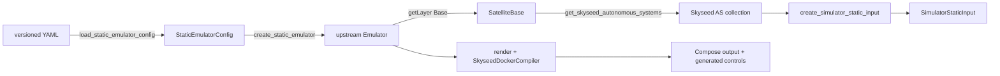

# Emulator Public Construction API

## Status and scope

Static Emulator configuration loading and construction are implemented. The
public file path is one direct chain; it creates the upstream
`seedemu.core.Emulator`, not a wrapper or Skyseed-specific Emulator subtype.
The Simulator static-input contract is **AVAILABLE** while Simulator algorithms
and engine remain **NOT STARTED**.

## Package ownership

| Path | Responsibility | Main public imports |
| --- | --- | --- |
| `skyseed_v2.entities` | Emulator entities and tightly bound values | `Shell`, `Orbit`, `OrbitParameters`, `Satellite`, `GroundStation`, `GroundStationLocation` |
| `skyseed_v2.configuration` | Frozen Config and auxiliary values plus strict YAML reading | `*Config`, `GeneratedOrbitLayout`, distribution/attachment/reference values, `load_static_emulator_config` |
| `skyseed_v2.static_emulator` | Stateless Config-to-Emulator operation | `create_static_emulator` |
| `skyseed_v2.seedemu_integration` | Skyseed extensions of upstream seedemu | `SkyseedAutonomousSystem`, `SatelliteBase`, `SkyseedDockerCompiler` |
| `skyseed_v2.node_id` | Neutral logical identity | `NodeId` |
| `skyseed_v2.simulator_input_generation` | Entity traversal and pure input copying | three input-generation functions |
| `skyseed_v2.simulator.static_input` | Simulator-owned immutable static input | three input types |
| `skyseed_v2.materialization` | Launch an already compiled Compose project | `ComposeProjectLauncher` |

The root package still exports only the six high-frequency entity/value names.
There is no top-level `emulator/` package, Builder, Factory, Loader class,
creation-result wrapper or compatibility facade.

## Configuration meaning and separation

`Config` means a frozen, validated declaration of how to construct the static
Emulator. It is not an entity, runtime state or universal application config.
File input and programmatic input both produce the same Config graph.

The configuration package separates three meanings without changing the YAML
schema:

```text
satellite.py       Shell / Orbit / Satellite declarations and generation values
ground_station.py GroundStation stable attributes and ID derivation rule
ground_network.py thin ordinary SEED AS / Network / Router / IX / eBGP adapter
attachments.py    node-to-existing-network attachment relations
static_emulator_config.py complete validated Config graph
yaml.py            YAML → Config only
```

The ordinary ground-network Config is intentionally narrow. At pinned upstream
seedemu 0.0.7, topology construction is imperative through `Base`,
`AutonomousSystem`, `Router` and routing-layer APIs. `Emulator.dump/load` is a
pickle of the entire Registry and replaces an Emulator's layers; it is not a
declarative, cross-file ground-network loader. Upstream example YAML files are
test-runner manifests, Kubernetes setup input or generated deployment files,
not reusable topology declarations.

GroundStation attributes, ordinary ground-network declarations and attachment
relations therefore remain distinct even though the unchanged v1 YAML nests
`ix_attachments` beside each node.

## Simulator static-input design

`SimulatorStaticInput` contains copied immutable values only. The adapter
accepts an iterable of `SkyseedAutonomousSystem`, walks the real ownership tree
and derives `NodeId`; the Simulator-owned input package never imports Config,
entities or seedemu.

The file-driven caller obtains the AS collection from its real owner:

```python
base = emulator.getLayer("Base")
skyseed_autonomous_systems = base.get_skyseed_autonomous_systems()
simulator_input = create_simulator_static_input(skyseed_autonomous_systems)
```

`SatelliteBase.get_skyseed_autonomous_systems()` is a narrow read-only query.
It composes upstream `Base.getAsns()` and `Base.getAutonomousSystem()` and keeps
no second collection or global index.

`NodeId` remains a pure cross-layer value. Any future dynamic execution will
resolve its ASN through the Base owner and then use the existing narrow AS,
Shell and Orbit queries. No Simulator algorithm, dynamic plan, resource
resolver or runtime updater exists.

## Static deployment and conceptual dynamic execution stages

```text
rendered Emulator → SkyseedDockerCompiler → Docker/Compose static deployment

future TopologyDifference
  → SemanticPlanner → BackendPlanner → ExecutionCompiler → Runner
```

`SkyseedDockerCompiler` is implemented and does not read Config. The dynamic
names are conceptual candidates. `SimulationPlanCompiler` remains only the
retired/corrected label for a formerly over-compressed dynamic chain.

## Public construction paths

### Handwritten isolated path


### Handwritten complete path

The complete example adds ordinary SEED Network/Router/IX/eBGP objects and a
GroundStation using the same public owner methods, then passes `(skyseed_as,)`
to `create_simulator_static_input()`.

### File-driven large path



The exact public sequence is:

```python
config = load_static_emulator_config(path)
emulator = create_static_emulator(config)
base = emulator.getLayer("Base")
skyseed_autonomous_systems = base.get_skyseed_autonomous_systems()
simulator_input = create_simulator_static_input(skyseed_autonomous_systems)
emulator.render()
emulator.compile(...)
```

`create_static_emulator(config)` is the only module operation that knows both
Config and real entity/seedemu construction APIs. It creates IX and ordinary
ground networks, creates Skyseed entities, applies attachment relations,
configures routing layers and returns the actual upstream Emulator.

## Implemented class and API map


### Retained public-type proof

- Config types are the typed and validated programmatic/file-equivalent input.
- Distribution, attachment and reference values have narrower names because
  they are components of Config rather than independent configuration roots.
- `SatelliteBase` owns AS lifecycle and therefore owns the narrow AS query.
- `create_static_emulator` is a function because it has no state or lifecycle.
- No result wrapper or Emulator subclass is necessary.

### Root export list

```python
from skyseed_v2 import (
    GroundStation,
    GroundStationLocation,
    Orbit,
    OrbitParameters,
    Satellite,
    Shell,
)
```

Owner imports remain explicit:

```python
from skyseed_v2.configuration import load_static_emulator_config
from skyseed_v2.static_emulator import create_static_emulator
from skyseed_v2.simulator_input_generation import create_simulator_static_input
```

## Rename and removal record

| Previous name/path | Current name/path | Reason/disposition |
| --- | --- | --- |
| `static_emulator_creation.py` | `static_emulator.py` | the qualified function already states the operation; the module names its exact product |
| `StaticEmulatorCreationResult` | removed | the function returns the real upstream Emulator; AS values come from `SatelliteBase` |
| `OrbitGenerationConfig` | `GeneratedOrbitLayout` | generated layout value nested in `ShellConfig`, not an independent Config |
| `RaanDistributionConfig` | `RightAscensionDistribution` | expands the acronym and names an auxiliary value |
| `InOrbitPhaseDistributionConfig` | `InOrbitPhaseDistribution` | auxiliary distribution value |
| attachment/reference `*Config` names | `InternetExchangeAttachment`, `LocalNetworkAttachment`, `EbgpRouterReference` | relation/reference values are not independent Config roots |
| `configuration/network.py` | `configuration/ground_network.py` + `attachments.py` | separates ordinary ground declarations from attachment relations |
| `ShellConfig.generation` / `.orbits` | `.generated_orbit_layout` / `.explicit_orbits` | makes the XOR modes explicit in Python |
| generated `.raan` / `.phase` | `.right_ascension_distribution` / `.in_orbit_phase_distribution` | removes ambiguous abbreviations in Python |
| eBGP `.first` / `.second` | `.peer_routers` | current `unfiltered` relationship is symmetric; YAML keys remain unchanged |

There are no compatibility aliases. YAML schema version and keys remain
unchanged, including `generation`, `orbits`, `raan`, `phase`, `first` and
`second`.

## API change summary

- `create_static_emulator(config) -> seedemu.core.Emulator` directly.
- `SatelliteBase.get_skyseed_autonomous_systems()` supplies the only required
  AS collection query from the real owner.
- Config remains the public declaration concept; only auxiliary values lose
  misleading `Config` suffixes.
- Ordinary ground-network Config remains a thin adapter because upstream has
  no reusable declarative topology file API at the pinned commit.
- YAML has one complete entry and no fragment loader, schema v2 or TLE path.
- Entity creation APIs, Simulator input, compiler, materialization and runtime
  responsibilities are unchanged.

## Review checklist

- [ ] YAML → Config → upstream Emulator is one direct path.
- [ ] `create_static_emulator` returns an `Emulator`, with no second `.emulator`.
- [ ] AS collections are queried from `SatelliteBase` without a new index.
- [ ] Config/YAML modules do not depend on entities, seedemu or Simulator.
- [ ] Entities and Simulator static input do not import configuration.
- [ ] No creation result, Emulator subclass, Builder/Factory/Loader class,
      fragment loader or compatibility alias exists.
- [ ] YAML schema version, keys and fixtures remain unchanged.
- [ ] Handwritten, programmatic Config and YAML construction converge on the
      same owner APIs and deployment semantics.
- [ ] Simulator algorithms and engine remain NOT STARTED.
