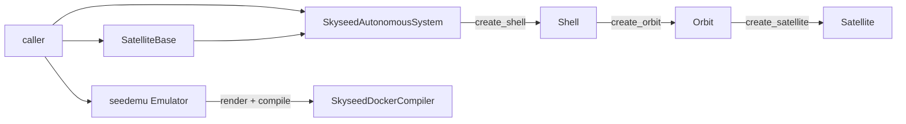
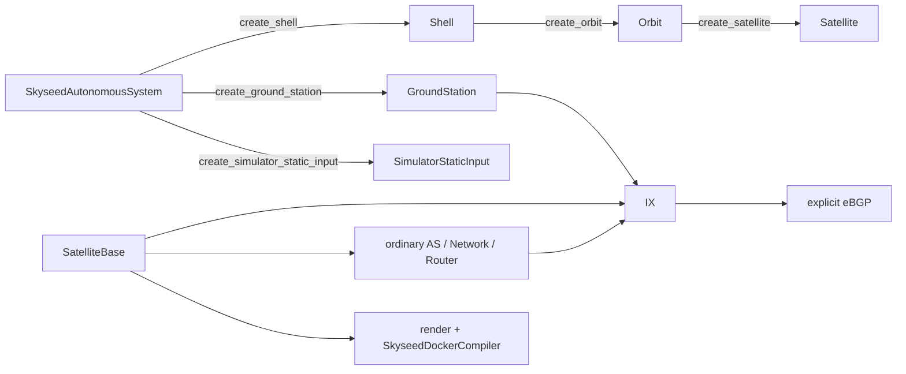
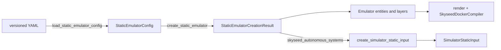
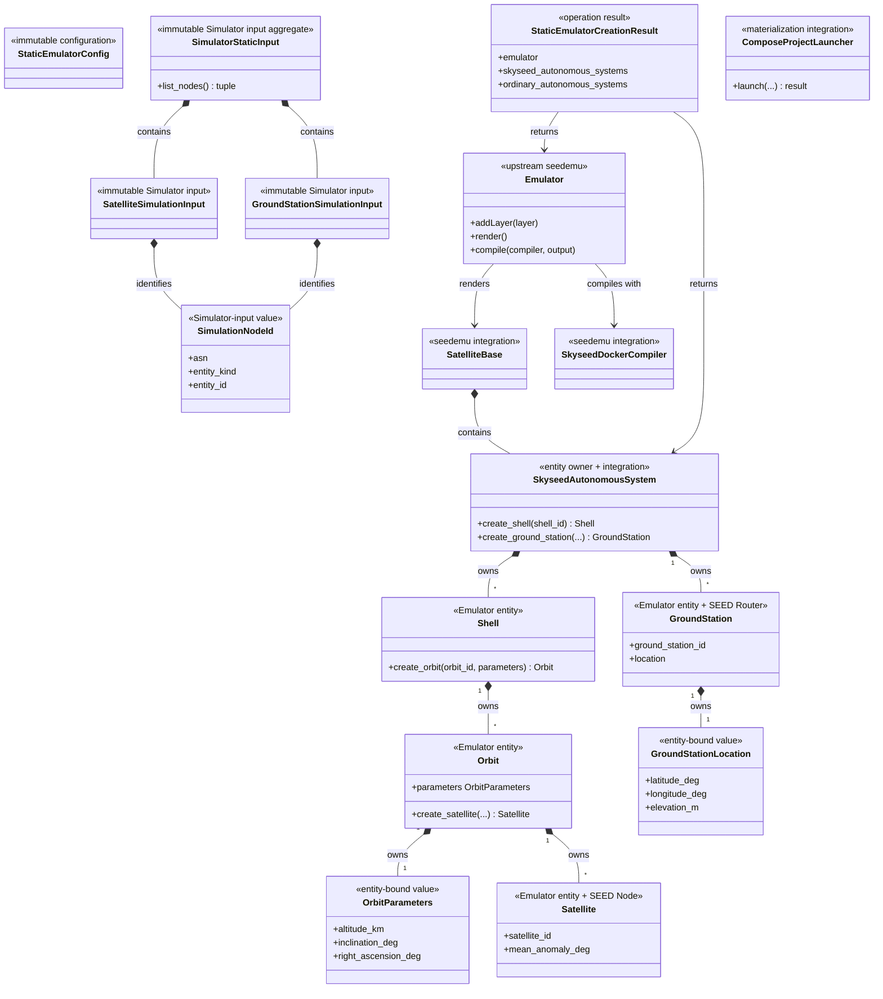

# Emulator Public Construction API

## Status and scope

The static Emulator construction API, domain-data ownership and file-driven
configuration boundary are implemented. Simulator remains **NOT STARTED**.
No entity relationship or Emulator behavior changed:

```text
SkyseedAutonomousSystem
├── Shell
│   └── Orbit
│       └── Satellite
└── GroundStation
```

## Package ownership

| Path | Responsibility | Main public imports |
| --- | --- | --- |
| `skyseed_v2.entities` | Emulator entities and tightly bound values | `Shell`, `Orbit`, `OrbitParameters`, `Satellite`, `GroundStation`, `GroundStationLocation` |
| `skyseed_v2.configuration` | Frozen Config values and versioned YAML loading | qualified `*Config` values, `load_static_emulator_config` |
| `skyseed_v2.static_emulator` | Config-to-Emulator creation operation | `create_static_emulator`, `StaticEmulatorCreationResult` |
| `skyseed_v2.simulator_input_generation` | Entity traversal and entity-to-input copying | three `create_*_simulation_input` / aggregate functions |
| `skyseed_v2.simulator_input` | Immutable static data supplied to the future Simulator | `SatelliteSimulationInput`, `GroundStationSimulationInput`, `SimulationNodeId`, `SimulatorStaticInput` |
| `skyseed_v2.seedemu_integration` | Skyseed-owned extensions of external seedemu | `SkyseedAutonomousSystem`, `SatelliteBase`, `SkyseedDockerCompiler` |
| `skyseed_v2.materialization` | Launch an already compiled Compose project | `ComposeProjectLauncher` |

These are ownership modules, not compatibility facades. The package root
still exposes only the six high-frequency entity/value names.

## Domain-data ownership

`OrbitParameters` is defined beside `Orbit` in `entities/orbit.py`. One Orbit
owns one frozen value containing altitude, inclination and right ascension.
Every Satellite in that Orbit shares those values through ownership; the
Satellite does not copy them and does not retain an Orbit reference.

`Satellite` owns only its identity, Shell/Orbit identifiers, index, mean
anomaly, payload and inherited SEED Node capability. `GroundStationLocation`
remains beside GroundStation because it is similarly bound to that entity and
is not shared by a separate owner.

## Simulator static-input design

The input package contains pure immutable data. Conversion and traversal live
outside it:

```text
Satellite + owning OrbitParameters
  → create_satellite_simulation_input(satellite, orbit_parameters)
  → SatelliteSimulationInput

GroundStation
  → create_ground_station_simulation_input(ground_station)
  → GroundStationSimulationInput

Iterable[SkyseedAutonomousSystem]
  → create_simulator_static_input(skyseed_autonomous_systems)
  → SimulatorStaticInput
```

The aggregate function accepts only `SkyseedAutonomousSystem` values, then
traverses AS → Shell → Orbit → Satellite. That traversal is where the owning
Orbit's parameters and each Satellite's own fields are combined. Ground
Stations are copied directly from each AS. Ordinary SEED ASes and unknown
objects fail closed.

`SimulatorStaticInput` receives already copied values, validates their types,
sorts deterministically, rejects duplicate logical IDs and builds a read-only
index. It does not traverse entities. No input retains an entity, Registry,
container, namespace, Compose, persistence or runtime Simulator object.

## Public construction paths

### Handwritten isolated path



`examples/isolated_satellites/main.py` shows this path directly and contains no
YAML/configuration flow.

### Handwritten complete path



`examples/complete_static_emulator/main.py` exposes Satellite, GroundStation,
ordinary Router/Network, IX, eBGP, static Simulator input and Compiler in one
file. Only `(skyseed_as,)` enters static-input generation.

### File-driven large path



The exact public sequence is:

`load_static_emulator_config(path)` → `create_static_emulator(config)` →
`create_simulator_static_input(creation.skyseed_autonomous_systems)`.

```python
config = load_static_emulator_config(path)
creation = create_static_emulator(config)
simulator_input = create_simulator_static_input(
    creation.skyseed_autonomous_systems
)
```

`create_static_emulator(config)` creates only Emulator entities and layers.
Its result has exactly `emulator`, `skyseed_autonomous_systems` and
`ordinary_autonomous_systems`; static-input generation is visibly separate.

## Implemented class and API map



### Retained public-type proof

- Entities correspond to user-visible ownership and creation points.
- Entity-bound values are required by direct construction.
- Config values make file/programmatic construction explicit and immutable.
- Static input types are the immutable future-Simulator boundary.
- `StaticEmulatorCreationResult` is module-public because the creation
  operation returns three independently owned values; it is not a root export.
- `ComposeProjectLauncher` remains outside Emulator construction and Compiler
  behavior.

### Root export list

```python
from skyseed_v2 import (
    GroundStation,
    GroundStationLocation,
    Orbit,
    OrbitParameters,
    Satellite,
    Shell,
)
```

Static-input types and operations use explicit owner imports:

```python
from skyseed_v2.configuration import load_static_emulator_config
from skyseed_v2.static_emulator import create_static_emulator
from skyseed_v2.simulator_input_generation import create_simulator_static_input
from skyseed_v2.simulator_input import SimulatorStaticInput
```

## Rename and removal record

| Previous name/path | Current name/path | Reason/disposition |
| --- | --- | --- |
| `Satellite.orbit_parameters` / `_orbit_parameters` | removed | shared data belongs to the owning Orbit |
| `entities/orbit_parameters.py` | `entities/orbit.py` | the value and its sole owner are tightly bound |
| `*Specification` | one-to-one `*Config` | names the actual role without DDD/input ambiguity |
| `specifications/` | `configuration/` | makes the file/programmatic boundary discoverable |
| stateless YAML reader class | `load_static_emulator_config(path)` | one direct operation needs no public class |
| stateless Config application class | `create_static_emulator(config)` | one direct operation needs no public class |
| four-field apply result | `StaticEmulatorCreationResult` | creation has only three outputs; Simulator input is separate |
| `application/simulator_static_input.py` | `simulator_input_generation.py` | direct cross-layer functions, no abstract application package |
| `application/static_scenario_application.py` | `static_emulator.py` | file name follows the operation it implements |
| `serialization/static_emulator_yaml_loader.py` | `configuration/yaml.py` | YAML reading belongs with Config values |
| per-entity projector classes | direct `create_*_simulation_input` functions | no state or reusable abstraction existed |
| input `from_*` classmethods | direct generation functions | input types remain pure data |

No compatibility aliases remain for deleted classes, types or old imports.

## API change summary

- Entity ownership remains AS → Shell → Orbit → Satellite and AS →
  GroundStation. Entity `create_*` behavior is unchanged.
- `Satellite` construction no longer accepts or stores `OrbitParameters`.
- All `*Specification` imports change one-to-one to `*Config` from
  `skyseed_v2.configuration`.
- File loading is a function import from `skyseed_v2.configuration`.
- Emulator creation and Simulator-input generation are two separate direct
  module imports and calls.
- Root exports remain the same six entity/value names.

## Review checklist

- [ ] Orbit alone owns common orbital parameters.
- [ ] The three examples expose the intended call chains.
- [ ] Static Simulator inputs contain no entity or runtime-resource reference.
- [ ] `simulator_input` imports no entity, seedemu integration or upstream
      seedemu module.
- [ ] `StaticEmulatorCreationResult` has exactly three fields.
- [ ] No old class, type or import alias survives.
- [ ] Simulator remains NOT STARTED.
