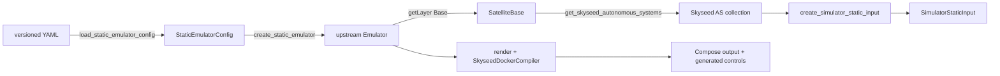
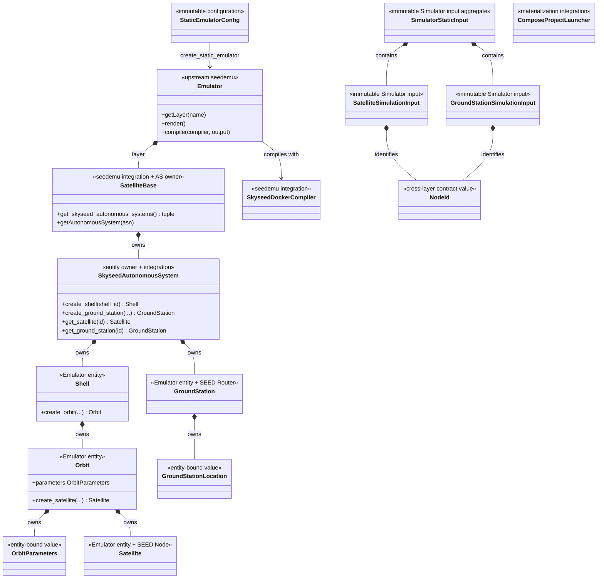
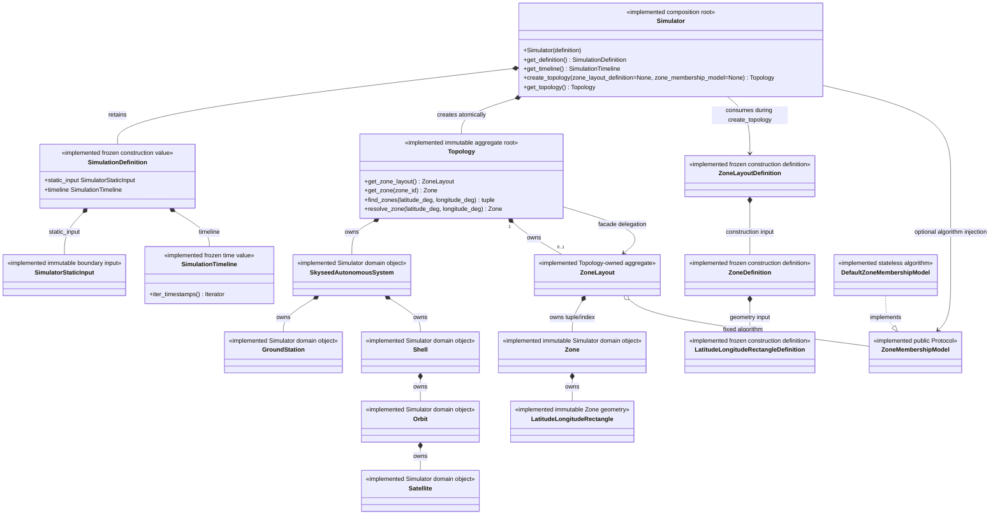

# Emulator Public Construction API

## Status and scope

Static Emulator configuration loading and construction are implemented. The
public file path is one direct chain; it creates the upstream
`seedemu.core.Emulator`, not a wrapper or Skyseed-specific Emulator subtype.
The Simulator static-input contract, accepted/frozen Iteration 1
composition/time/static Topology and Iteration 2 static Zone domain are
**IMPLEMENTED**. Satellite position, service-Satellite selection, dynamic
Topology, Planning and execution remain **NOT STARTED**.

## Package ownership

| Path | Responsibility | Main public imports |
| --- | --- | --- |
| `skyseed_v2.entities` | Emulator entities and tightly bound values | `Shell`, `Orbit`, `OrbitParameters`, `Satellite`, `GroundStation`, `GroundStationLocation` |
| `skyseed_v2.configuration` | Frozen Config/Definition and auxiliary values plus strict YAML reading | `*Config`, Zone Definitions, distribution/attachment/reference values, `load_static_emulator_config`, `load_zone_layout_definition` |
| `skyseed_v2.static_emulator` | Stateless Config-to-Emulator operation | `create_static_emulator` |
| `skyseed_v2.seedemu_integration` | Skyseed extensions of upstream seedemu | `SkyseedAutonomousSystem`, `SatelliteBase`, `SkyseedDockerCompiler` |
| `skyseed_v2.node_id` | Neutral logical identity | `NodeId` |
| `skyseed_v2.simulator_input_generation` | Entity traversal and pure input copying | three input-generation functions |
| `skyseed_v2.simulator.static_input` | receiving-side immutable cross-layer boundary input | three input types |
| `skyseed_v2.simulator` | Simulator definition, time, composition root, immutable static Topology and Zone domain | `SimulationDefinition`, `SimulationTimeline`, `Simulator`, `Topology`, five static node types and five Zone domain/Model types |
| `skyseed_v2.materialization` | Launch an already compiled Compose project | `ComposeProjectLauncher` |

The root package still exports only the six high-frequency entity/value names.
There is no top-level `emulator/` package, Builder, Factory, Loader class,
creation-result wrapper or compatibility facade. Zone types likewise remain
public only from their owning modules and are not root exports.

## Configuration meaning and separation

`Config` means a frozen, validated declaration of how to construct the static
Emulator. It is not an entity, runtime state or universal application config.
File input and programmatic input both produce the same Config graph.

The configuration package separates three meanings without changing the YAML
schema:

```text
satellite.py       Shell / Orbit / Satellite declarations and generation values
ground_station.py GroundStation stable attributes and ID derivation rule
ground_network.py thin ordinary SEED AS / Network / Router / IX / eBGP adapter
attachments.py    node-to-existing-network attachment relations
static_emulator_config.py complete validated Config graph
zone.py            Zone layout materialization Definitions
yaml.py            YAML → Config or ZoneLayoutDefinition only
```

The ordinary ground-network Config is intentionally narrow. At pinned upstream
seedemu 0.0.7, topology construction is imperative through `Base`,
`AutonomousSystem`, `Router` and routing-layer APIs. `Emulator.dump/load` is a
pickle of the entire Registry and replaces an Emulator's layers; it is not a
declarative, cross-file ground-network loader. Upstream example YAML files are
test-runner manifests, Kubernetes setup input or generated deployment files,
not reusable topology declarations.

GroundStation attributes, ordinary ground-network declarations and attachment
relations therefore remain distinct even though the unchanged v1 YAML nests
`ix_attachments` beside each node.

Zone YAML follows a separate direct path:

```text
raw YAML mapping/list
→ LatitudeLongitudeRectangleDefinition
→ ZoneDefinition
→ ZoneLayoutDefinition
```

`load_zone_layout_definition(path)` returns that final Definition directly.
YAML is only the input source; programmatic callers construct the same three
public Definition types, and both paths converge before Simulator. There is no
file-specific Zone domain type. Zone Definitions are materialization input and
do not enter Topology's long-lived object tree.

## Simulator static-input design

`SimulatorStaticInput` contains copied immutable values only. The adapter
accepts an iterable of `SkyseedAutonomousSystem`, walks the real ownership tree
and derives `NodeId`; the receiving-side input package never imports Config,
entities or seedemu.

The file-driven caller obtains the AS collection from its real owner:

```python
base = emulator.getLayer("Base")
skyseed_autonomous_systems = base.get_skyseed_autonomous_systems()
simulator_input = create_simulator_static_input(skyseed_autonomous_systems)
```

`SatelliteBase.get_skyseed_autonomous_systems()` is a narrow read-only query.
It composes upstream `Base.getAsns()` and `Base.getAutonomousSystem()` and keeps
no second collection or global index.

`SimulatorStaticInput.get(...)`, `get_satellite(...)` and
`get_ground_station(...)` accept only complete `NodeId` values. They do not
scan `entity_id` strings or provide a string fallback.

`NodeId` remains a pure cross-layer value. Any future dynamic execution will
resolve its ASN through the Base owner and then use the existing narrow AS,
Shell and Orbit queries. No Simulator algorithm, dynamic plan, resource
resolver or runtime updater exists.

## Static deployment and conceptual dynamic execution stages

```text
rendered Emulator
  → SkyseedDockerCompiler
  → compiled Docker/Compose project
  → ComposeProjectLauncher

future TopologyDifference
  → SemanticPlanner
  → SemanticTransitionPlan
  → BackendPlanner
  → BackendExecutionPlan
  → ExecutionCompiler
  → ExecutableBundle
  → SimulationRunner
```

`SkyseedDockerCompiler` is implemented and does not read Config. The dynamic
names are conceptual/open. `SimulationPlanCompiler` remains only the
retired/corrected label for a formerly over-compressed dynamic chain.

## Public construction paths

### Handwritten isolated path


### Handwritten complete path

The complete example has three explicit files and no entrypoint-to-entrypoint
import:

```text
emu.py  → build_emulator() → upstream Emulator
main.py → build_emulator() → one Simulator/Topology → render/compile → tools
simu.py → build_emulator()
        → query SatelliteBase-owned Skyseed AS values
        → create_simulator_static_input(...)
        → SimulationDefinition
        → Simulator
zones.yaml → load_zone_layout_definition(...)
        → ZoneLayoutDefinition
Simulator.create_topology(zone_layout_definition=...)
        → Topology-owned ZoneLayout
        → Zone[] + fixed ZoneMembershipModel
        → Topology facade
```

`build_emulator()` returns only the upstream Emulator. `main.py` is the
canonical full-output path: it assembles one Simulator/Topology from that same
Emulator, preserves render/compile, then runs repository-local offline tools.
`simu.py` is independent external assembly across the Emulator side, thin
adapter and Simulator side; it does not import `main.py` or generate tools. The Definition
could instead be constructed programmatically without changing the Simulator
materialization contract.

### File-driven large path



The exact public sequence is:

```python
config = load_static_emulator_config(path)
emulator = create_static_emulator(config)
base = emulator.getLayer("Base")
skyseed_autonomous_systems = base.get_skyseed_autonomous_systems()
simulator_input = create_simulator_static_input(skyseed_autonomous_systems)
emulator.render()
emulator.compile(...)
```

`create_static_emulator(config)` is the only module operation that knows both
Config and real entity/seedemu construction APIs. It creates IX and ordinary
ground networks, creates Skyseed entities, applies attachment relations,
configures routing layers and returns the actual upstream Emulator.

## Implemented class and API map



### Retained public-type proof

- Config types are the typed and validated programmatic/file-equivalent input.
- Distribution, attachment and reference values have narrower names because
  they are components of Config rather than independent configuration roots.
- `SatelliteBase` owns AS lifecycle and therefore owns the narrow AS query.
- `create_static_emulator` is a function because it has no state or lifecycle.
- No result wrapper or Emulator subclass is necessary.

## Simulator public contract through Iteration 2



The public constructors and facade methods are:

| Type | Public construction / operations |
| --- | --- |
| `SimulationTimeline` | `SimulationTimeline(start_time, end_time, slice_interval)`; `is_bounded`; `iter_timestamps()` |
| `SimulationDefinition` | `SimulationDefinition(static_input, timeline)` |
| `LatitudeLongitudeRectangleDefinition` | `LatitudeLongitudeRectangleDefinition(south_latitude_deg, north_latitude_deg, west_longitude_deg, east_longitude_deg)` |
| `ZoneDefinition` | `ZoneDefinition(*, zone_id, priority=0, geometry)` |
| `ZoneLayoutDefinition` | `ZoneLayoutDefinition(zones, allow_overlap)`; `zones` is normalized to a deterministic tuple |
| `load_zone_layout_definition` | `load_zone_layout_definition(path: Path) -> ZoneLayoutDefinition` |
| `Simulator` | `Simulator(definition)`; `get_definition()`; `get_timeline()`; `create_topology(*, zone_layout_definition=None, zone_membership_model=None)`; `get_topology()` |
| `Topology` | direct construction is blocked; existing static-node facade; `get_zone_layout()`; `get_zone(zone_id)`; `find_zones(latitude_deg, longitude_deg)`; `resolve_zone(latitude_deg, longitude_deg)` |
| Simulator `SkyseedAutonomousSystem` | direct construction is blocked; `asn`; `shells`; `ground_stations`; owner-local `get_shell(shell_id)` and `get_ground_station(node_id)` |
| Simulator `Shell` | direct construction is blocked; `asn`; `shell_id`; `orbits`; owner-local `get_orbit(orbit_id)` |
| Simulator `Orbit` | direct construction is blocked; identity/orbit-parameter properties; `satellites`; owner-local `get_satellite(node_id)` |
| Simulator `Satellite` | `Satellite(node_id, orbit_index, mean_anomaly_deg)`; `satellite_id` |
| Simulator `GroundStation` | `GroundStation(node_id, latitude_deg, longitude_deg, elevation_m, station_type, operator)`; `ground_station_id` |
| `LatitudeLongitudeRectangle` | `LatitudeLongitudeRectangle(south_latitude_deg, north_latitude_deg, west_longitude_deg, east_longitude_deg)`; bound properties; `representative_center`; `contains(latitude_deg, longitude_deg) -> bool` |
| `Zone` | `Zone(zone_id, priority, geometry)`; frozen fields; `contains(latitude_deg, longitude_deg) -> bool` |
| `ZoneMembershipModel` | runtime-checkable Protocol: `find_zones(zones, latitude_deg, longitude_deg) -> Iterable[Zone]`; `resolve_zone(matches, latitude_deg, longitude_deg) -> Zone` |
| `DefaultZoneMembershipModel` | `DefaultZoneMembershipModel()`; stateless implementations of both Protocol methods |
| `ZoneLayout` | direct construction is blocked; `zones`; `allow_overlap`; `get_zone(zone_id)`; `find_zones(latitude_deg, longitude_deg)`; `resolve_zone(latitude_deg, longitude_deg)` |

Topology retains `_autonomous_systems`, `_autonomous_systems_by_asn`,
`_nodes_by_id` and `_zone_layout`. Each owner retains its own tuple enumeration and private
`MappingProxyType` lookup: Orbit has Satellites by NodeId, Shell has Orbits by
local ID, and the Simulator AS has Shells by local ID and GroundStations by
NodeId. Tuple and mapping paths reference the same immutable instances.
Topology node-kind methods use `_nodes_by_id` and then check the returned type;
Shell and Orbit facade methods delegate through the AS/Shell owner chain. No
Satellite-parent reverse API or index exists.

When configured, ZoneLayout is the sole owner of the Zone tuple and immutable
ID index; both return the same Zone instances. Its Model reference is fixed at
materialization and owns no second Zone collection. Topology only delegates its
four Zone facade methods. The Definition is not retained. Reusing one
Definition with two Simulators creates independent Topology/ZoneLayout/Zone
trees.

The main failure surface is part of the public contract:

| Operation | Return | Public failures |
| --- | --- | --- |
| Definition/rectangle/Zone constructors | frozen value | `TypeError` for wrong types; `ValueError` for invalid ranges, identifiers, duplicates, zero-width longitude or forbidden positive-area overlap |
| `load_zone_layout_definition(path)` | `ZoneLayoutDefinition` | `StaticEmulatorConfigLoadError` for read, YAML shape/schema and wrapped Definition validation failures |
| `Simulator.create_topology(...)` | `Topology` | `RuntimeError` after a successful prior creation; `ValueError` for Model-only input; materialization validation errors propagate while leaving Topology unset |
| `Topology.get_zone_layout()` | same owned `ZoneLayout` | `RuntimeError` when no layout was configured |
| `get_zone(zone_id)` | same owned `Zone` | `TypeError` for non-string ID; `KeyError` for unknown ID; facade also raises `RuntimeError` when no layout exists |
| `find_zones(latitude_deg, longitude_deg)` | sorted tuple of owned physical matches | coordinate `TypeError`/`ValueError`; any Model/iteration `TypeError` is wrapped as the iterable-result `TypeError`; foreign/duplicate Model Zones raise `ValueError`; other custom exceptions propagate; facade raises `RuntimeError` when no layout exists |
| `resolve_zone(latitude_deg, longitude_deg)` | one owned authoritative `Zone` | coordinate errors; `LookupError` for no physical match; `ValueError` for a foreign authoritative result; custom resolution exceptions otherwise propagate |

Iteration 2 public exposure and return types are exact:

| Import path | Public API | Return / property type |
| --- | --- | --- |
| `skyseed_v2.configuration.LatitudeLongitudeRectangleDefinition` | constructor shown above; `south_latitude_deg`, `north_latitude_deg`, `west_longitude_deg`, `east_longitude_deg` | four canonical `float` fields |
| `skyseed_v2.configuration.ZoneDefinition` | constructor shown above; `zone_id`, `priority`, `geometry` | `str`, `int`, `LatitudeLongitudeRectangleDefinition` |
| `skyseed_v2.configuration.ZoneLayoutDefinition` | constructor shown above; `zones`, `allow_overlap` | `tuple[ZoneDefinition, ...]`, `bool` |
| `skyseed_v2.configuration.load_zone_layout_definition` | `(path: Path)` | `ZoneLayoutDefinition` |
| `skyseed_v2.simulator.LatitudeLongitudeRectangle` | constructor shown above; four bound properties; `representative_center`; `contains(latitude_deg: Real, longitude_deg: Real)` | floats; `tuple[float, float]`; `bool` |
| `skyseed_v2.simulator.Zone` | constructor shown above; `zone_id`, `priority`, `geometry`; `contains(latitude_deg: Real, longitude_deg: Real)` | `str`, `int`, `LatitudeLongitudeRectangle`; `bool` |
| `skyseed_v2.simulator.ZoneMembershipModel` | `find_zones(zones: tuple[Zone, ...], latitude_deg: float, longitude_deg: float)`; `resolve_zone(matches: tuple[Zone, ...], latitude_deg: float, longitude_deg: float)` | `Iterable[Zone]`; `Zone` |
| `skyseed_v2.simulator.DefaultZoneMembershipModel` | same two operations | sorted `tuple[Zone, ...]`; `Zone` |
| `skyseed_v2.simulator.ZoneLayout` | blocked constructor; `zones`; `allow_overlap`; three query operations shown above | `tuple[Zone, ...]`; `bool`; owned `Zone`/tuple results |
| `skyseed_v2.simulator.Simulator.create_topology` | `(*, zone_layout_definition: ZoneLayoutDefinition | None = None, zone_membership_model: ZoneMembershipModel | None = None)` | `Topology` |
| `skyseed_v2.simulator.Topology` | `get_zone_layout()`; `get_zone(zone_id: str)`; `find_zones(latitude_deg: float, longitude_deg: float)`; `resolve_zone(latitude_deg: float, longitude_deg: float)` | `ZoneLayout`; `Zone`; `tuple[Zone, ...]`; `Zone` |

The preceding failure table applies to each constructor and operation; these
types have no root-package export.

Physical membership is the complete set of Zones whose closed-boundary
`contains` returns true. The authoritative Zone is the one physical match
selected by the active Model. The default algorithm applies maximum priority,
minimum haversine central-angle distance to each deterministic representative
center, then lexicographic `zone_id` for distances within `1e-12` radians.
Priority defaults to `0` and higher values win. The representative center is
not claimed to be a spherical area centroid, the central angle needs no Earth
radius, and the tie tolerance never changes containment.

Longitude input uses `[-180, 180]`; `180` canonicalizes to `-180` and internal
values use `[-180, 180)`. `west < east` is ordinary, `west > east` crosses the
date line and equal canonical bounds are invalid. There is no all-longitude
special case. Containment has closed bounds and no epsilon; at exactly either
pole, longitude is ignored if the latitude range includes that pole.

With `allow_overlap=False`, only simultaneous positive latitude and longitude
overlap is rejected. A shared edge, corner, single pole or date-line boundary
has zero area and is valid even though a boundary point may have multiple
physical memberships. `find_zones()` retains those matches and
`resolve_zone()` selects one.

`ZoneMembershipModel` is an algorithm contract, not an entity, configuration
model, Zone owner, Satellite selector, previous-state holder, Connection,
Route or Planning component. The default implementation is stateless. A custom
Model must be deterministic and avoid previous state and service-Satellite
behavior; `Protocol` cannot enforce its internal immutability. ZoneLayout does
enforce that membership output contains unique, layout-owned Zone instances
and that the authoritative result is a physical match.

### Root export list

```python
from skyseed_v2 import (
    GroundStation,
    GroundStationLocation,
    Orbit,
    OrbitParameters,
    Satellite,
    Shell,
)
```

Owner imports remain explicit:

```python
from skyseed_v2.configuration import (
    LatitudeLongitudeRectangleDefinition,
    ZoneDefinition,
    ZoneLayoutDefinition,
    load_static_emulator_config,
    load_zone_layout_definition,
)
from skyseed_v2.static_emulator import create_static_emulator
from skyseed_v2.simulator_input_generation import create_simulator_static_input
from skyseed_v2.simulator import (
    DefaultZoneMembershipModel,
    LatitudeLongitudeRectangle,
    SimulationDefinition,
    SimulationTimeline,
    Simulator,
    Topology,
    Zone,
    ZoneLayout,
    ZoneMembershipModel,
)
```

## Rename and removal record

| Previous name/path | Current name/path | Reason/disposition |
| --- | --- | --- |
| `static_emulator_creation.py` | `static_emulator.py` | the qualified function already states the operation; the module names its exact product |
| `StaticEmulatorCreationResult` | removed | the function returns the real upstream Emulator; AS values come from `SatelliteBase` |
| `OrbitGenerationConfig` | `GeneratedOrbitLayout` | generated layout value nested in `ShellConfig`, not an independent Config |
| `RaanDistributionConfig` | `RightAscensionDistribution` | expands the acronym and names an auxiliary value |
| `InOrbitPhaseDistributionConfig` | `InOrbitPhaseDistribution` | auxiliary distribution value |
| attachment/reference `*Config` names | `InternetExchangeAttachment`, `LocalNetworkAttachment`, `EbgpRouterReference` | relation/reference values are not independent Config roots |
| `configuration/network.py` | `configuration/ground_network.py` + `attachments.py` | separates ordinary ground declarations from attachment relations |
| `ShellConfig.generation` / `.orbits` | `.generated_orbit_layout` / `.explicit_orbits` | makes the XOR modes explicit in Python |
| generated `.raan` / `.phase` | `.right_ascension_distribution` / `.in_orbit_phase_distribution` | removes ambiguous abbreviations in Python |
| eBGP `.first` / `.second` | `.peer_routers` | current `unfiltered` relationship is symmetric; YAML keys remain unchanged |
| `EmulatorStaticInput` | `SimulatorStaticInput` | input is named for the receiving Simulator contract; the former audit-era name has no alias |
| `create_emulator_static_input(...)` | `create_simulator_static_input(...)` | the external adapter's product is Simulator static input; the former name has no alias |
| `SimulationDefinition.emulator_input` | `SimulationDefinition.static_input` | the field names the input's role in the Simulator definition; no compatibility keyword/property exists |

There are no compatibility aliases. YAML schema version and keys remain
unchanged, including `generation`, `orbits`, `raan`, `phase`, `first` and
`second`.

## API change summary

- `create_static_emulator(config) -> seedemu.core.Emulator` directly.
- `SatelliteBase.get_skyseed_autonomous_systems()` supplies the only required
  AS collection query from the real owner.
- Config remains the public declaration concept; only auxiliary values lose
  misleading `Config` suffixes.
- Ordinary ground-network Config remains a thin adapter because upstream has
  no reusable declarative topology file API at the pinned commit.
- YAML has one complete entry and no fragment loader, schema v2 or TLE path.
- `SimulatorStaticInput`, `create_simulator_static_input(...)` and
  `SimulationDefinition.static_input` are the only current names; old names
  have no compatibility entrypoints.
- `Simulator` explicitly and atomically materializes one immutable Topology;
  it does not create an Emulator or invoke the external adapter.
- Topology uses a unified NodeId node index and owner-directed hierarchy
  queries; duplicate typed/global and Satellite-parent reverse indexes/APIs are
  absent.
- Zone YAML and programmatic input converge on `ZoneLayoutDefinition`; atomic
  Topology materialization creates an optional owned `ZoneLayout` and does not
  retain the Definition.
- ZoneLayout solely owns the Zone tuple/index and a fixed membership Model;
  Topology exposes only delegating Zone facade methods.

## Review checklist

- [ ] YAML → Config → upstream Emulator is one direct path.
- [ ] `create_static_emulator` returns an `Emulator`, with no second `.emulator`.
- [ ] AS collections are queried from `SatelliteBase` without a new index.
- [ ] Config/YAML modules do not depend on entities, seedemu or Simulator.
- [ ] Entities and Simulator static input do not import configuration.
- [ ] No creation result, Emulator subclass, Builder/Factory/Loader class,
      fragment loader or compatibility alias exists.
- [ ] YAML schema version, keys and fixtures remain unchanged.
- [ ] Handwritten, programmatic Config and YAML construction converge on the
      same owner APIs and deployment semantics.
- [ ] `emu.py` only builds and returns the upstream Emulator; both entrypoints
      reuse it and `simu.py` does not import `main.py`.
- [ ] `SimulatorStaticInput` queries accept only `NodeId`.
- [ ] Simulator core has no Emulator, seedemu or generation-adapter dependency.
- [ ] Topology creation is atomic; immutable tuple/mapping paths preserve
      instance identity and owner-directed queries.
- [ ] Zone YAML/programmatic paths converge on `ZoneLayoutDefinition` before
      `Simulator.create_topology(...)`; no file-specific Zone type exists.
- [ ] Topology owns at most one ZoneLayout, and a Topology without one is valid.
- [ ] ZoneLayout owns one Zone tuple/index and one fixed Model; Topology's four
      Zone methods only delegate.
- [ ] Physical membership and authoritative resolution remain distinct, and
      zero-area shared boundaries are not positive-area overlap.
- [ ] No old input name, duplicate Topology index or Satellite-parent reverse
      API remains.
- [ ] Satellite position, service-Satellite selection, Slicer, Connection,
      Route, TopologySlice, Planning and backend/runtime execution remain NOT
      STARTED.
