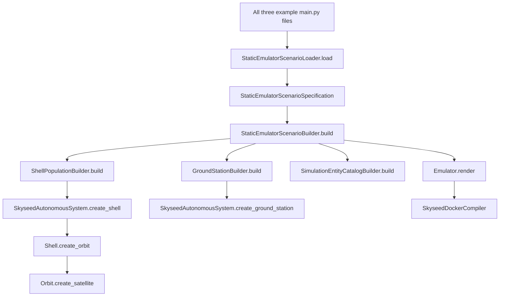
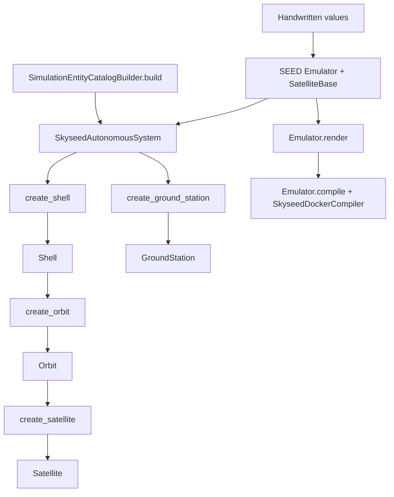
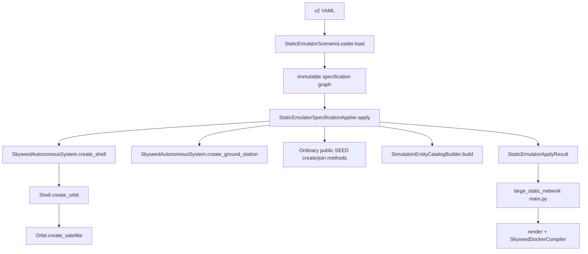

# Emulator Public Construction API

Status: **IMPLEMENTED, PENDING USER REVIEW**.

The pre-refactor audit below was recorded at `fd83099` before implementation.

## Review of `e83107c` recorded before corrections

The implementation was re-traced from all three example entrypoints rather
than accepted from the preceding report. Entity construction is correct and
still reaches the four approved public create methods without a hidden factory
or callback. Four traceability defects remain and are corrected in the review
commit:

1. the root package re-exports specifications, Loader, application services
   and the operation result even though only advanced/file-driven callers use
   them;
2. `SkyseedAutonomousSystem` owns Descriptor Projectors and exposes two
   Descriptor convenience methods, duplicating the independent projection
   boundary used by `SimulationEntityCatalogBuilder`;
3. `StaticEmulatorSpecificationApplier` rejects duplicate generated angular
   distributions even though a specification is supposed to be fully
   validated before application;
4. older diagrams and slice documents contain unclassified types, the
   temporary `create_ground_station(config)` signature, or obsolete small
   example YAML descriptions.

The corrections are deliberately narrow: application/specification types move
to their owning-module public APIs, AS-level projection convenience is removed,
generated-distribution validation moves to the immutable specification, and
documentation is synchronized. No approved entity, Descriptor, Catalog field
or public create method is renamed. The normative vocabulary is
[`terminology.md`](./terminology.md), and project-level approval rules are in
the repository-root `AGENTS.md`.

This document records the bounded construction-path audit before code changes.
It distinguishes approved domain ownership from immutable file input,
application orchestration, SEED integration and operation results. The target
is one entity-creation path that remains visible from each teaching example.

## Approved model and boundaries

The approved Emulator ownership model is:

```text
Emulator / SatelliteBase
└── SkyseedAutonomousSystem
    ├── Shell
    │   └── Orbit
    │       └── Satellite
    └── GroundStation
```

Ordinary ground topology continues to use SEED `AutonomousSystem`, `Network`,
`Router`, `InternetExchange`, `Routing`, `Ospf`, `Ibgp` and `Ebgp` directly.
`SimulationNodeId`, the two Descriptors and `SimulationEntityCatalog` are
read-only output contracts. They do not own or create Emulator entities.

There is no approved `Constellation`, `StaticEmulator`, Satellite/GroundStation
population, scenario runtime or deployment domain entity.

## Pre-refactor call-path audit

### `isolated_satellites`

```text
examples/isolated_satellites/main.py
├── imports StaticEmulatorScenarioLoader from skyseed_v2 root
├── imports StaticEmulatorScenarioBuilder / StaticEmulatorBuildResult
└── imports SkyseedDockerCompiler from skyseed_v2.seed
    ↓ build_emulator(scenario_file)
StaticEmulatorScenarioLoader.load(Path)
    ↓ YAML only becomes StaticEmulatorScenarioSpecification
StaticEmulatorScenarioBuilder.build(specification)
    ↓ creates Emulator + SatelliteBase + SkyseedAutonomousSystem
ShellPopulationBuilder.build(...)
    ↓ SkyseedAutonomousSystem.create_shell(...)
    ↓ Shell.create_orbit(...)
    ↓ Orbit.create_satellite(...)
StaticEmulatorBuildResult
    ↓ Emulator.render()
    ↓ Emulator.compile(SkyseedDockerCompiler, output)
```

The simplest example therefore requires a YAML file, a loader, a complete
scenario facade, a population builder and nested operation results before the
reader reaches the three real domain creation methods.

### `complete_static_emulator`

```text
examples/complete_static_emulator/main.py
├── imports the same Loader / ScenarioBuilder / BuildResult facade
├── imports SimulationEntityCatalog for display-only summary
└── imports SkyseedDockerCompiler
    ↓ Loader.load(...)
StaticEmulatorScenarioBuilder.build(...)
    ├── SatelliteBase.createInternetExchange(...)
    ├── SatelliteBase.setAutonomousSystem(SkyseedAutonomousSystem)
    ├── ShellPopulationBuilder.build(...)
    │   └── AS.create_shell → Shell.create_orbit → Orbit.create_satellite
    ├── GroundStationBuilder.build(...)
    │   └── SkyseedAutonomousSystem.create_ground_station(...)
    ├── GroundStation.joinNetwork(...)
    ├── Base.createAutonomousSystem(...)
    │   └── AS.createNetwork → AS.createRouter → Router.joinNetwork
    ├── Routing / Ospf / Ibgp / Ebgp construction
    └── SimulationEntityCatalogBuilder.build(...)
        ↓ StaticEmulatorBuildResult with nested population results
Emulator.render → Emulator.compile(SkyseedDockerCompiler)
```

The example hides the main Skyseed/SEED composition it is intended to teach.
VS Code navigation requires transitions through the root re-export, scenario
builder and population builder before reaching a real domain create method.

### `large_static_network`

```text
examples/large_static_network/main.py
├── StaticEmulatorScenarioLoader.load(...)
├── StaticEmulatorScenarioBuilder.build(...)
│   ├── ShellPopulationBuilder.build(...)
│   │   └── approved AS → Shell → Orbit create methods
│   └── GroundStationBuilder.build(...)
│       └── approved AS GroundStation create method
├── wraps the result in example-local LargeStaticScenario
├── calculates example-local LargeStaticSummary
├── render / compile
├── reparses generated Compose YAML
├── writes a second summary JSON structure
└── returns another summary/timing tuple
```

The Loader is correctly limited to `file → specification`, but the example
adds two data classes and duplicate reporting/Compose parsing around an already
nested application result.

## Actual entity creation and SEED lifecycle

The answers for the audited source are unambiguous:

1. `Satellite` is finally created by public
   `Orbit.create_satellite(...)`. `Orbit.create_satellites(...)` is a public
   batch convenience that delegates each entity to `create_satellite`.
2. `Orbit` is finally created by public `Shell.create_orbit(...)`.
3. `Shell` is finally created by public
   `SkyseedAutonomousSystem.create_shell(...)`.
4. `GroundStation` is finally created by public
   `SkyseedAutonomousSystem.create_ground_station(...)`.
5. The file-driven path does not bypass those methods, but hides them behind
   `StaticEmulatorScenarioBuilder → population builder` layers.
6. Registry and node lifecycle logic is not duplicated: it is concentrated in
   `SkyseedAutonomousSystem.registerNodes`, `inheritOptions` and `configure`.
7. Input and entity boundaries both validate scalar values. That is valid
   boundary defense, but the population builders additionally repeat collision
   preflight already represented by immutable specifications and domain
   ownership checks.
8. Generated Orbit/Satellite IDs exist only in `ShellPopulationBuilder`; GS
   specification identity exists in `ground_station_id_for`. Neither Loader
   nor Registry invents a second ID.

After the public create methods return entities, the SEED path is:

```text
Emulator.render()
→ SatelliteBase / upstream Base lifecycle
→ SkyseedAutonomousSystem.registerNodes(...)
   ├── GroundStation as rnode
   └── Satellite as satnode
→ SkyseedAutonomousSystem.configure(...)
   ├── ordinary inherited Router configuration
   ├── GroundStation Router configuration / optional brdnode registration
   └── Satellite Node configuration

Emulator.compile(SkyseedDockerCompiler, ...)
→ Satellite registry entries handled by _SatelliteCompilerBoundary
→ GroundStation and ordinary Router follow inherited SEED Router compilation
→ generated Compose receives BuildKit service contexts
```

The scenario Loader imports specifications only. It does not import SEED,
domain entities, Catalog, Compiler, Docker or Registry and does not create any
runtime object.

## Pre-refactor dependency flow



## Classification and disposition audit

| Type | Audit classification | Responsibility and callers | Public/API status | Decision |
| --- | --- | --- | --- | --- |
| `SkyseedAutonomousSystem` | approved domain owner plus SEED integration | owns Shells/GS; called by examples/application; registers nodes through SEED lifecycle | public | retain |
| `Shell`, `Orbit`, `Satellite`, `GroundStation` | approved domain entities | unique ownership and entity creation path | public | retain; improve construction docstrings |
| `OrbitParameters`, `GroundStationLocation` | domain values | validated values passed to public create methods | public | retain |
| `*Specification` classes | immutable input specifications | Loader and advanced programmatic file-input users | public | retain as input, never domain |
| `StaticEmulatorScenarioLoader` | serialization/input adapter | YAML to immutable specification only; large example/tests | public | retain with narrow docstring |
| `StaticEmulatorScenarioBuilder` | application facade/service | creates complete Emulator graph from a specification | public | rename to explicit specification applier, shorten its chain, expose `apply` rather than `build` |
| `StaticEmulatorBuildResult` | operation result | nested container used only by examples/tests | public | replace with a minimal, flat apply result; it is not an entity |
| `ShellPopulationBuilder` | application helper | expansion, preflight and loops; called by scenario builder/tests | public | remove; put private deterministic expansion directly in the one specification applier |
| `ShellPopulationBuildResult` | operation result | nested Shell/Orbit/Satellite tuple wrapper | public | remove; domain ownership and Catalog already expose the durable views |
| `GroundStationBuilder` | application helper | sorting, collision preflight and one create loop | public | remove; inline direct calls in specification applier |
| `GroundStationBuildResult` | operation result | one-field nested wrapper | public | remove |
| `SimulationEntityCatalogBuilder` and projectors | application services | project approved entities to immutable future-Simulator contracts | Catalog builder public; projectors module-level | retain; no entity creation |
| `SatelliteBase`, `SkyseedDockerCompiler` | SEED integration adapters | lifecycle and compilation | public under `skyseed_v2.seed` | retain |
| `LargeStaticScenario` | example-local wrapper | combines application result, summary and timings | example-local | remove; name resembles an unapproved runtime entity |
| `LargeStaticSummary` | example-local statistics data class | transient counting and JSON shape | example-local | remove; replace with direct reporting in the example |
| `_compose_support.materialization_expectations` | integration/test helper | classifies compiled Compose services for optional materialization evidence | not root public API | retain outside entity construction; large main must not reimplement it |

No test is treated as architectural justification for keeping an abstraction.
Tests for removed public helpers must move to the one specification application
path and the public domain create methods.

## Problems to correct

- `isolated_satellites` and `complete_static_emulator` are incorrectly forced
  through YAML and cannot teach the approved public ownership API directly.
- The root package exports population builders/results that ordinary users do
  not need and that can be mistaken for domain concepts.
- `StaticEmulatorScenarioBuilder` acts as a facade and then delegates core
  entity creation through two more public builder classes.
- Nested population results make callers navigate an application data shape
  instead of approved AS/Shell/Orbit ownership.
- Large-example data classes are temporary reporting wrappers with domain-like
  names; Compose/report parsing is duplicated in its `main.py`.
- Identifier validation exists at specification and entity boundaries as it
  should, but population collision checks repeat guarantees instead of relying
  on the immutable specification plus public domain ownership methods.

## Implementation decision recorded before refactoring

The implementation will make the two small examples handwritten and delete
their YAML inputs. Only the large example will use the Loader. Its file path
will be:

```text
YAML
→ StaticEmulatorScenarioLoader.load
→ immutable StaticEmulatorScenarioSpecification
→ one explicitly named specification application service
→ AS.create_shell → Shell.create_orbit → Orbit.create_satellite
→ AS.create_ground_station
→ minimal flat operation result + SimulationEntityCatalog
```

The application service will directly call the approved public create methods,
will not touch Registry or Compiler, and will contain only deterministic
specification expansion plus ordinary SEED topology composition. It will not
be required by handwritten users. No convenience compile facade or new domain
entity will be introduced in this work.

## Implemented unique construction paths

The handwritten path is now:

```text
example values
→ SkyseedAutonomousSystem.create_shell
→ Shell.create_orbit
→ Orbit.create_satellite
→ SkyseedAutonomousSystem.create_ground_station (when needed)
→ entities owned by the approved hierarchy
```

The only file-driven path is now:

```text
YAML
→ StaticEmulatorScenarioLoader.load
→ immutable StaticEmulatorScenarioSpecification
→ StaticEmulatorSpecificationApplier.apply
→ the same four public create methods
→ entities owned by the approved hierarchy
```

`StaticEmulatorSpecificationApplier` has no Loader, Registry, Compiler,
Docker, Compose or materialization dependency. It does not call another
builder/factory/coordinator. Its private `_expand_orbit_inputs` function performs
only deterministic specification expansion before public entity methods are
called.

### Handwritten call flow



### File-driven call flow



## Implemented class and API map

```mermaid
classDiagram
    direction LR

    class Emulator {
        <<external integration>>
        +addLayer(layer)
        +render()
        +compile(compiler, output)
    }
    class SatelliteBase {
        <<integration>>
        +setAutonomousSystem(as)
    }
    class SkyseedAutonomousSystem {
        <<domain owner + integration>>
        +create_shell(shell_id) Shell
        +create_ground_station(id, location, ...) GroundStation
        +shells tuple
        +satellites() tuple
        +ground_stations() tuple
        +registerNodes(emulator)
        +configure(emulator)
    }
    class Shell {
        <<domain entity>>
        +create_orbit(orbit_id, parameters) Orbit
        +orbits tuple
    }
    class Orbit {
        <<domain entity>>
        +create_satellite(...) Satellite
        +create_satellites(...) tuple
        +satellites tuple
    }
    class Satellite {
        <<domain entity + integration capability>>
    }
    class GroundStation {
        <<domain entity + integration capability>>
    }
    class OrbitParameters {
        <<value object>>
    }
    class GroundStationLocation {
        <<value object>>
    }
    class StaticEmulatorScenarioLoader {
        <<serialization adapter>>
        +load(path) StaticEmulatorScenarioSpecification
    }
    class StaticEmulatorScenarioSpecification {
        <<input specification>>
    }
    class StaticEmulatorSpecificationApplier {
        <<application service>>
        +apply(specification) StaticEmulatorApplyResult
    }
    class StaticEmulatorApplyResult {
        <<operation result>>
        +emulator
        +skyseed_autonomous_systems
        +ordinary_autonomous_systems
        +catalog
    }
    class SimulationEntityCatalogBuilder {
        <<application service>>
        +build(autonomous_systems) SimulationEntityCatalog
    }
    class SatelliteDescriptorProjector {
        <<application service>>
        +project(satellite) SatelliteDescriptor
    }
    class GroundStationDescriptorProjector {
        <<application service>>
        +project(ground_station) GroundStationDescriptor
    }
    class SatelliteDescriptor {
        <<cross-layer descriptor>>
    }
    class GroundStationDescriptor {
        <<cross-layer descriptor>>
    }
    class SimulationEntityCatalog {
        <<cross-layer contract>>
    }
    class SkyseedDockerCompiler {
        <<integration>>
    }
    class ComposeProjectLauncher {
        <<materialization integration>>
    }

    Emulator --> SatelliteBase : renders Layer
    SatelliteBase o-- SkyseedAutonomousSystem : contains through Base
    SkyseedAutonomousSystem "1" *-- "*" Shell : owns
    Shell "1" *-- "*" Orbit : owns
    Orbit "1" *-- "*" Satellite : owns
    SkyseedAutonomousSystem "1" *-- "*" GroundStation : owns
    Orbit --> OrbitParameters : reads
    GroundStation --> GroundStationLocation : reads
    StaticEmulatorScenarioLoader --> StaticEmulatorScenarioSpecification : returns
    StaticEmulatorSpecificationApplier --> StaticEmulatorScenarioSpecification : reads
    StaticEmulatorSpecificationApplier --> SkyseedAutonomousSystem : calls create methods
    StaticEmulatorSpecificationApplier --> Shell : calls create_orbit
    StaticEmulatorSpecificationApplier --> Orbit : calls create_satellite
    StaticEmulatorSpecificationApplier --> SimulationEntityCatalogBuilder : delegates projection
    StaticEmulatorSpecificationApplier --> StaticEmulatorApplyResult : returns
    StaticEmulatorApplyResult --> SkyseedAutonomousSystem : references
    StaticEmulatorApplyResult --> SimulationEntityCatalog : references
    SimulationEntityCatalogBuilder --> SatelliteDescriptorProjector : delegates
    SimulationEntityCatalogBuilder --> GroundStationDescriptorProjector : delegates
    SatelliteDescriptorProjector --> SatelliteDescriptor : produces
    GroundStationDescriptorProjector --> GroundStationDescriptor : produces
    SimulationEntityCatalogBuilder --> SimulationEntityCatalog : assembles
    SimulationEntityCatalog *-- SatelliteDescriptor : contains
    SimulationEntityCatalog *-- GroundStationDescriptor : contains
    Emulator --> SkyseedDockerCompiler : compile after creation
```



| Class/API | Type | Public method | Creates/returns | Calls next | Consumers |
| --- | --- | --- | --- | --- | --- |
| `SkyseedAutonomousSystem` | approved domain owner + SEED integration | `create_shell` | owned `Shell` | `Shell(...)` and AS ownership map | handwritten examples, specification Applier, advanced users |
| `Shell` | approved domain entity | `create_orbit` | owned `Orbit` | `Orbit(...)` and Shell ownership map | handwritten examples, specification Applier |
| `Orbit` | approved domain entity | `create_satellite` | owned `Satellite`/SEED Node | `Satellite(...)` and Orbit/AS ID ownership | handwritten examples, specification Applier |
| `Orbit` | domain batch convenience | `create_satellites` | tuple of owned Satellites | delegates every entity to `create_satellite` | optional advanced handwritten use |
| `SkyseedAutonomousSystem` | approved domain owner + SEED integration | `create_ground_station` | owned `GroundStation`/SEED Router | `GroundStation(...)` and AS ownership map | complete example, specification Applier |
| `StaticEmulatorScenarioLoader` | serialization adapter | `load` | immutable scenario specification | specification constructors only | large example and file-input users |
| `StaticEmulatorSpecificationApplier` | application service | `apply` | flat `StaticEmulatorApplyResult` | approved domain create methods, public SEED topology methods, Catalog builder | large example only among formal examples |
| `StaticEmulatorApplyResult` | operation result | field access only | references Emulator, AS tuples and Catalog | nothing | large example/tests; never Descriptor/Catalog input |
| `SimulationEntityCatalogBuilder` | application projection service | `build` | immutable Catalog | Descriptor projectors | complete example, Applier, advanced users |
| `SatelliteBase` | SEED integration adapter | inherited Base API | SEED lifecycle | `SkyseedAutonomousSystem.registerNodes/configure` | all examples |
| `SkyseedDockerCompiler` | SEED integration adapter | inherited Compiler API | Compose output | Satellite boundary + inherited Router Compiler | all examples |

### Retained public-type proof

| Type/family | What it is / layer | What it is not | Created by | Long-term consumers | Why another object cannot own it | Public exposure |
| --- | --- | --- | --- | --- | --- | --- |
| `Shell`, `Orbit`, `Satellite`, `GroundStation` | approved domain ownership/entity path | specifications, Descriptors or runtime topology | their approved parent create methods | handwritten/application callers and SEED lifecycle | ownership and entity capability must remain with the real objects | root |
| `OrbitParameters`, `GroundStationLocation` | immutable domain values | dynamic position/trajectory services | handwritten callers or Applier | entities and Projectors | scalar validation does not belong to a mutable SEED Node | root |
| all `*Specification` classes | immutable input specifications | entities, runtime scenario or deployment model | Loader or programmatic input callers | Applier | file/programmatic input must stay backend-independent | `skyseed_v2.specifications` only |
| `StaticEmulatorScenarioLoader` | serialization adapter | factory, Applier or Compiler | file-input caller | specification callers | only this boundary owns YAML/schema/path errors | `skyseed_v2.scenario_loader` only |
| `StaticEmulatorSpecificationApplier` | optional application service | entity, facade required by handwritten callers or lifecycle owner | file-input caller | large example and advanced file users | a complete heterogeneous specification needs ordered Skyseed/SEED calls | `skyseed_v2.scenario_application` only |
| `StaticEmulatorApplyResult` | flat operation result | entity parent, Descriptor or Catalog entry | Applier | file-input caller | no existing object truthfully owns Emulator, both AS collections and Catalog | `skyseed_v2.scenario_application` only |
| Descriptor Projectors | stateless application projection services | factories, serializers or Compiler hooks | CatalogBuilder or explicit caller | CatalogBuilder | entities must not depend on cross-layer contracts | `skyseed_v2.projection` only |
| `SimulationEntityCatalogBuilder` | multi-AS application projection service | entity creator, Registry reader or serializer | handwritten caller or Applier | Catalog consumers | individual Projectors do not own multi-AS collection/assembly | `skyseed_v2.catalog_builder` only |
| `SimulationNodeId`, Descriptors, `SimulationEntityCatalog` | approved immutable cross-layer contract | Registry/container/execution identities or scenario | Projectors/CatalogBuilder | future Simulator and current contract readers | mutable SEED entities cannot cross the restricted boundary | root |
| `SatelliteBase`, `SkyseedAutonomousSystem`, `SkyseedDockerCompiler` | SEED integration, with AS also the approved entity owner | scenario facade, Descriptor factory or materializer | examples/Applier | Emulator/SEED lifecycle | upstream SEED lacks Satellite lifecycle/dispatch hooks | `skyseed_v2.seed` only |
| `ComposeProjectLauncher` and materialization values/results | already-compiled Compose integration | Emulator model, Compiler, Runner or Simulator | tooling callers | materialization/evidence callers | process execution must remain outside entity/Compiler boundaries | `skyseed_v2.materialization` only |

### Root export list

The root package exports only ten stable, high-frequency types:
`GroundStation`, `GroundStationLocation`, `Orbit`, `OrbitParameters`,
`Satellite`, `Shell`, `GroundStationDescriptor`, `SatelliteDescriptor`,
`SimulationEntityCatalog` and `SimulationNodeId`. Application services,
operation results, Projectors, specifications, Loader and SEED/materialization
integration types remain public only from their owning submodules. This makes
their architectural origin visible at the import site.

### Remaining naming questions retained for user judgment

- `StaticEmulatorScenarioSpecification` uses `Scenario` only in a complete,
  layer-qualified input name. `StaticEmulatorSpecification` would be shorter
  but could be confused with its component specifications; no rename is made.
- `SimulationEntityCatalogBuilder` contains `Builder`, but the fully qualified
  name has one output and one responsibility. `SimulationEntityCatalogProjector`
  would incorrectly imply that it projects one entity rather than assembling
  multiple Projector outputs; no rename is made.
- `StaticEmulatorApplyResult` remains a qualified operation-result name.
  Returning an unlabelled tuple would hide the four meanings, while making it
  private would expose a private return type from a public Applier. It is kept
  module-public but removed from the root.
- `SatelliteBase` is narrower in name than the complete static composition.
  `SkyseedBase` is a possible future integration name, but the class's special
  responsibility is still adding Satellite lifecycle support to upstream
  Base; renaming it is not authorized in this review.

These are naming-review notes, not adopted alternatives or design drift.

## Final example structures

### `isolated_satellites/main.py`

Imports `Emulator`, `OrbitParameters`, `SatelliteBase`,
`SkyseedAutonomousSystem` and `SkyseedDockerCompiler`. Its visible body creates
the Base, AS, Shell, Orbit and two Satellites in that order, then renders and
compiles. It has no scenario file, Loader, Applier or population helper.

### `complete_static_emulator/main.py`

Imports the same construction types plus `GroundStationLocation`, ordinary
SEED routing layers and `SimulationEntityCatalogBuilder` from its application
submodule. Its visible body
creates Satellites, GroundStation, IX, ordinary AS/Network/Router, eBGP and
Catalog before render/compile. It has no scenario file or full-scene facade.

### `large_static_network/main.py`

Imports Loader from `scenario_loader`, Applier/result from
`scenario_application`, and Compiler from `seed`. Its `apply_scenario_file`
function contains exactly the two visible input steps. The main body obtains
the Emulator/Catalog, prints direct counts, then renders and compiles. It
defines no data class, reparses no Compose file and writes no second summary
format.

## Loader's complete responsibility

The Loader resolves a bounded path, reads YAML with duplicate-key rejection,
checks schema versions/fields and constructs immutable specifications. It can
read the large example's bounded secondary GroundStation file. It does not
import or create Emulator, Base, AS, Shell, Orbit, Satellite, GroundStation,
Catalog, Compiler, Registry, Docker or Compose objects.

## Retained application/helper/result types

- `StaticEmulatorSpecificationApplier`: retained because applying a complete
  heterogeneous file specification requires ordered coordination across
  Skyseed and ordinary SEED APIs. It has one layer and directly calls the real
  methods; handwritten users bypass it.
- `StaticEmulatorApplyResult`: retained as a four-field flat operation result
  so the large caller receives the created Emulator, AS collections and
  Catalog without a new ownership concept. It is no longer root-exported.
- `SimulationEntityCatalogBuilder` and its projectors: retained because
  projecting domain objects into restricted immutable contracts is an
  independent application responsibility.
- `StaticEmulatorScenarioLoader`: retained as the isolated serialization
  adapter; it is no longer root-exported.
- `_compose_support.materialization_expectations`: retained as a large-example
  integration/evidence helper outside entity construction and outside
  `main.py`.

## Removed or downgraded abstractions

- deleted public `ShellPopulationBuilder` and `ShellPopulationBuildResult`;
- deleted public `GroundStationBuilder` and `GroundStationBuildResult`;
- replaced `StaticEmulatorScenarioBuilder.build` with the explicitly
  application-level, single-layer `StaticEmulatorSpecificationApplier.apply`;
- replaced nested `StaticEmulatorBuildResult` with flat
  `StaticEmulatorApplyResult`;
- deleted example-local `LargeStaticScenario` and `LargeStaticSummary`;
- removed small-example YAML files and their Loader/facade path;
- removed large-example timing wrappers, Compose reparsing and summary JSON;
- removed internal application/projector/SEED convenience names from the root
  export list without promoting any replacement to a domain entity.

No new domain entity, Descriptor, Catalog member or Simulator contract was
introduced.

## Temporary design names and current implementation names

| Temporary/historical design name | Current formal implementation | Reason | Responsibility preserved? | Design drift? |
| --- | --- | --- | --- | --- |
| `createShell` / `createOrbit` / `createSatellite` / `createGroundStation` | `create_shell` / `create_orbit` / `create_satellite` / `create_ground_station` | existing Python naming convention retained | yes | no; spelling-only design notation |
| `Emulator.create_autonomous_system` | `SatelliteBase.createAutonomousSystem` or `setAutonomousSystem` | AS ownership is an upstream Base responsibility | yes | documentation correction; conceptual method was never implemented |
| `SatelliteAutonomousSystem` and `GroundStationAutonomousSystem` | `SkyseedAutonomousSystem` | one AS owns either or both approved entity kinds | yes, unified | approved structural convergence |
| `SatelliteDockerCompiler` | `SkyseedDockerCompiler` | Compiler scope is the whole Emulator, not one node kind | yes, broadened name only | approved naming convergence |
| `StaticEmulatorScenarioBuilder.build` | `StaticEmulatorSpecificationApplier.apply` | state-free application of input is not a domain builder/facade | narrowed to sequencing | approved application-boundary correction |
| `StaticEmulatorBuildResult` | `StaticEmulatorApplyResult` | the value reports an apply operation and owns no built hierarchy | yes, flattened | approved operation-result correction |
| population builder/result names | no public replacement | loops did not represent an approved concept | entity creation remains in parent create methods | approved removal, not domain drift |

## Implementation validation

Validation was repeated on the native Ubuntu 24 host after the refactor:

- focused construction, boundary, terminology and example tests: `50 passed`;
- full suite: `138 passed`, including the handwritten/file-driven equivalence
  test, which compares Catalog identities, owned entities, Registry rendering
  and compiled entity semantics;
- `compileall`: pass;
- isolated handwritten example: default BuildKit build/up pass; both
  Satellites use `network_mode: none`, expose only `lo`, and InternetMap
  returns two entities with both API and map page at HTTP 200;
- complete handwritten example: default BuildKit build/up pass; two
  Satellites remain loopback-only, GroundStation and ordinary Router establish
  eBGP, the GroundStation learns the ordinary prefix, packet reachability has
  zero loss, and InternetMap returns the four expected entities at HTTP 200;
- large file-driven example: generation and `docker compose config --quiet`
  pass without build/up; the normalized project has 365 services comprising
  348 Satellites, 12 GroundStations, two ordinary BorderRouters and three
  helper services. All Satellite services use `network_mode: none`, all 365
  services have build contexts (including the 362 entity services), five
  networks are declared, and the Catalog contains 360 descriptors;
- clean-cache wheel: 27 archive entries, 22 Python modules and zero
  `examples`/`tests`/`docs` or retired-builder paths. SHA-256 is
  `b242e41810b9937cb647787ec3c33139edf9bfb5942c03ea159c4c4b49ab14fa`.

All three Compose projects, their networks and generated example output were
removed after validation. Large was never built or started.

## User review checklist

1. Open `examples/isolated_satellites/main.py`; inspect its five Skyseed/SEED
   public imports and direct construction order.
2. Open `examples/complete_static_emulator/main.py`; inspect its Skyseed
   entities, ordinary SEED network/routing composition, Catalog and Compiler.
3. Open `examples/large_static_network/main.py`; confirm that only it loads
   YAML and that `apply_scenario_file` is two input/application lines.
4. Go to `SkyseedAutonomousSystem.create_shell` in
   `src/skyseed_v2/seed/autonomous_system.py`.
5. Go to `Shell.create_orbit`, `Orbit.create_satellite` and optional
   `Orbit.create_satellites` in `src/skyseed_v2/domain/satellite.py`.
6. Go to `SkyseedAutonomousSystem.create_ground_station`; confirm ownership is
   beside `create_shell`.
7. Inspect `StaticEmulatorScenarioLoader.load` and its imports; confirm it
   returns specifications only.
8. Inspect `StaticEmulatorSpecificationApplier.apply` in
   `src/skyseed_v2/scenario_application.py`; confirm its direct calls to the
   four domain methods and absence of Registry/Compiler handling.
9. Inspect `StaticEmulatorApplyResult`; confirm it is a flat operation result
   and not an entity parent.
10. Inspect package `__init__.py` and the removed module paths; confirm no
    population or retired scenario builder/result remains public.

This status remains pending until the user completes that source review.
