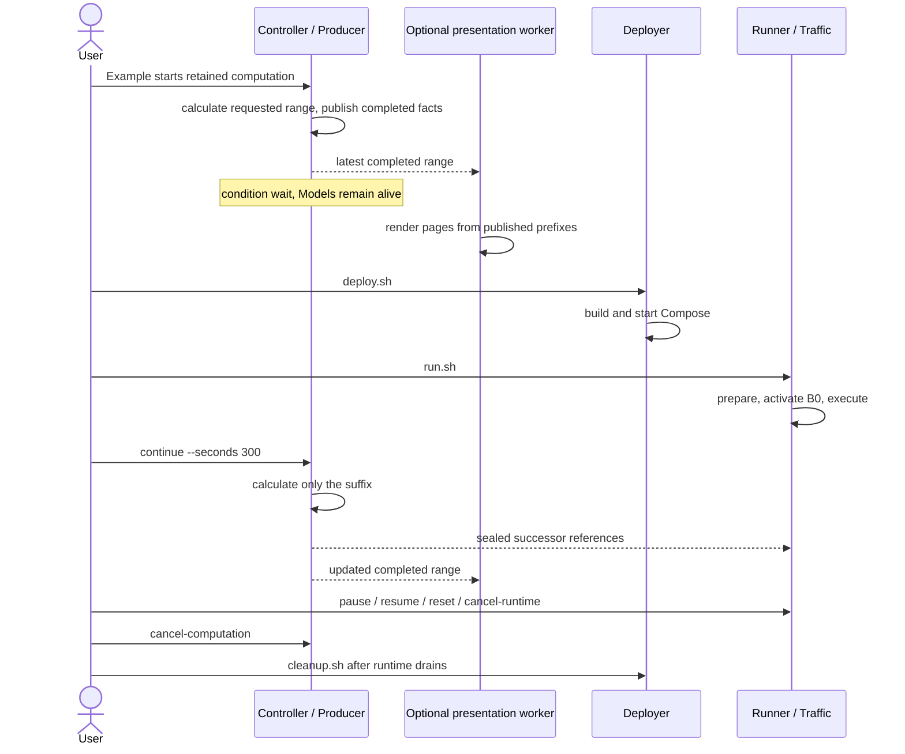
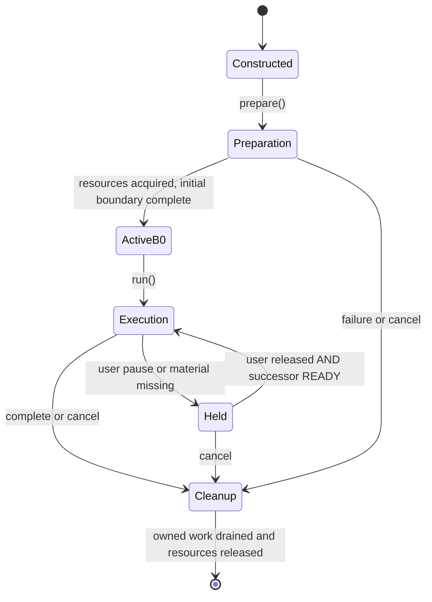

# Calculation, deployment and execution cooperate

A foreground retained calculation can wait while a separately invoked deployment and Runner
use its published materials. Their owners have separate control endpoints and output claims.
No resident Controller is required to execute already generated compiler output.

Optional rendering can overlap calculation and execution. It receives completed facts,
not live Model objects. Waiting for a view never becomes an execution barrier. A runtime
without its next delivery holds the current complete network; it does not tear down containers.
Pause likewise holds updates while applications and container clocks continue.

This is Runner's resource lifecycle, not the lifetime of every result value or container.
Reset ends one invocation and constructs another Runner on the same deployment/materials.
Coordinated shutdown retains requests across deployment/runtime handoff. Precise ordering is
in [experiment controls](../development/experiment-control.md#commands-and-cancellation) and
[backend lifecycle](../development/compiler-and-runner.md#runner-resource-lifecycle).

## Distinct kinds of waiting and stopping

A pause and a material wait can coexist. Either holds the last complete ACTIVE network;
resume clears only the user pause, while READY releases the material wait. Reset creates
a fresh Runner over retained materials on the existing deployment.

Applications and container clocks continue during update holds. Computation cancellation
does not implicitly remove an independently deployed network. Owner completion signals,
not interruptible thread bookkeeping or elapsed time, establish drainage; see the
[control contract](../development/experiment-control.md#commands-and-cancellation).
