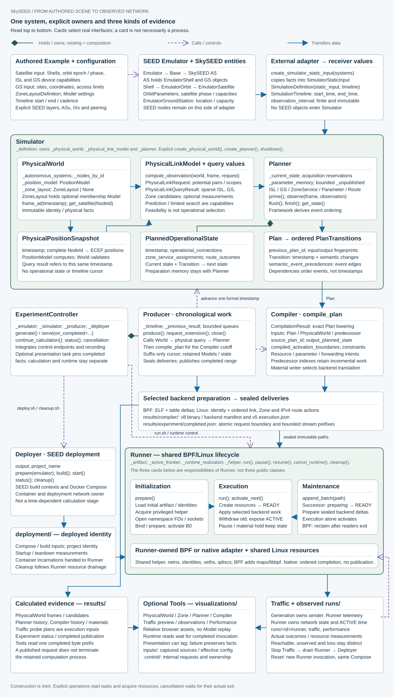

# System architecture

SkySEED turns an authored satellite scene into time-indexed physical facts, planned
network states and sealed execution materials for BPF or Linux. Execution then produces observed network
and Traffic records. The complete diagram follows that path and shows the objects
and resources that each owner retains.

[**Open the full-size, zoomable system diagram**](system-architecture.svg) ·
[Editable diagram source](system_architecture.py)

The diagram has three distinct relationships: nested cards and green diamond lines
show composition or held objects; dashed purple arrows show calls and controls;
blue arrows transfer values. Cards name objects, values or explicitly labelled
responsibilities. Runner's Initialization, Execution and Maintenance cards are parts
of one implementation, not three invented public classes or independent processes.

## Read the system in order

1. **Author the scene.** Satellite orbital/capability inputs and GroundStation sites
   enter SEED construction separately. AS/Shell/Orbit/Satellite and GS objects remain
   on the Emulator side of an external adapter. The adapter copies receiver-owned
   values into SimulatorStaticInput; Definition adds the finite Timeline.
2. **Calculate.** Simulator owns PhysicalWorld, PhysicalLinkModel and Planner.
   Position/query results feed selection. Planner retains current state and publishes
   Plans containing timestamped Transitions and framework-derived event dependencies.
   Producer advances time and calls Compiler with the predecessor result.
3. **Publish.** Compiler translates the same logical Plans into the selected backend's
   supported operations: BPF programs/tables or native IPv4 link/address/route changes.
   Material writing seals those prepared results into chronological deliveries. A complete
   request publishes bounded readable history prefixes. Controller integrates these
   owners, controls and optional presentation without making rendering a calculation gate.
4. **Deploy and execute.** Deployer builds/starts the SEED Compose project. Runner
   owns the selected runtime adapter, binds privileged Linux resources, activates
   prepared states and reclaims retired resources. BPF publishes forwarding generations;
   native execution completes ordered kernel operations. These lifetimes are separate from calculation. Active Traffic probes
   the realized network; it does not own Runner's clock or forwarding state.
5. **Inspect.** Tools read calculated or observed records and write relative browser
   bundles. A page is a derived view and may lag a completed calculation. It cannot
   supply a second authority for formal coverage.

## Choose a forwarding mode

Both modes use the pipeline above. Mode selection configures default assembly and
backend execution; it does not change the meaning of a Model result.

| Responsibility | Shared behavior | BPF | Linux |
|---|---|---|---|
| [Assembly](../api/assembly-and-control.md#forwarding-selection) | Select one mode before deployment; ordinary SEED payloads remain available | Default mode; optional `BpfProgram` | Optional native daemon configuration; no BPF program |
| [Planning](../development/planner-state-and-plans.md#routes) | Logical full paths or local arrangements; explicit empty/partial Models remain unchanged | Default gateway RouteModel | Default empty RouteModel; author may supply supported routes |
| [Compiler](../development/compiler-and-runner.md#compiler-and-sealed-materials) | Validate lineage and lower supported expressions into sealed deliveries | Declared structured data, BPF tables and ELF | IPv4 link/address operations and supported explicit routes |
| [Runner](../development/compiler-and-runner.md#shared-runner-resource-lifecycle) | Preparation, B0, formal clock, continuation, pause, cancellation and owned cleanup | Maps/programs, prewrite, atomic forwarding publication and reader-safe reclamation | Namespace/netlink resources and ordered changes; partial failure is not atomic rollback |
| [Tools](../user-guides/outputs-and-tools.md) | Separate generation, observation and development roles | Available ingress/hop telemetry | Sender replies/migrations and planned context; no recorded intermediate hops |
| Example | Authors own routing policy and preparation | [Precomputed S3 OSPF-like Model](../../examples/Sky03_s3_ospf/README.md) | [BIRD S4 workflow](../../examples/Sky06_s4_native_ospf/README.md) |

The general **data plane** is the realized packet-forwarding mechanism in either mode.
The current public `DataPlane` authoring type is **BPF-specific**; its name is retained.
C/maps/headers and packet-handler customization belong in the
[BPF customization reference](../development/dataplane.md), not a parallel Linux manual.

Construction alone starts no network. `serve()` starts owned calculation/control work;
`deploy.sh` starts deployment; `run.sh` acquires Runner/Traffic resources. Shutdown
waits for worker-owned completion signals and actual resource drainage.

- [Calculation and handoffs](calculation.md): physical queries, current state and Plans.
- [Models and framework flow](models-and-state.md): replaceable choices and fixed semantics.
- [Execution and controls](execution.md): delivery preparation, waiting and cancellation.
- [Mechanisms and tradeoffs](mechanisms.md): incremental state, bounded preparation and retention.
- [Terminology and source map](terminology.md), [developer references](../development/README.md).

Regenerate the vector with `python docs/architecture/system_architecture.py`.
The SVG is a derivative of that single editable source; local Mermaid diagrams explain
specific relationships at a smaller scale.
