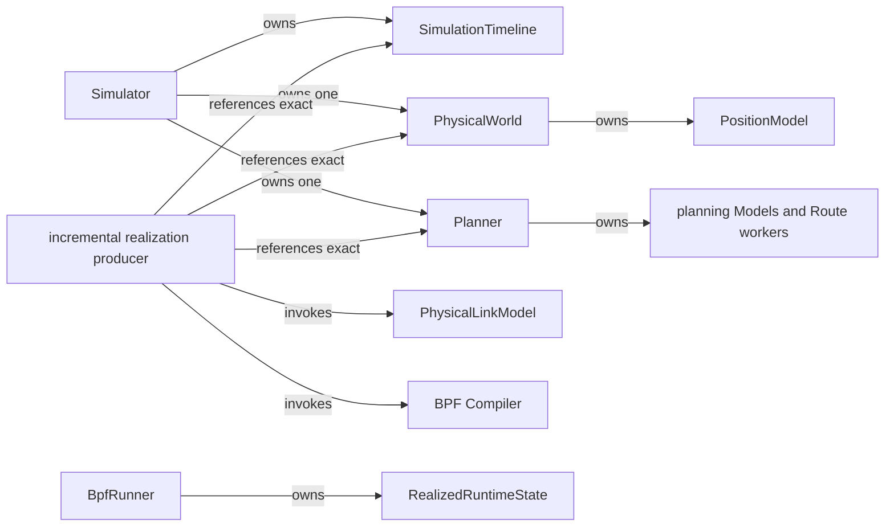

# Ownership and lifecycle

Ownership is singular and follows the production chain.

Legend: `-->` is the relationship named on each edge: ownership, exact
reference, or invocation. Different labels deliberately retain different roles.

## Simulator

`Simulator` materializes one PhysicalWorld after construction, then one Planner
with direct Model/policy injection. Repeated creation fails. Accessors return
the exact owned instances. The Simulator does not own backend execution.

PhysicalWorld owns its static entities, Zone layout, capabilities,
PositionModel, semantic fingerprint, and requested-time projection. A
PhysicalFrame owns no parent or progression reference.

Planner owns operational state, lifecycle memory, frontiers, bounded
unpublished transitions, published-state lineage, compact evidence, and its
Route Model workers. `shutdown` is deterministic and idempotent at the producer
boundary.

## Producer

Experiment orchestration owns `_IncrementalRealizationProducer` because it
crosses Simulator and backend domains. The producer owns the sole Timeline
cursor, bounded pending Plan queue, previous-realization pointer, per-invocation
evidence directory, and cleanup sequencing.

Precomputed orchestration owns the `_RunnerArtifactWriter` instance until
finalize; its packaging/reading implementation belongs to backend
`_runner_artifact.py`. It drains the producer before publishing a terminal
manifest and typed packed binary.
Generated execution verifies source/input identity and artifact seals before
`BpfRunner` construction. Runner owns read-only artifact mappings and decodes every boundary of each
batch during Preparation or Maintenance; it owns no producer or rich compiled-object sequence.

## Compiler and Runner

Compiler is a pure one-call lowering boundary. It owns no cursor, worker pool,
or live state. Each immutable `BpfCompiledRealization` owns one Plan-boundary
semantic output, formal activation records, backend intentions, and lineage.

`BpfRunner` owns initial Preparation, formal Main, optional continued-batch
Maintenance, cleanup, and realized-state snapshots. Preparation opens and fully
decodes the first sealed finite delivery, checks its metadata and binary
structure, and constructs all of that delivery's immutable delta plans and
activation JSON commands. Single-delivery execution prepares the whole sequence;
continued execution does not initially decode or prewrite its successor.
Artifact-local caches reuse decoded identities/timestamps; Preparation reuses
previous route/access state, stable names/slots, and route-by-interface indexes.
It discovers container incarnations once, retains
namespace descriptors and rtnetlink sockets, initializes maps/programs at the
sealed cumulative capacity for one delivery, or fixed resident reservations
based on the first delivery and configured capacity factor for continuation.
It prewrites the first delivery's generation semantics. Equal per-node content
shares an immutable node version across generations; unchanged entries are not
written again. The static demand index is built once per admitted batch.
Preparation then physically executes boundary 0, from no network to the initial
network, before returning. The formal clock begins in `run()`, whose first
possible activation is boundary 1. A one-boundary experiment has no formal
network activation.

Main consumes a prepared immutable delta: changed connections, affected nodes,
and normalized operation nodes. Each veth creation includes both deterministic
MACs, one RX/TX queue per endpoint, and its owned retirement group.
Single finite execution groups known future retirement cohorts; continuation
uses stable per-connection groups, preserving ownership across unknown future
withdrawals and re-establishment.
Interfaces start down; Main configures qdisc/BPF and readiness, changes
routes/neighbours and live port bindings, then commits
`active_generation`, then withdraws obsolete routes/bindings and deletes
withdrawn UP veths directly. One nonzero-group RTM_DELLINK per namespace cohort
collects devices into kernel grouped unregister, including their implicit peers.
Exactly one endpoint per pair carries the nonzero group. Independent namespace
batches use bounded persistent helper workers initialized in Preparation; one
worker owns each socket and all batches join before Main completes. Cleanup
uses the same owned cohorts, retains uncertain ownership, and closes the workers.
Candidate rollback deletes individual new pairs because their future groups can
also contain previously live pairs. Published generation content is immutable;
Maintenance writes only future content and reclaims only eligible retired
versions. Future veths remain absent until their own boundary.

Single-delivery execution retains finite semantic entries until Cleanup.
For append-only continuation, Runner/backend Maintenance loads and prewrites the
next sealed batch, then marks it READY. It reclaims eligible older plans and
map versions after actual activation, preserving in-flight readers and retained
references. Main alone executes boundaries, including timely withdrawals and
joined physical deletion. It never waits for READY past the nominal deadline:
missing/late READY or Maintenance failure produces an explicit failed/incomplete
run, without clock shifts, skipped boundaries or a successful fallback.
Capacity and identity failures are fail-closed. Formal Main handles actual
mutation results without full-network validation or PID/netns rediscovery.

One privileged command stream is established in Preparation. Its long-lived
process uses retained namespace rtnetlink sockets and BPF file descriptors.
Main does not launch Docker, namespace, shell, `ip`, or `tc` subprocesses.
Namespace operations are grouped by affected namespace within pre-publication,
active-generation publication, and post-publication barriers. Candidate rollback
uses the same sockets and syscalls. If a retained resource becomes unusable, its
operation fails; there is no container-restart recovery.

BPF publication is a forwarding subphase. Formal ACTIVE advances only after the
whole transition, including withdrawals and veth deletion, succeeds. Failure
preserves the last completed formal frontier and conservative cleanup ownership.
Before publication, newly allocated candidates may be removed; any remaining
partial live state is reported. After publication, selected-generation resources
are retained for final cleanup. Generation reuse does not invent a publication.

Main records compact boundary/barrier timing and enqueues telemetry template
references with live binding deltas. A background writer expands and serializes
identity records; observation never gates the next boundary. Cleanup owns final
network/BPF teardown, telemetry drain, privileged facility closure, and artifact
handle closure. Automatic deadlines use one fixed monotonic runtime origin plus
each nominal offset. Lateness consumes available idle time; an overrun executes
the next boundary when available and reports actual lag. All transitions remain
sequential and complete, with no skipped boundaries or reset origin. The helper
arrival clock is observational. Manual activation uses the same ordered plans.

The existing privileged helper owns deletion workers and the physical retirement
ledger. All current-boundary jobs join inside Main; none continues as a
cross-boundary deletion service. Its retained sockets/descriptors and the
private Linux execution and startup identity helpers add no lifecycle authority.
Prepared records, finite capacity accumulation and logical ports/live bindings
are backend representations, not domain components or Port entities.
Asynchronous identity expansion belongs to the existing observation facilities,
not Maintenance or a new network lifecycle.

## Tools and evidence

Every semantic producer owns its record schema and append timing. The shared
JSONL helper provides mechanical serialization only. Tool invocations own their
output directories and read detached records without extending domain-object
lifetime.

The private runtime wrapper owns actual `runner-total` and `traffic-total`
Observation production and the invocation-local generation/runtime merge.
Detached Tools own only presentation outputs. Their failure cannot invalidate
an already valid compute or replace a successful runtime outcome.

## Success and failure cleanup

On normal exhaustion the producer flushes Planner once, drains queued Plans,
releases published evidence after successful compile, and shuts down workers.
On any exception it closes the Planner before propagating failure. Runner
cleanup remains independent and follows its own lifecycle.

There is no second progression owner, runtime-selected alternate chain, online
runtime supplier, or semantic progression callback during Runner Main.
