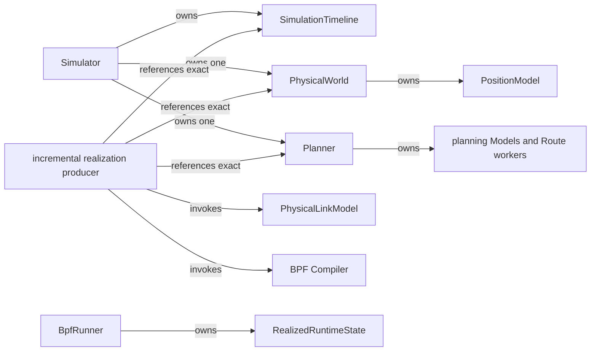

# Ownership and lifecycle

Ownership is singular and follows the production chain.

Legend: `-->` is the relationship named on each edge: ownership, exact
reference, or invocation. Different labels deliberately retain different roles.

## Simulator

`Simulator` materializes one PhysicalWorld after construction, then one Planner
with direct Model/policy injection. Repeated creation fails. Accessors return
the exact owned instances. The Simulator does not own backend execution.

PhysicalWorld owns its static entities, Zone layout, capabilities,
PositionModel, semantic fingerprint, and requested-time projection. A
PhysicalFrame owns no parent or progression reference.

Planner owns operational state, lifecycle memory, frontiers, bounded
unpublished transitions, published-state lineage, compact evidence, and its
Route Model workers. `shutdown` is deterministic and idempotent at the producer
boundary.

## Producer

Experiment orchestration owns `_IncrementalRealizationProducer` because it
crosses Simulator and backend domains. The producer owns the sole Timeline
cursor, bounded pending Plan queue, previous-realization pointer, per-invocation
evidence directory, and cleanup sequencing.

Precomputed orchestration owns `_RealizationHandoffWriter` until finalize.
Generated execution constructs `_PersistedRealizationSupplier` before
`BpfRunner`. Construction eagerly verifies checksums, decompresses and
structurally decodes the complete bounded sequence, validates lineage and
references, and retains only the validated immutable tuple. A Runner pull is a tuple lookup,
not persistence or semantic work.

## Compiler and Runner

Compiler is a pure one-call lowering boundary. It owns no cursor, worker pool,
or live state. Each immutable `BpfCompiledRealization` owns one Plan-boundary
semantic output, formal activation records, backend intentions, and lineage.

`BpfRunner` is the sole live BPF lifecycle owner. It owns preparation,
activation, maintenance, cleanup, and realized-state snapshots. It consumes
persisted realizations and does not own Planner progression.

## Tools and evidence

Every semantic producer owns its record schema and append timing. The shared
JSONL helper provides mechanical serialization only. Tool invocations own their
output directories and read detached records without extending domain-object
lifetime.

The private runtime wrapper owns actual `runner-total` and `traffic-total`
Observation production and the invocation-local generation/runtime merge.
Detached Tools own only presentation outputs. Their failure cannot invalidate
an already valid compute or replace a successful runtime outcome.

## Success and failure cleanup

On normal exhaustion the producer flushes Planner once, drains queued Plans,
releases published evidence after successful compile, and shuts down workers.
On any exception it closes the Planner before propagating failure. Runner
cleanup remains independent and follows its own lifecycle.

There is no second progression owner, runtime-selected alternate chain, or
synchronous heavy semantic callback from Runner maintenance.
