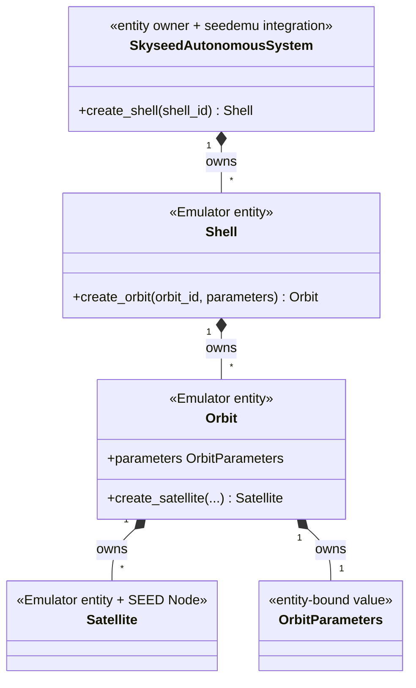
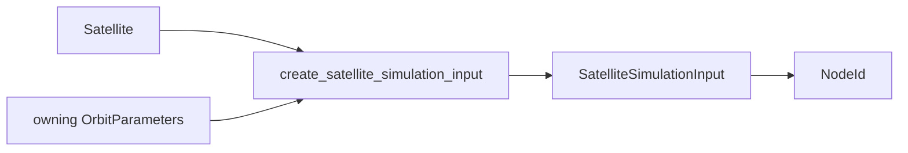

# Isolated Satellite Static Emulator Slice

## 1. Status and scope

The isolated static Satellite slice is implemented and validated. It proves
entity ownership, seedemu lifecycle integration, explicit no-network Compose
output and the static future-Simulator input boundary. It does not implement
positions, visibility, links, routing or Simulator execution.

## 2. One Satellite object

`Orbit.create_satellite()` creates the unique `Satellite`. That same object:

- is owned by its Orbit and Skyseed AS;
- inherits seedemu `Node`;
- is registered as `satnode` with role `Satellite`;
- receives Base options and render files;
- is handled by the internal Satellite static-deployment compiler boundary.

There is no parallel Satellite node wrapper.

## 3. Ownership hierarchy



The defining files are `entities/shell.py`, `entities/orbit.py` and
`entities/satellite.py`. `OrbitParameters` is defined beside its sole owner in
`orbit.py`; Satellite retains no copy of the shared orbital values.

## 4. Static Simulator input

`create_satellite_simulation_input(satellite, orbit.parameters)` combines the
Satellite's stable identity/own values with its owning Orbit's common orbital
scalars into a frozen
`SatelliteSimulationInput`. The input type itself does not import or read the
Satellite/Node and retains no Registry, container, namespace, Compose service
or runtime position.



The `NodeId` is derived only by the cross-layer generation operation; it is not
stored by Satellite. The isolated formal example intentionally does not invoke
this boundary.

## 5. seedemu lifecycle and SkyseedDockerCompiler

`SatelliteBase` integrates first-class Satellite nodes into the Base lifecycle.
`SkyseedAutonomousSystem` registers the unique instances. The internal
`_SatelliteCompilerBoundary` validates `satnode` identity and emits an
explicitly isolated service. `SkyseedDockerCompiler` is the implemented public
static Docker/Compose deployment compiler type; it has no relationship to the
reserved future `SimulationPlanCompiler` concept.

Satellite services use `network_mode: none`, have no Compose network
attachment and expose only loopback until a future dynamic design explicitly
authorizes more.

## 6. Formal example

`examples/isolated_satellites/main.py` is intentionally handwritten:

```text
Emulator → SatelliteBase → SkyseedAutonomousSystem
→ Shell → Orbit → Satellite → render → SkyseedDockerCompiler
```

It contains no YAML, file-configuration operation or static Simulator aggregate,
keeping the basic entity call chain directly visible.

## 7. Deferred work

Dynamic Satellite interfaces, topology, route planning, runtime resource
resolution and Simulator execution remain unstarted.
