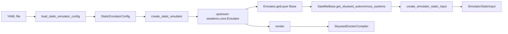
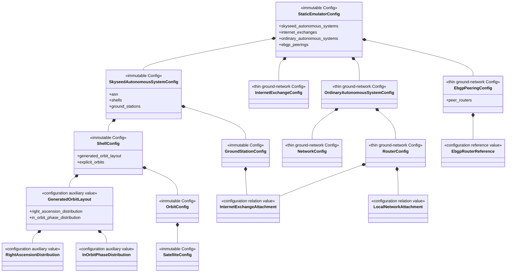

# Static Emulator Configuration

## Scope and public path

Config is the frozen, validated declaration of how to construct a static
Emulator. It is not an entity or runtime object. The single complete file path
is:



`create_static_emulator(config)` returns `Emulator` directly. There is no
creation-result wrapper, Emulator subclass or `.emulator` second lookup.

## Package structure and meanings

```text
configuration/
├── __init__.py
├── _validation.py
├── satellite.py
├── ground_station.py
├── ground_network.py
├── attachments.py
├── static_emulator.py
└── yaml.py
```

- `satellite.py` contains Shell/Orbit/Satellite Config and generated-layout
  auxiliary values.
- `ground_station.py` contains stable GroundStation attributes and the one
  private stable-ID derivation rule.
- `ground_network.py` is a thin Config adapter for ordinary upstream SEED AS,
  Network, Router, IX and eBGP objects.
- `attachments.py` contains node-to-existing-network relations. An attachment
  is neither GroundStation geography nor a SEED interface entity.
- `static_emulator.py` validates the complete cross-record Config graph.
- `yaml.py` alone knows Path, PyYAML, schema versions and YAML keys.

The physical YAML remains `skyseed-static-emulator/v1`, including the optional
referenced `skyseed-ground-stations/v1` data file already used by the large
example. No fragment loader, new fragment schema, schema v2 or TLE path exists.

## Config and auxiliary values



`ShellConfig` enforces `generated_orbit_layout XOR explicit_orbits`. YAML keeps
the old `generation`, `orbits`, `raan` and `phase` keys; only Python names are
more explicit. The currently supported eBGP relationship is `unfiltered` and
symmetric, so Python stores exactly two canonicalized `peer_routers`; YAML
keeps `first` and `second`.

## Creation ordering and ownership

```text
create upstream Emulator and SatelliteBase
→ create IXes
→ create ordinary ground AS / Network / Router objects
→ create Skyseed AS / Shell / Orbit / Satellite / GroundStation objects
→ apply node-to-IX attachments through joinNetwork
→ configure routing, OSPF, iBGP and eBGP layers
→ return Emulator
```

The operation delegates to existing public owner APIs and does not duplicate
entity validation. `SatelliteBase` is the true AS owner. Its
`get_skyseed_autonomous_systems()` query filters its existing upstream-owned AS
collection without retaining a parallel collection or knowing Config,
Simulator or containers.

## Upstream ground-network file investigation

At the pinned upstream commit `61acdf4c9699b25b06843ec4aad747108b05924e`
and distribution version 0.0.7:

- ordinary topology is constructed by formal imperative `Base`,
  `AutonomousSystem`, `Node` and `Ebgp` APIs;
- no formal declarative reader creates ordinary AS/Router/Network/IX/eBGP
  objects from YAML or JSON;
- example `example.yaml` files are test-runner manifests rather than topology;
- Kubernetes YAML readers configure deployment infrastructure, not Emulator
  topology;
- `Emulator.dump/load` pickles and restores the entire Registry and layer
  database, so loading replaces the target Emulator state rather than adding a
  referencable ground-network fragment;
- `Emulator.merge` combines complete Emulator layer sets and requires merger
  handlers for overlapping types; it is not a cross-file topology reference
  mechanism and does not close render/compile by itself.

Consequently, the current ordinary ground-network Config remains the smallest
adapter required by the complete static example. A future physical split into
Skyseed and ground-network files is only a possible later design decision.

## Dependency rules

- Config modules do not import YAML, Path, entities, seedemu or Simulator.
- `configuration/yaml.py` imports PyYAML and Config only.
- entities and Simulator static input do not import configuration.
- top-level `static_emulator.py` is the sole operation module that knows Config
  and real entity/seedemu creation APIs together.
- `SkyseedDockerCompiler` consumes the rendered Emulator model, never Config.
- Simulator implementation remains not started.
