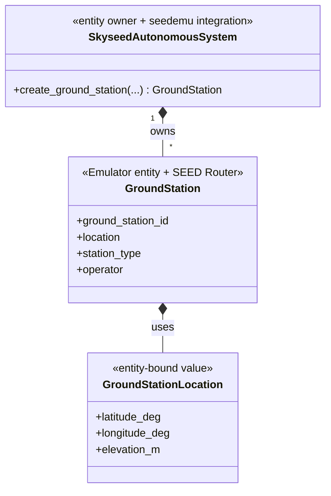
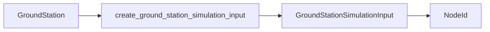

# Static GroundStation Emulator and Minimal Ground Integration

## 1. Status and scope

The static GroundStation slice is implemented. GroundStation participates in
ordinary seedemu Network/IX/eBGP behavior while Satellites remain explicitly
isolated. No GroundStation–Satellite link or dynamic Simulator behavior is
included.

## 2. One GroundStation object

`SkyseedAutonomousSystem.create_ground_station()` creates the unique
`GroundStation`. The same object inherits seedemu `Router`, is returned by AS
queries, joins Networks, registers as `rnode` and border router when applicable,
and compiles through the inherited standard Router path.

`GroundStationLocation` stays in `entities/ground_station.py` because it is
used only to construct and describe that entity.

## 3. Static Simulator input

`create_ground_station_simulation_input()` copies logical
identity, location and descriptive classification into a frozen
`GroundStationSimulationInput`.

The input contains no Router reference, interface, Registry identity, border
state, container, Compose or execution-target data. Joining an IX and border
registration do not alter a previously created input value.
GroundStation does not store `NodeId`; generation derives it from ASN,
ground-station kind and `ground_station_id`.

## 4. Routing and SkyseedDockerCompiler boundary

The complete example disables and masks OSPF/iBGP for the Skyseed AS and adds
one explicit eBGP peering to an ordinary ground AS. GroundStation uses the
ordinary Router Docker-compilation path; Skyseed only normalizes metadata keys
so the logical entity remains recognizable.

## 5. Formal example

`examples/complete_static_emulator/emu.py` directly constructs the
GroundStation, ordinary Router/Network, IX and explicit eBGP state. `main.py`
reuses that helper for Emulator compilation only. `simu.py` separately reuses
it, queries the Skyseed AS collection from `SatelliteBase` and generates static
Simulator input for external assembly. The example uses no YAML Config loading
or static Emulator creation operation and creates no Emulator-entity index or
runtime resolution path.

## 6. Deferred work

Dynamic satellite-facing interfaces remain deferred. Visibility, service
selection and dynamic Slice execution now have an accepted public contract but
remain unimplemented; Planning/backend execution remains deferred.
