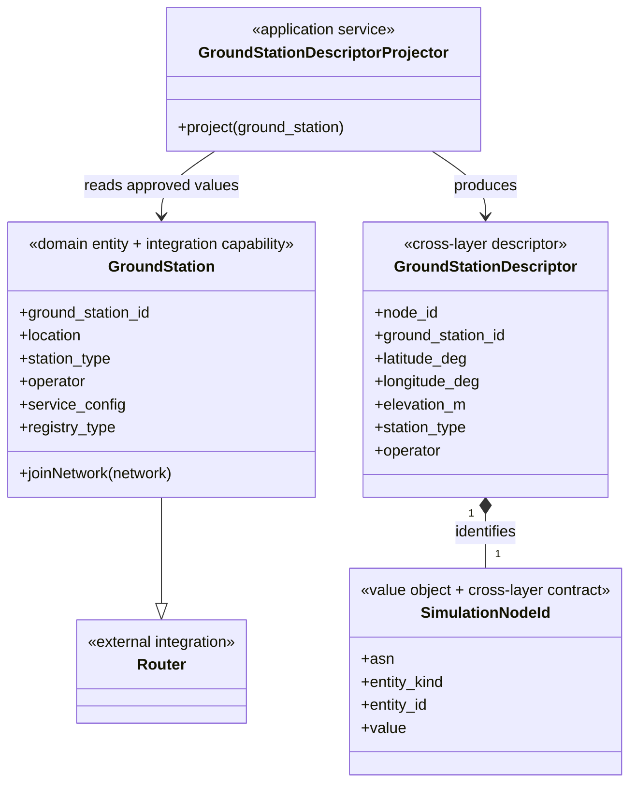

# Static GroundStation Emulator and Minimal Ground Integration

## 1. Status and scope

This document records the implemented second Skyseed v2 vertical slice. It
adds one static GroundStation, one ordinary ground Router, one IX and one
explicit eBGP session while retaining the two isolated Satellites.

The slice does not implement GS–Satellite links, satellite-side interfaces,
visibility, connection selection, dynamic routing, UT, Simulator, Topology,
Planner, BPF or MPLS updates.

## 2. One GroundStation object

The object and contract boundary is:



`GroundStation` in `src/skyseed_v2/domain/ground_station.py` is the only GS
object. `SkyseedAutonomousSystem.create_ground_station()` returns the
same instance later exposed by AS queries, registered as `rnode`, configured,
recognized as a border router, compiled and run. There is no
`GroundStationNode`, adapter object or binding map.

The static model contains stable ID, validated geodetic location, optional
elevation, station type, operator, display name and a copied read-only string
service configuration. It intentionally contains no visibility, service
satellite, Zone, TopologySlice, route-planning or runtime-update methods.

## 3. SEED Router lifecycle

`GroundStation` directly subclasses upstream `Router`. The custom AS owns the
instances because upstream `AutonomousSystem.createRouter()` has no public
node-class factory or insertion hook. Its narrow lifecycle extension:

1. registers each GroundStation as standard `(asn, "rnode", id)`;
2. lets inherited AS option propagation discover that `rnode`;
3. invokes the same `Node.configure()` used by upstream Routers;
4. registers the same object as `brdnode` after IX membership marks it as a
   border router.

Routing, Ebgp and Docker then discover the object through their standard
`rnode`/Router paths. Direct Router inheritance therefore proved sufficient
for this static slice without modifying upstream SEED or creating a parallel
route or Compose implementation.

## 4. Ground routing boundary

The formal example uses exactly one GS data-plane interface on `ix100`.
Standard Routing supplies IPv4 forwarding, Router image, BIRD, and `dummy0` as
the Router loopback. The GS has no local internal network and no satellite-side
interface.

The protocol controls belong to the formal scenario and its Layers, rather
than being hidden in the AS constructor:

- the scenario explicitly sets the Skyseed AS iBGP mode to `disabled`;
- the scenario also masks the GS ASN in `Ibgp`;
- `Ospf.maskAsn()` excludes the GS ASN;
- `Ebgp.addPrivatePeering()` creates one requested session to the ordinary
  ground AS.

Generated `/etc/bird/bird.conf` is the acceptance boundary: it has exactly one
`protocol bgp`, peer ASN 65002, and no `protocol ospf` or iBGP session. No file is
deleted or modified after render to obtain that result.

## 5. Descriptor contract

`GroundStationDescriptor` in `src/skyseed_v2/contracts/ground_station.py` and
the shared `SimulationNodeId` in `src/skyseed_v2/contracts/identity.py` are
frozen, slotted value objects. The independent projector in
`src/skyseed_v2/projection.py` copies only approved scalar values and constructs
`SimulationNodeId(65001, "ground-station", "gs-new-york")`.

The entity does not import the contracts layer or construct the logical ID.
The Projector constructs it from the entity's stable ASN and ground-station
ID. Joining an IX and registering the same object as `brdnode` does not change
the Descriptor or logical ID; `rnode` and `brdnode` remain SEED-only identities.

The Descriptor contains no GroundStation/Router, Registry, routing backend,
BIRD/FRR configuration, software, file, command, Docker/Compose object,
mutable interface or Emulator lifecycle method. Future Simulator needs must
extend this contract explicitly rather than expose the Router.

## 6. Compiler and metadata boundary

GroundStation is not handled by `_SatelliteCompilerBoundary`. It follows the
upstream `_compileNode()` Router path, including real network attachment.
`SkyseedDockerCompiler._getNodeMeta()` performs one small type check solely
to normalize GroundStation metadata by complete key:

- `role=GroundStation`;
- `type=rnode`;
- stable namespaced entity ID, location and classification.

The common keyed serializer replaces collisions before serialization, so no
duplicate YAML label key is emitted. This does not access
`_Docker__services`; that private member remains confined to the existing
Satellite no-network service append method. No GS dispatch, Compose path or
plugin framework was added.

GroundStation retains truthful upstream `net.0` metadata for its one IX
interface. Unlike isolated Satellites, it does not use `network_mode: none`.

## 7. Formal example

`examples/complete_static_emulator/main.py` builds the current self-contained
minimal scenario:

```text
Skyseed AS 65001
├── Shell / Orbit / two isolated Satellites
└── GroundStation gs-new-york ── ix100
                                  │ explicit eBGP
Ground AS 65002                   │
└── standard Router ──────────────┘
    └── ground-net 10.202.0.0/24
```

The same `SkyseedAutonomousSystem(65001)` owns both entity kinds. The routable
packet-level target is the ordinary Router's ground-side address
`10.202.0.254`. No static route stands in for eBGP.

## 8. Evolving and deferred decisions

Direct Router inheritance is accepted for the static slice because its real
costs—Router image, BIRD, forwarding and standard loopback—are exactly the
approved ground-routing capabilities. It is still an evolving boundary.
Future satellite-side dynamic interfaces, services, richer policy or multiple
GS roles require their own design and may expose additional SEED capability
trade-offs.

Upstream AS still lacks a public custom Router factory/insertion hook, so the
unified Skyseed AS has a narrow lifecycle override. This is separate from the existing
Docker private-accumulator debt and does not require private AS-member access.

The unified AS can be used with Satellites only, GroundStations only, or both,
and retains inherited ordinary Network/Host/Router APIs. The implementation
does not expose entity-specific AS subclasses or compatibility aliases.

The Simulator-facing contract does not know the SEED Registry, container,
namespace or Compose service. Mapping `SimulationNodeId` to execution resources
will be designed only when a Backend Planner, Execution Compiler or Runner has
a real consumer; no locator or resolver is introduced here.
