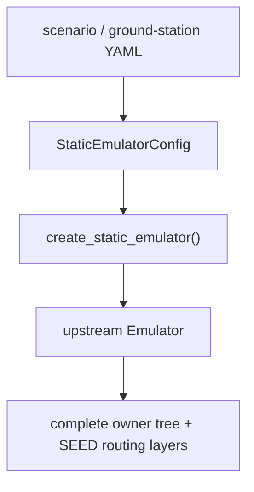
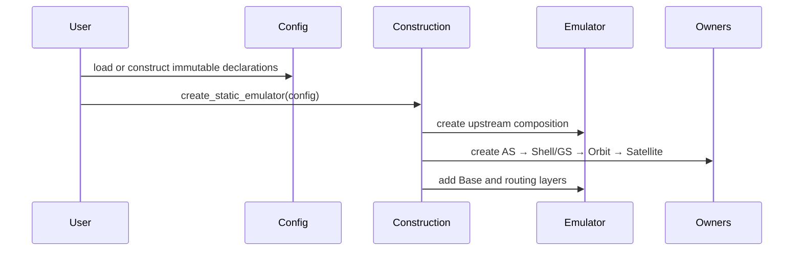

# Emulator owner and construction chain

Legend: `A --> B` means B receives the output of the preceding construction
stage. Ownership cardinality is shown only in [the object model](object-model.md).

Legend: every `A ->> B` message is a direct call from A to B; returns are
omitted.

Code entry: `src/skyseed_v2/emulator/construction.py`. Human examples:
`examples/complete_static_emulator/`, `examples/mini_satellite_internet/`, and
the static scale-review input in `examples/starlink_gen1_satellite_internet/`.
Implementation state is recorded only in [`CURRENT.md`](../CURRENT.md).
