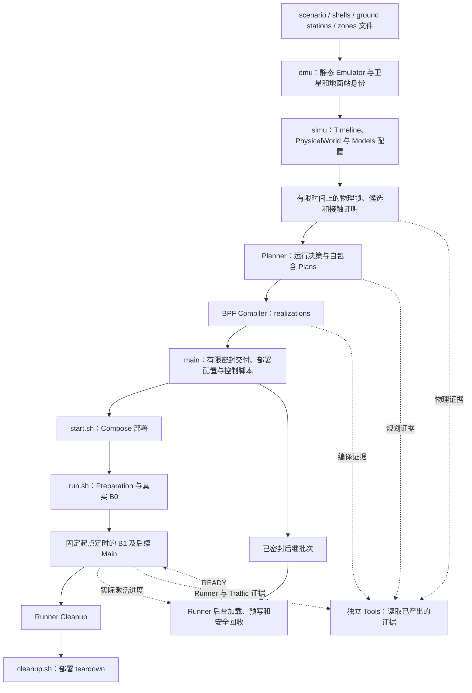
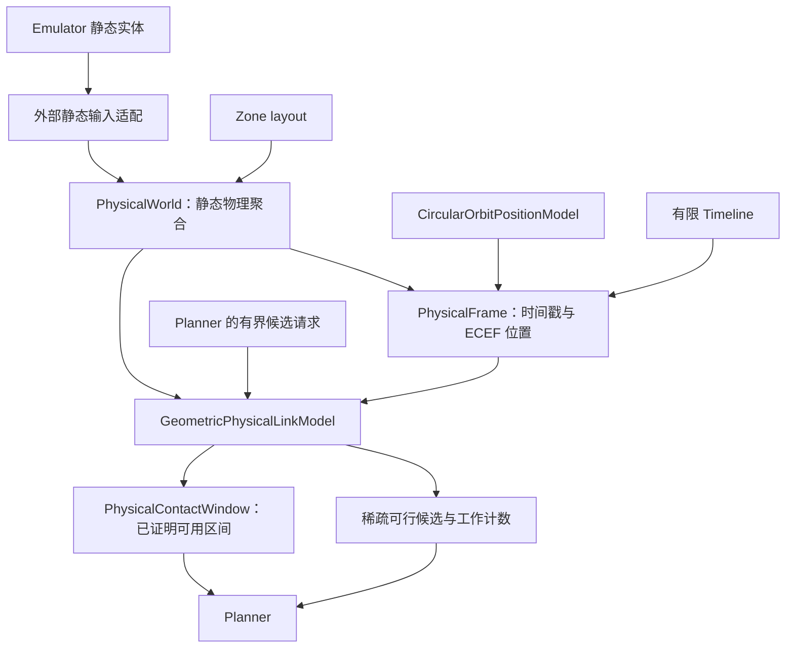
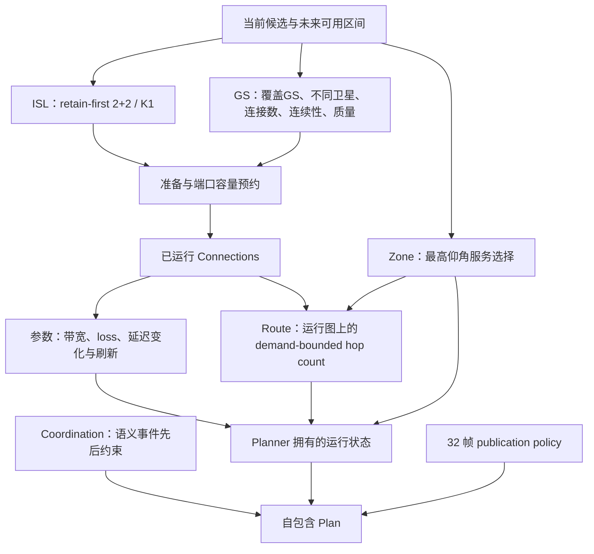
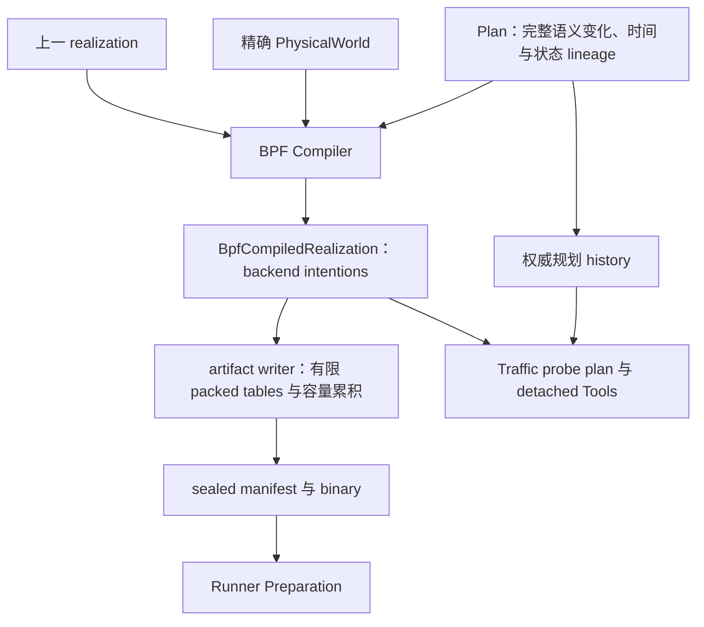
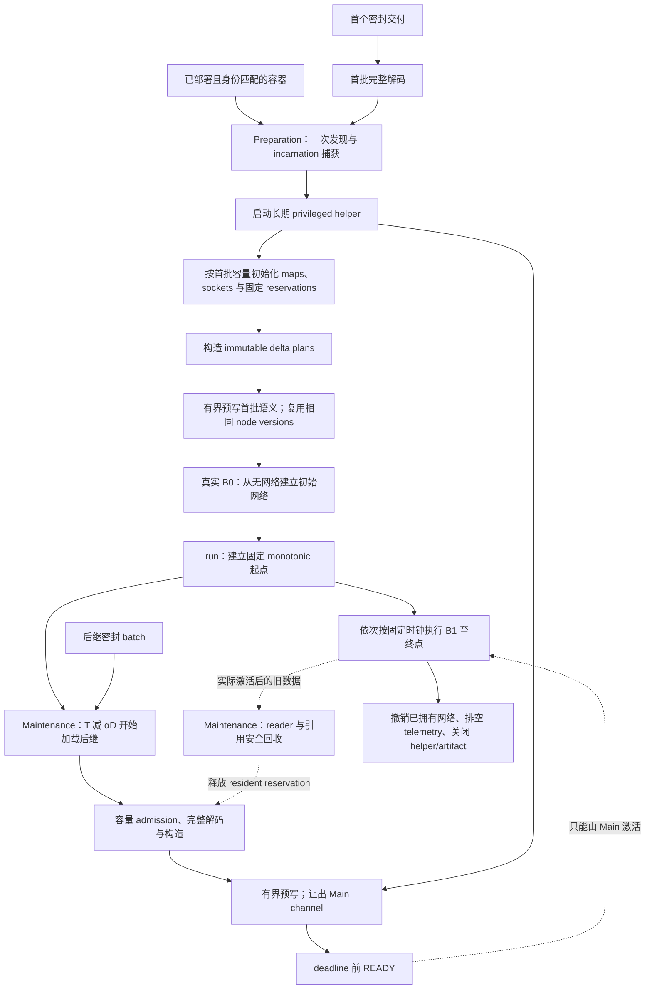
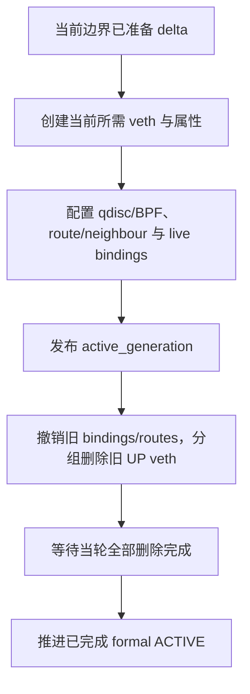

# 从配置构建、定制和执行卫星网络

本文沿当前 Starlink 单 Shell 与 S1–S5 Example 的真实流程解释各层怎样把输入变成可运行网络。
`emu.py` 构造静态 Emulator，`simu.py` 选择物理与规划 Models，`main.py`
推进有限计算、封存产物并调用 Tools。这里省略输入校验和状态提示等辅助调用；
Example 尚未进行下一轮的入口重构。正式合同见
[accepted design](../accepted-design.md)，已采用机制的理由见
[优化说明](optimization-decisions.md)。

## 一条完整流程

Legend: 实线箭头表示输入、产物流转或执行先后；虚线箭头表示已产出的
观察证据、READY 或实际激活进度。

单 Shell Starlink 的 `main.py --through physical-world|planner|compiler`
使用同一有限 producer，在对应边界结束。S1–S5 Example 固定运行完整
Compiler 链。Compiler 模式先完成全部 runtime materials 和 controls，
再完成 generation Tools。`start.sh` 只部署；`run.sh` 启动 Runner/Traffic
并生成 runtime Tools；`launch.sh` 依次组合 start/run；`cleanup.sh` 可独立执行。
静态教学 Example `complete_static_emulator` 保持自身 start/cleanup 流程。

## 配置从哪里来

| 当前入口 | 直接输入与选择 | 产生什么 |
| --- | --- | --- |
| [emu.py](../../examples/starlink_gen1_satellite_internet/emu.py) | scenario 指向 shell 和地面站配置 | 静态 Emulator、AS、卫星和地面站 |
| [scenario.yaml](../../examples/starlink_gen1_satellite_internet/scenario.yaml) / [shells.yaml](../../examples/starlink_gen1_satellite_internet/shells.yaml) | shell、轨道面、轨道高度/倾角、相位、实体能力 | 静态几何和身份输入 |
| [ground_stations.yaml](../../examples/starlink_gen1_satellite_internet/ground_stations.yaml) / [zones.yaml](../../examples/starlink_gen1_satellite_internet/zones.yaml) | 地面站位置与属性；Zone 分区 | 固定地面位置与服务目标区域 |
| [simu.py](../../examples/starlink_gen1_satellite_internet/simu.py) | Timeline、物理阈值、Model 选择和规划策略 | Simulator 拥有的 PhysicalWorld 与 Planner |
| [main.py](../../examples/starlink_gen1_satellite_internet/main.py) | `--shell`、`--observation-interval-seconds`、`--through`、`--output` | 所选配置的输入副本、完整有限产物和 Tools |

省略 `--shell` 时遵循 scenario 中的选择。显式选择写入该次 output 的
`inputs/scenario.yaml`，Emulator 从这份输入构建；源码中的 scenario 不被改写。
执行入口核对源码和输入身份、artifact hash 与元数据，因此生成完成后再改变
生产源码需要重新生成匹配材料。

S3 为 36×20 星、570 km、70°；S1 为 72×22 星、550 km、53°。
这同时改变规模与几何，不能把两者的耗时差仅解释成节点数量的影响。
两者均显式配置每星最多 4 个 ISL、2 个 GS access；这是实验能力假设，
不是商用卫星硬件的实测声明。

## 物理事实与未来接触证明

Legend: 实线箭头表示输入、产物流转或执行先后；虚线箭头表示已产出的观察证据。

Emulator→Simulator 适配位于 Simulator 核心外，输入是纯值。Simulator 不反向
查找 SEED 实体。PhysicalWorld 拥有真实物理聚合；PositionModel 计算位置；
GeometricPhysicalLinkModel 判断距离、地球遮挡、仰角和传播延迟。候选只说明
物理可行性，既不是已连接的链路，也不是服务或路由决定。

ZoneLayout 拥有静态 Zone 和 membership Model；当前默认
`DefaultZoneMembershipModel` 按配置分区处理位置归属。它决定位置属于哪些
Zone，与后续最高仰角 Model 决定谁服务 Zone 是不同责任。

有限接触预测只执行物理计算。圆轨道条件允许时使用全相位界证明稳定 ISL；
其余情况使用采样单元内的连续运动保守界。没有证明的未来单元属于未知。
预测覆盖实验区间及各连接种类所需的 admission tail；它不会偷偷运行未来
Planner 或创建额外正式时点。几何分块和派生缓存由原有 Model 私有拥有。

## Models 怎样把事实变成运行决策

Legend: 实线箭头表示输入、产物流转或执行先后；虚线箭头表示已产出的观察证据。

| Model/策略 | 当前 Example 的可调选择 | 输出与下游影响 |
| --- | --- | --- |
| ISL selection | 每星最多 4 个 ISL；目标同轨 2、跨轨 2；相邻轨面 K1、同轨循环前后邻星；宽范围仍可配置 | 选择/保留链路；新链路需服务证明和准备 |
| GS allocation | GS 未显式配置能力时假定 4；显式 2/4/8 不被默认值截断；卫星端默认 2 | 按覆盖GS数、不同接入卫星数、总接入数、连续性、确定性质量依次优化 |
| candidate query | GS 从每站最近合格 32 颗起，保留有效已选/准备连接并按竞争扩展；跨轨瞬时每方向邻面最近 4 候选 | 限制查询/对象构造，不修改物理距离仰角包络；K 内部分几何仍全算，不宣称全物理图最优 |
| admission / preparation | ISL/GS 准备均 5 s；准备后最小有用服务 180/60 s | 准备期间预约两端容量；不足端口的替换产生 break-before-make 间隙 |
| Zone service | 最高仰角，确定性 tie | 明确的 serving Satellite 或 unserved |
| parameter | ISL/GSL 带宽 1 Gb/s、500 Mb/s；loss 100/200 ppm；延迟相对变化 10%，最长 120 s 刷新 | 完整有效参数的变化；Compiler 降低为 qdisc/backend 更新 |
| Route | 候选 gateway 数 3，hop count 目标 | 明确 reachable path 或不可达原因，不从缺失 BPF 项反推计划 |
| publication | 每批 32 帧，终点 flush | 有界 Plan/Compiler 批次；不改变正式时间分辨率 |

上述时间量以秒为单位。把观察间隔从 5 s 改成 1 s 后，5 s 准备仍是 5 s，
180/60 s admission 要求和 120 s 刷新上限保持原值。600 s 实验在 5 s 下为
121 个时点/4 Plans，在 1 s 下为 601 个时点/19 Plans。正式时点来自
Timeline；批次边界不能合并或跳过它们。这些默认值是当前实验选择，并非通用最优。

## Plans 怎样变成执行材料

Legend: 实线箭头表示输入、产物流转或执行先后；虚线箭头表示已产出的观察证据。

每个 transition 对应一个正式时点，包括没有网络变化的时点。Compiler 只重放
Plan 并降低已决定的 Connection、参数、Zone、Route 和 precedence；不会重新
选择链路或求路由。writer 在生成时检查整个序列的衔接、等间隔和引用，累积
有限执行所需容量并封存。execution 核对身份/hash/元数据；Preparation 打开
binary 检查 header/index bounds 并解码首批全部记录；后继交付由
Maintenance 做同样的批次工作。reader 的索引能力不代表 Main 按需解码。完整语义对照属于 qualification，不再重复放入正常生成热路径。

## Runner 怎样把路由变成真实转发

Legend: 实线箭头表示输入、产物流转或执行先后；虚线箭头表示 readiness、
激活进度或回收条件，不转移执行所有权。

Legend: 实线箭头表示输入、产物流转或执行先后；虚线箭头表示已产出的观察证据。

有限预计算使用稳定的 backend logical endpoint IDs；它们不是领域 Port。
真实 veth 的 ifindex 通过少量 live binding maps 与 logical endpoint 对应。
Route 的已计划下一跳被降低为 logical egress；packet 程序读取
`active_generation` 与该节点 content version，检查逻辑 ingress、查目的地址路由，再通过 live egress
binding 获得真实 ifindex 并 redirect。本地路由交给本地协议栈；缺少必需的
active link、route 或 binding 时丢包。预写未来 generation 不会使未来链路提前
可见，未来 veth 只在其自身边界创建。

长期 helper 保留 namespace netlink sockets 和 BPF descriptors，避免 Main 中
重复 Docker/PID/netns 发现和 shell 命令。MAC、queue 与退休 group 在创建时
设置；独立 namespace 的删除由该 helper 的有界 workers 执行，当轮全部 join。
删除 ledger 是该 helper 的资源所有权记录，不是跨边界删除服务。

generation publication 是转发子阶段；完成整个 Main 才推进 formal ACTIVE。
单交付保留有限语义项到 Cleanup；连续交付由 Runner/backend Maintenance
加载后继并回收已退役、无在途 reader 或保留引用的旧版本。缺少及时 READY
时明确失败，不等待超出名义截止时间。Main 始终使用同一时钟，不重置、缩短
或跳过边界。遥测身份写入属于原 observation 设施，Cleanup 排空它。
失败状态与不确定资源所有权保留给 Cleanup。

更细的 map、barrier 与失败语义见
[Runner/Traffic 合同](../codex-reference/producer-runtime-contracts.md) 和
[已采用机制](optimization-decisions.md)。

## Traffic 与 Tools 的位置

Traffic 从 Plans、编译后的显式计划可达性及 Runner 已完成 frontier 决定
实际 probe 的 arm/reconcile；理想时钟只是 pacing，不是 live-state 权威。
默认 persistent/activation probe 间隔为 1/0.5 s，独立于物理观察间隔。
1 s 仿真不自动把相同 probe 的发送速率乘五；选择出的 episode 数和路径仍可能
随真实事件变化，应比较实际发送数和 episode 覆盖。

Tools 在材料 ready 之后读取 sealed history；运行后的 Traffic Tool 联合计划、
packet、probe executor 和 Runner 证据，区分 expected-unreachable、切换关联
瞬态、未解释的 reachable loss、基础设施失败及持续黑洞。100/200 ppm 注入和
网络切换是可能影响因素，不能证明每个孤立丢包的原因。Tools 不反向驱动生产或
拥有网络生命周期。

## 定制的因果链

| 改什么 | 影响组件 | 改变的产物 | 网络效果 |
| --- | --- | --- | --- |
| `--shell S1` | Emulator 静态输入、Position/Physical Models | 身份、位置、候选、接触证明，继而 Plans | 拓扑、服务机会和实际工作量一起改变 |
| `--observation-interval-seconds 1` | Timeline、物理采样和 Planner progression | 601 个正式 transition；19 批 publication | 更细的决策/更新时点，秒单位政策不缩短 |
| GS 最低仰角或最大距离 | GeometricPhysicalLinkModel | 可行 access 与未来可用证明 | 改变 GS admission 和连接机会 |
| 准备/最小服务时长 | ISL/GS planning Models | acquiring/operational 变化和端口预约 | 改变接入时机和替换间隙 |
| 延迟阈值/刷新上限 | Parameter Model | 有效参数变化 | 改变实际 qdisc 参数更新时机 |
| gateway 候选数 | Route Model | demand 的路径或不可达结果 | 改变编译转发表与实际转发路径 |
| 32 帧批次大小 | publication policy 与有限 producer | Plan 切分和生成内存/并行工作粒度 | 保留同一正式时点；不是 runtime 控制间隔 |

shared images、几何 tiles、路由索引、logical bindings 和 persistent helper
是现有 owner 的自动实现机制，不是每个 Example 都需要开启的配置开关。
当前没有 UT、rolling 运行或通用服务层扩展；这些不在本文的实际执行链中。

## S1–S5 的连续交付配置

[独立 Example](../../examples/starlink_multi_shell_satellite_internet/README.md)
在一个 Emu 中使用原有 S1–S5 定义，共 4,408 星与共享 355 GS / 732 Zones。
ISL 只在 Shell 内；共享 GS 的容量不按 Shell 数量增加。
`settings.yaml` 明示 5 s 采样、600 s 全程、300 s 交付、α=0.75、容量因子 2。
原有配置 schema、Models、生成支持和 start/run/launch/cleanup 职责复用。

第一批含 0–295 s，第二批含 300–600 s，共 121 时点与 120 Main。
两批离线生成封存，只有首批进入初始 Preparation；第二批在运行到 75 s 时
开始后台准备，目标在 300 s 前 READY。一次部署、helper、B0、Traffic 与时钟
贯穿接缝。Planner 的 `flush()` 与 Producer continuation 不结束接触或清空
记忆，Compiler predecessor 和 backend 逻辑端口保持连续。

每次 helper 预写最多 64 节点 / 2048 项，回收预算为 1024 work units；
临近 Main 截止点时后台让出 channel。相同 node 内容通过 generation→version
映射共享。generation counter 的读取协议和版本引用防止在途 packet 或未来
generation 仍使用的内容被提前回收。这些是已有 Runner/backend 内部机制。
固定初始容量与逐批 admission 限制 resident 工作集；不能从两批成功推断
无限期运行，也不能将移到后台的构造时间称为消除工作。

Zone service is globally unique across the world: one Zone has at most one current
serving satellite, not one per Shell. In the current example, ISLs stay within
Shells and GSs cannot be transit nodes. Geographic three-GS associations and
independent GS allocation do not guarantee those GSs have operational access to
the Zone's serving Shell. Stable logical pairs therefore differ from the underlying
GS→Zone and changing serving-satellite→GS demands. Coordinated Zone/GS selection
and cross-Shell communication research are deferred; this Tool correction changes
neither allocation nor routing or topology.

Global unique Zone service and shared GS admission can select incompatible,
disconnected Shell components. Resolving this is future Model coordination work.
Per-Shell serving/routing contexts over shared GS entities and Zone geometry are
only a recorded alternative, not an adopted design; shared GS physical capacity
must not be duplicated. This closeout changes no routing or Model policy.
