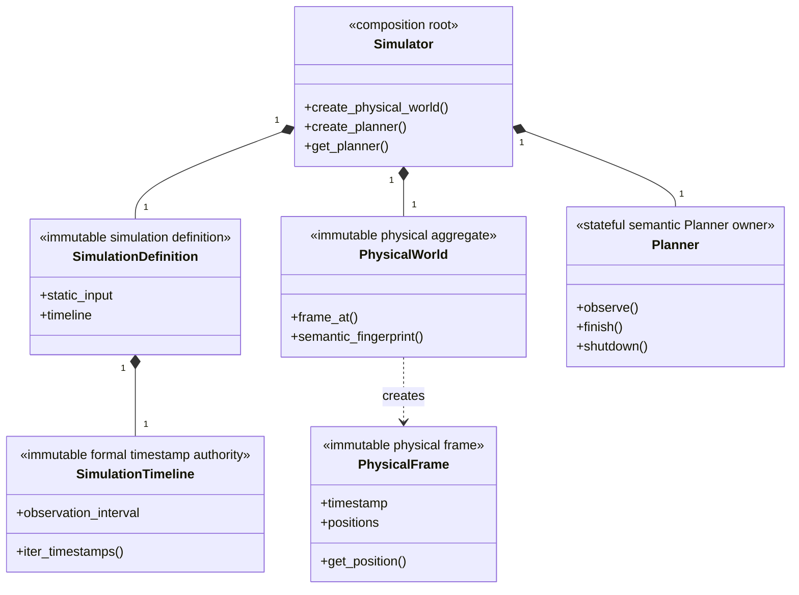
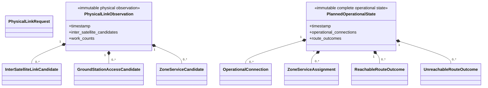
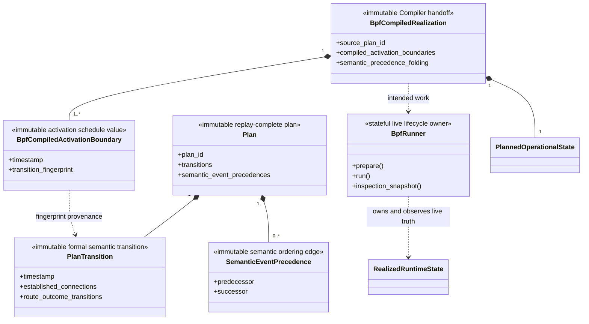

# Object model

## Core ownership

Legend: `*--` is lifecycle composition and `..>` is creation. Each
`<<...>>` names the public role; `+` shows only 1–3 key members whose complete
inventory lives in the owner package README.

## Physical and planned values

Legend: `*--` is immutable value composition. Physical candidates and planned
operational values remain separate authority families.

Candidate values are physical facts. The state values are operational decisions.
Neither family owns the other.

## Plan and realization

Legend: `*--` is immutable composition, `-->` is an exact semantic reference,
and `..>` is the intended-to-live handoff. RealizedRuntimeState is a
Runner-owned concept, not a separate public import.

Every formal transition creates a compiled activation boundary, including an
empty transition. A realization owns intended state; Runner owns realized
state.

## Model realization

Legend: `..|>` is implementation of exactly one replaceable public Protocol
role; it does not transfer Planner or physical aggregate ownership.

```mermaid
classDiagram
    class PositionModel
    class PhysicalLinkModel
    class InterSatelliteConnectionPlanningModel
    class GroundStationAccessPlanningModel
    class ZoneServicePlanningModel
    class ParameterPlanningModel
    class RoutePlanningModel
    class CoordinationPolicy
    class PlanningWindowPolicy

    class CircularOrbitPositionModel
    class GeometricPhysicalLinkModel
    class RetainFirstInterSatelliteConnectionPlanningModel
    class QualityFirstGroundStationAccessPlanningModel
    class HighestElevationZoneServicePlanningModel
    class AccumulatedDeadbandParameterPlanningModel
    class GatewayHopCountRoutePlanningModel
    class DefaultCoordinationPolicy
    class TimeHorizonPlanningWindowPolicy

    CircularOrbitPositionModel ..|> PositionModel
    GeometricPhysicalLinkModel ..|> PhysicalLinkModel
    RetainFirstInterSatelliteConnectionPlanningModel ..|> InterSatelliteConnectionPlanningModel
    QualityFirstGroundStationAccessPlanningModel ..|> GroundStationAccessPlanningModel
    HighestElevationZoneServicePlanningModel ..|> ZoneServicePlanningModel
    AccumulatedDeadbandParameterPlanningModel ..|> ParameterPlanningModel
    GatewayHopCountRoutePlanningModel ..|> RoutePlanningModel
    DefaultCoordinationPolicy ..|> CoordinationPolicy
    TimeHorizonPlanningWindowPolicy ..|> PlanningWindowPolicy
```

## Exact high-level public mapping

The high-level class blocks above map to these executable public contracts.
Their 1–3 displayed members must be a subset of the complete owner README
inventory.

| Diagram class | Public contract |
|---|---|
| `Simulator` | `skyseed_v2.simulator.Simulator` |
| `SimulationDefinition` | `skyseed_v2.simulator.SimulationDefinition` |
| `SimulationTimeline` | `skyseed_v2.simulator.SimulationTimeline` |
| `PhysicalWorld` | `skyseed_v2.simulator.PhysicalWorld` |
| `PhysicalFrame` | `skyseed_v2.simulator.PhysicalFrame` |
| `Planner` | `skyseed_v2.simulator.Planner` |
| `PhysicalLinkObservation` | `skyseed_v2.simulator.PhysicalLinkObservation` |
| `PlannedOperationalState` | `skyseed_v2.simulator.PlannedOperationalState` |
| `Plan` | `skyseed_v2.simulator.Plan` |
| `PlanTransition` | `skyseed_v2.simulator.PlanTransition` |
| `SemanticEventPrecedence` | `skyseed_v2.simulator.SemanticEventPrecedence` |
| `BpfCompiledRealization` | `skyseed_v2.backend.bpf.BpfCompiledRealization` |
| `BpfCompiledActivationBoundary` | `skyseed_v2.backend.bpf.BpfCompiledActivationBoundary` |
| `BpfRunner` | `skyseed_v2.backend.bpf.BpfRunner` |

Public import paths are listed in
[`../codex-reference/public-imports.md`](../codex-reference/public-imports.md).
