# High-level object ownership and cardinality

This is the only global object model. It shows roles, cardinalities, and a few
navigation members. Complete class/member diagrams live only in the
corresponding production package README files listed below. Current
implementation state is maintained only in [`CURRENT.md`](../CURRENT.md).

## Ownership and composition

Legend: `A *-- B` is owner/composition. Labels describe the owned value;
endpoint numbers are cardinalities.

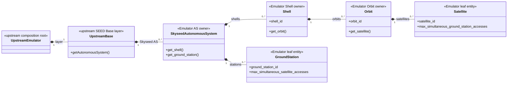

Legend: `<|--` is Python inheritance; `o--` is a same-instance lifecycle
reference and does not transfer domain ownership.

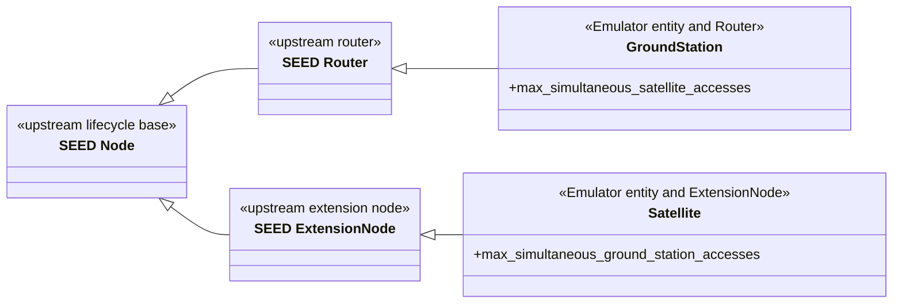

Legend: `*--` means Orbit owns Satellite in domain organization.

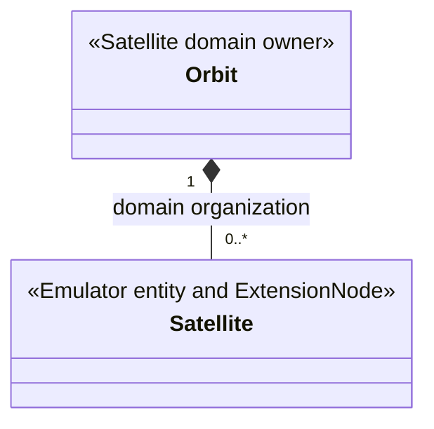

Legend: `o--` means the AS lifecycle inventory references that same instance.

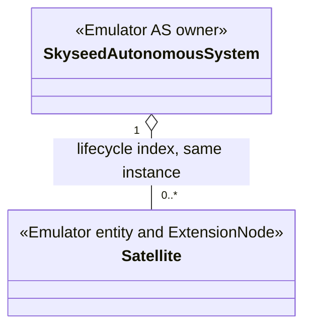

Legend: `A --> B` is a static lowering or future injection data flow; it does
not express ownership.

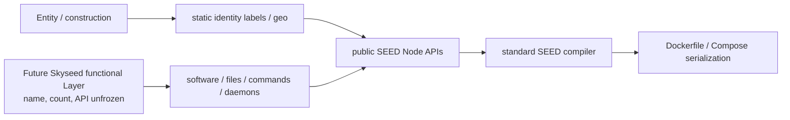

Legend: `A *-- B` is owner/composition. Labels describe the owned value;
endpoint numbers are cardinalities.

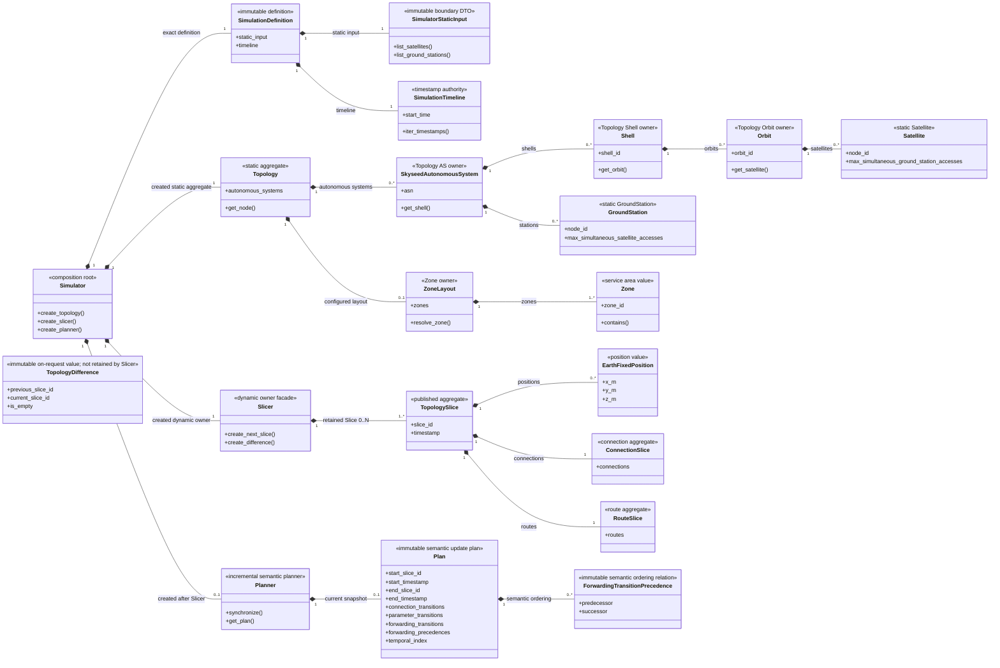

Topology, Slicer, and Planner are peer-level components inside the Simulator
domain. Their peer status does not remove the explicit composition relation:
the one `Simulator` creates and retains all three, while Planner references the
exact sibling Slicer rather than owning it.

Legend: `A ..> B` is a boundary projection that creates a receiver-owned B
value; it retains no A object or cross-domain ownership.

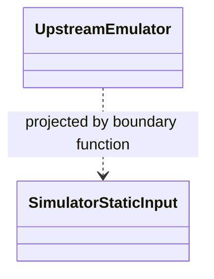

## Exact references

Legend: `A --> B` means A retains the exact B instance. It is neither
composition nor a copied lookup.

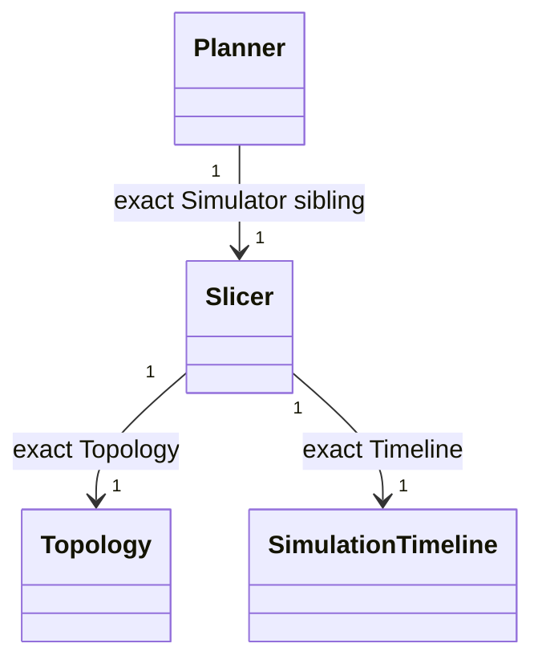

Legend: `A ..> B` means A consumes separately supplied immutable B values; it
does not express composition, ownership transfer, or lifecycle control.

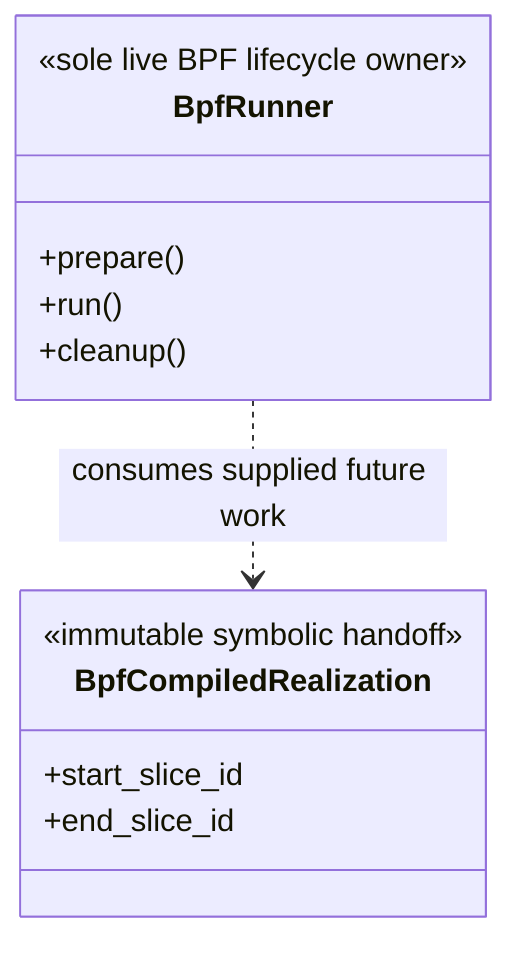

## Creation, projection, calls, and value handoff

Legend: every edge below is labeled with its exact relationship. No edge implies
retained ownership unless it explicitly says `creates and owns`; the ownership
cardinalities remain in the class diagram above.

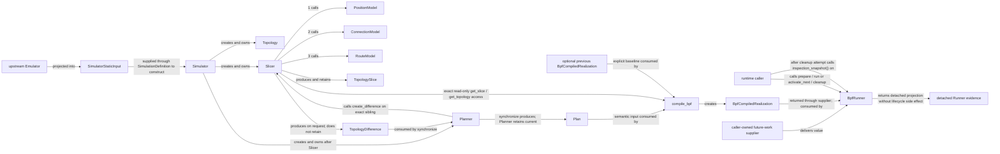

`compile_bpf` has no separate `SlicerFacts` DTO. Its architectural input is
`Plan + approved read-only Simulator facts + optional previous baseline`; the
current public API exposes those Simulator facts through the exact `Slicer`'s
`get_slice()` and `get_topology()` methods. The caller/supplier, not an immutable
`BpfCompiledRealization` value, invokes or controls `BpfRunner`.

The projection carries no Emulator/SEED reference. No Model calls another
Model.

Legend: `Slicer ..> Model` is a numbered direct call to an injected Protocol
role; it does not express ownership and no Model calls another Model.

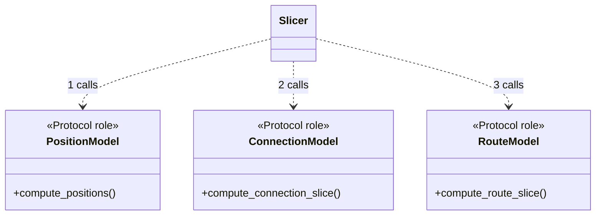

## Protocol realization

Legend: `Implementation ..|> Protocol` is UML Protocol realization; it is not
call order.

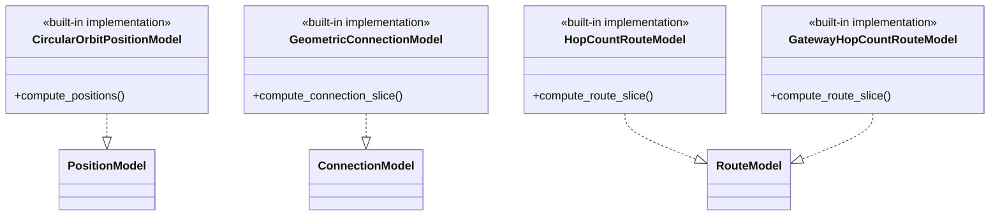

## Public-contract and local-detail mapping

| Diagram object | Public contract |
|---|---|
| `EmulatorAS` | `skyseed_v2.emulator.seedemu.SkyseedAutonomousSystem` |
| `EmulatorShell` | `skyseed_v2.emulator.entities.Shell` |
| `EmulatorOrbit` | `skyseed_v2.emulator.entities.Orbit` |
| `EmulatorSatellite` | `skyseed_v2.emulator.entities.Satellite` |
| `EmulatorGroundStation` | `skyseed_v2.emulator.entities.GroundStation` |
| `SimulatorStaticInput` | `skyseed_v2.simulator.input.SimulatorStaticInput` |
| `SimulationDefinition` | `skyseed_v2.simulator.SimulationDefinition` |
| `SimulationTimeline` | `skyseed_v2.simulator.SimulationTimeline` |
| `Simulator` | `skyseed_v2.simulator.Simulator` |
| `Topology` | `skyseed_v2.simulator.topology.Topology` |
| `SimulatorAS` | `skyseed_v2.simulator.topology.SkyseedAutonomousSystem` |
| `SimulatorShell` | `skyseed_v2.simulator.topology.Shell` |
| `SimulatorOrbit` | `skyseed_v2.simulator.topology.Orbit` |
| `SimulatorSatellite` | `skyseed_v2.simulator.topology.Satellite` |
| `SimulatorGroundStation` | `skyseed_v2.simulator.topology.GroundStation` |
| `ZoneLayout` | `skyseed_v2.simulator.topology.ZoneLayout` |
| `Zone` | `skyseed_v2.simulator.topology.Zone` |
| `Slicer` | `skyseed_v2.simulator.slicing.Slicer` |
| `PositionModel` | `skyseed_v2.simulator.slicing.PositionModel` |
| `ConnectionModel` | `skyseed_v2.simulator.slicing.ConnectionModel` |
| `RouteModel` | `skyseed_v2.simulator.slicing.RouteModel` |
| `TopologySlice` | `skyseed_v2.simulator.slicing.TopologySlice` |
| `EarthFixedPosition` | `skyseed_v2.simulator.geometry.EarthFixedPosition` |
| `ConnectionSlice` | `skyseed_v2.simulator.slicing.ConnectionSlice` |
| `RouteSlice` | `skyseed_v2.simulator.slicing.RouteSlice` |
| `TopologyDifference` | `skyseed_v2.simulator.slicing.TopologyDifference` |
| `CircularOrbitPositionModel` | `skyseed_v2.simulator.models.CircularOrbitPositionModel` |
| `GeometricConnectionModel` | `skyseed_v2.simulator.models.GeometricConnectionModel` |
| `HopCountRouteModel` | `skyseed_v2.simulator.models.HopCountRouteModel` |
| `GatewayHopCountRouteModel` | `skyseed_v2.simulator.models.GatewayHopCountRouteModel` |
| `BpfCompiledRealization` | `skyseed_v2.backend.bpf.BpfCompiledRealization` |
| `BpfRunner` | `skyseed_v2.backend.bpf.BpfRunner` |

Each mapped class has one detailed maintenance source: the README in the
package that owns its implementation. See
[`maintenance-map.md`](../codex-reference/maintenance-map.md). Lifecycle and
failure contracts are in
[`ownership-lifecycle.md`](../codex-reference/ownership-lifecycle.md) and
[`dynamic-slicing-contracts.md`](../codex-reference/dynamic-slicing-contracts.md).
