# 有限生成、部署与执行的性能视图

本里程碑已由用户与 Work 接受。正常五 Shell 输出保留最新完整运行，当前 Tools
在其后离线刷新；没有重新归因运行计时。启动默认恢复为全程 64/eight，后续分批
快速清理仅有既有定向测试和孤立 smoke，未新增全规模资格。最终运行的 teardown
按用户要求人工加速，Traffic 仍为 WARN。

2026-09-10 收尾把必要测量汇入正常 output 的 `qualification/`。下文最新运行的
原始 domain/runtime 证据仍在正常输出；历史对照仅保留选定摘要和测量表，原有
失败/修正运行、完整历史 Tool portal、重复源码快照和临时日志已删除。记录中的
原路径是历史来源，不再承诺文件可访问；本文图表与数值保持其原测量含义。已经
提交的 Runner 证据 archive 未删除。关闭任务未运行新实验或任何视觉 QA。

本文维护新策略资格轮和历史连续交付/部署实测；每组保留自己的策略和源码身份。
当前轮的接受状态只由
[CURRENT](../CURRENT.md) 记录；计时不是验收替代物。配置到真实转发的关系见
[Framework 构建与执行图](framework-construction-execution.md)，机制与历史选择见
[优化说明](optimization-decisions.md) 和
[D4/D5 与 B1 决策记录](../provenance/optimization-decision-history.md#b1)。

## 2026-09-10 最终新运行：运行完成，收尾按用户要求人工加速

本次唯一运行为 `20260910T044347.546519766Z-154590`，源码指纹
`641359dbff07ebb50e8e03a4de437f59022fe2b3f24650cf215478e2c1b986a4`。生成、部署、Runner、Traffic 和所有
Tools 完成后，用户明确要求当前批次结束再接管剩余容器，保留小批次和依赖顺序、
跳过十秒停止宽限期、不要修改一般默认值或重跑实验。下列记录遵循这次范围修订；
**不宣称完整默认 teardown 已通过资格验证**。
[原始测量与交接证据](/home/lionheart/workspace/skyseed/skyseed_v2/examples/starlink_multi_shell_satellite_internet/output/qualification/latest-run/) 保留默认与人工两段；旧失败尝试的完整 raw bundle 已删除，只保留下述结论。

| 测量范围 | 当前秒数 | 上轮参考秒数 |
| --- | ---: | ---: |
| 材料就绪 | 1406.245 | 5729.891 |
| 生成 Tool 尾部 | 336.524 | 297.482 |
| 生成外层 | 1744.359 | 6030.937 |
| GS 扩展决定，真实 stage 计时 | 88.726 | 约 2261.700，外围区间重建 |
| GS 精确选择累计 | 227.017 | 2045.775 |
| 物理 observation 累计 | 198.254 | 574.363 |
| Route planning 累计 | 270.668 | 263.871 |
| 部署外层 | 1901.866 | 1927.918 |
| Preparation，含 B0 | 300.780 | 329.101 |
| Main 工作累计 | 89.751 | 86.651 |
| Main 含 pacing | 600.705 | 601.050 |
| Runner cleanup | 49.753 | 52.763 |
| Runner Tool | 1.713 | 1.448 |
| Traffic Tool | 150.175 | 252.346，旧证据独立重试 |
| 默认 teardown 至人工交接，部分范围 | 4661.343 | 不作完整收尾比较 |
| 人工加速 teardown 外层，剩余 1661 个容器 | 196.751 | — |

stage 有包含与重叠，不能相加成材料墙钟；旧轮也有归档/检查等重叠，不能把所有
差异归因于单个算法。本次候选循环含物理查询累计 287.039 s；真正扩展决定为
88.726 s。仅 warm 帧进行了 32→64→128→256 三次扩展，其余正式查询沿用经过
输入依赖检查的耗尽范围。122 次精确 GS 选择有 1353 次冷增广、166554 次保留边
种子计数、2507 次残量负环修正；正式帧直接 retained-optimum 计数仍为零。
Route 的 531426 个需求中，154292 条路径计算、377134 条复用；请求对象构造
276393、复用 255033，outcome 复用 458560。465648 是 per-Zone demand 引用
复用计数。实际 Route 墙钟未改善，不能以复用数代替速度结论。

GS geometry 实算/复用为 10606684/260463，contact rows 为 5914843/145449，
GS candidate objects 为 4972278/73598；ISL geometry 为 4222878/103851，
Zone geometry 为 2352792/57993。GS rank omission 48085 与 contact rejection
966331 分开记录；这些都是跨查询工作量，不是唯一物理对数。

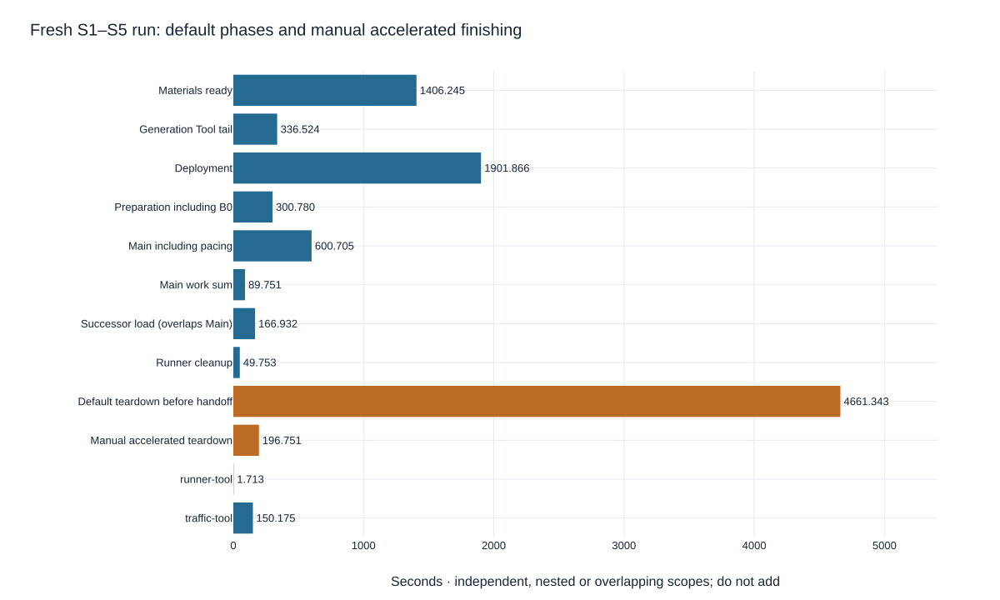

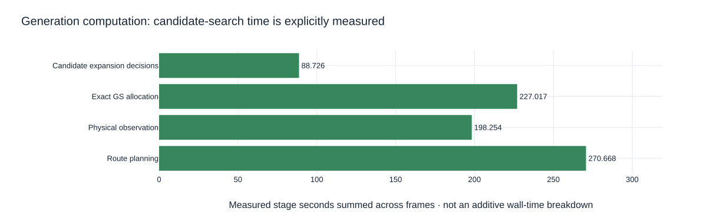

### 固定时钟、接缝与实际 Traffic

121 个时间戳恰为 0–600 秒、间隔五秒，一次 foundation、一次 B0、120 次 Main。
Main p50/p95/max 为 0.738/1.090/1.346 s；最大开始/完成 lag 为
0.998/1.866 s，没有完成 lag 超过五秒的边界，没有跳帧或重置时钟。
后继在 Main 中加载/解码/构造预写 13.355/51.765/101.812 s，
总计 166.932 s，比 deadline 提前 58.062 s ready。旧批 60 个计划在接缝后
释放，实际回收 0.125 s。119 个历史 generation 完成回收，共
4452 条 reclaim 记录、4511273 个工作单位；剩余资源由 Runner cleanup 关闭。

两个容器检查点均为 4765 个相同 ID/PID/StartedAt/image/restart 身份，4764 个
running 和一个正常 exit 0 的 auxiliary，restart/OOMKilled 为零；检查各耗时
22.283/22.705 s，不在逐边界 Main 内扫描。helper 身份保持不变。
295/300 秒接缝保留的 19922 个接口端点身份相同，原始 telemetry 有一个时钟锚点
和全部 121 个边界。

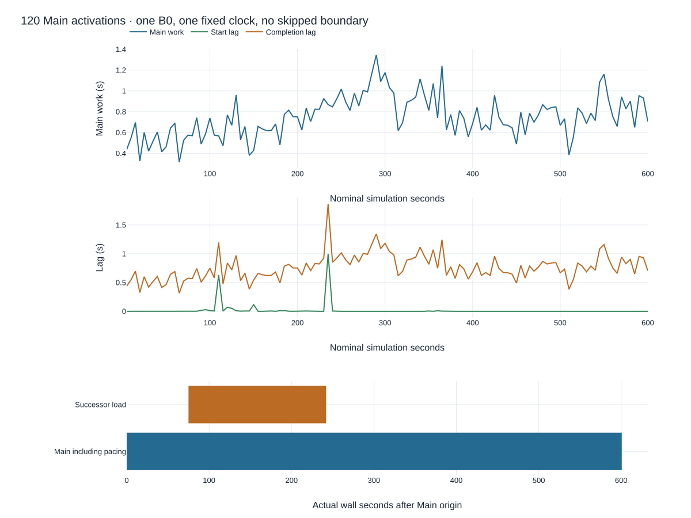

Traffic seed 为 20260909，20 个 episodes、1320 个估计请求、实际并发峰值六，
在 20/3600/8 共享预算内。全部 20 个合格的 Shell × 双向 × 稳定/切换目标均
选中且有实际合格窗口内请求；两条长流均有接缝前后包证据，没有虚构完整 600 秒
稳定控制流。执行器完整、基础设施/persistent failure 为零，控制 RPC 超时为零。
实际为 **1321 sent / 1236 received / 85 loss（6.435%）**。分类保留 59 个
expected-unreachable、三个有证据的 handover disturbance、12 个 unexplained
reachable loss、11 个 unclassified；健康状态仍为 **WARN**。

独立包证据有 **28302 observations / 1253 transactions / 1240 endpoint deliveries**，
ring lost events 和 association ambiguity 均为零；包分类有 1239 observed-reachable、
三个 expected-handover-disturbance、一个 activation-associated-loss 和十个
unclassified。包侧与执行器计数单位不同，1240 与 1236 不强行对齐。
原始 JSONL 为 **86819805 bytes**，Tool aggregate 输入 480925269 bytes（含其他
正式证据），输出 405469441 bytes，其中 replay JSON 401921008 bytes。
保留旧格式的同一证据重放仍为 WARN、计数不变，PSS 约 3.203 GiB；该重放与
离线测试有重叠，不是独立 CPU benchmark。

### 收尾交接、内存范围与剩余成本

Runner cleanup 完成后，默认部署清理与离线 Tools 正常重叠；`run.sh` 在
1175.825 s 返回 0，所有 Tools 已结束并保留文件及校验信息。默认 teardown
执行 388 个实际八容器批次，删除 3104 个容器。387 个批次在原始默认日志中；
最后一个正在删除的批次退出码为零后，父循环在发起下一批之前停止，该八个
不可变 ID 与完成时刻另存 `manual-teardown-handoff.json`，没有补写原始日志。
默认部分范围为 4661.343 s，其 388 次 stop 命令累计 4315.667 s、中位
11.110 s；Docker 日志明确记录 3104 次十秒停止宽限到期。这解释当前收尾的
主要等待成本，不是新的压力终止门限。

按用户明确指示，独立人工进程复用现有归属和反向依赖检查，以最多八个一批
直接 force-remove 剩余 1661 个容器，209 批和一个 owned network 全部成功。
人工外层 196.751 s，控制器内部 188.697 s；两段清理均无命令失败。
原始 runtime 外层 5682.597 s / exit 241 表示用户要求停止 cleanup 父循环，
不是 Runner/Traffic 失败，也不是完成默认收尾。一般 stop grace、生成 cleanup.sh、
launcher 源码和宿主保护未改变；本次没有重跑实验。

最终确认全部 4765 个容器 ID、project containers/networks、helper、owned BPF
pin 均不存在；同时对 14296 个本轮及历史不可变 ID 检查 shim 残留，结果为空。
独立只读 pin 检查容器也已删除。同期日志没有 RPC deadline exceeded 或 oomd
记录；有六条镜像构建期 session healthcheck 错误，原样保留，部署最终返回成功，
不把它们改写为没有发生。Docker/containerd 的服务恢复属于早先失败的恢复范围。

| 采样范围 | 命令进程树 PSS 峰值 GiB | 整机 available 最低 GiB |
| --- | ---: | ---: |
| 生成含 Tool 尾部 | 4.431 | 49.065 |
| 部署 | 0.276 | 22.936 |
| runtime、Tools 与默认清理至交接 | 3.285 | 13.772 |
| 人工加速清理 | 0.216 | 41.992 |

命令树不含 Docker daemon/部署容器 cgroups。独立 helper cgroup 采样峰值
6.167 GiB，oom/oom_kill/max 为零；它与 PSS 不能相加。Traffic Tool 自报
进程 RSS 峰值约 3.596 GiB，与十秒采样的命令树 PSS 也不是同一指标。名义采样
十秒，实际间隔会变长，采样最大值不是未采样时刻的真实峰值。图中灰带为默认
测量结束与人工测量开始之间的交接空档；没有补造连续内存曲线。最终人工控制器
完成距 run control 开始 5972.546 s，包含交接间隔，不能与各重叠 span 相加。

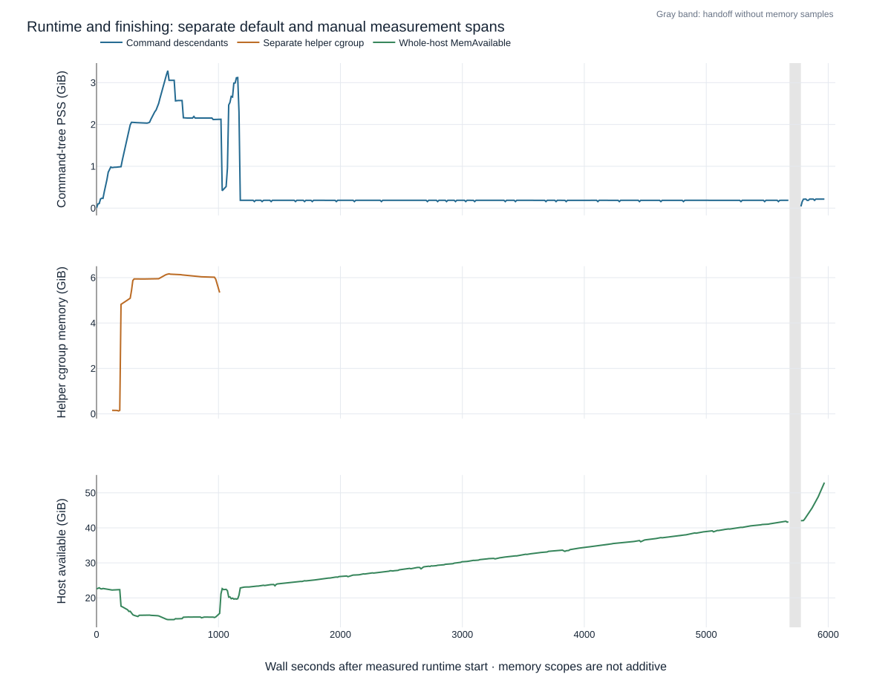

### 正式网络、对照与交付

全 121 帧的严格旧/新比较保持原 oracle 状态。五个 GS 整数目标全部相同，
54 帧的等目标并列解选择不同；延续影响导致 19032 个跨帧 Route outcome 差异，
并影响 Compiler、artifact、logical-port 的首次使用序号和容量结果。所有差异
均有分类；新的封存流与独立冷 Route（531426 demands）及原 Compiler 全帧
重放核验的流相同，不冒充旧/新字节完全一致。ISL、Zone 以及 S2/S5 物理输入
保持不变。

当前正式 GS 占用 1363–1418/1420，运行 GSL 1317–1406，准备 6–62；平均
占用率 98.05%，运行容量利用率 96.04%。直接接地卫星 942–986，GS 运行覆盖
353–355。13 个 GS 零服务空窗在下一五秒样本恢复；另一个空窗从最后 600 秒
样本开始，其后恢复没有证据，不能把零长截断区间当作已恢复。每个 Shell 在
全部正式帧均保持一个 ISL 分量，4408 颗卫星均经路径接地。

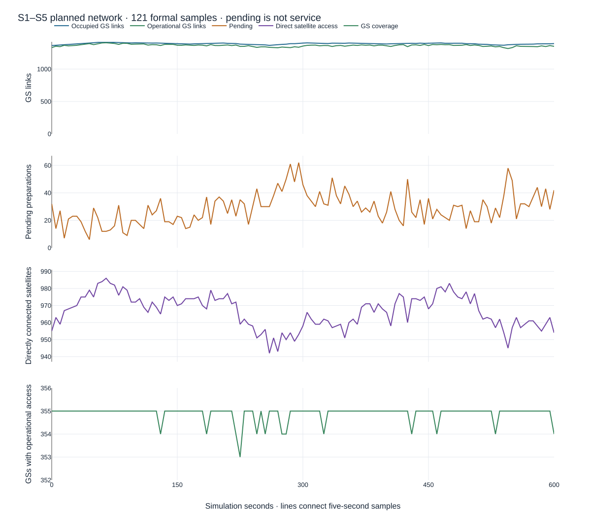

最终正常 Tool 入口保留这一实验，175 个文件校验和、12 个相对链接通过。
Firefox 154.0.1 的所有现有 Tool 页面检查通过，物理/Planner/Compiler 交互、
121 帧与接缝跳转正常，Traffic 页面实际显示 WARN。浏览器连接仅在该验证命令
中绕过 loopback HTTP 代理，没有修改宿主配置。静态图由临时外部 Plotly 资产
导出，没有安装或更改 canonical Python 环境的依赖。
[临时可视化导出](/home/lionheart/workspace/skyseed-local/exports/focused-correction-20260909T170209Z/) 保持根中文 README、
network/ 和 traffic/ 结构：121 帧、45727 个共享路径、20 流、1253 个实际事务、
1321 个执行器请求，161 个文件共 225347217 bytes；两个未知路径引用保留，
没有宿主执行 timing/lag 或内部候选处理细节。

## 历史失败尝试的限制

最终成功运行之前的一次五 Shell 尝试没有完成资格：Traffic 启动附近的 Docker
status RPC 超时使 executor 未完成，随后仅设置 Compose 并发标志的 teardown
仍发出数千次 stop 并遇到删除超时。该次 Preparation 为 639.979 s，Main 最大
工作为 9.067 s，包记录为 4412 observations / 573 transactions；这些数字不
归入最终成功运行。修正保留 RPC 重试/错误记录，并显式限制删除批次；没有把
独立重试重标为完整成功。失败 raw bundle 和临时诊断已删除，本节保留其结论。

## 2026-09-09 最终修正轮

新轮使用 GS fallback 4、显式能力优先、不同接入卫星数与总连接数目标；ISL
参考范围改为 K=1 和同轨循环前后邻星。旧轮承担不同的网络工作，墙钟差异
不能归因于纯实现加速，也不能外推一秒资格。GS 全包络几何仍用于找最近候选；
跨轨只在 K 范围内减少瞬时对象，保留每次时间查询和完整接触证明。

[保留的本轮测量摘要](/home/lionheart/workspace/skyseed/skyseed_v2/examples/starlink_multi_shell_satellite_internet/output/qualification/comparisons/20260909/)
保留代表帧宽范围对照与性能/运行/Traffic 摘要；完整源码快照与 raw bundle 已删除。每十秒采样的PSS/RSS
包含命令子进程/worker，不包含Docker守护进程和容器cgroup，不能相加成宿主
总使用量。宿主available是另一范围的观测值，没有压力准入或终止作用。

| 独立冷准入对照仿真秒 | GS覆盖 | 不同直接接入卫星 | 选择GSL | K1查询ISL对数 | 宽K3查询ISL对数 |
| --- | ---: | ---: | ---: | ---: | ---: |
| 0 | 355 | 960 | 1357 | 116084 | 367476 |
| 300 | 355 | 964 | 1363 | 116084 | 367476 |
| 600 | 355 | 961 | 1357 | 116084 | 367476 |

上述GS三个目标在K1不截断邻居与宽K3对照中相同；参考GS查询从32扩展到256。
参考拓扑在每个Shell形成一个连通分量。这里是假设准备完成后的独立冷准入图，
不是新的实际逐帧生命周期/Traffic证明；实际状态和运行证据在下文单独记录。

新材料生成完成：materials-ready **5729.891 s**，additional generation Tools
**297.482 s**，内部总计 **6027.373 s**，外层命令 **6030.937 s**。外层旧测量
wrapper 每十秒轮询退出，因此含最多十秒的退出检测开销。全部五项 generation
Tools 完成。生成期间与必要的 S3 output 恢复、归档 I/O 和离线检查有部分重叠；
部署开始也与 generation Tools 尾部重叠，不能当作隔离 benchmark。
部署期间还有离线网络导出、报告修正验证和浏览器检查；各组启动时长的差异
不能单独归因于Shell规模或宿主机某一机制。

122 次 warm/formal GS 选择累计 **2045.775 s**、169815 次增广、4972056 个
输入候选计数，保留解直接复用为 0。488 次物理查询包含逐帧扩展，重复查询
计数不能当成唯一物理对数。Physical observation stage 累计 **574.363 s**，
未来预测 **34.560 s**；Route planning **263.871 s**。这些 span 存在包含与
重叠，也未覆盖所有外围工作，不能相加成材料总时间或据此完整归因剩余耗时。
原始 stage/work 汇总见本轮 `generation-stage-summary.json`。

正式状态的占用、准备与实际服务分别如下；不同于上面的独立冷准入对照：

| 正式仿真秒 | 占用GSL | 运行GSL | 准备GSL | 运行GS覆盖 | 运行直接卫星 | 空闲GS槽 |
| --- | ---: | ---: | ---: | ---: | ---: | ---: |
| 0 | 1363 | 1331 | 32 | 355 | 955 | 57 |
| 300 | 1398 | 1352 | 46 | 355 | 957 | 22 |
| 600 | 1390 | 1348 | 42 | 355 | 958 | 30 |

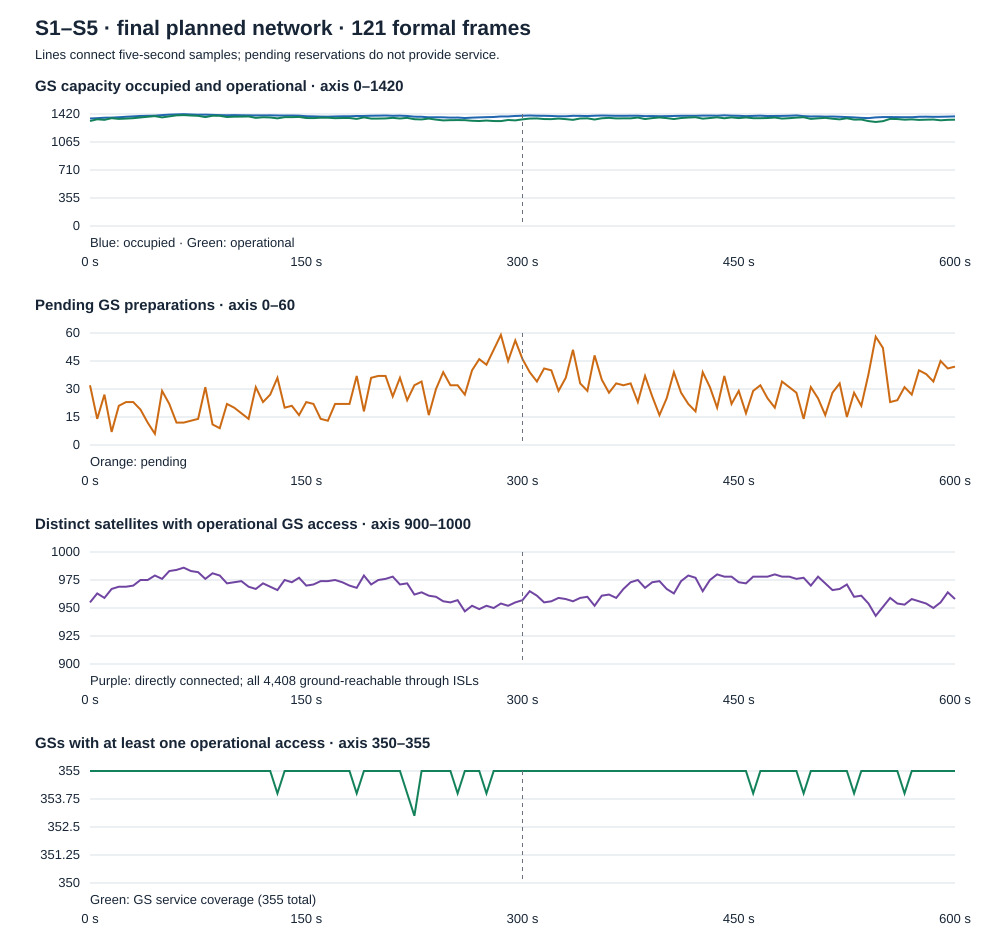

121 帧中占用范围1363–1418/1420，运行1319–1406，准备6–59；平均占用率
98.05%，平均运行容量利用率96.02%。运行直接卫星943–986，仅占全部卫星的一部分；
每个Shell在全部121帧均为一个运行ISL分量，全部4408颗卫星经运行路径可达地面。
运行GS覆盖353–355；11段GS零服务空窗均在下一个五秒正式样本恢复。
不把样本间连线解释为额外仿真精度。B0之后GSL建立3373、撤销3356；全部连接
建立3445、撤销3404。2029个station-frame仍有空槽，查询候选数量足够但受准入或
端点竞争约束，当前证据不进一步拆分这两种原因，也不称其为物理不可见。
每站每帧度数、Shell分布和空窗见正常output的`inspection/planner/network-behavior.json`。

Traffic计划使用seed20260909，20个episodes、估计1328个请求、峰值并发5。
两条长流跨过300秒接缝；全部正式帧中没有保持不变的非空Zone服务身份或可达路径，
因此没有完整600秒稳定长流。短流覆盖五Shell、两个方向及稳定/切换案例；20个细分
目标中18个选中，S1的Zone→GS切换和S5的GS→Zone切换仍为预算/窗口覆盖缺口，
不是没有物理机会。

### 完整运行、接缝与清理

唯一 runtime invocation 为 `20260909T150851.376091042Z-3108291`。新材料完整运行
到600秒：一个foundation、一次B0、120次Main、121个正式时间戳和一个固定原点；
没有跳帧或activation limit。Main总工作 **86.651 s**，p50/p95/max为
**0.700 / 1.031 / 1.881 s**；含pacing的Main elapsed为 **601.050 s**。
最大开始/完成lag为 **0.463 / 1.889 s**，没有完成lag超过5秒的边界；这些
实测数值不构成一秒资格，也没有作为暂停或终止条件。

部署外层 **1927.918 s**，Preparation含B0 **329.101 s**。后继加载在Main
原点后 **75.033 s** 开始，耗时 **155.373 s**，其中load/decode/construction+
prewrite为 **11.733 / 47.105 / 96.535 s**；在300秒deadline前 **69.593 s**
ready。第一批在Main前只准备60个边界，后继61个边界在Main期间准备；300秒
只激活一次，旧批60个plans于原点后 **301.829 s** 释放，实际释放工作 **0.534 s**。
接缝295/300秒保留的 **19924** 个接口端点身份完全一致。

两个完整容器检查点均为4765个相同ID/PID/StartedAt/image/restart身份，4764个
running、一个正常exit 0的auxiliary，restart和OOMKilled均为0；每次检查约22秒，
不在逐边界Main内扫描。独立helper终端快照确认同PID、零restart/OOMKilled。
Runner cleanup完成，耗时 **52.763 s**，其中runtime teardown **47.014 s**；
最终逐一确认全部4765个旧容器ID、项目容器/网络、helper及owned BPF pin均不存在。

Runner Tool完成 **1.448 s** 后，最初Traffic离线投影与deployment teardown
重叠。系统日志明确记录systemd-oomd因user slice内存压力结束ChatGPT和VS Code
app scopes；发生在完整运行及Runner cleanup之后。两条外层wrapper没有完成记录，
所以原runtime总外层时间、第一次deployment teardown总时间均为 **UNAVAILABLE**。
中断日志和部分采样保留，不从最后采样点伪造总时长。恢复后的标准scoped teardown
单独耗时 **79.536 s**，随后才重试离线Tools，没有重跑Main或改动原始证据。
没有证据把压力精确归因到某一个并发进程；本轮未调整sysctl、保护策略、依赖或
共享服务。最终watermark_scale_factor/swappiness/min_free_kbytes仍为10/60/67584。

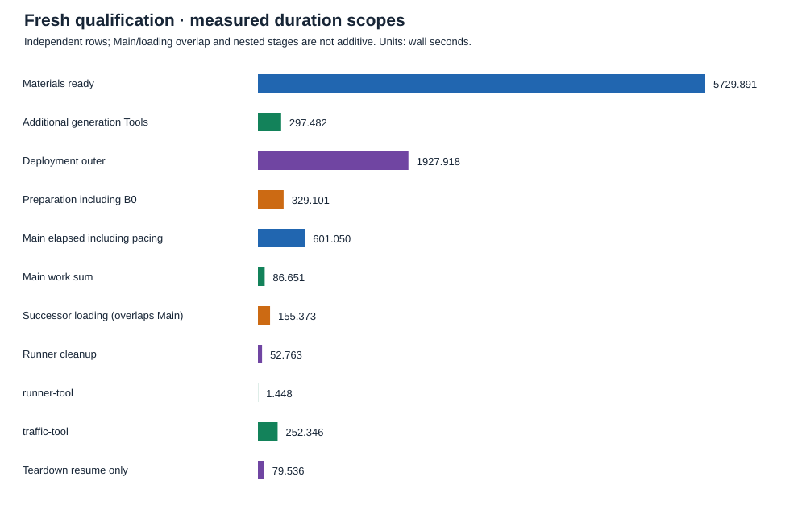

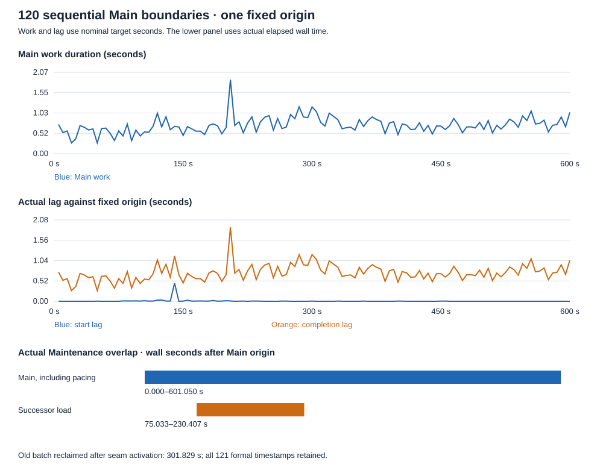

generation命令树采样峰值PSS **4.373 GiB**；完整runtime及中断前Tool尝试的
命令树峰值 **8.549 GiB**，独立helper cgroup峰值 **6.163 GiB**。后两者是
不同且可能重叠的核算范围，不相加；该runtime采样区间整机MemAvailable最低
**13.597 GiB**，并不排除systemd-oomd按压力指标采取动作。helper自身cgroup
采样的oom/oom_kill/max均为0，与后来桌面app scope被结束是不同证据。
采样周期名义10秒，实际阻塞可拉长间隔，图中最大值不是未采样时刻的真实峰值。
Main期间generation reclaim共4468个记录、4528753个删除工作单位、119个
已回收generation；最终仍由Runner cleanup关闭剩余资源。

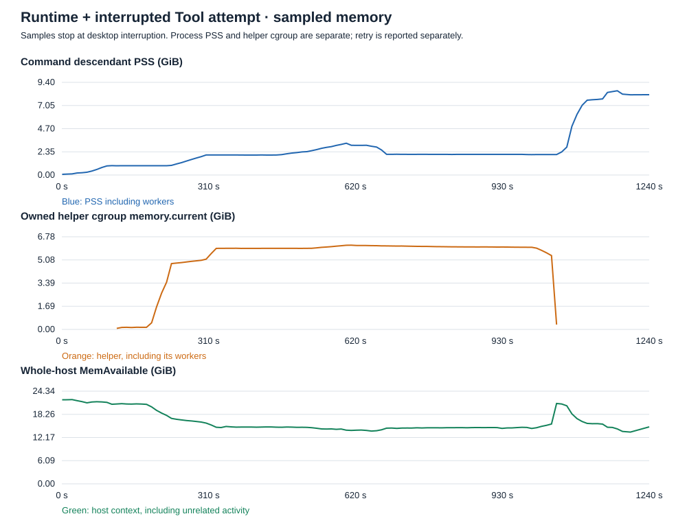

### 实际Traffic与交付验证

离线Traffic Tool重试完成，函数计时 **252.346 s**；含Observation和聚合导航
收尾的重试外层 **256.820 s**。重试命令树采样峰值PSS **8.897 GiB**，
整机available最低 **32.337 GiB**；它在deployment teardown后运行，与最初
中断尝试分开记录。全部生成/运行Tools现已完成，Traffic资格状态仍为 **WARN**。

执行器20个episodes全部完成，34个generator segments全部停止（含14次Zone
源迁移），实际并发峰值5。估计1328请求，实际 **1323 sent / 1228 received /
95 loss（7.181%）**。执行器请求分类为1228 observed-reachable、73
expected-unreachable、6有实际事件与恢复证据的expected-handover-disturbance、
6 unexplained-reachable-loss和10 unclassified。基础设施与persistent failure
均为0；未知和未解释损失没有重新标为正常。

独立包观测是 **25324** 条，重建 **1240** 个事务，其中 **1229** 个端点送达、
6切换关联、1预期不可达、4未分类，association ambiguity为0，ring lost events
为0。端点送达比执行器received多1，保留各自证据单位而不强行对齐。
两条600秒长流在300秒两侧均有实际请求/回复观测；一条在295秒附近仍有一次
未确认端点送达的切换扰动，不能把跨接缝观察等同于零丢包。观测时间可超过
正式网络最后600秒（本轮有601.277秒请求）；保留事实，不增加网络正式帧。

五个Shell均实际观察到两个方向；18个选中的稳定/切换细分目标全部有合格窗口
观测。S2/S3/S4四项齐全，S1缺Zone→GS切换，S5缺GS→Zone切换，与计划未选中
缺口一致。因此完整20项覆盖为 **NOT PROVEN**，不能称全部分层目标通过。
每Shell统计按计划路径归属可重叠，不能相加为执行器请求总数。

外部临时交付含121完整网络帧、45847去重路径、20流、1240实际事务和1323个
执行器请求案例；1238个事务有计划路径引用，2个保持未知。161文件共225471140
字节，网络引用/归属/路由与实际Traffic分类一致，排除host时钟、lag和内部参数。
两个正常Example输出342个checksum条目、22个相对导航以及12个原始/正式输入
均校验通过。新图通过已安装librsvg/cairo栅格渲染检查。桌面恢复后浏览器provider
不可用，最终新Traffic交互检查为 **UNAVAILABLE**；先前generation/S3/A-B浏览器
检查保留原范围，不替代这项缺失。

## 历史连续交付轮（旧 GS/ISL 策略）

该轮选定阶段测量、连续性和 scoped teardown 摘要保留在
[consolidated qualification](/home/lionheart/workspace/skyseed/skyseed_v2/examples/starlink_multi_shell_satellite_internet/output/qualification/comparisons/continuous-delivery/)。
[正常 output 导航](/home/lionheart/workspace/skyseed/skyseed_v2/examples/starlink_multi_shell_satellite_internet/output/inspection/index.html)
只打开最新五 Shell 运行；历史完整 Tool portal 已删除。
下文历史数字保留各自运行身份，不用本轮源码重标其结果。

### A：匹配的 S1 / 1 s / 600 s

A 保持原物理输入、策略秒数、Traffic probe plan 和 601 个正式时点。完整
artifact manifest、binary hash、19 个 Compiler 记录的 Plan/state/world
lineage、transition fingerprints 和 workload 对照一致。Traffic probe plan
只有构造耗时这个观测字段不同；排除项与首次严格比较失败均保留在
`s1-1s/semantic-comparison.json` 及相邻日志中。

| 同口径秒数 | 历史 S1 / 1 s | 当前 A | 变化 |
| --- | ---: | ---: | ---: |
| Materials ready | 1654.368 | 1450.630 | −12.3% |
| Additional generation Tools | 786.780 | 729.957 | −7.2% |
| Outer generation | 2442.332 | 2181.776 | −10.7% |
| Deployment | 252.374 | 237.635 | −5.8% |
| Preparation，包括 B0 | 442.559 | 339.576 | −23.3% |
| 其中 finite construction | 269.677 | 215.847 | −20.0% |
| 其中 prewrite roundtrip | 100.519 | 56.569 | −43.7% |
| Main p50 / p95 / max | .041 / .105 / .193 | .041 / .107 / .355 | max 增加 |
| Main elapsed，包括 pacing | 600.102 | 600.138 | 同一 600 s 正式覆盖 |
| Traffic Tool CLI | 464.456 | 384.133 | −17.3% |
| Runner Cleanup / deployment teardown | 9.861 / 106.593 | 8.750 / 102.863 | 分离计时 |

这是一组联合实现对照，不能把各阶段收益独立归因后相加。A 实际预写
671,566 active-link 与 4,286,111 route entries；原来逐 generation 全写的
累计需求为 4,217,190 与 15,723,192。共享 node content version 后，本次
复用 1,007,827 个 node versions，写入 157,512 个；601 个正式 generation
仍全部准备。构造和预写的减少是实际工作减少，后继批次移入 Maintenance
只是工作时段改变，两者分开解释。

ISL 保留解证明通过时省去策略排序；A 的 606 次调用中只有一次完整 policy
sort，605 次复用选择，仍重新处理当前候选与正确拒绝证据。Route 复用了
2,414,287 个相同 outcome 对象，构造 52,217 个；本次全局 assignment 持续
变化，demand/request 复用命中为 **0**，不能把该候选路径宣称为 A 的收益。
GS 保留已有精确分配 fast path，仅减少剩余候选包装和不必要的索引构造。
Physical World Tool 的私有 owned-snapshot 路径消除了重复 deepcopy，公共
projection 仍隔离调用者输入。生成树峰值 PSS 从 9.557 到约 9.574 GiB，
没有测得整体峰值降低，不能把复制消除等同于内存峰值收益。

600 个 Main 全部完成，最大 completion lag 为 0.354865 s，最大 start lag
为 0.005389 s；所有 completion 均早于下一 1 s 边界。Main max 比历史增加，
没有独立 profile 证明具体原因。Traffic 保持 **WARN**：2528 sends、2489
replies、39 losses（1.543%），25 个 expected-unreachable executor
observations，5 个切换关联 episodes；replay 仍有 6551 个 unexplained
reachable-loss transactions。这些单位不同，不相减、不重新命名。
基础设施和 persistent-blackhole failures 均为 0，证据完整、ring loss 为 0。

### B：S1–S5 / 5 s / 两个连续 300 s 交付

B 使用 4408 颗卫星、共享 355 GS 与 732 Zones。所有卫星明确为四端口 ISL，
连接保持 shell 内部，GS capacity 不随 shell 数乘倍。首批 `[0,300)` 为
60 个时点，后批 `[300,600]` 为 61 个；同一 session 总计一次 B0 和 120 次
Main。第一轮生成发现 per-node admission 不足与 `flush()` 观测 phase 非法，
原失败记录完整保留在 `s1-s5-5s`；修正后重新生成于 `s1-s5-5s-retry`。
修正后的材料 ready 为 1226.938 s，随后 generation Tools 为 323.762 s，
outer generation 为 1552.322 s。首次全量启动因主机压力中断，保留原日志；
恢复复用密封材料与镜像，没有重跑 A 或 B generation。

恢复中修正了完整 Compose 文件的重复处理、Docker 缺失对象错误解析和
通用 inspect 查询范围；每次尝试及其源码身份均保留。最终以 shared、S1–S5
顺序、每批至多 64、并发 8 完成 4,765 个服务。下表来自最终启动的
[资源检查点](/home/lionheart/workspace/skyseed/skyseed_v2/examples/starlink_multi_shell_satellite_internet/output/qualification/comparisons/continuous-delivery/recovery/startup-measurements.json)：

| 组 | 服务数 | 启动与稳定检查（s） | 整机增量（GiB） | 稳定后 MemAvailable（GiB） |
| --- | ---: | ---: | ---: | ---: |
| shared：355 GS + 2 auxiliaries | 357 | 74.655 | 2.154 | 51.411 |
| S1 | 1584 | 431.357 | 9.930 | 41.480 |
| S2 | 1584 | 677.688 | 10.410 | 31.071 |
| S3 | 720 | 416.086 | 5.199 | 25.871 |
| S4 | 348 | 226.699 | 2.536 | 23.336 |
| S5 | 172 | 122.622 | 1.257 | 22.079 |

整机增量包含容器、daemon、kernel 和其他主机活动；它与容器 cgroup
重叠，不能相加。每组瞬时最低值、稳定值、PSI、swap 与 cgroup 缺测数在
同一原始记录中。最终启动 cgroup 覆盖完整，没有内存压力暂停；最初约
6 s 等待用于稳定性滞回。12 GiB 后续阶段 reserve 是基于 A 和 B 规模的
显式估计，不是通用空闲内存阈值。没有修改宿主机 sysctl、服务限制或保护。

B 的初始 Preparation/B0 为 225.810 s，只解码首批 60 个时点。其中构造
39.681 s、prewrite roundtrip 12.792 s、B0 48.649 s；initialization 中
collision audit 为 71.655 s，是实测成本，不据此推断 RTNL 原因。
Maintenance 在 offset 75.028 s 开始，89.078 s 后 READY，余量 135.894 s。
后批构造 44.519 s、prewrite roundtrip 16.551 s；这部分是移入运行期间的
工作，不能算作总工作减少。首/后批实际 route writes 为 474,180 / 470,415。

一次固定时钟执行 120 Main，p50/p95/max 为 0.181/0.490/0.663 s，最大
completion lag 为 0.942 s，全部早于下一 5 s 边界。加载重叠的 18 个 Main
最大 start lag 为 0.617 s，重叠外为 0.00561 s；这是时间关联证据，不是
独立因果 profile。接缝 Main 完成后释放 60 个旧计划；2,065 个有界 reclaim
请求删除 2,060,719 entries，完成 119 generations，均满足记录中的
active-generation 和工作预算检查。18,216 个跨缝保留接口端点身份一致。

Runner Cleanup 为 40.519 s，受控部署 teardown 为 809.941 s。容器、网络、
helper、BPF pins 已验证清除。运行及 Tools 树峰值 PSS 约 7.504 GiB，helper
cgroup 峰值约 4.621 GiB；两者不相加。运行监测最低 MemAvailable 为
15.036 GiB、memory full PSI avg10 最大 0.18%，没有压力中断。

Traffic 保持 **WARN**：2,435 sends、906 replies、1,529 losses（62.793%）。
1,500 expected-unreachable executor observations、4 个切换关联 episodes
和 3,020 unexplained replay transactions 分开保留，不以不同单位抵扣丢包。
infra/persistent-blackhole failures 与 ring loss 为 0，所有 Tools 已完成。
完整实验已执行，但末端 PID/restart 快照因提取脚本头记录处理错误而缺失；
原始事件的离线修正已完成，未伪造 after-run 快照。详见 CURRENT 与
[审计记录](/home/lionheart/workspace/skyseed/skyseed_v2/examples/starlink_multi_shell_satellite_internet/output/qualification/comparisons/continuous-delivery/s1-s5-5s-retry/session-continuity.json)。

## 历史部署矩阵（独立运行，仅保留测量摘要）

以下三条件和图属于前一部署/Tool 轮，仍等待该轮完整独立 Work review。
其中关于全量预写、Physical World snapshot 复制和内存的描述是当时源码的
测量与调查结论；当前采用机制见上文及 B1，历史数字未改写。

## 条件与测量边界

| 条件 | 几何 | 正式边界（含 B0）/ Plans | Main |
| --- | --- | --- | --- |
| S3 / 5 s | 36×20 星；570 km；70° | 121 / 4 | 120 |
| S1 / 5 s | 72×22 星；550 km；53° | 121 / 4 | 120 |
| S1 / 1 s | 同上 | 601 / 19 | 600 |

全部为 600 s、355 地面站、732 Zones、32 帧 publication batch。两种 shell
均明确配置每星 4 个 ISL、2 个 GS access。准备 5 s、ISL/GS 最小有用服务
180/60 s、延迟相对阈值 10%、最长刷新 120 s 保持一致。Traffic persistent /
activation probe 的 1/0.5 s 发送间隔独立于观察间隔。S1/S3 同时改变几何和
规模，因此不是只控制节点数量的线性扩展实验。

保留的 [qualification matrix 测量摘要](/home/lionheart/workspace/skyseed/skyseed_v2/examples/starlink_multi_shell_satellite_internet/output/qualification/comparisons/deployment-matrix/)
包含三条件测量、宿主机起始状态及相关语义/措辞核验摘要。当时的完整源码
快照、diff、inputs、invocation 原文、Tool portals 和临时绘图脚本已删除，
不能从该摘要目录恢复完整历史实验。仓库继续保留已生成的 SVG 和本文对照。

计时分清四种量：外层 subprocess elapsed、组件 wall spans、worker 累计时长、
进程 CPU。材料 ready 之后的 **additional Tools** 才能与 ready 相加；各 Tool
本身可能已与其他 Tool 并行。Compiler、writer、history worker 与 Planner 的
span 可以嵌套/重叠，不把其累计时间堆成总 elapsed。图中的缺测不是零。

## 时间花在哪里

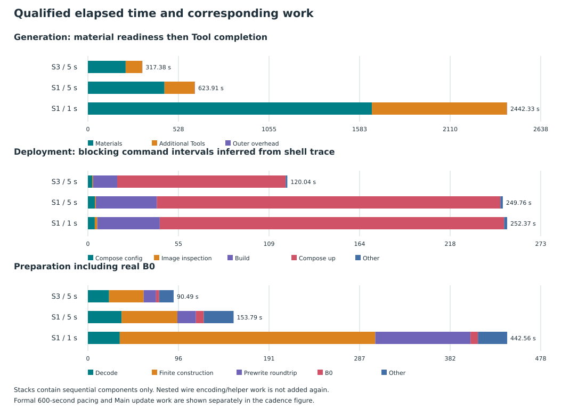

Preparation 的 decode 是完整 artifact materialization；finite construction
生成全部边界计划；prewrite roundtrip 包含 Python 侧编码、传输及 helper 预写；
B0 真正创建初始网络。嵌套的 wire encoding、helper timer 不再重复相加。
remaining/other 是总 Preparation 与这些可分离阶段之差，包含一次发现和 setup，
不是据此断言某个未分项操作的成本。

<!-- measured-summary-start -->
全部时间为秒；每列均来自自身完整 qualified invocation。

| 量 / 单位 | S3 / 5 s | S1 / 5 s | S1 / 1 s |
| --- | ---: | ---: | ---: |
| Materials ready | 219.926 | 445.967 | 1,654.368 |
| Additional generation Tools | 96.414 | 176.625 | 786.780 |
| Outer generation | 317.377 | 623.910 | 2,442.332 |
| Deployment outer | 120.040 | 249.760 | 252.374 |
| Preparation 含 B0 | 90.486 | 153.793 | 442.559 |
| Main elapsed 含 pacing | 600.165 | 600.216 | 600.102 |
| Main 工作合计 | 14.060 | 20.387 | 28.789 |
| Main p50 / p95 / max | 0.107 / 0.197 / 0.227 | 0.160 / 0.284 / 0.367 | 0.041 / 0.105 / 0.193 |
| Start lag max | 0.005481 | 0.010345 | 0.010754 |
| Completion lag max | 0.232747 | 0.367507 | 0.193008 |
| 最后 10 / 最初 10 边界 mean start lag | 0.000623 / 0.000144 | 0.000078 / 0.000960 | 0.000617 / 0.000113 |
| Runner Cleanup | 3.884 | 8.125 | 9.861 |
| Traffic Tool CLI | 82.341 | 135.620 | 464.456 |
| Runner / Observation Tool CLI | 0.373 / 0.357 | 0.292 / 0.367 | 1.078 / 1.492 |
| run.sh outer（含 execution 与 runtime Tools） | 782.368 | 905.500 | 1,527.997 |
| Deployment teardown outer | 62.289 | 106.988 | 106.593 |

以下 generation wall 累计量相互嵌套/重叠，不能相加为总 elapsed。

| 量 / 单位 | S3 / 5 s | S1 / 5 s | S1 / 1 s |
| --- | ---: | ---: | ---: |
| Contact prediction | 8.261 | 16.767 | 75.852 |
| Physical link observations（含 prehistory） | 39.397 | 99.522 | 478.629 |
| Planner progression | 97.227 | 201.795 | 866.948 |
| 其中 GS planning | 20.165 | 51.468 | 185.166 |
| 其中 Route planning | 27.114 | 29.879 | 133.696 |
| Compiler | 29.169 | 48.863 | 123.271 |
| Artifact writer | 29.014 | 46.093 | 42.670 |
| History serialization worker | 23.575 | 39.321 | 132.325 |
| Physical World Tool | 16.956 | 40.515 | 219.318 |
| Zone / Observation generation Tools | 0.350 / 0.324 | 0.356 / 0.322 | 0.355 / 1.295 |
| Planner Tool worker | 78.946 | 135.604 | 566.773 |
| Compiler Tool worker | 0.175 | 0.187 | 0.899 |

Preparation 与部署分项（秒；helper/encoding 包含于 roundtrip）：

| 量 / 单位 | S3 / 5 s | S1 / 5 s | S1 / 1 s |
| --- | ---: | ---: | ---: |
| Artifact loading / finite decode | 0.760 / 22.329 | 2.046 / 35.566 | 1.998 / 33.648 |
| Runtime binding discovery | 8.283 | 13.702 | 13.342 |
| Finite plan construction | 36.532 | 58.888 | 269.677 |
| Prewrite roundtrip / helper（嵌套） | 13.020 / 9.550 | 19.541 / 14.754 | 100.519 / 76.174 |
| B0 Main | 3.332 | 8.382 | 7.877 |
| Deployment config / unique inspect / builds | 2.569 / 0.563 / 14.511 | 4.183 / 0.605 / 36.693 | 4.138 / 1.494 / 37.618 |
| Compose up | 101.412 | 206.789 | 207.286 |
| Docker service CPU / observer wall | 91.651 / 120.052 | 167.851 / 248.148 | 171.163 / 252.163 |

工作量与资源（独立测量范围，不相加）：

| 量 / 单位 | S3 / 5 s | S1 / 5 s | S1 / 1 s |
| --- | ---: | ---: | ---: |
| Artifact operations | 218,731 | 341,819 | 348,509 |
| Planner semantic events | 91,989 | 130,527 | 133,318 |
| Main veth creations / retired pairs / deletion requests | 556 / 556 / 530 | 534 / 545 / 516 | 539 / 548 / 541 |
| Main existing qdisc updates | 17,994 | 31,900 | 33,354 |
| Prediction queries / stable ISL proofs | 158 / 11,520 | 158 / 30,140 | 790 / 30,140 |
| ISL / GS prediction interval evaluations | 6,086,160 / 1,664,098 | 14,383,688 / 4,532,203 | 71,918,440 / 22,661,106 |
| Physical connections high water | 1,705 | 3,513 | 3,513 |
| 累计 semantic route / link map entries | 2,415,977 / 409,708 | 3,175,260 / 849,056 | 15,723,192 / 4,217,190 |
| Generation output bytes（runtime 前） | 578,801,763 | 1,221,266,609 | 4,974,448,909 |
| Runner binary bytes | 147,288,341 | 229,962,865 | 233,326,708 |
| Traffic JSON bytes | 383,039,607 | 731,716,913 | 2,725,062,282 |
| Generation user / system CPU s | 332.815 / 4.947 | 645.681 / 8.529 | 2475.714 / 22.610 |
| Generation block read / write MiB | 0.000 / 717.988 | 0.000 / 1428.238 | 0.008 / 5019.105 |
| Generation sampled tree peak PSS GiB | 1.361 | 2.215 | 9.557 |
| Material / Physical World Tool / Planner Tool span PSS GiB | 1.068 / 1.059 / 1.361 | 1.414 / 2.215 / 2.176 | 1.288 / 9.557 / 2.727 |
| Runtime execution / Traffic Tool tree PSS GiB | 0.939 / 2.000 | 1.497 / 3.715 | 4.120 / 13.914 |
| Compose / helper cgroup sampled peak GiB | 1.275 / 0.540 | 2.278 / 0.824 | 2.277 / 2.130 |
| Main user-tree PSS first / last / max GiB | 0.916 / 0.916 / 0.939 | 1.435 / 1.462 / 1.481 | 4.067 / 4.120 / 4.120 |
| Main Compose cgroup first / last / max GiB | 1.272 / 1.271 / 1.275 | 2.272 / 2.271 / 2.278 | 2.273 / 2.270 / 2.274 |
| Main helper cgroup first / last / max GiB | 0.538 / 0.537 / 0.538 | 0.824 / 0.821 / 0.824 | 2.124 / 2.124 / 2.125 |
| Compose services / unique images | 1077 / 4 | 1941 / 4 | 1941 / 4 |
<!-- measured-summary-end -->

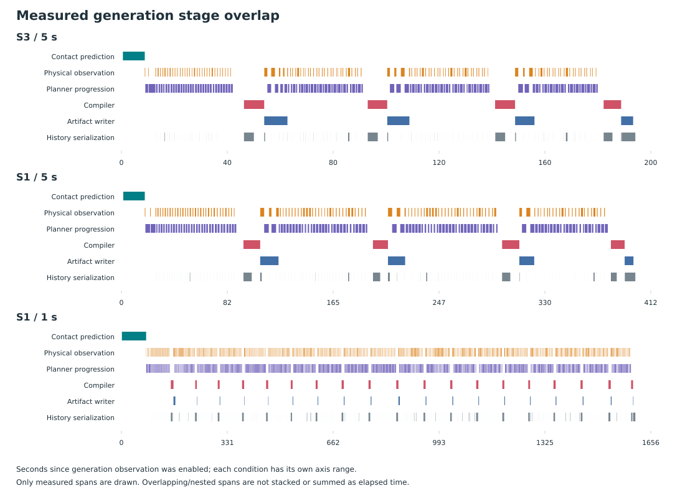

artifact operations、语义事件与实际 netlink/BPF 请求是不同单位；分组删除
可让一个请求退休多对 veth，不能把它们当作等价工作计数。

这张图以 generation Observation 启用时刻为起点，各条件横轴独立。它不是
`main.py` 入口起点，未观测的前置输入构造不被伪造为某个 span。细粒度记录
来自 `generation-observation/execution-observations.jsonl`；只绘制
`measured-monotonic` 区间。`generation-stage-totals.json` 可查看逐阶段累计
wall 与工作计数，但 min/max 字段的数值求和不是全局极值。

## 部署的重复工作与仍保留的成本

此前 S3 同内容 node contexts 已分成两组，但还为 1,075 个节点生成 per-service
image aliases。旧 trace 中 image inspect 约 219.718 s、1,073 次 tag 约
184.694 s。新生成路径为每组一个项目作用域镜像，保留独立节点配置/挂载/身份；
1077 个 S3 Compose services 使用 4 个唯一镜像、3 个 build declarations，
不再执行 tag。外部 InternetMap 镜像没有 project label 也合法；生成镜像必须
匹配项目 label，所有引用必须有有效 image ID。

fresh S3 deployment outer 为 120.040 s（此前 533.780 s）：配置 2.569 s、
唯一镜像核对 0.563 s、已有项目 inventory 0.792 s、三次 build 14.511 s、
Compose up 101.412 s、其余 0.193 s。它们是 shell trace 推导的阻塞命令区间，
不是 daemon 函数 profile。两个规模可能复用宿主机已有 base/layers；fresh 指
独立 output/project/container，不声称 cold Docker cache。

部署观察记录 Compose project 的 create/start 事件与 Docker service cgroup。
create 到 start 尚未完成的容器数量表示启动中的容器积压，**不能当作并发 API
调用数**。Docker service CPU 只覆盖该 cgroup，不包含独立 containerd/整个
宿主机，也不能与 outer elapsed 直接相加。没有证据要求更改当前默认并发，
因此未增加 blanket serialization 或新的并发默认值。Compose up 仍是实测成本，
本轮未证明它不可进一步优化。

## Main 的计算工作与预定等待

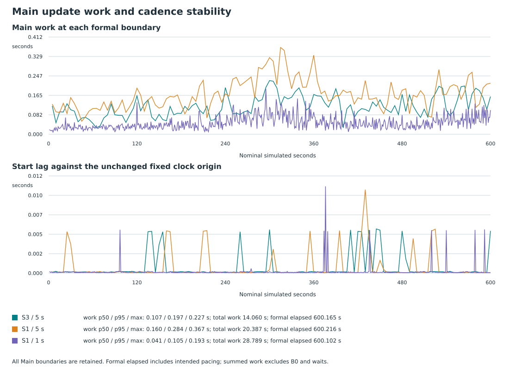

Main 总 elapsed 含有意的 600 s pacing；边界工作量之和不包含等待或 B0。
每个 deadline 始终是同一 monotonic 起点加 nominal offset。记录核对正式
边界数量、顺序、实际 start/completion lag 及终点；发生迟到也不重置时钟、
跳过边界或缩短 horizon。generation publication 和整个 Main 完成不同，
所有当轮删除 worker join 后才能推进完成状态。

三条件分别完成 120、120、600 个 Main；每次 completion lag 均小于该条件的
下一 nominal interval。S1/1 s 的最大 completion lag 为 0.193008 s，最后
10 个 start lag 平均 0.000617 s，完整 Main elapsed 为 600.102 s。这支持本次
负载下持续 1 s cadence，未见逐边界积累的延迟；不外推到其他负载或无限 horizon。

## 从比较能解释什么

S1/5 s 的材料生成约为 S3/5 s 的 2.03 倍，同时卫星数为 2.2 倍、几何改变；
实际 ISL/GS prediction interval evaluations 为 2.36/2.72 倍。不同阶段有
不同依赖：Route planning 仅从 27.114 增至 29.879 s，物理观测则从 39.397
增至 99.522 s。需求、已连接图、事件与候选数均影响工作，不能用一个节点
倍率解释所有阶段，也不能从这一对条件拟合通用扩展规律。

S1 从 5 s 改为 1 s 后，正式时点从 121 增至 601，额外 prediction queries
与 ISL/GS interval evaluations 恰为五倍。材料生成为 3.71 倍，Planner Tool
为 4.18 倍；但 artifact operations 只增加约 1.96%，binary 只增加约 1.46%。
artifact 编码的是事件 delta，事件总数并未随采样次数乘五；writer 耗时接近
且没有同比增长，与这一工作量相符，不能据此判为漏掉边界。

Runner 仍对每个正式边界构造有限计划并预写 generation：累计 route/link
map entries 为约 4.95/4.97 倍，finite construction 从 58.888 增至 269.677 s，
prewrite roundtrip 从 19.541 增至 100.519 s。完整 decode 接近，是因为 packed
事件字节量接近；Main 单次工作变小而总工作从 20.387 增至 28.789 s。两次
部署都为 1,941 services / 4 images，Compose up 为 206.789/207.286 s，
这种平坦成本与部署对象相同相符。以上是联合条件的观察，不是单项优化的
独立收益证明。

## Tools、资源与 Traffic

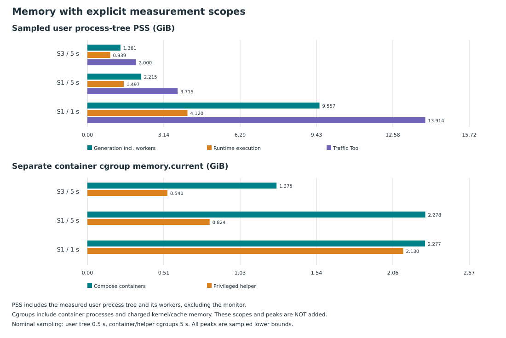

user process-tree PSS 以约 0.5 s 采样，包含实际后代 Route/Tool worker，排除
monitor；RSS 会重复计共享页。runtime CLI 的 phase 划分使用 shell trace，
与 monitor 起点存在启动级微小偏差。Compose/helper 每约 5 s 分别测
`memory.current`，包含其 charged kernel/cache。容器 cgroup 与用户进程
PSS 口径不同，独立峰值不相加。所有 sampled peaks 都是瞬时峰值的下界。
Main 的 first/last/max 来自阶段内最近可用样本，借 event 与 shell wall clock
对齐，允许启动级偏差；它们不是精确边界瞬时值，也不证明其他 horizon 没有
内存增长。`main-memory-ranges.json` 保存原始数值和采样数。

S1/1 s 的 Main 用户进程树 PSS 从近起点 4.067 到近终点 4.120 GiB，helper
cgroup 约为 2.124 GiB；Compose cgroup 从 2.273 到 2.270 GiB。未见 OOM、
异常退出或重启。有限 Prepared 数据和完整观察证据本就驻留内存，这些样本
不能证明所有保留对象均必要，也不能据此宣称不存在其他 horizon 的泄漏。
运行后 Traffic Tool 峰值为 13.914 GiB PSS、CLI 为 464.456 s，最终 JSON
为 2,725,062,282 bytes；Main 中的内存与更新耗时不包含这段分析。

S1/1 s 全生成链的 9.557 GiB PSS 峰值发生在 Physical World Tool：采样时刻
为 outer 1856.637 s，Tool span 为 main-relative 1654.368–1873.686 s；
outer/main 起点差至多 1.184 s，不影响该阶段归属。它不发生在材料生成热路径
或已启动的 Planner worker 内。Physical World reader/collector 保留完整物理帧，
projection 对 snapshot 做 deepcopy；这是进一步调查复制/保留成本的具体依据，
本轮没有 allocation profile，不能把全部峰值归因到某一个对象或复制。
`generation-memory-phase-peaks.json` 给出各 span 内整棵用户进程树的 PSS，
排除无法确定阶段归属的边界样本；它不把相邻/并发 worker 当成独立可加峰值。

generation 的 `RUSAGE_CHILDREN` 包含已等待子进程及其已等待后代的 user/system
CPU；Linux block I/O 单位为 512 bytes。它不是写入 JSON 字节数，也不是整个
host 的 I/O。主流程和 worker 可能同时工作，CPU 可以超过 elapsed。

Traffic Tool 复用已验证语义 replay、跳过自身不消费的完整 Model inspection
重建，并按 record 流式输出紧凑 JSON；所有原始证据和 viewer 字段保留。
原 S3 相同网络输入的完整 JSON 对照（仅排除 accounting）通过，文件由
600,332,172 降为 382,953,832 bytes；诊断 outer 82.654 s。随后只更正一处
Main 时间窗 caption，fresh S3 使用该修正版，Traffic Tool 为 82.341 s。
这是多项 Tool 修改的联合结果；中间 cProfile 有额外开销，不能用来给单项
机制分摊 speedup。Planner Tool 仍需完整 Model inspection，不能把 Traffic
私有 Plan-only reader 描述成删去 Planner 证据。

剩余成本也有明确输入来源：Planner history Tool 虽逐 publication 投影并写
frame chunks，仍通过 `read_sealed_physical_frames` 保留完整物理帧输入；Traffic
Tool 仍保留 detached replay snapshot 和完整最终 JSON。进一步按时间连接输入
或压缩重复字段有这些具体对象作为调查起点，但本轮没有验证其收益或 viewer
取舍，不宣称当前成本不可再压缩，也不在 closeout 中自动开展另一轮实现。

<!-- traffic-summary-start -->
Traffic 保持实际 WARN/PASS；单位按行明确：

| 量 / 单位 | S3 / 5 s | S1 / 5 s | S1 / 1 s |
| --- | ---: | ---: | ---: |
| Status | WARN | WARN | WARN |
| 实际 sends / replies / losses | 2,483 / 1,651 / 832 | 2,515 / 2,486 / 29 | 2,526 / 2,489 / 37 |
| 实际 loss % | 33.508 | 1.153 | 1.465 |
| Episodes | 18 | 19 | 20 |
| Expected-unreachable executor observations | 819 | 21 | 25 |
| 切换关联 / isolated-loss episodes（可重叠） | 5 / 1 | 4 / 1 | 6 / 1 |
| Packet observations / replay transactions | 25,278 / 12,643 | 52,233 / 26,116 | 53,288 / 26,636 |
| Replay: observed reachable / expected unreachable | 1,656 / 7 | 2,490 / 1 | 2,496 / 0 |
| Replay: activation-associated / unexplained reachable loss | 66 / 2,426 | 209 / 6,195 | 179 / 6,622 |
| Replay: unclassified / unexpected reachable | 8,487 / 1 | 17,221 / 0 | 17,339 / 0 |
| Infrastructure / persistent-blackhole failures | 0 / 0 | 0 / 0 | 0 / 0 |
| Executor / global evidence / cleanup complete | True / True / True | True / True / True | True / True / True |
<!-- traffic-summary-end -->

实际发送/接收/损失来自 probe executor；replay transaction、packet observation
与 episode taxonomy 是不同计数单位，不能互相相减或当作 loss rate 分母。
expected-unreachable、activation-associated 与 unexplained reachable loss
均保留。100/200 ppm 注入和切换可造成损失，但不能证明每个未解释丢包的原因。
零基础设施失败与完整证据也不等于所有路径、所有负载或真实商业硬件已验证。

## 历史故障、系统设置与可复核性

三条件轮曾修正唯一 image inventory 对外部 InternetMap 的遗漏、无 Labels
镜像的 Go template 处理，以及 S1 的明确 4-ISL capability。前两项在当时
最终 S3 前修正；最后一项改变 S1 配置。早期中止不是完整基线。保留的
matrix 摘要记录测量范围，完整失败原文和源码快照已删除。

该轮没有采用新的宿主机设置或依赖；原有值保留在 `host-starting-state.json`。
已采用配置及回滚理由见 [配置决策](optimization-decisions.md)。当时部署和
运行后核对 restart、OOM、exit，清理后核对项目资源、helper 身份和可读
BPF parent 下的 owned pin root；不可访问路径不作为资源缺失证明。

此前一次历史清理移除了 68,416 个可重建/重复文件（11,614,792,243 bytes）、
6,488 个旧项目 image references 和两份过时临时报告。这与本次最终收口的
62.028 GiB 目录清理是不同操作。原 `historical-cleanup.json`、完整三条件
raw bundles 和旧检查日志已删除；本节保留当时结果，不把旧计时或旧视觉检查
记作本次新验证。Mini 只保留现有历史部分输出，旧 checksum 描述原完整包。
版本化 Runner archive 及 75 个成员继续保留并已在本次重新核对。

当时 Compiler caption 更正为通用 scenario 和 completed ACTIVE；保留
`diagnostics/compiler-caption-correction.json` 摘要，原前后 HTML 副本已删除。
该措辞更正没有改变机器证据、generation status 或计时，也不归因性能收益。
